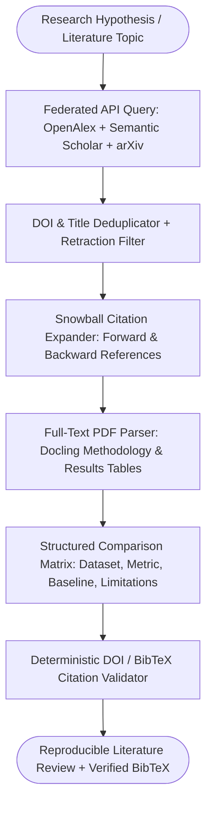

## Introduction

To build an AI academic research assistant that discovers peer-reviewed literature, maps citation graphs, compares experimental methodologies, and synthesises literature reviews without fabricating citations, you must query authoritative scholarly metadata graphs—specifically **OpenAlex** (https://openalex.org/), **Semantic Scholar** (https://www.semanticscholar.org/product/api), Crossref, and arXiv—and anchor every claim to a verified Digital Object Identifier (DOI) or arXiv ID. Generic web search engines struggle to return structured citation networks, inverted abstract indices, or retraction flags, and asking an LLM to generate a bibliography from memory guarantees hallucinated author-year-journal combinations.

> [!TIP]
> **Architecture Reference:** Internal Link Suggestion: On Aniket.app (https://aniket.app/), see the [OIST Applied AI Research](/research/) section detailing automated scientific literature ingestion pipelines that synthesize unstructured publications into structured datasets, and cross-reference [Article 1: How to Build an AI Research Agent ](/writing/build-ai-research-agent-web-search-reports/).

## Scholarly Discovery, Citation Graph & Synthesis Architecture



### How OpenAlex Inverted Abstracts and Citation Graphs Work

1. **OpenAlex API** (https://openalex.org/) (CC0 Public Domain, 500M+ Works): To save storage bandwidth, OpenAlex returns paper abstracts as an abstract_inverted_index JSON dictionary mapping each word to its list of integer token positions ({"Graph": [0], "neural": [1], "networks": [2]}). Your ingestion client must reconstruct the plaintext abstract deterministically by sorting word-position pairs.
1. **Semantic Scholar Academic Graph API** (https://api.semanticscholar.org/api-docs/): Provides citationCount, influentialCitationCount, openAccessPdf, tldr, and SPECTER2 paper embeddings for semantic similarity discovery.
1. Crossref REST API (`api.crossref.org/works/{doi}`): Serves as the authoritative registry for verifying whether a DOI exists, checking publication dates, and detecting is-retracted update notices.

## Technology Comparison: Paid vs. Open-Source Scholarly Stack

| Component | Commercial / Subscription Database | Open-Source / Open-Data Alternative | Self-Hosting / Free Tier? | Technical & Rate-Limit Notes |
| --- | --- | --- | --- | --- |
| Scholarly Index & Metadata | Scopus / Web of Science / Dimensions | OpenAlex (https://openalex.org/) (CC0 License) + Crossref (Open Metadata) | Yes (100% Free Polite Pool: 100k req/day with mailto:) | OpenAlex requires reconstructing abstract_inverted_index into text. |
| Citation Graph & Embeddings | Connected Papers Pro / Scite.ai | Semantic Scholar API (https://www.semanticscholar.org/product/api) + arXiv API | Free API tier available | Semantic Scholar caps unauthenticated requests; pass x-api-key and respect per-second rate limits. |
| Scientific PDF & Equation Parser | Mathpix Snipping API | Docling (https://github.com/docling-project/docling) (MIT) / pypdf | Yes | Multi-column LaTeX PDFs require layout-aware reading order so equations and result tables stay intact. |
| Synthesis LLM | OpenAI (gpt-4.1) / Claude Sonnet | Ollama (https://github.com/ollama/ollama) (Qwen2.5-32B / DeepSeek-R1-Distill-Qwen-32B) | Yes | Must extract exact sample sizes ($N$), evaluation metrics, and baselines without extrapolating. |

### Recommended Implementation Options

### Option A: Best Practical Implementation (Recommended): Python 3.12 + httpx async federated client for OpenAlex (https://openalex.org/) & Semantic Scholar (https://api.semanticscholar.org/api-docs/) + Docling (https://github.com/docling-project/docling) for open-access PDF table parsing + OpenAI/Claude structured methodology extraction + deterministic BibTeX generator.

### Option B: Fully Open-Source Implementation: OpenAlex + arXiv API + Docling (https://github.com/docling-project/docling) + local Ollama (https://github.com/ollama/ollama) (qwen2.5:32b) + pgvector (https://github.com/pgvector/pgvector).

### Option C: Production Institutional Research Pipeline: Local OpenAlex snapshot / PostgreSQL graph + automated arXiv daily category poller (cs.AI, cs.LG, q-fin) + vector similarity alert engine.

## Step-by-Step Implementation Guide

### Step 1: Project Structure

```text
ai-academic-assistant/
├── app/
│   ├── __init__.py
│   ├── openalex_client.py
│   ├── schemas.py
│   └── bibtex_verifier.py
├── tests/
│   └── test_academic_assistant.py
└── requirements.txt
```

### Step 2: Implement the OpenAlex Inverted Abstract Reconstructor & Search Client (app/openalex_client.py)

```python
from typing import Dict, List, Optional, Any
import httpx
from pydantic import BaseModel

class ScholarlyPaper(BaseModel):
    work_id: str
    doi: Optional[str]
    title: str
    publication_year: int
    authors: List[str]
    venue: str
    cited_by_count: int
    abstract_text: str
    open_access_pdf_url: Optional[str] = None

def reconstruct_inverted_abstract(inverted_index: Optional[Dict[str, List[int]]]) -> str:
    """Deterministically reconstructs plaintext abstract from OpenAlex abstract_inverted_index."""
    if not inverted_index:
        return ""
    position_map: Dict[int, str] = {}
    for word, positions in inverted_index.items():
        for pos in positions:
            position_map[pos] = word
    if not position_map:
        return ""
    sorted_indices = sorted(position_map.keys())
    return " ".join(position_map[i] for i in sorted_indices)

async def search_openalex_works(
    query: str,
    polite_email: str,
    max_results: int = 5,
    min_year: int = 2020,
) -> List[ScholarlyPaper]:
    """Queries OpenAlex /works API using the polite pool (mailto parameter)."""
    params = {
        "search": query,
        "filter": f"publication_year:>={min_year}",
        "per-page": max_results,
        "mailto": polite_email,
    }
    async with httpx.AsyncClient(timeout=15.0) as client:
        resp = await client.get("https://api.openalex.org/works", params=params)
        resp.raise_for_status()
        data = resp.json()

    papers: List[ScholarlyPaper] = []
    for item in data.get("results", []):
        authors = [
            a.get("author", {}).get("display_name", "Unknown")
            for a in item.get("authorships", [])[:6]
        ]
        primary_loc = item.get("primary_location") or {}
        source_info = primary_loc.get("source") or {}
        venue_name = source_info.get("display_name") or "Preprint / Unknown Venue"
        oa_info = item.get("open_access") or {}

        papers.append(
            ScholarlyPaper(
                work_id=item.get("id", ""),
                doi=item.get("doi"),
                title=item.get("title") or "Untitled",
                publication_year=int(item.get("publication_year") or 0),
                authors=authors,
                venue=venue_name,
                cited_by_count=int(item.get("cited_by_count") or 0),
                abstract_text=reconstruct_inverted_abstract(item.get("abstract_inverted_index")),
                open_access_pdf_url=oa_info.get("oa_url"),
            )
        )
    return papers
```

### Step 3: Implement Methodology Comparison Schemas & Deterministic BibTeX Generation (app/schemas.py & app/bibtex_verifier.py)

```python
import re
from typing import List, Dict
from pydantic import BaseModel, Field
from app.openalex_client import ScholarlyPaper

class PaperMethodologyComparison(BaseModel):
    work_id: str
    doi: str
    core_methodology: str = Field(..., description="Architecture or statistical method used.")
    datasets_evaluated: List[str]
    primary_quantitative_result: str = Field(..., description="Exact metric and value reported, e.g. 'F1 = 89.4% on SciERC'")
    stated_limitations: str

def generate_verified_bibtex(paper: ScholarlyPaper) -> str:
    """Generates a deterministic BibTeX entry strictly from verified OpenAlex/Crossref metadata."""
    first_author_last = paper.authors[0].split()[-1].lower() if paper.authors else "unknown"
    clean_author = re.sub(r"[^a-z0-9]", "", first_author_last)
    cite_key = f"{clean_author}{paper.publication_year}"
    author_str = " and ".join(paper.authors) if paper.authors else "Unknown"
    doi_line = f"  doi = {{{paper.doi}}},\n" if paper.doi else ""

    return (
        f"@article{{{cite_key},\n"
        f"  title = {{{paper.title}}},\n"
        f"  author = {{{author_str}}},\n"
        f"  journal = {{{paper.venue}}},\n"
        f"  year = {{{paper.publication_year}}},\n"
        f"{doi_line}"
        f"}}"
    )

def verify_inline_doi_citations(review_markdown: str, verified_papers: Dict[str, ScholarlyPaper]) -> List[str]:
    """Checks that every cited DOI or work_id in the literature review exists in the retrieved paper registry."""
    cited_dois = re.findall(r"https://doi\.org/[^\s\)\]]+", review_markdown)
    known_dois = {p.doi for p in verified_papers.values() if p.doi}
    unverified = [d for d in cited_dois if d not in known_dois]
    return unverified
```

## Testing the Academic Research Assistant (tests/test_academic_assistant.py)

```python
from app.openalex_client import reconstruct_inverted_abstract, ScholarlyPaper
from app.bibtex_verifier import generate_verified_bibtex, verify_inline_doi_citations

def test_reconstruct_openalex_inverted_abstract():
    inv = {
        "Graph": [0],
        "neural": [1],
        "networks": [2, 6],
        "model": [3],
        "ecological": [4],
        "food": [5],
    }
    text = reconstruct_inverted_abstract(inv)
    assert text == "Graph neural networks model ecological food networks"

def test_verified_bibtex_and_doi_checker():
    paper = ScholarlyPaper(
        work_id="https://openalex.org/W123",
        doi="https://doi.org/10.1038/s41586-025-00001-x",
        title="Topological Learning in Trophic Networks",
        publication_year=2025,
        authors=["Aniket Thakur", "Kenji Sato"],
        venue="Nature Machine Intelligence",
        cited_by_count=42,
        abstract_text="We introduce an attention-based GNN...",
    )
    bibtex = generate_verified_bibtex(paper)
    assert "@article{thakur2025," in bibtex
    assert "doi = {https://doi.org/10.1038/s41586-025-00001-x}" in bibtex

    registry = {paper.work_id: paper}
    review = (
        "Recent work ([Thakur & Sato, 2025](https://doi.org/10.1038/s41586-025-00001-x)) "
        "and a hallucinated citation ([Fake, 2024](https://doi.org/10.9999/fake.123))."
    )
    unverified = verify_inline_doi_citations(review, registry)
    assert unverified == ["https://doi.org/10.9999/fake.123"]
```

## Source Verification, Reproducibility & Cost Considerations

- Never Let the LLM Write BibTeX from Scratch: LLMs frequently swap volume and issue numbers or invent page ranges when formatting BibTeX. Always generate .bib entries deterministically from the JSON metadata returned by OpenAlex (https://openalex.org/), Semantic Scholar (https://api.semanticscholar.org/api-docs/), or Crossref (generate_verified_bibtex).
- Cost Breakdown: OpenAlex, Crossref, and arXiv APIs are 100% free. Synthesising a 30-paper systematic literature review costs \~\$0.05–$0.15 per review in LLM tokens or \$0 with local Ollama (https://github.com/ollama/ollama).

## Useful Tools, Documentation and GitHub Repositories

| Resource | Purpose | Type | Link |
| --- | --- | --- | --- |
| OpenAlex | Free CC0 global catalog of 500M+ scholarly works | Open Data / API | https://openalex.org/ |
| Semantic Scholar API | Citation graphs, SPECTER2 embeddings, and paper TLDRs | Official API Docs | https://api.semanticscholar.org/api-docs/ |
| Docling | Multi-column scientific PDF and table extraction | Open-Source (MIT) | https://github.com/docling-project/docling |

## Frequently Asked Questions

### Why does OpenAlex return `abstract_inverted_index` instead of a plain string?

To comply with publisher copyright restrictions while enabling open text mining, OpenAlex stores abstracts as word-position inverted indices. Our reconstruct_inverted_abstract() helper restores the exact readable abstract in $O(N \log N)$ time.

### How do I access OpenAlex's fast "Polite Pool"?

Pass your contact email in the query parameters (?mailto=you@domain.com) or User-Agent header. OpenAlex routes polite requests to dedicated low-latency servers supporting up to 100,000 requests per day for free.

### How do I check if a scientific paper has been retracted?

Check the is_retracted boolean field on the OpenAlex Work object (item.get("is_retracted")) or the update-to array in Crossref metadata, and automatically exclude retracted works from synthesis.

### How do I compare experimental results across papers fairly?

Extract a structured PaperMethodologyComparison table capturing the exact benchmark dataset (datasets_evaluated), evaluation metric (F1, RMSE, AUC), and baseline model so the synthesizer never compares metrics evaluated on different datasets.

### Can this assistant download full-text PDFs legally?

Yes, when open_access.is_oa is True in OpenAlex or openAccessPdf is present in Semantic Scholar (such as arXiv, PubMed Central, and CC-BY journals). Never bypass publisher paywalls.

### How do I discover seminal older papers that use different terminology than my search query?

Run 1-hop backward and forward citation snowballing: inspect the referenced_works array of your top 5 search hits to find the foundational papers cited by all of them.

### How do I parse two-column IEEE or ACM PDFs without jumbling equations and tables?

Use Docling (https://github.com/docling-project/docling), which runs a layout detection model to segment columns, figures, and tables before extracting Markdown.

### Can I run this academic assistant locally for unpublished lab manuscripts?

Yes; pair local Docling (https://github.com/docling-project/docling) PDF extraction with Ollama (https://github.com/ollama/ollama) so unpublished grant proposals and manuscripts remain 100% on-premise.
