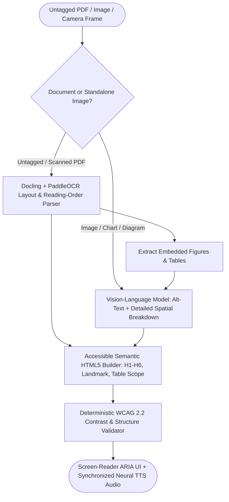

## Introduction

To build an AI accessibility assistant for blind, low-vision, dyslexic, and print-disabled users that describes complex images and reads multi-column PDF documents aloud, you must design around WCAG 2.2 Level AA standards, screen-reader compatibility (NVDA, JAWS, VoiceOver), and progressive disclosure. Many untagged PDFs fail screen-reader users because two-column layouts, tables without <th> scope attributes, and complex charts are read out as a jumbled stream of disconnected words or skipped entirely as "graphic". By combining layout-aware document reconstruction ([Docling](https://github.com/docling-project/docling)), two-tier Vision-Language image description (concise 1-sentence alt-text paired with an on-demand structured spatial/data breakdown), WCAG contrast and heading hierarchy verification, and sentence-synchronized Neural TTS with variable playback speed (`0.75x` to `2.5x`), you empower users to navigate visual and document content independently.

## Multimodal Accessibility & Screen-Reader Integration Architecture



### Core WCAG 2.2 & Inclusive Design Engineering Principles

1. Progressive Disclosure for Image Descriptions (Brief vs. Detailed): Screen-reader users scanning a document do not want a 300-word essay every time focus lands on an icon or photo. Generate two distinct fields per visual asset:
- concise_alt_text ($\le 125$ characters): Objective, immediate summary read automatically via alt="...".
- extended_description: Structured spatial and data breakdown (e.g., converting a bar chart into an accessible <table role="table"> with <th scope="col">) placed inside a collapsible <details><summary>Detailed Image & Chart Description</summary>...</details> block so the user chooses when to expand it.
1. Never Override Native Screen Readers: Blind users often listen to NVDA, JAWS, or VoiceOver at 2.0x–3.0x speech rates. Expose clean semantic HTML (<main>, <nav>, <h1>–<h3>, aria-live="polite") so native screen readers work effortlessly, while offering built-in Neural TTS audio with keyboard-accessible shortcuts (Space to play/pause, [ and ] to skip by heading or sentence) for low-vision and dyslexic users.
1. Privacy for Camera/Document Captures: Blind users frequently photograph mail, medication labels, bank letters, or ID cards to have them read aloud. Support 100% local inference via Ollama (https://github.com/ollama/ollama) (Qwen2.5-VL or Gemma 4) and local TTS (OHF-Voice/piper1-gpl (https://github.com/OHF-Voice/piper1-gpl)) with zero cloud retention of sensitive personal photos.

## Technology Comparison: Paid vs. Open-Source Accessibility Stack

| Component | Commercial API | Open-Source / Local Privacy Alternative | Self-Hosting Possible? | Accessibility & Privacy Notes |
| --- | --- | --- | --- | --- |
| Vision-Language Image & Chart Understanding | OpenAI (gpt-4o) / Gemini 2.5 Pro / Claude Sonnet | Ollama (https://github.com/ollama/ollama) (Qwen2.5-VL-7B / Qwen2.5-VL-32B / Gemma 4) | Yes | Local VLM ensures private mail, prescriptions, and financial letters never leave the user's device. |
| Document Layout & OCR | Adobe PDF Accessibility API / AWS Textract | Docling (https://github.com/docling-project/docling) (MIT) + PaddleOCR (https://www.paddleocr.ai/main/en/index.html) (Apache-2.0) | Yes | Reconstructs logical reading order across multi-column pages and converts visual tables into semantic HTML <table> markup. |
| Text-to-Speech (Read Aloud) | Deepgram Aura-2 (https://deepgram.com/pricing) / ElevenLabs Reader | OHF-Voice/piper1-gpl (https://github.com/OHF-Voice/piper1-gpl) (GPLv3, formerly rhasspy/piper) / Kokoro-82M (Apache-2.0) | Yes (runs faster than real-time on CPU) | Supports sentence-level SSML/timestamp markers for synchronized visual word/sentence highlighting (helpful for dyslexia). |

### Recommended Implementation Options

### Option A: Best Practical Implementation (Recommended): Python 3.12 + Docling (https://github.com/docling-project/docling) + Vision LLM (gpt-4o-mini or local Qwen2.5-VL) + WCAG 2.2 semantic HTML validator + sentence-synchronized TTS.

### Option B: 100% Offline Privacy Implementation: Docling (https://github.com/docling-project/docling) + PaddleOCR (https://www.paddleocr.ai/main/en/index.html) + local Ollama (https://github.com/ollama/ollama) (qwen2.5-vl:7b) + local Piper/Kokoro CPU TTS.

### Option C: Production Web & Mobile Accessibility Service: FastAPI backend + WCAG AA accessible web frontend with aria-live="polite" status regions + multilingual TTS.

## Step-by-Step Implementation Guide

### Step 1: Project Structure

```text
ai-accessibility-assistant/
├── app/
│   ├── __init__.py
│   ├── wcag_validator.py
│   └── accessible_html_builder.py
├── tests/
│   └── test_accessibility_assistant.py
└── requirements.txt
```

### Step 2: Implement Deterministic WCAG 2.2 Contrast Ratio & Heading Hierarchy Validation (app/wcag_validator.py)

Per the official W3C WCAG 2.2 specification, normal body text requires a minimum luminance contrast ratio of 4.5:1 (Level AA) or 7.0:1 (Level AAA), and document headings (<h1> through <h6>) must never skip levels (e.g., jumping from <h1> directly to <h4> breaks screen-reader heading navigation):

```python
from typing import Tuple, List

def _srgb_channel_to_linear(channel_8bit: int) -> float:
    c = channel_8bit / 255.0
    return c / 12.92 if c <= 0.04045 else ((c + 0.055) / 1.055) ** 2.4

def compute_relative_luminance(hex_color: str) -> float:
    """Computes W3C WCAG 2.2 relative luminance L for a 6-digit hex color (#RRGGBB)."""
    clean = hex_color.lstrip("#")
    if len(clean) != 6:
        raise ValueError(f"Expected 6-digit hex color, got: {hex_color}")
    r = _srgb_channel_to_linear(int(clean[0:2], 16))
    g = _srgb_channel_to_linear(int(clean[2:4], 16))
    b = _srgb_channel_to_linear(int(clean[4:6], 16))
    return 0.2126 * r + 0.7152 * g + 0.0722 * b

def compute_wcag_contrast_ratio(fg_hex: str, bg_hex: str) -> Tuple[float, bool, bool]:
    """Returns (contrast_ratio, passes_aa_normal_4_5, passes_aaa_normal_7_0)."""
    l1 = compute_relative_luminance(fg_hex)
    l2 = compute_relative_luminance(bg_hex)
    lighter = max(l1, l2)
    darker = min(l1, l2)
    ratio = round((lighter + 0.05) / (darker + 0.05), 2)
    return ratio, (ratio >= 4.5), (ratio >= 7.0)

def validate_heading_hierarchy(heading_levels: List[int]) -> List[str]:
    """Verifies that document headings start at H1 and never skip levels downward (e.g. H1 -> H3)."""
    errors: List[str] = []
    if not heading_levels:
        return ["Document contains no headings for screen-reader navigation."]
    if heading_levels[0] != 1:
        errors.append(f"First heading should be H1, found H{heading_levels[0]}.")
    for prev, curr in zip(heading_levels, heading_levels[1:]):
        if curr > prev + 1:
            errors.append(f"Skipped heading level from H{prev} to H{curr}.")
    return errors
```

### Step 3: Implement Progressive-Disclosure Accessible Figure & Document HTML Builder (app/accessible_html_builder.py)

```python
import html
from typing import List, Optional
from pydantic import BaseModel, Field

class AccessibleFigureDescription(BaseModel):
    figure_id: str
    concise_alt_text: str = Field(..., max_length=125, description="Short objective alt text <= 125 chars.")
    detailed_spatial_description: str = Field(..., description="Thorough layout and visual description.")
    extracted_ocr_text: Optional[str] = None
    chart_data_rows: Optional[List[List[str]]] = Field(
        None, description="Optional tabular rows [header_row, ...data_rows] if the image is a chart."
    )

def render_accessible_figure_html(fig: AccessibleFigureDescription, image_src: str) -> str:
    """Renders WCAG 2.2 compliant <figure> with concise alt text, <details> disclosure, and accessible data table."""
    safe_alt = html.escape(fig.concise_alt_text)
    safe_detail = html.escape(fig.detailed_spatial_description)
    desc_id = f"desc-{html.escape(fig.figure_id)}"

    table_html = ""
    if fig.chart_data_rows and len(fig.chart_data_rows) >= 2:
        headers = "".join(f"<th scope='col'>{html.escape(h)}</th>" for h in fig.chart_data_rows[0])
        body_rows = []
        for row in fig.chart_data_rows[1:]:
            cells = "".join(f"<td>{html.escape(c)}</td>" for c in row)
            body_rows.append(f"<tr>{cells}</tr>")
        table_html = (
            f"<table><caption>Extracted Chart Data</caption>"
            f"<thead><tr>{headers}</tr></thead>"
            f"<tbody>{''.join(body_rows)}</tbody></table>"
        )

    ocr_block = (
        f"<p><strong>Transcribed Text in Image:</strong> {html.escape(fig.extracted_ocr_text)}</p>"
        if fig.extracted_ocr_text
        else ""
    )

    return (
        f"<figure role='group' aria-describedby='{desc_id}'>\n"
        f"  \n"
        f"  <details id='{desc_id}'>\n"
        f"    <summary>Extended Description for Screen Readers</summary>\n"
        f"    <p>{safe_detail}</p>\n"
        f"    {ocr_block}\n"
        f"    {table_html}\n"
        f"  </details>\n"
        f"</figure>"
    )
```

## Testing the Accessibility Assistant (tests/test_accessibility_assistant.py)

```python
from app.wcag_validator import compute_wcag_contrast_ratio, validate_heading_hierarchy
from app.accessible_html_builder import AccessibleFigureDescription, render_accessible_figure_html

def test_wcag_contrast_ratio_calculation():
    # Dark navy (#0F172A) on pure white (#FFFFFF) -> high contrast AAA pass
    ratio, aa, aaa = compute_wcag_contrast_ratio("#0F172A", "#FFFFFF")
    assert ratio > 15.0
    assert aa is True and aaa is True

    # Light grey (#94A3B8) on white (#FFFFFF) -> fails WCAG AA 4.5:1
    low_ratio, low_aa, _ = compute_wcag_contrast_ratio("#94A3B8", "#FFFFFF")
    assert low_ratio < 4.5
    assert low_aa is False

def test_heading_hierarchy_validation():
    assert validate_heading_hierarchy([1, 2, 2, 3, 2]) == []
    errors = validate_heading_hierarchy([1, 4])
    assert len(errors) == 1
    assert "Skipped heading level from H1 to H4" in errors[0]

def test_accessible_figure_html_renders_alt_and_table_scope():
    fig = AccessibleFigureDescription(
        figure_id="chart-q4",
        concise_alt_text="Bar chart showing Q1 to Q4 revenue growth from $1.2M to $2.1M.",
        detailed_spatial_description="Vertical bar chart with four bars increasing steadily across quarters.",
        extracted_ocr_text="FY2026 Quarterly Revenue ($M)",
        chart_data_rows=[["Quarter", "Revenue ($M)"], ["Q1", "1.2"], ["Q4", "2.1"]],
    )
    rendered = render_accessible_figure_html(fig, "chart-q4.png")
    assert "alt='Bar chart showing Q1 to Q4 revenue growth from $1.2M to $2.1M.'" in rendered
    assert "aria-describedby='desc-chart-q4'" in rendered
    assert "<th scope='col'>Quarter</th>" in rendered
```

## Deployment, Inclusive Design & Cost Considerations

- Screen-Reader Live Announcements: When the Vision LLM is processing an uploaded PDF or camera image, emit status updates inside <div role="status" aria-live="polite" aria-atomic="true">Processing page 1 of 4...</div> so blind users receive immediate non-visual feedback that the application is working.
- Cost Breakdown: Running Docling (https://github.com/docling-project/docling), PaddleOCR (https://www.paddleocr.ai/main/en/index.html), local Qwen2.5-VL via Ollama (https://github.com/ollama/ollama), and local Piper/Kokoro TTS has \$0 API cost and keeps sensitive personal documents 100% private. On cloud APIs, describing 500 images/documents per month costs \~\$1.50–$4.00/month.

## Useful Tools, Documentation and GitHub Repositories

| Resource | Purpose | Type | Link |
| --- | --- | --- | --- |
| W3C WCAG 2.2 Guidelines | Official Web Content Accessibility Guidelines specification | Official Standard | https://www.google.com/search?q=https://www.w3.org/TR/WCAG22/ |
| Docling | Converting untagged PDFs into structured accessible layouts | Open-Source (MIT) | https://github.com/docling-project/docling |
| PaddleOCR Documentation | Multilingual OCR for scanned documents and signs | Open-Source (Apache-2.0) | https://www.paddleocr.ai/main/en/index.html |
| Piper TTS (Active Fork) | Fast local neural text-to-speech (OHF-Voice/piper1-gpl) | Open-Source (GPLv3) | https://github.com/OHF-Voice/piper1-gpl |
| Ollama | Local execution of Vision-Language models (Qwen2.5-VL) | Open-Source (MIT) | https://github.com/ollama/ollama |

## Frequently Asked Questions

### Why shouldn't an AI image description start with "Image of..." or "Picture showing..."?

Screen readers (NVDA, JAWS, VoiceOver) already announce "Graphic" or "Image" when encountering an  element. Starting alt text with "Image of..." causes the screen reader to say "Graphic, Image of...", wasting the user's time. Start directly with the subject and action.

### How should the AI describe charts and graphs for blind engineers or analysts?

Provide a 1-sentence summary of the trend in alt text, and automatically convert the chart's data points into an HTML <table> with <th scope="col"> headers inside <details> (render_accessible_figure_html) so the user can navigate rows and columns using standard screen-reader table shortcuts (Ctrl+Alt+Arrow in NVDA/JAWS).

### Why is logical reading order critical when reading two-column PDFs aloud?

If an OCR script reads across the full horizontal width of a two-column PDF page, it reads line 1 of Column A followed immediately by line 1 of Column B, rendering the audio completely incomprehensible. Layout-aware parsers like Docling (https://github.com/docling-project/docling) segment bounding boxes by column first.

### What is the difference between `aria-live="polite"` and `aria-live="assertive"`?

aria-live="polite" waits until the screen reader finishes speaking the current element before announcing the status update, whereas aria-live="assertive" interrupts the screen reader immediately. Use polite for progress updates and reserve assertive strictly for critical errors or safety warnings.

### How do I support users with dyslexia alongside blind users?

Pair synchronized sentence/word visual highlighting (<mark>) with high-contrast customizable themes (>= 4.5:1 verified by compute_wcag_contrast_ratio), generous line spacing (line-height: 1.6), and adjustable TTS playback speeds.

### Yes; maintain the image in the VLM conversation context so the user can ask voice or text follow-ups like *"What is the expiration date printed on the bottom right corner of the box?

"*

### How do I protect user privacy when the accessibility assistant reads personal mail or medical prescriptions?

Default to local on-device or self-hosted inference via Ollama (https://github.com/ollama/ollama) (Qwen2.5-VL) and never log or retain uploaded camera images on disk after the session ends.

### What playback speeds should an accessible document reader support?

Support increments from 0.75x up to 3.0x with pitch preservation (using time-scale modification / WSOLA so speeding up the voice does not raise its pitch like a chipmunk).
