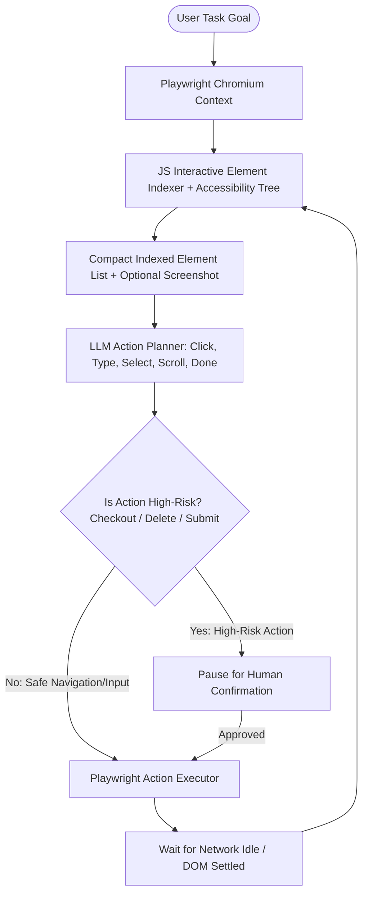

## Introduction

To build an AI browser agent that reliably navigates dynamic websites, fills multi-step forms, and executes workflows without breaking whenever a CSS class name changes, you must combine DOM Accessibility Tree indexing with visual Set-of-Marks (SoM) screenshot grounding and mandatory human approval gates for state-mutating actions. Traditional Selenium or Playwright scripts hardcode brittle XPath or CSS selectors (div.btn-primary-v2 > span) that break on every frontend deployment. Conversely, sending a raw 5MB HTML string to an LLM overflows the context window. By injecting a lightweight JavaScript script that assigns sequential numeric IDs ([1], [2], [3]) to visible, interactive DOM elements (<button>, <input>, <a>, <select>) and pairing them with Playwright for Python (https://github.com/microsoft/playwright-python) or Browser-Use (https://github.com/browser-use/browser-use), your agent can navigate complex web applications using compact numeric element indices.

> [!TIP]
> **Architecture Reference:** Internal Link Suggestion: For read-only web research and report synthesis, see [Article 1: How to Build an AI Research Agent That Searches the Web and Writes Reports ](/writing/build-ai-research-agent-web-search-reports/).

## Browser Automation Architecture: DOM Indexing, Grounding & Action Safety



### DOM Understanding vs. Screenshot-Based Interaction

1. Indexed DOM Extraction (Fast, Low Token Cost): A JavaScript snippet queries all interactive elements (button, a, input, select, textarea, [role="button"]), filters out elements with width == 0, height == 0, or visibility == "hidden", assigns a data-ai-id="12" attribute, and returns a clean list: [12] <input type="text" placeholder="Search flights...">.
1. Visual Set-of-Marks (Fallback for Canvas & Custom Widgets): When a site renders controls inside custom <canvas> elements or unlabeled <div> tags, overlay numbered bounding boxes onto a viewport screenshot and pass both the image and the DOM index list to a multimodal model.

## Technology Comparison: Paid vs. Open-Source Stack

*(Verified October 30, 2026 via browser-use/browser-use (https://github.com/browser-use/browser-use) and microsoft/playwright-python (https://github.com/microsoft/playwright-python)).*

| Component | Commercial / Hosted Solution | Open-Source Alternative | Self-Hosting Possible? | Technical & Pricing Notes |
| --- | --- | --- | --- | --- |
| Browser Agent Framework | Browser Use Cloud API / MultiOn | Browser-Use (https://github.com/browser-use/browser-use) (MIT License, v0.13.14, 119.6k stars) | Yes (Python >= 3.11) | Supports local Chromium, CDP connections, and deterministic action replay (load_and_rerun). |
| Browser Automation Driver | Browserbase / Browser Use Cloud (\$0.02/browser-hr) | Playwright for Python (https://github.com/microsoft/playwright-python) (Apache-2.0, v1.64.1) | Yes | Built-in auto-waiting and real mouse/keyboard event dispatch across Chromium, Firefox, and WebKit. |
| Action Planning LLM | OpenAI (gpt-4o / gpt-4.1) / Claude Sonnet | Ollama (https://github.com/ollama/ollama) (Qwen2.5-VL-32B / Llama-3.3-70B) | Yes | Vision-language models require \~1,000 image tokens per viewport screenshot. |

### Recommended Implementation Options

### Option A: Best Practical Implementation (Recommended): Python 3.12 + Browser-Use (https://github.com/browser-use/browser-use) or custom Playwright (https://github.com/microsoft/playwright-python) DOM indexer + OpenAI/Claude structured action loop + human approval middleware for form submissions.

### Option B: Fully Open-Source Local Implementation: Browser-Use (https://github.com/browser-use/browser-use) + local Chromium + Ollama (https://github.com/ollama/ollama) (qwen2.5:32b).

### Option C: Production Cloud Browser Pool: Python agent connected over Chrome DevTools Protocol (CDP) to Browser Use Cloud (https://github.com/browser-use/browser-use) (\$0.02/hour stealth browsers with profile sync and session recordings).

## Step-by-Step Implementation Guide

### Step 1: Project Structure

```text
ai-browser-agent/
├── app/
│   ├── __init__.py
│   ├── dom_indexer.py
│   ├── schemas.py
│   └── navigator.py
├── tests/
│   └── test_browser_agent.py
└── requirements.txt
```

### Step 2: Implement the Interactive DOM Element Indexer (app/dom_indexer.py)

Rather than sending raw HTML to the LLM, this parser extracts only visible interactive controls and assigns deterministic integer indices ([1], [2], ...) mapped to unique CSS selectors:

```python
from typing import List, Dict
from bs4 import BeautifulSoup
from pydantic import BaseModel

INTERACTIVE_TAGS = {"a", "button", "input", "select", "textarea"}

class IndexedElement(BaseModel):
    index: int
    tag: str
    element_type: str
    text_or_label: str
    selector: str
    is_sensitive_submit: bool = False

SENSITIVE_KEYWORDS = ("pay", "purchase", "buy now", "checkout", "delete", "transfer", "confirm order", "wire")

def index_interactive_dom_from_html(html: str) -> List[IndexedElement]:
    """Parses HTML and assigns sequential 1-based indices to interactive elements."""
    soup = BeautifulSoup(html, "html.parser")
    elements: List[IndexedElement] = []
    idx = 1

    for tag in soup.find_all(lambda t: t.name in INTERACTIVE_TAGS or t.get("role") == "button"):
        if tag.get("type") == "hidden" or "display:none" in str(tag.get("style", "")).replace(" ", "").lower():
            continue

        el_type = str(tag.get("type", tag.name))
        label = (
            tag.get_text(strip=True)
            or str(tag.get("placeholder", ""))
            or str(tag.get("aria-label", ""))
            or str(tag.get("name", ""))
            or str(tag.get("value", ""))
        )[:80]

        el_id = tag.get("id")
        el_name = tag.get("name")
        if el_id:
            selector = f"#{el_id}"
        elif el_name:
            selector = f"{tag.name}[name='{el_name}']"
        else:
            selector = f"{tag.name}:nth-of-type({idx})"

        combined_text = f"{label} {el_id or ''} {el_name or ''}".lower()
        is_sensitive = any(k in combined_text for k in SENSITIVE_KEYWORDS)

        elements.append(
            IndexedElement(
                index=idx,
                tag=tag.name,
                element_type=el_type,
                text_or_label=label,
                selector=selector,
                is_sensitive_submit=is_sensitive,
            )
        )
        idx += 1

    return elements

def format_indexed_dom_for_llm(elements: List[IndexedElement]) -> str:
    """Formats the interactive element map into a compact token representation for the LLM."""
    lines = []
    for el in elements:
        flag = " [SENSITIVE_ACTION_REQUIRES_APPROVAL]" if el.is_sensitive_submit else ""
        lines.append(f"[{el.index}] <{el.tag} type='{el.element_type}'> \"{el.text_or_label}\"{flag}")
    return "\n".join(lines)
```

### Step 3: Define Browser Action Schemas and Human Approval Gate (app/schemas.py & app/navigator.py)

```python
from enum import Enum
from typing import Optional, List
from pydantic import BaseModel, Field
from app.dom_indexer import IndexedElement

class ActionType(str, Enum):
    CLICK = "CLICK"
    FILL_TEXT = "FILL_TEXT"
    GOTO_URL = "GOTO_URL"
    ASK_HUMAN_APPROVAL = "ASK_HUMAN_APPROVAL"
    COMPLETE = "COMPLETE"

class BrowserStepAction(BaseModel):
    action_type: ActionType
    target_element_index: Optional[int] = Field(None, ge=1)
    text_input: Optional[str] = None
    reasoning: str

def verify_action_safety(
    action: BrowserStepAction,
    indexed_elements: List[IndexedElement],
    human_approved: bool = False,
) -> BrowserStepAction:
    """Intercepts clicks on sensitive checkout/delete/payment buttons if human_approved is False."""
    if action.action_type == ActionType.CLICK and action.target_element_index is not None:
        matched = next((e for e in indexed_elements if e.index == action.target_element_index), None)
        if matched is None:
            raise ValueError(f"Element index [{action.target_element_index}] does not exist on page.")
        if matched.is_sensitive_submit and not human_approved:
            return BrowserStepAction(
                action_type=ActionType.ASK_HUMAN_APPROVAL,
                target_element_index=matched.index,
                reasoning=f"Intercepted sensitive action on [{matched.index}] '{matched.text_or_label}'. Waiting for human confirmation.",
            )
    return action
```

## Testing the Browser Agent (tests/test_browser_agent.py)

```python
from app.dom_indexer import index_interactive_dom_from_html, format_indexed_dom_for_llm
from app.schemas import BrowserStepAction, ActionType, verify_action_safety

SAMPLE_CHECKOUT_HTML = """
<html>
  <body>
    <input id="search-box" type="text" placeholder="Search products" />
    <input id="csrf-token" type="hidden" value="secret123" />
    <button id="filter-btn">Apply Filter</button>
    <button id="pay-btn">Pay Now $499</button>
  </body>
</html>
"""

def test_dom_indexer_skips_hidden_inputs_and_flags_sensitive_buttons():
    elements = index_interactive_dom_from_html(SAMPLE_CHECKOUT_HTML)
    assert len(elements) == 3  # hidden input skipped
    assert elements[0].selector == "#search-box"
    assert elements[1].is_sensitive_submit is False
    assert elements[2].text_or_label == "Pay Now $499"
    assert elements[2].is_sensitive_submit is True

    prompt_view = format_indexed_dom_for_llm(elements)
    assert "[3] <button type='button'> \"Pay Now $499\" [SENSITIVE_ACTION_REQUIRES_APPROVAL]" in prompt_view

def test_safety_gate_intercepts_unapproved_payment_click():
    elements = index_interactive_dom_from_html(SAMPLE_CHECKOUT_HTML)
    proposed_click = BrowserStepAction(
        action_type=ActionType.CLICK,
        target_element_index=3,
        reasoning="Click the Pay Now button to complete purchase.",
    )
    gated = verify_action_safety(proposed_click, elements, human_approved=False)
    assert gated.action_type == ActionType.ASK_HUMAN_APPROVAL

    approved = verify_action_safety(proposed_click, elements, human_approved=True)
    assert approved.action_type == ActionType.CLICK
```

## Authentication, Session Security & Cost Considerations

- Handling Authentication Safely: Never hardcode plaintext passwords into LLM prompts (where they leak into model provider logs or trace snapshots). In Browser-Use (https://github.com/browser-use/browser-use), pass credentials via the sensitive_data={"x_password": "..."} dictionary so the LLM only sees placeholder tokens (<secret>x_password</secret>), or authenticate once in a persistent Playwright browser context (storage_state="auth_state.json") and reuse session cookies.
- Zero-LLM Replay for Recurring Tasks: As documented in Browser-Use v0.13.14 (https://github.com/browser-use/browser-use), once an agent completes a workflow (such as downloading a monthly vendor invoice), save the run history (agent.save_history("run.json")) and replay it with new variables (load_and_rerun) without calling the LLM on every click.

## Useful Tools, Documentation and GitHub Repositories

| Resource | Purpose | Type | Link |
| --- | --- | --- | --- |
| Browser-Use | Open-source AI browser agent library & cloud stealth browsers | Open-Source (MIT) | https://github.com/browser-use/browser-use |
| Playwright for Python | Deterministic cross-browser automation engine | Open-Source (Apache-2.0) | https://github.com/microsoft/playwright-python |
| Playwright Docs | Official Python async API and locator documentation | Documentation | https://playwright.dev/python/docs/intro |

## Frequently Asked Questions

### When should I use raw Playwright vs. an AI browser agent like Browser-Use?

Use deterministic Playwright scripts when automating a single known website that you control (such as your own E2E test suite). Use an AI browser agent when navigating dozens of external vendor portals whose DOM structures vary or change unpredictably.

### How do I prevent an AI browser agent from making accidental purchases or deleting data?

Classify every button or form submission against sensitive keywords (pay, checkout, delete, wire, remove) and HTTP methods (POST/DELETE to billing endpoints) in deterministic middleware (verify_action_safety), pausing execution until the user approves the action.

### Why shouldn't I put user passwords inside the browser agent prompt?

Anything placed in the prompt is sent to the LLM API and saved in execution trace logs. Inject credentials via Playwright storage state cookies or sensitive_data secret placeholders.

### How do I handle Single-Page Applications (React/Next.js) that load content asynchronously?

After every click or navigation action, wait for network activity to settle (await page.wait_for_load_state("networkidle")) and re-run the DOM indexer before planning the next step.

### How much does it cost to run a cloud stealth browser in production?

Per Browser-Use official pricing (https://github.com/browser-use/browser-use) (checked October 30, 2026), cloud stealth browsers cost \$0.02 per browser-hour plus network traffic, or \$0 if running headless Chromium on your own server.

### Can I rerun a successful browser workflow without paying for LLM tokens on every step?

Yes; record the action trajectory (save_history) and replay parameterized form fills deterministically, invoking the LLM only if a selector fails due to a site redesign.

### How do I defend against prompt injection hidden inside a webpage's text?

Restrict the action planner's view to the structured interactive element list (format_indexed_dom_for_llm) when navigating, and prohibit the agent from navigating to arbitrary external domains outside the task's allowlisted domain scope.

### What happens if an element is inside an `<iframe>` or Shadow DOM?

Use Playwright's page.frames and built-in shadow-piercing locators to traverse open shadow roots when building the interactive element map.
