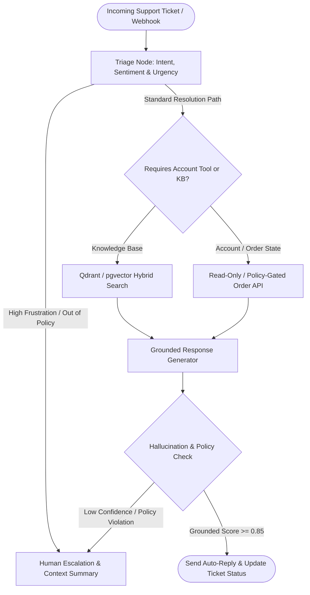

## Introduction

To build an AI customer support agent that resolves real customer tickets rather than frustrating users with generic FAQ links, you must combine Hybrid Knowledge-Base Retrieval (RAG) with authenticated CRM/Order tool calling and a deterministic confidence-based human escalation gate. Roughly 40% of support tickets ask informational questions (*"How do I configure SSO?"*), another 40% require account-specific state lookups or actions (*"Where is order #8492?"* or *"Refund my duplicate charge"*), and the remaining 20% involve complex edge cases or upset customers that must be routed immediately to a human specialist with a structured context handoff.

> [!TIP]
> **Architecture Reference:** Internal Link Suggestion: For deploying this support architecture directly onto WhatsApp Business Cloud API, see [Article 16: How to Build a WhatsApp AI Customer Support Bot with Business API Integration ](/writing/build-whatsapp-ai-customer-support-bot-business-api/).

## Customer Support Architecture: Triage, Hybrid RAG, Action Tools & Human Handoff



### Preventing Support Hallucinations (The "Air Canada" Policy Trap)

A support agent must never invent refund policies, SLA discounts, or feature roadmaps. To prevent policy hallucinations:

1. Strict Grounding Citations: Every policy statement generated by the agent must reference a retrieved knowledge-base article_id.
1. Policy-Gated Action Tools: If the agent has a tool to issue a refund or credit (issue_refund), enforce hard business rules in Python inside the tool (e.g., order_age_days <= 30 and amount_usd <= 50.00), never in the system prompt alone.
1. Automatic Escalation Triggers: Immediately escalate to a human queue if:
- Customer sentiment is ANGRY or the customer explicitly asks for a human.
- Maximum retrieval similarity score falls below 0.78.
- The ticket involves legal threats, security incidents, or refunds above the automated threshold.

## Technology Comparison: Paid vs. Open-Source Stack

| Component | Commercial / Managed Service | Open-Source Alternative | Self-Hosting Possible? | Technical Limitations |
| --- | --- | --- | --- | --- |
| Helpdesk / Ticketing Platform | Zendesk / Intercom / Freshdesk | Chatwoot (MIT) / FreeScout / Zammad | Yes | Self-hosted helpdesks require configuring SMTP/IMAP and webhook workers. |
| Knowledge-Base Vector Search | Pinecone / Qdrant Cloud | Qdrant (https://github.com/qdrant/qdrant) (Apache-2.0) or pgvector (https://github.com/pgvector/pgvector) (PostgreSQL License) | Yes | Combine dense embeddings with sparse BM25 keyword search so exact error codes (ERR_SSL_402) match reliably. |
| Orchestration & State | Managed Agent Platforms | LangGraph (https://github.com/langchain-ai/langgraph) (MIT) | Yes | Requires idempotency keys on ticket webhook events. |
| LLM Inference | OpenAI (gpt-4o-mini) / Anthropic Claude | Ollama (https://github.com/ollama/ollama) (Qwen2.5-32B / Llama-3.3-70B) | Yes | Local inference requires GPU provisioning for sub-3s chat latency. |

### Recommended Implementation Options

### Option A: Best Practical Implementation (Recommended): Python 3.12 + FastAPI + LangGraph (https://github.com/langchain-ai/langgraph) + Qdrant (https://github.com/qdrant/qdrant) (or pgvector (https://github.com/pgvector/pgvector)) hybrid search + OpenAI Structured Outputs + Zendesk/Chatwoot REST webhooks.

### Option B: Fully Open-Source Stack: Self-hosted Chatwoot + FastAPI + Qdrant (https://github.com/qdrant/qdrant) + Ollama (https://github.com/ollama/ollama).

### Option C: Production Enterprise Stack: Multi-region FastAPI workers + Redis idempotency locks + PostgreSQL audit trail + automated RAG evaluation pipeline.

## Step-by-Step Implementation Guide

### Step 1: Project Structure

```text
ai-support-agent/
├── app/
│   ├── __init__.py
│   ├── schemas.py
│   ├── tools.py
│   └── resolver.py
├── tests/
│   └── test_support_agent.py
└── requirements.txt
```

### Step 2: Define Ticket Triage, Grounding, and Escalation Schemas (app/schemas.py)

```python
from enum import Enum
from typing import List, Optional
from pydantic import BaseModel, Field

class TicketIntent(str, Enum):
    ORDER_STATUS = "ORDER_STATUS"
    REFUND_REQUEST = "REFUND_REQUEST"
    TECHNICAL_HOWTO = "TECHNICAL_HOWTO"
    SECURITY_OR_LEGAL = "SECURITY_OR_LEGAL"
    HUMAN_REQUESTED = "HUMAN_REQUESTED"

class CustomerSentiment(str, Enum):
    CALM = "CALM"
    FRUSTRATED = "FRUSTRATED"
    ANGRY = "ANGRY"

class TicketTriage(BaseModel):
    intent: TicketIntent
    sentiment: CustomerSentiment
    priority: int = Field(..., ge=1, le=5)
    extracted_order_id: Optional[str] = None

class KBChunk(BaseModel):
    article_id: str
    title: str
    content: str
    similarity_score: float

class SupportResolution(BaseModel):
    action: str = Field(..., pattern="^(AUTO_REPLY|ESCALATE_TO_HUMAN)$")
    customer_reply: Optional[str] = None
    cited_article_ids: List[str] = Field(default_factory=list)
    internal_handoff_note: Optional[str] = None
    escalation_reason: Optional[str] = None
```

### Step 3: Implement Deterministic Policy-Gated Order & Refund Tools (app/tools.py)

```python
from typing import Dict, Any

MOCK_ORDERS_DB: Dict[str, Dict[str, Any]] = {
    "ORD-1001": {"customer_email": "user@example.com", "status": "DELIVERED", "amount_usd": 35.0, "age_days": 12},
    "ORD-1002": {"customer_email": "vip@example.com", "status": "PROCESSING", "amount_usd": 240.0, "age_days": 5},
}

def lookup_order_status(order_id: str, authenticated_email: str) -> Dict[str, Any]:
    """Looks up an order only if it belongs to the authenticated customer email."""
    order = MOCK_ORDERS_DB.get(order_id)
    if not order:
        return {"found": False, "error": "Order ID not found."}
    if order["customer_email"].lower() != authenticated_email.lower():
        raise PermissionError("Order does not belong to authenticated customer.")
    return {"found": True, "order_id": order_id, **order}

def process_policy_gated_refund(order_id: str, authenticated_email: str) -> Dict[str, Any]:
    """Executes an automated refund strictly within hard-coded policy limits (<= $50 and <= 30 days)."""
    order_info = lookup_order_status(order_id, authenticated_email)
    if not order_info.get("found"):
        return {"approved": False, "reason": "ORDER_NOT_FOUND"}
    if order_info["age_days"] > 30:
        return {"approved": False, "reason": "EXCEEDS_30_DAY_WINDOW"}
    if order_info["amount_usd"] > 50.0:
        return {"approved": False, "reason": "AMOUNT_REQUIRES_HUMAN_APPROVAL"}
    return {
        "approved": True,
        "refunded_amount_usd": order_info["amount_usd"],
        "transaction_ref": f"REF-{order_id}",
    }
```

### Step 4: Implement the Escalation & Grounding Gate (app/resolver.py)

```python
from typing import List
from app.schemas import TicketTriage, TicketIntent, CustomerSentiment, KBChunk, SupportResolution

MIN_KB_SIMILARITY_THRESHOLD = 0.78

def evaluate_escalation_rules(
    triage: TicketTriage,
    kb_chunks: List[KBChunk],
) -> SupportResolution | None:
    """Deterministically checks whether a ticket must bypass auto-reply and escalate to a human agent."""
    if triage.intent in (TicketIntent.SECURITY_OR_LEGAL, TicketIntent.HUMAN_REQUESTED):
        return SupportResolution(
            action="ESCALATE_TO_HUMAN",
            escalation_reason=f"Mandatory escalation for intent: {triage.intent.value}",
            internal_handoff_note=f"Customer intent={triage.intent.value}, priority={triage.priority}.",
        )
    if triage.sentiment == CustomerSentiment.ANGRY:
        return SupportResolution(
            action="ESCALATE_TO_HUMAN",
            escalation_reason="High customer frustration detected (ANGRY sentiment).",
            internal_handoff_note="Route to senior support specialist immediately.",
        )
    if triage.intent == TicketIntent.TECHNICAL_HOWTO:
        best_score = max((c.similarity_score for c in kb_chunks), default=0.0)
        if best_score < MIN_KB_SIMILARITY_THRESHOLD:
            return SupportResolution(
                action="ESCALATE_TO_HUMAN",
                escalation_reason=f"Low KB retrieval confidence ({best_score:.2f} < {MIN_KB_SIMILARITY_THRESHOLD}).",
                internal_handoff_note="Knowledge base lacks a high-confidence article for this question.",
            )
    return None
```

## Testing the Customer Support Agent (tests/test_support_agent.py)

```python
import pytest
from app.schemas import TicketTriage, TicketIntent, CustomerSentiment, KBChunk
from app.tools import lookup_order_status, process_policy_gated_refund
from app.resolver import evaluate_escalation_rules

def test_cross_tenant_order_lookup_blocked():
    with pytest.raises(PermissionError):
        lookup_order_status("ORD-1001", authenticated_email="attacker@example.com")

def test_policy_gated_refund_limits():
    small_refund = process_policy_gated_refund("ORD-1001", "user@example.com")
    assert small_refund["approved"] is True

    large_refund = process_policy_gated_refund("ORD-1002", "vip@example.com")
    assert large_refund["approved"] is False
    assert large_refund["reason"] == "AMOUNT_REQUIRES_HUMAN_APPROVAL"

def test_low_kb_confidence_triggers_escalation():
    triage = TicketTriage(
        intent=TicketIntent.TECHNICAL_HOWTO,
        sentiment=CustomerSentiment.CALM,
        priority=2,
    )
    weak_chunks = [KBChunk(article_id="KB-12", title="Billing FAQ", content="...", similarity_score=0.61)]
    resolution = evaluate_escalation_rules(triage, weak_chunks)
    assert resolution is not None
    assert resolution.action == "ESCALATE_TO_HUMAN"
```

## Troubleshooting, Cost & Production Considerations

- Preventing Cross-Customer Data Leakage: Never let the LLM pass an arbitrary customer_email parameter into lookup_order_status. Inject authenticated_email directly from your signed session token or verified helpdesk ticket record on the backend.
- Cost Breakdown: Resolving 5,000 tickets/month with hybrid vector search in Qdrant (https://github.com/qdrant/qdrant) and structured LLM generation (\~1,800 input tokens and \~300 output tokens per ticket) costs \~\$3.50–$8.00/month in LLM API usage plus a \$10–$25/month VPS for FastAPI and Qdrant.

## Useful Tools, Documentation and GitHub Repositories

| Resource | Purpose | Type | Link |
| --- | --- | --- | --- |
| Qdrant | High-performance hybrid vector search engine | Open-Source (Apache-2.0) | https://github.com/qdrant/qdrant |
| LangGraph | Stateful support workflow & escalation orchestration | Open-Source (MIT) | https://github.com/langchain-ai/langgraph |
| pgvector | PostgreSQL vector similarity search extension | Open-Source (PostgreSQL) | https://github.com/pgvector/pgvector |

## Frequently Asked Questions

### How do I stop the AI support agent from inventing company policies or promising unauthorized refunds?

Enforce two hard boundaries: (1) require cited_article_ids from retrieved KB chunks with similarity >= 0.78 before answering policy questions, and (2) enforce refund eligibility thresholds (amount_usd <= 50.0 and age_days <= 30) inside deterministic Python code rather than relying on the system prompt.

### What happens when the agent escalates a ticket to a human?

The agent updates the helpdesk ticket status to Open, assigns it to the human specialist queue, and posts an internal private note (internal_handoff_note) containing the conversation summary, extracted order_id, and escalation reason so the customer never has to repeat themselves.

### Why is hybrid search (dense + keyword) better than dense vector search alone for customer support?

Customers frequently paste exact alphanumeric error codes (ERR_OAUTH_504), SKU numbers (SKU-9921-B), or CLI flags. Dense embeddings smooth over exact character strings, whereas hybrid search with BM25 sparse vectors matches exact error codes with 100% precision.

### How do I prevent duplicate replies when a helpdesk sends duplicate webhook retries?

Store each webhook's event_id or message_id in PostgreSQL with a UNIQUE constraint and ignore duplicate deliveries.

### Can this agent handle multi-turn troubleshooting conversations?

Yes; store the conversation state keyed by ticket_id in PostgreSQL using LangGraph's checkpointer so follow-up customer replies resume the existing troubleshooting state.

### How do I evaluate the support agent before turning on auto-reply in production?

Run the agent in Shadow Mode (Draft-Only Mode) for 2 weeks: let it post every proposed reply as an internal private note on live tickets, and compare its drafts against what human agents actually sent.

### Can I self-host the entire helpdesk and AI support stack?

Yes. Pair self-hosted Chatwoot with FastAPI, Qdrant (https://github.com/qdrant/qdrant), and local Ollama (https://github.com/ollama/ollama) for a 100% self-hosted customer support stack.

### How should I update the vector database when support documentation changes?

Trigger a webhook from your documentation Git repository or CMS on commit, hash each article section, and upsert only modified chunks into Qdrant mapped by article_id.
