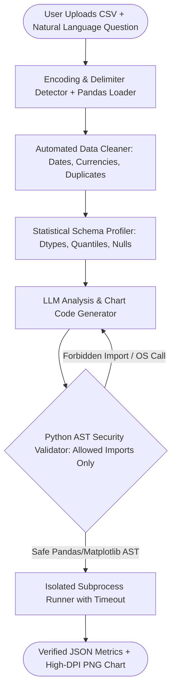

## Introduction

To build an AI data analyst that ingests arbitrary CSV files, cleans dirty columns, runs statistical hypothesis tests, and generates publication-grade charts in response to natural-language questions, you must never pass raw CSV rows into the LLM prompt or call unrestricted exec() on AI-generated Python code. Real-world CSVs contain hundreds of thousands of rows, mixed encodings (UTF-8-SIG, Latin-1), currency strings ("$1,420.50"), and missing values. Instead, your architecture should extract a compact statistical schema profile, let the LLM generate AST-validated Pandas/Matplotlib analysis scripts (or declarative analysis specifications), execute them in an isolated subprocess with strict resource and import allowlists, and return both the verifiable numerical table and the rendered chart image.

> [!TIP]
> **Architecture Reference:** Internal Link Suggestion: Compare this CSV/DataFrame pipeline with [Article 2: How to Build an AI Excel Agent and [Article 9: How to Build an AI SQL Agent ](/writing/build-ai-excel-agent-spreadsheets-analysis/](/writing/build-ai-sql-agent-natural-language-database-queries/)).

## System Architecture: Profiling, AST-Validated Execution & Chart Generation



### Securing AI-Generated Python Code

When an LLM writes Python code to group a DataFrame and plot a chart, executing that code blindly on your server allows remote code execution (import os; os.system(...) or open('/etc/passwd')). Before executing any AI-generated analysis snippet:

1. Parse the code using Python's built-in ast.parse().
1. Walk every AST node and allow imports strictly from { "pandas", "numpy", "matplotlib", "matplotlib.pyplot", "seaborn", "scipy.stats" }.
1. Block all calls to eval, exec, open, compile, __import__, getattr, setattr, os, sys, subprocess, socket, and pathlib.
1. Run the validated calculation inside a child process with a hard timeout (timeout=15s) and a read-only reference to the cleaned DataFrame.

## Technology Comparison: Paid vs. Open-Source Stack

| Component | Commercial / Managed Solution | Open-Source Alternative | Self-Hosting Possible? | Technical Limitations |
| --- | --- | --- | --- | --- |
| DataFrame & OLAP Engine | Snowflake / BigQuery | Pandas (https://www.google.com/search?q=https://github.com/pandas-dev/pandas) (BSD-3-Clause) / DuckDB (MIT) | Yes | For CSVs >500MB, use DuckDB or Polars to avoid out-of-memory errors. |
| Charting & Visualisation | Tableau / PowerBI Embedded | Matplotlib (PSF) / Seaborn (BSD-3) / Plotly (MIT) | Yes | Always set plt.tight_layout() and dpi=200 to prevent clipped axis labels. |
| Code Sandbox | E2B Cloud Code Interpreter | Python ast Allowlist + Linux bubblewrap / Docker Sandbox | Yes | ast validation must be paired with OS-level process isolation in multi-tenant production. |
| Interactive Dashboard | Retool / Hex | Streamlit (Apache-2.0) / FastAPI + React | Yes | Streamlit reruns the script on interaction unless @st.cache_data is applied. |

### Recommended Implementation Options

### Option A: Best Practical Implementation (Recommended): Python 3.12 + Pandas (https://www.google.com/search?q=https://github.com/pandas-dev/pandas) + Matplotlib/Seaborn + Python ast security validator + OpenAI (gpt-4o-mini or gpt-4.1) + FastAPI/Streamlit.

### Option B: Fully Open-Source Local Implementation: Pandas (https://www.google.com/search?q=https://github.com/pandas-dev/pandas) + Matplotlib + local Ollama (https://github.com/ollama/ollama) (qwen2.5-coder:32b).

### Option C: Production Multi-Tenant Implementation: FastAPI + DuckDB for zero-copy Parquet/CSV analytics + ephemeral gVisor/Docker worker containers for code execution.

## Step-by-Step Implementation Guide

### Step 1: Project Structure

```text
ai-data-analyst/
├── app/
│   ├── __init__.py
│   ├── cleaner_profiler.py
│   ├── sandbox_runner.py
│   └── chart_generator.py
├── tests/
│   └── test_data_analyst.py
└── requirements.txt
```

### Step 2: Implement Automated CSV Cleaning and Profiling (app/cleaner_profiler.py)

```python
from typing import Dict, Any
import pandas as pd
import numpy as np

def clean_and_profile_dataframe(df: pd.DataFrame) -> tuple[pd.DataFrame, Dict[str, Any]]:
    """Cleans whitespace, coerces currency/numeric strings, and extracts a compact statistical profile."""
    cleaned = df.copy()
    cleaning_actions = []

    # 1. Strip column name whitespace
    cleaned.columns = [str(c).strip() for c in cleaned.columns]

    # 2. Drop exact duplicate rows
    dup_count = int(cleaned.duplicated().sum())
    if dup_count > 0:
        cleaned = cleaned.drop_duplicates().reset_index(drop=True)
        cleaning_actions.append(f"Dropped {dup_count} duplicate rows.")

    # 3. Coerce currency/percentage object columns where >80% parse as numeric
    for col in cleaned.select_dtypes(include=["object"]).columns:
        sample_non_null = cleaned[col].dropna().astype(str).str.strip()
        if len(sample_non_null) == 0:
            continue
        stripped = sample_non_null.str.replace(r"^[\$₹€£,]+|%$", "", regex=True).str.replace(",", "", regex=False)
        coerced = pd.to_numeric(stripped, errors="coerce")
        if coerced.notna().mean() >= 0.85:
            cleaned[col] = pd.to_numeric(
                cleaned[col].astype(str).str.replace(r"[\$₹€£,%]", "", regex=True).str.strip(),
                errors="coerce",
            )
            cleaning_actions.append(f"Converted column '{col}' from string to float.")

    # 4. Build compact profile for the LLM
    col_profiles = {}
    for col in cleaned.columns:
        series = cleaned[col]
        info: Dict[str, Any] = {
            "dtype": str(series.dtype),
            "null_count": int(series.isna().sum()),
            "unique_count": int(series.nunique(dropna=True)),
        }
        if pd.api.types.is_numeric_dtype(series):
            desc = series.describe()
            info["mean"] = round(float(desc.get("mean", 0.0)), 4) if not np.isnan(desc.get("mean", np.nan)) else None
            info["std"] = round(float(desc.get("std", 0.0)), 4) if not np.isnan(desc.get("std", np.nan)) else None
            info["min"] = float(desc.get("min", 0.0)) if not np.isnan(desc.get("min", np.nan)) else None
            info["max"] = float(desc.get("max", 0.0)) if not np.isnan(desc.get("max", np.nan)) else None
        else:
            info["top_values"] = series.dropna().astype(str).value_counts().head(5).to_dict()
        col_profiles[col] = info

    profile = {
        "row_count": int(len(cleaned)),
        "column_count": int(len(cleaned.columns)),
        "cleaning_actions": cleaning_actions,
        "columns": col_profiles,
    }
    return cleaned, profile
```

### Step 3: Implement the AST-Validated Python Analysis & Chart Runner (app/sandbox_runner.py)

```python
import ast
from typing import Dict, Any, Set
import pandas as pd
import numpy as np
import matplotlib
matplotlib.use("Agg")
import matplotlib.pyplot as plt

ALLOWED_MODULES: Set[str] = {"pandas", "numpy", "matplotlib", "matplotlib.pyplot", "math"}
FORBIDDEN_CALL_NAMES: Set[str] = {
    "eval", "exec", "open", "compile", "__import__", "getattr", "setattr",
    "delattr", "globals", "locals", "input", "breakpoint", "system", "popen",
}
FORBIDDEN_ATTRIBUTES: Set[str] = {
    "to_pickle", "read_pickle", "to_sql", "to_csv", "to_excel", "system",
    "__subclasses__", "__bases__", "__globals__", "__code__",
}

def validate_analysis_code_ast(code_str: str) -> None:
    """Inspects the Python AST to block file I/O, network access, and disallowed imports."""
    tree = ast.parse(code_str)
    for node in ast.walk(tree):
        if isinstance(node, ast.Import):
            for alias in node.names:
                if alias.name not in ALLOWED_MODULES:
                    raise PermissionError(f"Disallowed import: {alias.name}")
        elif isinstance(node, ast.ImportFrom):
            if not node.module or node.module not in ALLOWED_MODULES:
                raise PermissionError(f"Disallowed import from: {node.module}")
        elif isinstance(node, ast.Call):
            if isinstance(node.func, ast.Name) and node.func.id in FORBIDDEN_CALL_NAMES:
                raise PermissionError(f"Disallowed function call: {node.func.id}")
        elif isinstance(node, ast.Attribute):
            if node.attr in FORBIDDEN_ATTRIBUTES or node.attr.startswith("__"):
                raise PermissionError(f"Disallowed attribute access: {node.attr}")

def execute_verified_analysis(
    df: pd.DataFrame,
    code_str: str,
    chart_output_path: str | None = None,
) -> Dict[str, Any]:
    """Validates `code_str`, runs it against a copy of `df`, and saves `fig` if generated."""
    validate_analysis_code_ast(code_str)
    plt.close("all")
    fig, ax = plt.subplots(figsize=(8, 4.5), dpi=150)

    safe_locals: Dict[str, Any] = {
        "df": df.copy(deep=True),
        "pd": pd,
        "np": np,
        "plt": plt,
        "fig": fig,
        "ax": ax,
        "result": None,
    }
    safe_builtins = {
        "len": len, "round": round, "min": min, "max": max, "sum": sum,
        "abs": abs, "float": float, "int": int, "str": str, "dict": dict, "list": list,
    }
    exec(code_str, {"__builtins__": safe_builtins}, safe_locals)

    saved_chart = None
    if chart_output_path and len(ax.patches) + len(ax.lines) + len(ax.collections) > 0:
        fig.tight_layout()
        fig.savefig(chart_output_path, dpi=150)
        saved_chart = chart_output_path
    plt.close(fig)

    res = safe_locals.get("result")
    if isinstance(res, pd.DataFrame):
        res = res.to_dict(orient="records")
    elif isinstance(res, pd.Series):
        res = res.to_dict()

    return {"result": res, "chart_path": saved_chart}
```

## Testing the AI Data Analyst (tests/test_data_analyst.py)

```python
import os
import pandas as pd
import pytest
from app.cleaner_profiler import clean_and_profile_dataframe
from app.sandbox_runner import validate_analysis_code_ast, execute_verified_analysis

def test_csv_cleaner_and_profiler():
    raw_df = pd.DataFrame({
        " Category ": ["Cloud", "Cloud", "Edge", "AI"],
        "Revenue_USD": ["$1,200.50", "$1,200.50", "$850.00", "$2,400.00"],
    })
    cleaned, profile = clean_and_profile_dataframe(raw_df)
    assert profile["row_count"] == 3  # Duplicate row dropped
    assert cleaned["Revenue_USD"].dtype == float
    assert profile["columns"]["Revenue_USD"]["max"] == 2400.0

def test_ast_sandbox_blocks_os_and_dunder_escapes():
    with pytest.raises(PermissionError, match="Disallowed import"):
        validate_analysis_code_ast("import os\nos.system('ls')")
    with pytest.raises(PermissionError, match="Disallowed function call"):
        validate_analysis_code_ast("open('/etc/passwd').read()")
    with pytest.raises(PermissionError, match="Disallowed attribute access"):
        validate_analysis_code_ast("x = df.__class__.__bases__")

def test_verified_pandas_aggregation_and_chart_export(tmp_path):
    df = pd.DataFrame({
        "Segment": ["Enterprise", "SMB", "Enterprise", "SMB"],
        "ARR": [150000, 40000, 210000, 60000],
    })
    code = """
grouped = df.groupby('Segment')['ARR'].sum()
grouped.plot(kind='bar', ax=ax, title='Total ARR by Segment')
result = grouped
"""
    chart_file = str(tmp_path / "arr_chart.png")
    out = execute_verified_analysis(df, code, chart_output_path=chart_file)
    assert out["result"] == {"Enterprise": 360000, "SMB": 100000}
    assert os.path.exists(chart_file)
```

## Troubleshooting, Reproducibility & Cost Considerations

- Ensuring Data Reproducibility: Along with every chart and summary answer, return the exact Pandas code snippet and the SHA-256 hash of the input CSV so any data scientist can reproduce the exact numbers independently.
- Cost Breakdown: Because the LLM only reads the JSON statistical profile (\~600 tokens) and outputs a 10-line Pandas snippet (\~150 tokens), analysing 1,000 CSV questions/month costs <\$0.50/month on commercial APIs or \$0 on local Ollama (https://github.com/ollama/ollama).

## Useful Tools, Documentation and GitHub Repositories

| Resource | Purpose | Type | Link |
| --- | --- | --- | --- |
| Pandas | Tabular data cleaning, aggregation, and time-series analysis | Open-Source (BSD-3) | https://www.google.com/search?q=https://github.com/pandas-dev/pandas |
| Matplotlib | High-DPI programmatic chart rendering | Open-Source (PSF) | https://www.google.com/search?q=https://matplotlib.org/stable/index.html |
| Ollama | Local execution of Qwen2.5-Coder for Pandas code generation | Open-Source (MIT) | https://github.com/ollama/ollama |

## Frequently Asked Questions

### Why does the agent profile the CSV first instead of passing the CSV file directly to the LLM?

A 50,000-row CSV contains millions of tokens—exceeding context limits and costing dollars per query—while LLMs frequently miscalculate averages over raw text. Passing a 600-token statistical schema profile (dtypes, min, max, null_count, top_values) costs 99.9% less and allows Pandas to compute exact floating-point aggregations.

### Is Python's `ast` check alone enough to sandbox untrusted multi-tenant users?

ast inspection is your first line of defence against accidental file writes, network calls, and dunder attribute escapes. In a public multi-tenant SaaS app, always run the validated Python snippet inside an unprivileged container (Docker with --network none --read-only --memory 512m) or microVM.

### How do I handle CSV files that fail with `UnicodeDecodeError: 'utf-8' codec can't decode byte`?

Attempt reading with encoding="utf-8-sig" first (to handle Excel BOM markers), and fall back to charset_normalizer or encoding="latin1".

### How do I prevent Matplotlib memory leaks in a long-running FastAPI server?

Always set matplotlib.use("Agg") at startup and call plt.close(fig) inside a finally block after saving every chart.

### What if the CSV is 5GB and doesn't fit in Pandas memory?

Swap pd.read_csv() for DuckDB (duckdb.sql("SELECT Segment, SUM(ARR) FROM 'large_file.csv' GROUP BY Segment").df()), which streams out-of-core aggregations over multi-gigabyte CSVs using minimal RAM.

### How do I stop the LLM from picking the wrong chart type (like a pie chart with 40 slices)?

Encode chart-selection rules in the system prompt: use bar charts for categorical comparisons (<= 12 categories), line charts for continuous time series, and histograms/boxplots for distributions; ban pie charts whenever category count exceeds 5.

### Can I return interactive charts for a web dashboard instead of static PNGs?

Yes; instruct the agent to output a Vega-Lite or Plotly JSON specification populated with the aggregated result dictionary, which your React frontend renders interactively without executing arbitrary JavaScript.

### How do I handle missing values (`NaN`) before running statistical correlations?

Report the exact null_count per column in the profile and explicitly log whether rows with NaN were dropped (dropna()) or imputed (fillna(median)) in the cleaning_actions audit trail.
