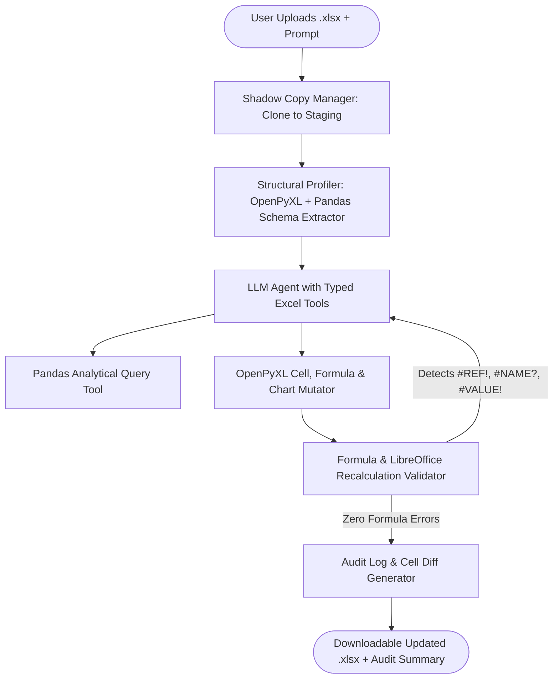

## Introduction

Building an AI agent for Excel requires separating statistical data reading from structural workbook mutation. While pandas excels at vectorised filtering, aggregation, and exploratory statistics over tabular data, pandas.to_excel() overwrites existing cell formatting, conditional styles, column widths, and native Excel formulas (=SUM(), =INDEX/MATCH()). To build a reliable AI Excel agent that reads, analyses, and updates .xlsx workbooks without corrupting user files, you must pair Pandas for read-only analytical profiling with OpenPyXL for surgical cell updates, native formula insertion, and embedded chart generation, backed by a shadow-copy validation pipeline.

> [!TIP]
> **Architecture Reference:** Internal Link Suggestion: On Aniket.app (https://aniket.app/), see the [Finance Tools — DCF Valuation](/projects/finance-tools/) case study for how deterministic Python/FastAPI engines reconcile JSON state with .xlsx workbooks with zero cell drift, and cross-reference [Article 8: How to Build an AI Financial Analyst and [Article 10: How to Build an AI Data Analyst ](/writing/build-ai-financial-analyst-annual-reports-sec/](/writing/build-ai-data-analyst-csv-charts-pandas/)).

## What an AI Excel Agent Is and Practical Use Cases

An AI Excel agent is a tool-augmented system that inspects the structure of a multi-sheet .xlsx or .csv file (sheet names, header coordinates, data types, existing formulas, and named ranges), translates natural-language instructions into deterministic operations, and writes auditable updates back to a copy of the workbook.

Practical engineering use cases include:

- Financial & Operational Rollups: Reading monthly departmental expense tabs, standardizing currency/date columns, and inserting dynamic =SUMIFS() summary tabs and native BarChart visualisations.
- Automated Audit & Reconciliation: Highlighting variance anomalies above a threshold (e.g., >10% YoY variance) with conditional fills while preserving every original formula in the workbook.
- Natural-Language Formula Authoring: Translating requests like *"Add a Gross Margin % column in column F and a Total row at the bottom"* into exact coordinate-mapped Excel formulas (=(D2-E2)/D2) rather than hardcoded static floats.

## System Architecture: Dual-Engine Read/Write & Shadow Workbook Safety

Never allow an LLM to directly overwrite a user's source .xlsx file or emit raw unvalidated Python exec() strings against production files. Instead, design a deterministic tool-calling architecture with five safety layers:



### Preventing Accidental Spreadsheet Modifications

1. Immutable Source & Shadow Cloning: Upon upload, compute the SHA-256 hash of source.xlsx and clone it to a staging path (staging_<uuid>.xlsx). All mutations occur exclusively on the staging copy.
1. Coordinate & Formula Guardrails: Before OpenPyXL writes to a cell (row, col), inspect ws.cell(row, col).value. If the cell already contains a formula (starts with =) and allow_overwrite_formulas=False, reject the write and return an error message to the agent.
1. Spreadsheet Formula Injection Sanitization: When ingesting external text or user strings into cells, strip or prefix leading =, +, -, or @ characters on text fields so malicious inputs cannot trigger DDE/CSV formula injection (=cmd|' /C calc'!A0) when opened in desktop Excel.
1. Headless LibreOffice Formula Evaluation: Because OpenPyXL writes formula strings (=SUM(B2:B10)) without evaluating them, run libreoffice --headless --convert-to xlsx or inspect cached values to verify that generated formulas do not evaluate to #REF!, #NAME?, #DIV/0!, or #VALUE!.

## Technology Stack & Open-Source vs. Commercial Comparison

| Component | Paid / Commercial Solution | Open-Source Alternative | Self-Hosting Possible? | Technical Limitations |
| --- | --- | --- | --- | --- |
| Workbook Read/Write Engine | Microsoft Graph Excel REST API / Aspose.Cells | OpenPyXL (https://www.google.com/search?q=https://foss.heptapod.net/openpyxl/openpyxl) (MIT) + Pandas (https://www.google.com/search?q=https://github.com/pandas-dev/pandas) (BSD-3-Clause) | Yes | OpenPyXL does not evaluate formulas natively; requires headless LibreOffice if cached values must be pre-computed. |
| Fast Write-Only Generation | SheetJS Pro | XlsxWriter (BSD-2-Clause) | Yes | XlsxWriter cannot read or modify existing .xlsx files; use OpenPyXL for updating existing workbooks. |
| LLM Tool Calling | OpenAI API (gpt-4o-mini / gpt-4.1) | Ollama (https://github.com/ollama/ollama) (Qwen2.5-Coder-32B / Llama-3.3-70B) | Yes | Model must accurately map 1-indexed Excel coordinates (C12) without off-by-one row errors. |
| Formula Recalculation | Microsoft Excel Desktop / Graph API | LibreOffice Calc Headless (libreoffice --headless) (MPL-2.0) | Yes (Linux container) | Adds \~1.5–3.0 seconds per validation pass for process startup. |

### Recommended Implementation Options

### Option A: Best Practical Implementation (Recommended): Python 3.12 + FastAPI + Pandas (https://www.google.com/search?q=https://github.com/pandas-dev/pandas) (read-only profiling) + openpyxl (in-place workbook updates, formulas, and charts) + OpenAI Structured Tool Calling.

### Option B: Fully Open-Source Implementation: Same Python/Pandas/OpenPyXL core paired with local Ollama (https://github.com/ollama/ollama) running qwen2.5-coder:32b and headless LibreOffice for formula verification.

### Option C: Production-Scale Implementation: Containerized FastAPI + S3/MinIO object storage for versioned workbook snapshots + Celery workers running isolated LibreOffice formula verification containers.

## Step-by-Step Implementation Guide

### Step 1: Project Structure

Create the following directory layout:

```text
ai-excel-agent/
├── app/
│   ├── __init__.py
│   ├── profiler.py
│   ├── mutator.py
│   └── agent.py
├── tests/
│   └── test_excel_agent.py
└── requirements.txt
```

### Step 2: Install Dependencies

```bash
pip install openpyxl==3.1.5 pandas==2.2.3 pydantic==2.9.2 openai==1.51.0 pytest==8.3.3
```

### Step 3: Implement the Workbook Structural Profiler (app/profiler.py)

Before an LLM can write a valid formula like =SUM(C2:C15), it needs the exact sheet names, column letters, header row indices, row counts, and sample values.

```python
from typing import Dict, Any, List
import openpyxl
from openpyxl.utils import get_column_letter
import pandas as pd

def profile_workbook(file_path: str, max_sample_rows: int = 3) -> Dict[str, Any]:
    """Extracts exact 1-indexed sheet coordinates, column letters, headers, and existing formulas."""
    wb_formulas = openpyxl.load_workbook(file_path, data_only=False)
    wb_values = openpyxl.load_workbook(file_path, data_only=True)
    profile: Dict[str, Any] = {"file_path": file_path, "sheets": {}}

    for sheet_name in wb_formulas.sheetnames:
        ws_f = wb_formulas[sheet_name]
        ws_v = wb_values[sheet_name]
        max_row = ws_f.max_row
        max_col = ws_f.max_column

        headers: List[Dict[str, str]] = []
        for col_idx in range(1, max_col + 1):
            col_letter = get_column_letter(col_idx)
            header_val = ws_v.cell(row=1, column=col_idx).value
            headers.append({
                "column_letter": col_letter,
                "header_cell": f"{col_letter}1",
                "header_name": str(header_val) if header_val is not None else f"Unnamed_{col_letter}",
            })

        sample_rows = []
        for row_idx in range(2, min(max_row + 1, 2 + max_sample_rows)):
            row_dict = {}
            for col_idx in range(1, max_col + 1):
                col_letter = get_column_letter(col_idx)
                f_val = ws_f.cell(row=row_idx, column=col_idx).value
                v_val = ws_v.cell(row=row_idx, column=col_idx).value
                row_dict[f"{col_letter}{row_idx}"] = {
                    "value": v_val,
                    "formula": f_val if isinstance(f_val, str) and f_val.startswith("=") else None,
                }
            sample_rows.append(row_dict)

        profile["sheets"][sheet_name] = {
            "max_row": max_row,
            "max_column": max_col,
            "data_row_range": f"2:{max_row}" if max_row >= 2 else "None",
            "headers": headers,
            "sample_rows": sample_rows,
        }

    wb_formulas.close()
    wb_values.close()
    return profile

def run_pandas_summary(file_path: str, sheet_name: str) -> Dict[str, Any]:
    """Computes descriptive statistics on numeric columns using Pandas without modifying the file."""
    df = pd.read_excel(file_path, sheet_name=sheet_name)
    numeric_summary = df.describe().to_dict()
    missing_counts = df.isna().sum().to_dict()
    return {
        "row_count": int(len(df)),
        "missing_values_per_column": {str(k): int(v) for k, v in missing_counts.items()},
        "numeric_statistics": numeric_summary,
    }
```

### Step 4: Implement Safe Workbook Mutation, Formula Validation, and Charting (app/mutator.py)

This module clones the workbook before editing, blocks unintended formula overwrites, validates formula syntax, and embeds native Excel charts.

```python
import re
import shutil
from pathlib import Path
from typing import List, Dict, Any, Optional
import openpyxl
from openpyxl.styles import Font, PatternFill
from openpyxl.chart import BarChart, Reference
from pydantic import BaseModel, Field

EXCEL_ERROR_TOKENS = {"#REF!", "#NAME?", "#VALUE!", "#DIV/0!", "#N/A", "#NUM!", "#NULL!"}
ALLOWED_FORMULA_PATTERN = re.compile(r"^=[A-Z0-9_]+\(.*\)$|^=[A-Z]+[0-9]+(\s*[\+\-\*\/]\s*[A-Z0-9\.]+)+$", re.IGNORECASE)

class CellWriteOperation(BaseModel):
    sheet_name: str
    cell_coord: str = Field(..., pattern=r"^[A-Z]{1,3}[1-9][0-9]*$")
    value: Any
    is_formula: bool = False
    number_format: Optional[str] = None
    bold: bool = False

class ChartSpec(BaseModel):
    sheet_name: str
    title: str
    data_col_idx: int
    categories_col_idx: int
    min_row: int
    max_row: int
    anchor_cell: str = "H2"

def validate_formula_syntax(formula_str: str) -> None:
    """Validates balanced parentheses, leading '=', and blocks dangerous DDE injection patterns."""
    if not isinstance(formula_str, str) or not formula_str.startswith("="):
        raise ValueError(f"Formula must start with '=': {formula_str}")
    if any(token in formula_str.upper() for token in ("CMD|", "POWERSHELL", "WEBSERVICE(")):
        raise ValueError(f"Blocked unsafe external/DDE formula: {formula_str}")
    if formula_str.count("(") != formula_str.count(")"):
        raise ValueError(f"Unbalanced parentheses in formula: {formula_str}")
    if not ALLOWED_FORMULA_PATTERN.match(formula_str.strip()):
        raise ValueError(f"Formula does not match valid Excel expression syntax: {formula_str}")

def apply_workbook_operations(
    source_path: str,
    target_path: str,
    operations: List[CellWriteOperation],
    chart_spec: Optional[ChartSpec] = None,
    allow_overwrite_formulas: bool = False,
) -> Dict[str, Any]:
    """Clones source_path to target_path and applies audited cell/formula/chart operations."""
    shutil.copy2(source_path, target_path)
    wb = openpyxl.load_workbook(target_path)
    audit_log: List[Dict[str, Any]] = []

    for op in operations:
        if op.sheet_name not in wb.sheetnames:
            raise ValueError(f"Sheet '{op.sheet_name}' does not exist in workbook.")
        ws = wb[op.sheet_name]
        existing_val = ws[op.cell_coord].value

        if (
            isinstance(existing_val, str)
            and existing_val.startswith("=")
            and not allow_overwrite_formulas
        ):
            raise PermissionError(
                f"Refusing to overwrite existing formula '{existing_val}' in {op.sheet_name}!{op.cell_coord}."
            )

        if op.is_formula:
            validate_formula_syntax(str(op.value))
            write_val = str(op.value)
        else:
            # Prevent accidental CSV/DDE injection in text cells
            if isinstance(op.value, str) and op.value.startswith(("=", "+", "-", "@")):
                write_val = "'" + op.value
            else:
                write_val = op.value

        ws[op.cell_coord].value = write_val
        if op.number_format:
            ws[op.cell_coord].number_format = op.number_format
        if op.bold:
            ws[op.cell_coord].font = Font(bold=True)

        audit_log.append({
            "sheet": op.sheet_name,
            "cell": op.cell_coord,
            "previous_value": existing_val,
            "new_value": write_val,
        })

    if chart_spec:
        ws = wb[chart_spec.sheet_name]
        chart = BarChart()
        chart.title = chart_spec.title
        chart.style = 10
        data_ref = Reference(
            ws,
            min_col=chart_spec.data_col_idx,
            min_row=chart_spec.min_row,
            max_row=chart_spec.max_row,
        )
        cats_ref = Reference(
            ws,
            min_col=chart_spec.categories_col_idx,
            min_row=chart_spec.min_row + 1,
            max_row=chart_spec.max_row,
        )
        chart.add_data(data_ref, titles_from_data=True)
        chart.set_categories(cats_ref)
        ws.add_chart(chart, chart_spec.anchor_cell)

    wb.save(target_path)
    wb.close()
    return {"target_path": target_path, "changes_applied": len(audit_log), "audit_log": audit_log}
```

## Testing the Excel Agent (tests/test_excel_agent.py)

We can execute a complete end-to-end test that creates a sample financial workbook, profiles its coordinates, adds a Gross Profit column (=B2-C2), inserts a =SUM(D2:D4) total formula, embeds a native BarChart, and verifies formula protection:

```python
import os
import openpyxl
import pytest
from app.profiler import profile_workbook, run_pandas_summary
from app.mutator import (
    CellWriteOperation,
    ChartSpec,
    apply_workbook_operations,
    validate_formula_syntax,
)

def create_sample_workbook(path: str):
    wb = openpyxl.Workbook()
    ws = wb.active
    ws.title = "RegionalSales"
    ws.append(["Region", "Revenue", "COGS"])
    ws.append(["North", 120000, 70000])
    ws.append(["South", 95000, 52000])
    ws.append(["West", 150000, 85000])
    wb.save(path)
    wb.close()

def test_excel_agent_profile_and_safe_mutation(tmp_path):
    src = str(tmp_path / "source.xlsx")
    dst = str(tmp_path / "updated.xlsx")
    create_sample_workbook(src)

    profile = profile_workbook(src)
    assert "RegionalSales" in profile["sheets"]
    assert profile["sheets"]["RegionalSales"]["max_row"] == 4

    stats = run_pandas_summary(src, "RegionalSales")
    assert stats["row_count"] == 3

    ops = [
        CellWriteOperation(sheet_name="RegionalSales", cell_coord="D1", value="Gross Profit", bold=True),
        CellWriteOperation(sheet_name="RegionalSales", cell_coord="D2", value="=B2-C2", is_formula=True, number_format="$#,##0"),
        CellWriteOperation(sheet_name="RegionalSales", cell_coord="D3", value="=B3-C3", is_formula=True, number_format="$#,##0"),
        CellWriteOperation(sheet_name="RegionalSales", cell_coord="D4", value="=B4-C4", is_formula=True, number_format="$#,##0"),
        CellWriteOperation(sheet_name="RegionalSales", cell_coord="A5", value="Total", bold=True),
        CellWriteOperation(sheet_name="RegionalSales", cell_coord="D5", value="=SUM(D2:D4)", is_formula=True, number_format="$#,##0", bold=True),
    ]
    chart = ChartSpec(
        sheet_name="RegionalSales",
        title="Gross Profit by Region",
        data_col_idx=4,
        categories_col_idx=1,
        min_row=1,
        max_row=4,
        anchor_cell="F2",
    )
    result = apply_workbook_operations(src, dst, ops, chart_spec=chart)
    assert result["changes_applied"] == 6

    # Verify formula protection blocks accidental overwrite of D5
    with pytest.raises(PermissionError):
        apply_workbook_operations(
            dst,
            str(tmp_path / "fail.xlsx"),
            [CellWriteOperation(sheet_name="RegionalSales", cell_coord="D5", value=999)],
            allow_overwrite_formulas=False,
        )

def test_formula_validation_blocks_dde_and_unbalanced_parens():
    with pytest.raises(ValueError):
        validate_formula_syntax("=SUM(B2:B5")
    with pytest.raises(ValueError):
        validate_formula_syntax("=CMD|'/C calc'!A0")
```

## Troubleshooting, Cost & Production Considerations

- Common Failure — Cached Formula Values Read as `None`: When openpyxl writes a new formula (=SUM(D2:D4)), it does not run an Excel calculation engine, so opening the file immediately with load_workbook(..., data_only=True) returns None for D5 until Excel or headless LibreOffice recalculates the sheet. Run libreoffice --headless --convert-to xlsx --outdir ./validated updated.xlsx in your post-processing pipeline if downstream Python scripts need the evaluated float immediately.
- Cost Breakdown: Because openpyxl, pandas, and LibreOffice are 100% free open-source libraries, processing a 10-tab workbook requires only \~2,500 tokens of schema metadata (rather than sending 50,000 raw rows to the LLM). At current API rates, each workbook update costs <\$0.005, or \$0 when using a local model via Ollama (https://github.com/ollama/ollama).

## Useful Tools, Documentation and GitHub Repositories

| Resource | Purpose | Type | Link |
| --- | --- | --- | --- |
| OpenPyXL Documentation | Reading, writing, styling, and charting .xlsx files | Open-Source (MIT) | https://www.google.com/search?q=https://openpyxl.readthedocs.io/en/stable/ |
| Pandas | Vectorised tabular data profiling and aggregation | Open-Source (BSD-3-Clause) | https://www.google.com/search?q=https://github.com/pandas-dev/pandas |
| Pydantic | Strict schema validation for cell operations | Open-Source (MIT) | https://www.google.com/search?q=https://docs.pydantic.dev/latest/ |
| Ollama | Local execution of coding models (qwen2.5-coder) | Open-Source (MIT) | https://github.com/ollama/ollama |

## Frequently Asked Questions

### Why shouldn't I send the entire Excel file rows directly into the LLM context window?

Sending 20,000 spreadsheet rows into an LLM context window wastes tens of thousands of tokens, hits context limits, and causes arithmetic hallucinations. Instead, send only the structural schema (sheet names, column letters, header names, and 3 sample rows) and let the LLM generate openpyxl coordinate operations or pandas aggregations.

### Can this AI Excel agent preserve existing conditional formatting and macros?

Yes, openpyxl preserves existing styles and formatting on untouched cells when loading and saving an existing .xlsx file. If the workbook is macro-enabled (.xlsm), pass keep_vba=True to openpyxl.load_workbook(path, keep_vba=True).

### How do I prevent the AI from overwriting formulas that a financial analyst already built?

Check ws[coord].value before every write operation (as implemented in apply_workbook_operations). If the current value starts with =, raise a PermissionError unless the user explicitly approved replacing that specific formula cell.

### How do I handle merged cells in messy corporate spreadsheets?

In openpyxl, inspect ws.merged_cells.ranges. Only the top-left cell of a merged range holds the value; writing to any subordinate cell in a merged range raises an AttributeError ('MergedCell' object attribute 'value' is read-only). Unmerge or map writes to merged_range.start_cell.coordinate.

### Can I build this application entirely with open-source tools?

Yes. openpyxl, pandas, and headless LibreOffice are open-source, and Qwen2.5-Coder via Ollama (https://github.com/ollama/ollama) handles Excel coordinate math reliably on local hardware.

### What is Spreadsheet Formula Injection and how does the agent block it?

If an untrusted string (such as a customer comment imported into a sheet) starts with =, +, -, or @, desktop Excel interprets it as an executable formula or DDE command. Prefixing untrusted string literals with a single quote (') forces Excel to treat the cell strictly as plain text.

### When should I use `XlsxWriter` instead of `OpenPyXL`?

Use XlsxWriter only when generating brand-new, multi-hundred-thousand-row .xlsx workbooks from scratch where write speed and memory efficiency are critical. Because XlsxWriter cannot open or edit existing .xlsx files, OpenPyXL is required for any agent that updates existing spreadsheets.

### How can I verify that an AI-generated formula won't show `#NAME?

` or `#REF!` when the user opens it? Validate balanced parentheses and function names via regex before saving, then invoke libreoffice --headless --convert-to xlsx in a sandbox subprocess and re-open the converted workbook with openpyxl.load_workbook(..., data_only=True) to verify no cell value equals #REF!, #NAME?, or #VALUE!.
