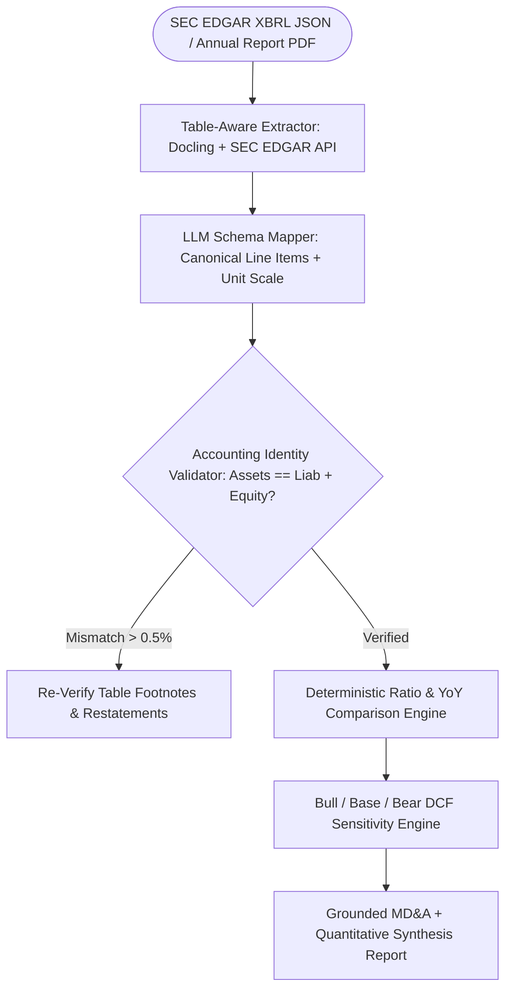

## Introduction

To build an AI financial analyst capable of reading 200-page annual reports (SEC Form 10-K, 10-Q, or international annual filings) and analysing income statements, balance sheets, and cash flow statements, you must follow one foundational rule of financial engineering: LLMs extract and map line items; deterministic Python code performs all arithmetic, ratio calculations, and scenario modelling. Allowing a language model to divide net income by shareholders' equity or project 5-year Discounted Cash Flows (DCF) directly in token space introduces floating-point rounding errors and unit mismatches (such as mixing $ in millions with $ in thousands).

> [!TIP]
> **Architecture Reference:** Internal Link Suggestion: On Aniket.app (https://aniket.app/), see the [Finance Tools — DCF Valuation](/projects/finance-tools/) case study for how a deterministic Python/FastAPI valuation engine computes Gordon Growth and Exit Multiple terminal values with zero cell drift, and cross-reference [Article 2: How to Build an AI Excel Agent and [Article 13: How to Build an AI Invoice Processing Agent ](/writing/build-ai-excel-agent-spreadsheets-analysis/](/writing/build-ai-invoice-processing-agent-financial-extraction/)).

## Financial Document Ingestion & Accounting Validation Architecture



### Numerical Accuracy and Accounting Identity Validation

Before computing any financial ratio, your pipeline must run three deterministic checks:

1. Balance Sheet Identity Check: Verify that $\text{Total Assets} = \text{Total Liabilities} + \text{Total Shareholders' Equity}$ within a rounding tolerance of $\le 0.1\%$ (to account for table rounding in millions).
1. Unit Scale Normalisation: Annual reports frequently state *"(\$ in millions, except per share data)"* in the table header. Store an explicit unit_multiplier (1_000_000, 1_000, or 1) on every extracted statement before comparing across companies.
1. Cash Flow Reconciliation: Verify that $\text{Operating Cash Flow} - \text{Capital Expenditures} = \text{Free Cash Flow (FCF)}$.

## Technology Comparison: Paid vs. Open-Source Stack

| Component | Commercial / Paid API | Open-Source / Free Official Source | Self-Hosting Possible? | Technical Limitations |
| --- | --- | --- | --- | --- |
| Financial Filing Data | Bloomberg / S&P Capital IQ / Financial Modeling Prep | SEC EDGAR REST API (data.sec.gov/api/xbrl/companyfacts/) (Public Domain) | Yes | SEC EDGAR requires a custom User-Agent: Sample Company Name AdminContact@<sample company domain>.com header and caps requests at 10 req/sec. |
| PDF Table Extraction | AWS Textract / Azure Document Intelligence | Docling (https://github.com/docling-project/docling) (MIT License) / pdfplumber | Yes | Multi-page financial tables with parenthetical negative numbers (1,240) must be parsed as -1240.0. |
| Retrieval Over MD&A Text | Managed Vector DB | PostgreSQL (https://www.postgresql.org/docs/) + pgvector (https://github.com/pgvector/pgvector) / Qdrant (https://github.com/qdrant/qdrant) | Yes | Chunk by document section (Item 1A. Risk Factors, Item 7. MD&A) rather than arbitrary 500-token slices. |
| Quantitative Engine | Proprietary Excel Add-ins | Python decimal / numpy / pandas + pydantic | Yes | Never use standard LLM token generation for financial arithmetic. |

### Recommended Implementation Options

### Option A: Best Practical Implementation (Recommended): Python 3.12 + SEC EDGAR XBRL API + Docling (https://github.com/docling-project/docling) for PDF reports + OpenAI Structured Outputs for line-item normalisation + deterministic Python ratio and DCF scenario engine + pgvector (https://github.com/pgvector/pgvector) for MD&A qualitative citations.

### Option B: Fully Open-Source Local Implementation: Docling (https://github.com/docling-project/docling) + SEC EDGAR API + local Ollama (https://github.com/ollama/ollama) (qwen2.5:32b) + Python deterministic financial engine.

### Option C: Production Institutional Research Pipeline: FastAPI + PostgreSQL + automated filing ingestion worker + Excel reconciliation export via openpyxl.

## Step-by-Step Implementation Guide

### Step 1: Project Structure

```text
ai-financial-analyst/
├── app/
│   ├── __init__.py
│   ├── statements.py
│   ├── ratios.py
│   └── scenario_dcf.py
├── tests/
│   └── test_financial_analyst.py
└── requirements.txt
```

### Step 2: Define Validated Financial Statement Schemas (app/statements.py)

```python
from pydantic import BaseModel, Field, model_validator

class FinancialPeriodStatement(BaseModel):
    ticker: str
    fiscal_year: int
    currency: str = "USD"
    unit_multiplier: int = Field(1_000_000, description="1_000_000 for $ in millions")

    # Income Statement
    revenue: float
    cost_of_goods_sold: float
    operating_income: float
    interest_expense: float = 0.0
    net_income: float

    # Balance Sheet
    cash_and_equivalents: float
    current_assets: float
    total_assets: float
    current_liabilities: float
    total_debt: float
    total_liabilities: float
    total_shareholders_equity: float

    # Cash Flow Statement
    operating_cash_flow: float
    capital_expenditures: float = Field(..., ge=0.0, description="Positive magnitude of CapEx")

    @model_validator(mode="after")
    def verify_accounting_identities(self) -> "FinancialPeriodStatement":
        """Enforces Assets == Liabilities + Equity within 0.5% tolerance for table rounding."""
        rhs = self.total_liabilities + self.total_shareholders_equity
        diff = abs(self.total_assets - rhs)
        tolerance = max(1.0, abs(self.total_assets) * 0.005)
        if diff > tolerance:
            raise ValueError(
                f"Balance Sheet identity violation for {self.ticker} FY{self.fiscal_year}: "
                f"Total Assets ({self.total_assets}) != Total Liabilities ({self.total_liabilities}) "
                f"+ Equity ({self.total_shareholders_equity}). Diff={diff}"
            )
        return self
```

### Step 3: Implement Deterministic Financial Ratios & YoY Comparison (app/ratios.py)

```python
from typing import Dict, Any
from app.statements import FinancialPeriodStatement

def compute_financial_ratios(stmt: FinancialPeriodStatement) -> Dict[str, float]:
    """Deterministically computes profitability, liquidity, leverage, and cash flow ratios."""
    gross_profit = stmt.revenue - stmt.cost_of_goods_sold
    free_cash_flow = stmt.operating_cash_flow - stmt.capital_expenditures

    return {
        "gross_margin_pct": round((gross_profit / stmt.revenue) * 100.0, 2) if stmt.revenue else 0.0,
        "operating_margin_pct": round((stmt.operating_income / stmt.revenue) * 100.0, 2) if stmt.revenue else 0.0,
        "net_margin_pct": round((stmt.net_income / stmt.revenue) * 100.0, 2) if stmt.revenue else 0.0,
        "return_on_equity_pct": round((stmt.net_income / stmt.total_shareholders_equity) * 100.0, 2)
        if stmt.total_shareholders_equity
        else 0.0,
        "current_ratio": round(stmt.current_assets / stmt.current_liabilities, 2)
        if stmt.current_liabilities
        else 0.0,
        "debt_to_equity": round(stmt.total_debt / stmt.total_shareholders_equity, 2)
        if stmt.total_shareholders_equity
        else 0.0,
        "free_cash_flow": round(free_cash_flow, 2),
        "fcf_margin_pct": round((free_cash_flow / stmt.revenue) * 100.0, 2) if stmt.revenue else 0.0,
    }

def compare_periods_yoy(prior: FinancialPeriodStatement, current: FinancialPeriodStatement) -> Dict[str, Any]:
    """Computes Year-over-Year growth rates and margin expansion in basis points (bps)."""
    p_ratios = compute_financial_ratios(prior)
    c_ratios = compute_financial_ratios(current)

    rev_growth_pct = ((current.revenue - prior.revenue) / abs(prior.revenue)) * 100.0
    ni_growth_pct = ((current.net_income - prior.net_income) / abs(prior.net_income)) * 100.0
    op_margin_bps = round((c_ratios["operating_margin_pct"] - p_ratios["operating_margin_pct"]) * 100.0, 0)

    return {
        "ticker": current.ticker,
        "period_comparison": f"FY{prior.fiscal_year} vs FY{current.fiscal_year}",
        "revenue_yoy_growth_pct": round(rev_growth_pct, 2),
        "net_income_yoy_growth_pct": round(ni_growth_pct, 2),
        "operating_margin_change_bps": int(op_margin_bps),
        "prior_ratios": p_ratios,
        "current_ratios": c_ratios,
    }
```

### Step 4: Implement Deterministic DCF Scenario Analysis (app/scenario_dcf.py)

```python
from typing import Dict
from pydantic import BaseModel, Field

class DCFScenarioAssumptions(BaseModel):
    name: str
    base_fcf: float
    annual_growth_rate: float = Field(..., ge=-0.5, le=1.0)
    wacc: float = Field(..., gt=0.02, le=0.30)
    terminal_growth_rate: float = Field(..., ge=0.0, le=0.06)
    projection_years: int = 5

def calculate_dcf_enterprise_value(scenario: DCFScenarioAssumptions) -> Dict[str, float]:
    """Calculates 5-year projected FCF present value and Gordon Growth Terminal Value."""
    if scenario.wacc <= scenario.terminal_growth_rate:
        raise ValueError("WACC must be strictly greater than terminal growth rate.")

    pv_fcf_sum = 0.0
    projected_fcf = scenario.base_fcf
    for year in range(1, scenario.projection_years + 1):
        projected_fcf = projected_fcf * (1.0 + scenario.annual_growth_rate)
        pv_fcf_sum += projected_fcf / ((1.0 + scenario.wacc) ** year)

    terminal_fcf = projected_fcf * (1.0 + scenario.terminal_growth_rate)
    terminal_value = terminal_fcf / (scenario.wacc - scenario.terminal_growth_rate)
    pv_terminal_value = terminal_value / ((1.0 + scenario.wacc) ** scenario.projection_years)
    enterprise_value = pv_fcf_sum + pv_terminal_value

    return {
        "pv_of_cash_flows": round(pv_fcf_sum, 2),
        "pv_of_terminal_value": round(pv_terminal_value, 2),
        "enterprise_value": round(enterprise_value, 2),
    }
```

## Testing the Financial Analyst (tests/test_financial_analyst.py)

```python
import pytest
from app.statements import FinancialPeriodStatement
from app.ratios import compute_financial_ratios, compare_periods_yoy
from app.scenario_dcf import DCFScenarioAssumptions, calculate_dcf_enterprise_value

def test_balance_sheet_identity_guardrail():
    with pytest.raises(ValueError, match="Balance Sheet identity violation"):
        FinancialPeriodStatement(
            ticker="ACME",
            fiscal_year=2025,
            revenue=1000.0,
            cost_of_goods_sold=400.0,
            operating_income=300.0,
            net_income=220.0,
            cash_and_equivalents=150.0,
            current_assets=400.0,
            total_assets=1000.0,
            current_liabilities=200.0,
            total_debt=300.0,
            total_liabilities=500.0,
            total_shareholders_equity=300.0,  # 500 + 300 = 800 != 1000
            operating_cash_flow=280.0,
            capital_expenditures=50.0,
        )

def test_ratios_yoy_and_dcf():
    fy24 = FinancialPeriodStatement(
        ticker="ACME", fiscal_year=2024,
        revenue=1000.0, cost_of_goods_sold=400.0, operating_income=250.0, net_income=180.0,
        cash_and_equivalents=120.0, current_assets=350.0, total_assets=900.0,
        current_liabilities=150.0, total_debt=200.0, total_liabilities=400.0,
        total_shareholders_equity=500.0, operating_cash_flow=240.0, capital_expenditures=40.0,
    )
    fy25 = FinancialPeriodStatement(
        ticker="ACME", fiscal_year=2025,
        revenue=1200.0, cost_of_goods_sold=450.0, operating_income=336.0, net_income=250.0,
        cash_and_equivalents=180.0, current_assets=450.0, total_assets=1100.0,
        current_liabilities=180.0, total_debt=220.0, total_liabilities=450.0,
        total_shareholders_equity=650.0, operating_cash_flow=310.0, capital_expenditures=50.0,
    )
    comp = compare_periods_yoy(fy24, fy25)
    assert comp["revenue_yoy_growth_pct"] == 20.0
    assert comp["operating_margin_change_bps"] == 300  # 25.0% -> 28.0% = +300 bps

    dcf = calculate_dcf_enterprise_value(
        DCFScenarioAssumptions(
            name="Base Case", base_fcf=260.0, annual_growth_rate=0.10, wacc=0.09, terminal_growth_rate=0.025
        )
    )
    assert dcf["enterprise_value"] > 5000.0
```

## Financial Disclaimers, Human Verification & Cost Considerations

- Regulatory Disclaimer & Human Verification: Automated financial analysis outputs must include an explicit disclaimer stating that the report is for informational and research purposes only and does not constitute investment advice. Every extracted statement line item should store its exact page number and table coordinate so a human analyst can verify restatements, non-GAAP adjustments, and footnote contingencies.
- Cost Breakdown: SEC EDGAR API is 100% free. Parsing and analysing a 150-page 10-K report with Docling (https://github.com/docling-project/docling) and structured LLM extraction costs \~\$0.03–$0.08 per annual report on commercial APIs or \$0 using local Ollama (https://github.com/ollama/ollama).

## Useful Tools, Documentation and GitHub Repositories

| Resource | Purpose | Type | Link |
| --- | --- | --- | --- |
| SEC EDGAR API Docs | Free official XBRL JSON company financial facts | Official API | https://www.google.com/search?q=https://www.sec.gov/edgar/searchedgar/companysearch |
| Docling | High-precision PDF financial table extraction | Open-Source (MIT) | https://github.com/docling-project/docling |
| Aniket.app Valuation Case Study | Reference architecture for deterministic DCF engines | Case Study | https://aniket.app/ |

## Frequently Asked Questions

### Why shouldn't I use standard chunk-based RAG alone to read financial statements?

Standard 500-token text chunking slices a Balance Sheet table in half, separating the table header (FY2025 | FY2024 ($ in millions)) from the bottom rows (Total Liabilities and Equity). Always extract entire financial tables intact using Docling (https://github.com/docling-project/docling) or fetch structured XBRL JSON directly from SEC EDGAR.

### How do I handle parenthetical negative numbers like `(45.2)` in PDF financial tables?

In accounting tables, parentheses denote negative values or cash outflows. Pre-process numeric table strings with a regex (r"^\(([0-9,\.]+)\)$") to convert (1,250.5) into -1250.5 before validation.

### What happens if a company's Balance Sheet doesn't balance after extraction?

Our Pydantic @model_validator (verify_accounting_identities) immediately raises a ValueError if $|\text{Assets} - (\text{Liabilities} + \text{Equity})| > 0.5\%$, triggering a re-extraction pass or flagging the filing for human review rather than computing corrupted ratios.

### How do I prevent the AI from mixing GAAP and Non-GAAP numbers?

Define distinct fields in your Pydantic schema (gaap_operating_income vs non_gaap_adjusted_ebitda) and instruct the extraction prompt to map strictly from the audited Consolidated Statements of Operations.

### Is the SEC EDGAR API free for commercial use?

Yes; SEC EDGAR filings and the /api/xbrl/companyfacts/CIK{cik}.json API are public domain and free to query up to 10 requests per second, provided you pass a valid identifying User-Agent HTTP header.

### How do I handle Indian corporate annual reports (BSE/NSE PDF filings)?

For Indian companies reporting under Ind AS (typically in ₹ Crore or ₹ Lakh), set currency="INR" and unit_multiplier=10_000_000 (for Crore) or 100_000 (for Lakh) and parse the Consolidated Standalone/Group tables using Docling (https://github.com/docling-project/docling).

### Why does the DCF validator enforce `wacc > terminal_growth_rate`?

In the Gordon Growth terminal value formula $TV = \frac{FCF_n (1 + g)}{WACC - g}$, a terminal growth rate $g \ge WACC$ produces a negative or infinite enterprise value and is economically invalid.

### Can I export the AI Financial Analyst's output directly to an Excel model?

Yes; combine app/ratios.py and app/scenario_dcf.py with the openpyxl mutator from Article 2 to populate a live .xlsx valuation workbook automatically.
