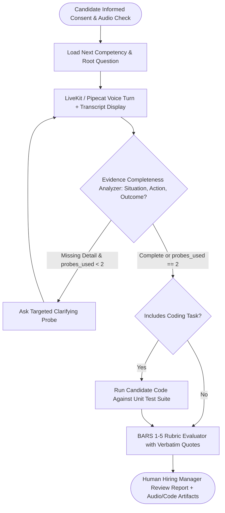

## Introduction

To build an AI interviewer that conducts structured technical or behavioural interviews and produces reliable, legally defensible candidate evaluations, you must replace open-ended LLM impressions with Behaviorally Anchored Rating Scales (BARS), bounded adaptive depth-probing, and deterministic code test-case execution. When an unstructured LLM conducts an interview, it often asks leading questions, penalises non-native speech disfluencies (*"um"*, pauses, regional accents), or exhibits recency bias. By structuring the interview as a finite state machine—where each competency has a standardized root question, up to 2 adaptive follow-up probes triggered only when specific rubric evidence is missing, and a 1-to-5 BARS rubric anchored to explicit behavioural indicators—you achieve high inter-rater reliability and fairness.

> [!TIP]
> **Architecture Reference:** Internal Link Suggestion: Connect this structured interview pipeline with [Article 5: How to Build an AI Recruitment Agent That Screens Resumes and Shortlists Candidates and [Article 17: How to Build an AI Phone Receptionist ](/writing/build-ai-recruitment-agent-resume-screening/](/writing/build-ai-phone-receptionist-twilio-voice-calls/)).

## Structured Interview Workflow & BARS Evaluation Architecture



### Bias Mitigation, Candidate Consent & Evaluation Reliability

1. Mandatory Informed Consent & Accommodations: Before recording a single audio frame, display a clear disclosure explaining how the AI interviewer operates, what competencies are evaluated, that a human hiring manager reviews all transcripts and scores, and provide a one-click option to request a traditional human interview or accessibility accommodation (e.g., extended response time or text-only mode).
1. Acoustic & Accent Fairness: Evaluate strictly on the semantic content of the transcript and executed code test cases—never on speech rate, pitch, filler word frequency, or accent. Show the live transcript on screen so the candidate can see and correct any ASR misrecognition of technical terms (*"idempotency"*, *"PostgreSQL"*).
1. Measuring Evaluation Reliability (Cohen's Quadratic Weighted Kappa $\kappa_w$): Validate your BARS evaluator against a benchmark set of 50 human-graded interview transcripts and require Quadratic Weighted Kappa $\kappa_w \ge 0.75$ before production deployment.

## Technology Comparison: Paid vs. Open-Source Stack

| Component | Commercial Platform | Open-Source / Custom Stack | Self-Hosting Possible? | Technical & Compliance Notes |
| --- | --- | --- | --- | --- |
| Voice & WebRTC Session | Karat / HireVue / Micro1 | LiveKit Agents (https://github.com/livekit/agents) (Apache-2.0) or Pipecat (https://github.com/pipecat-ai/pipecat) (BSD-2) | Yes | Use generous endpointing silence thresholds (1.2s–1.8s) so candidates can pause and think without being cut off. |
| Speech-to-Text | Deepgram Nova-3 (https://deepgram.com/pricing) with Keyterm Prompting | Faster-Whisper (https://github.com/SYSTRAN/faster-whisper) (MIT) | Yes | Always boost technical vocabulary (keyterm: Kubernetes, idempotent, Big-O) so domain jargon is transcribed accurately. |
| Rubric & Probe Orchestration | Managed LLM APIs (gpt-4.1 / Claude) | LangGraph (https://github.com/langchain-ai/langgraph) (MIT) + Ollama (https://github.com/ollama/ollama) (Qwen2.5-32B) | Yes | Run evaluation at temperature=0.0 with explicit BARS level descriptions. |

### Recommended Implementation Options

### Option A: Best Practical Implementation (Recommended): LiveKit Agents (https://github.com/livekit/agents) WebRTC + Deepgram Nova-3 with technical keyterms + LangGraph (https://github.com/langchain-ai/langgraph) competency state machine + OpenAI Structured BARS Evaluator + isolated pytest code runner.

### Option B: Fully Open-Source Self-Hosted Implementation: Pipecat (https://github.com/pipecat-ai/pipecat) + Faster-Whisper (https://github.com/SYSTRAN/faster-whisper) + local Ollama (https://github.com/ollama/ollama) (qwen2.5:32b) + Dockerized code runner.

### Option C: Enterprise Assessment Platform: Multi-region WebRTC rooms + Monaco code editor sync + Quadratic Weighted Kappa calibration dashboard.

## Step-by-Step Implementation Guide

### Step 1: Project Structure

```text
ai-interviewer/
├── app/
│   ├── __init__.py
│   ├── bars_rubric.py
│   └── reliability_metrics.py
├── tests/
│   └── test_interviewer.py
└── requirements.txt
```

### Step 2: Implement Adaptive Probe Logic & BARS Rubric Schemas (app/bars_rubric.py)

```python
from typing import Dict, List, Optional
from pydantic import BaseModel, Field

class CompetencyBARSRubric(BaseModel):
    competency_id: str
    competency_name: str
    root_question: str
    max_probes: int = 2
    anchor_level_1_unsatisfactory: str
    anchor_level_3_proficient: str
    anchor_level_5_exceptional: str

class ProbeDecision(BaseModel):
    has_specific_example: bool
    has_technical_tradeoffs: bool
    has_measurable_outcome: bool
    should_ask_probe: bool
    next_probe_question: Optional[str] = None

def decide_deterministic_probe_gate(
    probes_already_asked: int,
    max_probes: int,
    has_specific_example: bool,
    has_technical_tradeoffs: bool,
    has_measurable_outcome: bool,
) -> Tuple[bool, str]:
    """Deterministically decides whether to ask a follow-up probe or advance to the next competency."""
    if probes_already_asked >= max_probes:
        return False, "MAX_PROBES_REACHED"
    if not has_specific_example:
        return True, "MISSING_CONCRETE_EXAMPLE"
    if not has_technical_tradeoffs:
        return True, "MISSING_TECHNICAL_TRADEOFFS"
    if not has_measurable_outcome:
        return True, "MISSING_MEASURABLE_OUTCOME"
    return False, "EVIDENCE_COMPLETE"

class CompetencyScoreCard(BaseModel):
    competency_id: str
    bars_score: int = Field(..., ge=1, le=5)
    verbatim_candidate_quotes: List[str] = Field(..., min_length=1)
    matched_anchor_rationale: str
    coding_tests_passed: Optional[int] = None
    coding_tests_total: Optional[int] = None
```

### Step 3: Implement Quadratic Weighted Kappa ($\kappa_w$) for Evaluation Reliability (app/reliability_metrics.py)

To verify that your AI BARS evaluator agrees with human senior engineers across 1-to-5 ordinal scores, compute Quadratic Weighted Cohen's Kappa ($\kappa_w$):

```python
from typing import List

def compute_quadratic_weighted_kappa(
    human_scores: List[int],
    ai_scores: List[int],
    min_rating: int = 1,
    max_rating: int = 5,
) -> float:
    """Computes Quadratic Weighted Cohen's Kappa between human and AI ordinal 1-5 rubric ratings."""
    if len(human_scores) != len(ai_scores) or len(human_scores) == 0:
        raise ValueError("Score lists must be non-empty and of equal length.")

    num_classes = max_rating - min_rating + 1
    n = float(len(human_scores))

    # Observed confusion matrix O and marginal histograms
    obs = [[0.0] * num_classes for _ in range(num_classes)]
    hist_h = [0.0] * num_classes
    hist_a = [0.0] * num_classes

    for h, a in zip(human_scores, ai_scores):
        i = h - min_rating
        j = a - min_rating
        obs[i][j] += 1.0
        hist_h[i] += 1.0
        hist_a[j] += 1.0

    num = 0.0
    den = 0.0
    for i in range(num_classes):
        for j in range(num_classes):
            weight = float((i - j) ** 2) / float((num_classes - 1) ** 2)
            expected_ij = (hist_h[i] * hist_a[j]) / n
            num += weight * (obs[i][j] / n)
            den += weight * (expected_ij / n)

    if den == 0.0:
        return 1.0
    return round(1.0 - (num / den), 4)
```

## Testing the AI Interviewer (tests/test_interviewer.py)

```python
from app.bars_rubric import decide_deterministic_probe_gate
from app.reliability_metrics import compute_quadratic_weighted_kappa

def test_adaptive_probe_gate_stops_at_max_probes_or_complete_evidence():
    should_probe, reason = decide_deterministic_probe_gate(
        probes_already_asked=0,
        max_probes=2,
        has_specific_example=True,
        has_technical_tradeoffs=False,
        has_measurable_outcome=True,
    )
    assert should_probe is True
    assert reason == "MISSING_TECHNICAL_TRADEOFFS"

    capped, cap_reason = decide_deterministic_probe_gate(
        probes_already_asked=2,
        max_probes=2,
        has_specific_example=False,
        has_technical_tradeoffs=False,
        has_measurable_outcome=False,
    )
    assert capped is False
    assert cap_reason == "MAX_PROBES_REACHED"

def test_quadratic_weighted_kappa_reliability():
    human = [5, 4, 3, 2, 1, 4, 5, 3]
    ai_good = [5, 4, 3, 2, 1, 4, 4, 3]
    kappa = compute_quadratic_weighted_kappa(human, ai_good)
    assert kappa > 0.90
```

## Human Oversight & Cost Considerations

- Never Auto-Reject Without Human Oversight: Present the CompetencyScoreCard alongside the playable audio timestamps, verbatim candidate quotes, and unit-test execution logs to the human hiring panel.
- Cost Breakdown: A 30-minute voice + coding interview costs \~\$0.55–$0.85 per interview all-in (WebRTC + Deepgram Nova-3 STT + LLM probe/rubric scoring + streaming TTS).

## Useful Tools, Documentation and GitHub Repositories

| Resource | Purpose | Type | Link |
| --- | --- | --- | --- |
| LiveKit Agents | Real-time WebRTC interview rooms & turn detection | Open-Source (Apache-2.0) | https://github.com/livekit/agents |
| LangGraph | Competency state machine and probe tracking | Open-Source (MIT) | https://github.com/langchain-ai/langgraph |
| Faster-Whisper | Local speech recognition for candidate responses | Open-Source (MIT) | https://github.com/SYSTRAN/faster-whisper |

## Frequently Asked Questions

### Why use Behaviorally Anchored Rating Scales (BARS) instead of asking the LLM for a 1–100 score?

A 1–100 scale has arbitrary granularity—an LLM cannot meaningfully distinguish a "73" from a "76". A 1–5 BARS rubric defines explicit observable engineering behaviors for Level 1 (cannot explain basic indexing), Level 3 (designs standard B-tree indexes and explains read/write trade-offs), and Level 5 (diagnoses lock contention, partitioning, and HNSW recall tuning in production).

### How do I prevent the voice AI from cutting off a candidate who is pausing to think through a system design question?

Configure a longer VAD endpointing silence threshold (min_endpointing_delay=1.5 seconds) during interview sessions compared to customer support calls (0.5s), and allow candidates to hold a "Push to Think / Mute" key.

### What if the speech-to-text model mishears a technical term like `idempotency` as `item potency`?

Pass a domain keyterm list to the STT engine and instruct the BARS evaluator prompt to account for phonetic ASR homophones of technical terms, while displaying the live transcript so the candidate can clarify.

### How many follow-up probes should the AI ask per question?

Cap follow-up probes at 2 per competency (`max_probes=2`) so a single question never consumes the entire 30-minute interview slot.

### How should technical coding assessments be graded inside an AI interview?

Run the candidate's submitted code against deterministic unit tests (checking correctness, edge cases, and execution time) and use the LLM only to evaluate code readability, complexity explanation, and debugging process.

### What is a good Quadratic Weighted Kappa ($\kappa_w$) threshold before deploying an AI interviewer?

Industrial-organizational psychology standards recommend $\kappa_w \ge 0.75$ between the automated rubric scorer and calibrated human domain experts.

### Should an AI interviewer analyse facial expressions or eye tracking via webcam?

No. Affective webcam analysis (scoring "confidence" from facial micro-expressions or eye movement) lacks scientific validity, discriminates against neurodivergent candidates, and is restricted or banned under the EU AI Act and Illinois AIVIA.

### How do I detect if a candidate is reading verbatim from another AI screen during a remote interview?

Ask adaptive follow-up probes grounded in the candidate's specific design choices (*"In line 14 of your code, why did you choose a min-heap over quickselect if* $K$ *is fixed at 3?"*); real-time architectural trade-off probing naturally distinguishes genuine understanding from scripted reading.
