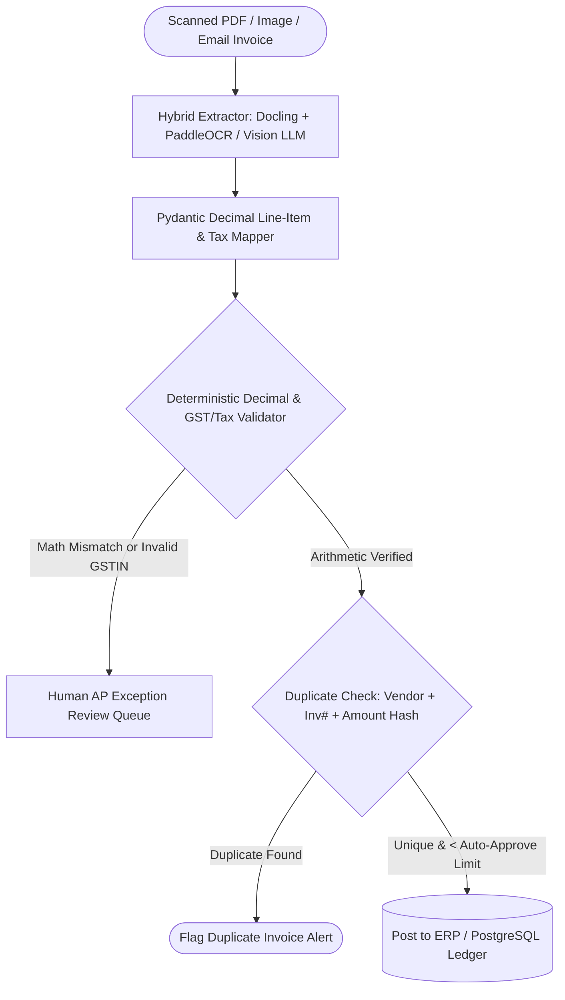

## Introduction

To build an AI invoice processing agent ready for Accounts Payable (AP) production, you must combine multilingual OCR and Vision-Language extraction with exact `decimal.Decimal` arithmetic validation, tax ID checksum verification (such as India's 15-character GSTIN or EU VAT), and composite duplicate detection. Never use standard IEEE 754 binary float types (0.1 + 0.2 == 0.30000000000000004) for invoice line items, and never post an extracted invoice directly to an ERP ledger without verifying that $\sum (\text{Quantity} \times \text{Unit Price}) + \text{Tax} = \text{Grand Total}$.

> [!TIP]
> **Architecture Reference:** Internal Link Suggestion: On Aniket.app (https://aniket.app/), see the [Invoice OCR Extractor](/projects/invoice-ocr/) system in the project directory, and cross-reference [Article 8: How to Build an AI Financial Analyst ](/writing/build-ai-financial-analyst-annual-reports-sec/).

## Invoice Ingestion, OCR & Arithmetic Validation Architecture



### Why decimal.Decimal and Composite Duplicate Keys Are Mandatory

1. Exact Base-10 Monetary Math: Financial ledgers require decimal.Decimal quantized to 0.01 with ROUND_HALF_UP. If an OCR engine misreads an 8 as a 3 on a line item, the deterministic check $\sum \text{Line Totals} == \text{Subtotal}$ immediately catches the discrepancy and routes the invoice to a human AP clerk.
1. Fuzzy & Exact Duplicate Detection: Scammers or vendors sometimes resubmit the same invoice with a leading zero (INV-0042 vs INV-42). Normalize the invoice number by stripping non-alphanumeric characters and leading zeros (re.sub(r"^0+", "", re.sub(r"[^A-Z0-9]", "", inv_no.upper()))) and enforce a unique composite index on (vendor_tax_id, normalized_invoice_number).

## Technology Comparison: Paid vs. Open-Source Stack

| Component | Commercial / Managed Service | Open-Source Alternative | Self-Hosting Possible? | Technical & Version Notes |
| --- | --- | --- | --- | --- |
| OCR Engine | AWS Textract / Google Document AI / Azure Invoice | PaddleOCR (https://www.paddleocr.ai/main/en/index.html) (Apache-2.0, 80+ languages) + Docling (https://github.com/docling-project/docling) (MIT) | Yes | Per PaddleOCR 3.x docs (https://www.paddleocr.ai/main/en/index.html), note that PaddleOCR 3.x introduced interface updates compared to 2.x; match your wrapper to the installed major version. |
| Structured Extraction LLM | OpenAI (gpt-4o-mini / gpt-4.1) | Ollama (https://github.com/ollama/ollama) (Qwen2.5-VL-7B / Qwen2.5-VL-32B) | Yes | Vision-Language Models (Qwen2.5-VL) read skewed thermal receipts and multi-column invoices directly without brittle regex templates. |
| ERP / Accounting Sync | QuickBooks / Xero / SAP Business One API | ERPNext (GPL-3.0) / Odoo Community (LGPL-3.0) | Yes | Always post new invoices as Draft bills requiring controller sign-off above a threshold (e.g., >$2,500). |

### Recommended Implementation Options

### Option A: Best Practical Implementation (Recommended): Python 3.12 + Docling (https://github.com/docling-project/docling) / PaddleOCR (https://www.paddleocr.ai/main/en/index.html) + Vision LLM structured extraction + Python Decimal arithmetic & GSTIN validator + PostgreSQL duplicate registry.

### Option B: Fully Open-Source On-Premise Stack: PaddleOCR (https://www.paddleocr.ai/main/en/index.html) + local Qwen2.5-VL via Ollama (https://github.com/ollama/ollama) + PostgreSQL + ERPNext REST API.

### Option C: Production High-Volume AP Pipeline: FastAPI + S3 immutable audit archive + Celery OCR workers + 3-way Purchase Order (PO) matching engine.

## Step-by-Step Implementation Guide

### Step 1: Project Structure

```text
ai-invoice-agent/
├── app/
│   ├── __init__.py
│   ├── invoice_validator.py
│   └── dedupe_store.py
├── tests/
│   └── test_invoice_agent.py
└── requirements.txt
```

### Step 2: Implement Exact Decimal Invoice & GSTIN Validation (app/invoice_validator.py)

```python
import re
from decimal import Decimal, ROUND_HALF_UP
from typing import List, Optional
from pydantic import BaseModel, Field, model_validator

GSTIN_REGEX = re.compile(r"^[0-9]{2}[A-Z]{5}[0-9]{4}[A-Z]{1}[1-9A-Z]{1}Z[0-9A-Z]{1}$")

def q2(val: Decimal) -> Decimal:
    return val.quantize(Decimal("0.01"), rounding=ROUND_HALF_UP)

class InvoiceLineItem(BaseModel):
    description: str
    quantity: Decimal = Field(..., gt=Decimal("0"))
    unit_price: Decimal = Field(..., ge=Decimal("0"))
    line_total: Decimal

    @model_validator(mode="after")
    def check_line_math(self) -> "InvoiceLineItem":
        expected = q2(self.quantity * self.unit_price)
        actual = q2(self.line_total)
        if abs(expected - actual) > Decimal("0.02"):
            raise ValueError(
                f"Line item math error for '{self.description}': "
                f"{self.quantity} * {self.unit_price} = {expected}, but extracted line_total is {actual}"
            )
        return self

class ExtractedInvoice(BaseModel):
    vendor_name: str
    vendor_tax_id: str = Field(..., description="Vendor GSTIN, VAT, or EIN")
    invoice_number: str
    invoice_date_iso: str
    currency: str = "INR"
    line_items: List[InvoiceLineItem] = Field(..., min_length=1)
    subtotal: Decimal
    cgst_amount: Decimal = Decimal("0.00")
    sgst_amount: Decimal = Decimal("0.00")
    igst_amount: Decimal = Decimal("0.00")
    total_tax_amount: Decimal
    grand_total: Decimal

    @model_validator(mode="after")
    def verify_invoice_arithmetic_and_tax(self) -> "ExtractedInvoice":
        if self.currency == "INR" and not GSTIN_REGEX.match(self.vendor_tax_id.strip().upper()):
            raise ValueError(f"Invalid Indian GSTIN format: {self.vendor_tax_id}")

        sum_lines = q2(sum((item.line_total for item in self.line_items), Decimal("0.00")))
        if abs(sum_lines - q2(self.subtotal)) > Decimal("0.05"):
            raise ValueError(f"Subtotal mismatch: sum of lines ({sum_lines}) != subtotal ({self.subtotal})")

        component_tax = q2(self.cgst_amount + self.sgst_amount + self.igst_amount)
        if component_tax > Decimal("0.00") and abs(component_tax - q2(self.total_tax_amount)) > Decimal("0.05"):
            raise ValueError(f"GST component sum ({component_tax}) != total_tax_amount ({self.total_tax_amount})")

        expected_grand = q2(self.subtotal + self.total_tax_amount)
        if abs(expected_grand - q2(self.grand_total)) > Decimal("0.05"):
            raise ValueError(
                f"Grand total mismatch: subtotal ({self.subtotal}) + tax ({self.total_tax_amount}) "
                f"= {expected_grand} != grand_total ({self.grand_total})"
            )
        return self

def normalize_invoice_key(vendor_tax_id: str, invoice_number: str) -> str:
    """Normalizes invoice number to catch 'INV-0042' vs 'INV42' duplicates."""
    clean_tax = re.sub(r"[^A-Z0-9]", "", vendor_tax_id.upper())
    clean_inv = re.sub(r"[^A-Z0-9]", "", invoice_number.upper()).lstrip("0")
    return f"{clean_tax}::{clean_inv or '0'}"
```

## Testing the Invoice Processing Agent (tests/test_invoice_agent.py)

```python
from decimal import Decimal
import pytest
from app.invoice_validator import InvoiceLineItem, ExtractedInvoice, normalize_invoice_key

def test_valid_gst_invoice_passes_decimal_checks():
    inv = ExtractedInvoice(
        vendor_name="Cloud Infra Pvt Ltd",
        vendor_tax_id="07AABCU9603R1ZP",
        invoice_number="INV-00984",
        invoice_date_iso="2026-10-15",
        currency="INR",
        line_items=[
            InvoiceLineItem(description="GPU Node Rental", quantity=Decimal("2"), unit_price=Decimal("15000.00"), line_total=Decimal("30000.00")),
            InvoiceLineItem(description="Block Storage", quantity=Decimal("1"), unit_price=Decimal("5000.00"), line_total=Decimal("5000.00")),
        ],
        subtotal=Decimal("35000.00"),
        cgst_amount=Decimal("3150.00"),
        sgst_amount=Decimal("3150.00"),
        total_tax_amount=Decimal("6300.00"),
        grand_total=Decimal("41300.00"),
    )
    assert inv.grand_total == Decimal("41300.00")

def test_tampered_or_misread_line_item_raises_error():
    with pytest.raises(ValueError, match="Line item math error"):
        InvoiceLineItem(
            description="Server Rack",
            quantity=Decimal("3"),
            unit_price=Decimal("1000.00"),
            line_total=Decimal("3800.00"),  # OCR misread 3000 as 3800
        )

def test_duplicate_invoice_key_normalization():
    k1 = normalize_invoice_key("07AABCU9603R1ZP", "INV-00042")
    k2 = normalize_invoice_key("07aabcu9603r1zp", "inv/42")
    assert k1 == k2
```

## Approval Workflows, Security & Cost Considerations

- Approval Routing Thresholds: Invoices that pass all arithmetic and duplicate checks and match an approved Purchase Order (<= $1,000) can auto-stage as approved bills; invoices with any ValueError math discrepancy or totals > $1,000 route to the AP supervisor queue with the exact failing line highlighted.
- Cost Breakdown: PaddleOCR (https://www.paddleocr.ai/main/en/index.html) and Docling (https://github.com/docling-project/docling) are free open-source tools (and PaddleOCR also offers a free API tier supporting up to 20,000 pages/day per PaddleOCR Docs (https://www.paddleocr.ai/main/en/index.html)). Structured LLM mapping costs \~\$0.002 per invoice or \$0 locally with Qwen2.5-VL.

## Useful Tools, Documentation and GitHub Repositories

| Resource | Purpose | Type | Link |
| --- | --- | --- | --- |
| PaddleOCR Documentation | Multilingual OCR toolkit supporting 80+ languages | Open-Source (Apache-2.0) | https://www.paddleocr.ai/main/en/index.html |
| Docling | Structured PDF table and document parser | Open-Source (MIT) | https://github.com/docling-project/docling |
| Unstructured PaddleOCR | Pipeline integration for PDF to text with PaddleOCR | Open-Source (Apache-2.0) | https://github.com/Unstructured-IO/pipeline-paddleocr |

## Frequently Asked Questions

### Why must I use `decimal.Decimal` instead of `float` for invoice validation?

Binary floating-point numbers cannot represent base-10 fractions like 0.10 or 0.01 exactly, producing false-positive cent discrepancies when summing dozens of invoice line items. Decimal performs exact base-10 arithmetic matching accounting ledgers.

### What happens when an invoice has a 1-cent rounding difference on tax calculations?

Different ERP systems round tax either per line item or on the subtotal. Our validator applies a Decimal("0.05") tolerance on subtotal/tax reconciliation so legitimate 1–2 cent vendor rounding conventions do not trigger false failures, while genuine OCR misreads ($300 vs $800) are caught immediately.

### How do I prevent a vendor from being paid twice if they resend an invoice with a slightly modified invoice number?

Normalize the invoice number (normalize_invoice_key) by stripping punctuation and leading zeros, and also flag any second invoice from the same vendor_tax_id with the exact same grand_total and invoice_date_iso.

### How do I validate Indian GST invoices specifically?

Verify the 15-character GSTIN format (^[0-9]{2}[A-Z]{5}[0-9]{4}[A-Z]{1}[1-9A-Z]{1}Z[0-9A-Z]{1}$), verify that intra-state supplies split tax equally into CGST + SGST, and inter-state supplies charge IGST.

### What is 3-Way Matching in invoice automation?

3-Way Matching verifies that the Invoice line items and prices match both the approved Purchase Order (PO) and the warehouse Goods Receipt Note (GRN) before scheduling payment.

### Can this agent extract data from skewed smartphone photos of paper receipts?

Yes; pair PaddleOCR (https://www.paddleocr.ai/main/en/index.html)'s text angle classification with a Vision-Language Model (Qwen2.5-VL or gpt-4o-mini) to extract structured fields from skewed or crumpled thermal receipts.

### How should original invoice PDFs be stored for tax audits?

Store the original PDF in an immutable S3/MinIO bucket with Object Lock (WORM — Write Once, Read Many) for the statutory tax retention period (7–8 years) linked by SHA-256 hash to the database ledger row.

### Is PaddleOCR 3.x backward-compatible with older PaddleOCR 2.x tutorial code?

No. As noted in the official PaddleOCR Documentation (https://www.paddleocr.ai/main/en/index.html), PaddleOCR 3.x introduced breaking interface changes compared to 2.x; always pin your package version in requirements.txt and match the 3.x API reference.
