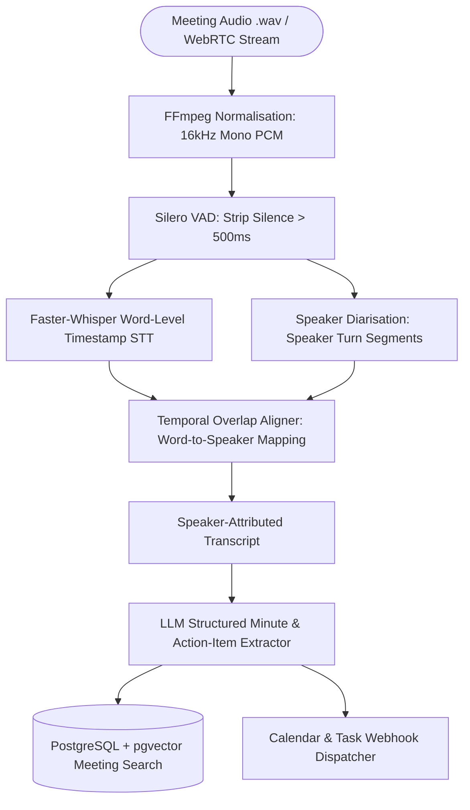

## Introduction

To build an AI meeting assistant that accurately attributes decisions and tracks action items across multi-speaker calls, you must combine Speech-to-Text (STT) word-level timestamps with Speaker Diarisation ("who spoke when") before passing the aligned transcript to an LLM. A raw, unlabelled transcript blends the client's objections with the account manager's commitments, causing the LLM to assign action items to the wrong person. By combining Faster-Whisper (https://github.com/SYSTRAN/faster-whisper) (or Deepgram Nova-3) with speaker diarisation, Silero Voice Activity Detection (VAD), and structured Pydantic extraction, you can build a privacy-first meeting assistant that produces speaker-attributed minutes, assigns tasks with deadlines, and syncs follow-ups to Google Calendar or project trackers.

> [!TIP]
> **Architecture Reference:** Internal Link Suggestion: Connect this pipeline with [Article 14: How to Build an AI Project Management Assistant That Tracks Tasks and Deadlines and [Article 18: How to Build a Multilingual AI Voice Assistant ](/writing/build-ai-project-management-assistant-task-tracking/](/writing/build-multilingual-ai-voice-assistant-hindi-english/)).

## Audio Capture, Speech-to-Text, and Speaker Diarisation Architecture

An engineering-grade meeting assistant handles two distinct ingestion modes:

1. Post-Meeting Recording Ingestion (Batch Mode): Ingests .mp3, .wav, or .mp4 recordings from Zoom, Google Meet, Microsoft Teams, or local microphone capture. Batch mode achieves the highest word accuracy and speaker clustering precision because the diarisation model sees the global acoustic clusters of the entire recording.
1. Real-Time Streaming Ingestion (Live Mode): Captures 16kHz 16-bit mono PCM audio frames over WebSockets or WebRTC (via LiveKit Agents (https://github.com/livekit/agents) or Pipecat (https://github.com/pipecat-ai/pipecat)), runs streaming VAD chunking, and emits rolling partial transcripts every 2–3 seconds.



### How Word-to-Speaker Temporal Alignment Works

Whisper outputs word segments [t_start, t_end, word], while a diarisation model (such as pyannote.audio or WhisperX (https://www.google.com/search?q=https://github.com/m-bain/whisperX)) outputs speaker turn intervals [s_start, s_end, SPEAKER_01]. To merge them deterministically, your aligner calculates the temporal intersection $\max(0, \min(t_{\text{end}}, s_{\text{end}}) - \max(t_{\text{start}}, s_{\text{start}}))$ for every word and assigns the speaker with the maximum overlap.

## Technology Comparison: Paid vs. Open-Source Stack

| Component | Commercial / Managed API | Open-Source / Open-Weight Alternative | Self-Hosting Possible? | Technical & Production Limitations |
| --- | --- | --- | --- | --- |
| Speech-to-Text (STT) | Deepgram Nova-3 (https://deepgram.com/pricing) (\$0.0077/min) or OpenAI Audio API | Faster-Whisper (https://github.com/SYSTRAN/faster-whisper) (MIT, CTranslate2 large-v3 / distil-large-v3) | Yes (CPU INT8 or NVIDIA GPU FP16) | per Faster-Whisper benchmarks (https://github.com/SYSTRAN/faster-whisper), 13 min of audio takes 16s on an RTX 3070 Ti (INT8 batch_size=8) or 51s on an 8-thread CPU (small INT8). |
| Speaker Diarisation | Deepgram Diarisation Add-on (\$0.0020/min) | WhisperX (https://www.google.com/search?q=https://github.com/m-bain/whisperX) (BSD-4-Clause) / pyannote-audio (MIT) | Yes | Overlapping cross-talk remains challenging; requires clean 16kHz audio. |
| Voice Activity Detection | Managed endpointing | Silero VAD (https://www.google.com/search?q=https://github.com/snakers4/silero-vad) (MIT, built into faster-whisper) | Yes | Removes long silences (vad_filter=True) to prevent Whisper hallucination loops on background noise. |
| Summarisation & Action LLM | OpenAI (gpt-4o-mini) / Claude | Ollama (https://github.com/ollama/ollama) (Llama-3.3-70B / Qwen2.5-32B) | Yes | A 60-minute meeting produces \~8,000–12,000 transcript tokens; ensure context window >=16k. |

### Recommended Implementation Options

### Option A: Best Practical Implementation (Recommended): Python 3.12 + Faster-Whisper (https://github.com/SYSTRAN/faster-whisper) (distil-large-v3 or turbo with vad_filter=True and word_timestamps=True) + temporal speaker alignment + OpenAI Structured Outputs + PostgreSQL/pgvector (https://github.com/pgvector/pgvector).

### Option B: Fully Open-Source Local Implementation: Faster-Whisper (https://github.com/SYSTRAN/faster-whisper) + pyannote.audio + local Ollama (https://github.com/ollama/ollama) (qwen2.5:14b) + PostgreSQL. Ideal for confidential board, legal, or healthcare meetings where audio cannot leave on-premise servers.

### Option C: Production High-Concurrency Cloud Implementation: Deepgram Pre-recorded Nova-3 API with native diarize=true (\$0.0077/min + $0.0020/min diarisation, checked Oct 30, 2026 at Deepgram Pricing (https://deepgram.com/pricing)) + FastAPI webhook workers + PostgreSQL.

## Step-by-Step Implementation Guide

### Step 1: Project Structure

```text
ai-meeting-assistant/
├── app/
│   ├── __init__.py
│   ├── aligner.py
│   ├── transcriber.py
│   └── extractor.py
├── tests/
│   └── test_meeting_assistant.py
└── requirements.txt
```

### Step 2: Install Dependencies

```bash
pip install faster-whisper==1.2.1 pydantic==2.9.2 openai==1.51.0 pytest==8.3.3
```

### Step 3: Implement the Temporal Word-to-Speaker Aligner (app/aligner.py)

```python
from typing import List
from pydantic import BaseModel, Field

class WordSegment(BaseModel):
    start: float
    end: float
    word: str

class SpeakerTurn(BaseModel):
    start: float
    end: float
    speaker: str

class Utterance(BaseModel):
    speaker: str
    start: float
    end: float
    text: str

def align_words_with_speakers(
    words: List[WordSegment],
    speaker_turns: List[SpeakerTurn],
) -> List[Utterance]:
    """Assigns each transcribed word to the speaker turn with maximum temporal overlap and merges consecutive turns."""
    if not words:
        return []

    assigned_words = []
    for w in words:
        best_speaker = "SPEAKER_UNKNOWN"
        max_overlap = 0.0
        w_mid = (w.start + w.end) / 2.0

        for turn in speaker_turns:
            overlap = max(0.0, min(w.end, turn.end) - max(w.start, turn.start))
            if overlap > max_overlap:
                max_overlap = overlap
                best_speaker = turn.speaker
            elif max_overlap == 0.0 and turn.start <= w_mid <= turn.end:
                best_speaker = turn.speaker

        assigned_words.append((best_speaker, w))

    # Merge contiguous words spoken by the same speaker into utterances
    utterances: List[Utterance] = []
    curr_speaker, first_w = assigned_words[0]
    curr_start = first_w.start
    curr_end = first_w.end
    curr_tokens = [first_w.word.strip()]

    for speaker, w in assigned_words[1:]:
        if speaker == curr_speaker:
            curr_end = w.end
            curr_tokens.append(w.word.strip())
        else:
            utterances.append(
                Utterance(
                    speaker=curr_speaker,
                    start=round(curr_start, 2),
                    end=round(curr_end, 2),
                    text=" ".join(curr_tokens),
                )
            )
            curr_speaker = speaker
            curr_start = w.start
            curr_end = w.end
            curr_tokens = [w.word.strip()]

    utterances.append(
        Utterance(
            speaker=curr_speaker,
            start=round(curr_start, 2),
            end=round(curr_end, 2),
            text=" ".join(curr_tokens),
        )
    )
    return utterances
```

### Step 4: Implement Faster-Whisper Transcription with Silero VAD (app/transcriber.py)

```python
from typing import List
from faster_whisper import WhisperModel
from app.aligner import WordSegment

class LocalWhisperTranscriber:
    def __init__(self, model_size: str = "base", device: str = "cpu", compute_type: str = "int8"):
        self.model = WhisperModel(model_size, device=device, compute_type=compute_type)

    def transcribe_words(self, audio_path: str) -> List[WordSegment]:
        """Transcribes audio with Silero VAD filtering and word-level timestamps."""
        segments, _info = self.model.transcribe(
            audio_path,
            beam_size=5,
            word_timestamps=True,
            vad_filter=True,
            vad_parameters=dict(min_silence_duration_ms=500),
        )
        words: List[WordSegment] = []
        for seg in segments:
            if seg.words:
                for w in seg.words:
                    words.append(WordSegment(start=w.start, end=w.end, word=w.word))
        return words
```

### Step 5: Structured Action-Item and Decision Extraction (app/extractor.py)

```python
from typing import List, Optional
from pydantic import BaseModel, Field
from openai import AsyncOpenAI
from app.aligner import Utterance

class ActionItem(BaseModel):
    owner: str = Field(..., description="Speaker name or ID responsible for the task.")
    task_description: str = Field(..., description="Concrete action item to complete.")
    due_date_iso: Optional[str] = Field(None, description="ISO-8601 date if mentioned, else None.")
    evidence_timestamp: str = Field(..., description="Start-end timestamp in [MM:SS] where agreed.")

class MeetingNotes(BaseModel):
    executive_summary: str
    key_decisions: List[str]
    action_items: List[ActionItem]
    open_questions: List[str]

def format_transcript_for_llm(utterances: List[Utterance]) -> str:
    lines = []
    for u in utterances:
        lines.append(f"[{u.start:.1f}s - {u.end:.1f}s] {u.speaker}: {u.text}")
    return "\n".join(lines)

async def extract_meeting_notes(
    client: AsyncOpenAI,
    utterances: List[Utterance],
    meeting_date_iso: str,
    model: str = "gpt-4o-mini",
) -> MeetingNotes:
    formatted_text = format_transcript_for_llm(utterances)
    prompt = (
        f"Meeting Reference Date: {meeting_date_iso}\n"
        "Extract an executive summary, key decisions, and speaker-attributed action items from this transcript.\n"
        "Resolve relative dates (like 'next Friday') against the Meeting Reference Date.\n\n"
        f"Transcript:\n{formatted_text}"
    )
    completion = await client.beta.chat.completions.parse(
        model=model,
        messages=[{"role": "user", "content": prompt}],
        response_format=MeetingNotes,
        temperature=0.0,
    )
    return completion.choices[0].message.parsed
```

## Testing the Meeting Aligner (tests/test_meeting_assistant.py)

```python
from app.aligner import WordSegment, SpeakerTurn, align_words_with_speakers

def test_temporal_word_to_speaker_alignment():
    words = [
        WordSegment(start=0.0, end=0.4, word="I"),
        WordSegment(start=0.4, end=0.8, word="will"),
        WordSegment(start=0.8, end=1.5, word="deploy"),
        WordSegment(start=2.0, end=2.5, word="Sounds"),
        WordSegment(start=2.5, end=3.0, word="good."),
    ]
    turns = [
        SpeakerTurn(start=0.0, end=1.6, speaker="Aniket"),
        SpeakerTurn(start=1.9, end=3.2, speaker="Priya"),
    ]
    utterances = align_words_with_speakers(words, turns)
    assert len(utterances) == 2
    assert utterances[0].speaker == "Aniket"
    assert utterances[0].text == "I will deploy"
    assert utterances[1].speaker == "Priya"
    assert utterances[1].text == "Sounds good."
```

## Troubleshooting, Cost & Production Considerations

- Troubleshooting Whisper Hallucinations During Silence: OpenAI Whisper models trained on subtitle data notoriously hallucinate phrases like *"Thank you for watching"* or *"Subtitles by Amara.org"* during long stretches of silence or hold music. Always enable vad_filter=True with min_silence_duration_ms=500 in Faster-Whisper (https://github.com/SYSTRAN/faster-whisper) to strip non-speech intervals before inference.
- Cost Breakdown (Checked October 30, 2026 via [Deepgram Pricing](https://deepgram.com/pricing)):
- Self-Hosted Faster-Whisper + Ollama: \$0 API cost; a single $40/month cloud GPU instance or local workstation transcribes hundreds of hours per month.
- Cloud API (100 hours = 6,000 minutes of meetings/month): Deepgram Nova-3 Monolingual (\$0.0077/min) + Speaker Diarisation add-on ($0.0020/min) = $0.0097/min × 6,000 min = \$58.20/month (with \$200 free starter credit), plus \~$3.00/month for LLM note extraction.

## Useful Tools, Documentation and GitHub Repositories

| Resource | Purpose | Type | Link |
| --- | --- | --- | --- |
| Faster-Whisper | CTranslate2 Whisper inference (4x faster, INT8/FP16) | Open-Source (MIT) | https://github.com/SYSTRAN/faster-whisper |
| WhisperX | Word-level alignment & speaker diarisation pipeline | Open-Source (BSD-4-Clause) | https://www.google.com/search?q=https://github.com/m-bain/whisperX |
| Silero VAD | Pre-trained enterprise Voice Activity Detector | Open-Source (MIT) | https://www.google.com/search?q=https://github.com/snakers4/silero-vad |
| Deepgram Pricing | Official per-second STT and diarisation pricing | Commercial API | https://deepgram.com/pricing |

## Frequently Asked Questions

### How does the assistant know the real names of `SPEAKER_00` and `SPEAKER_01`?

You can map speaker IDs to real names in two ways: (a) pass the calendar invite attendee list into the LLM prompt so it infers names from conversational introductions (*"Hi Aniket, thanks for joining"*), or (b) store a 10-second voiceprint embedding (pyannote/embedding) per team member and compute cosine similarity against each speaker cluster.

### Why does `faster-whisper` appear to finish instantly without returning text if I don't wrap `segments` in `list()`?

In faster-whisper, model.transcribe() returns a Python generator (segments). Inference only executes as you iterate over segments in a for loop or call list(segments).

### Do I need FFmpeg installed on the host OS to use `faster-whisper`?

No. Unlike the original openai-whisper package, Faster-Whisper (https://github.com/SYSTRAN/faster-whisper) decodes audio using PyAV, which bundles FFmpeg libraries directly inside its Python wheel.

### What is the difference between real-time and post-meeting transcription accuracy?

Post-meeting batch processing allows bi-directional acoustic clustering across the entire recording, yielding 15–25% lower Speaker Error Rate (SER) than real-time streaming diarisation. Use real-time streaming only when live in-meeting prompts are required.

### How do I handle legal recording consent in production?

Many jurisdictions (including US two-party consent states and GDPR regions) require explicit participant notification before recording. When joining a call via a bot or recording locally, play an audible announcement or display a consent banner and log participant consent timestamps in PostgreSQL.

### How do I search across 500 past meetings efficiently?

Chunk utterances into 3-minute sliding windows preserving [start_time, end_time, speaker] metadata, embed them into PostgreSQL with pgvector (https://github.com/pgvector/pgvector), and combine semantic cosine search (<=>) with metadata filters on meeting_date and speaker.

### Can I run `faster-whisper` on a CPU without an NVIDIA GPU?

Yes. Initialize WhisperModel("small", device="cpu", compute_type="int8"). Per official Faster-Whisper benchmarks (https://github.com/SYSTRAN/faster-whisper), an 8-thread CPU transcribes 13 minutes of audio in 51 seconds using int8 and batch_size=8.

### How do I stop the LLM from inventing due dates when a speaker only says "next Tuesday"?

Always inject the exact ISO-8601 meeting_date_iso (from the calendar event metadata) into the system prompt so the model calculates deterministic calendar dates relative to when the meeting occurred.
