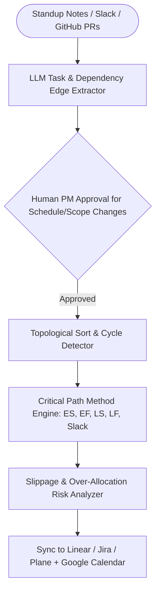

## Introduction

To build an AI project management assistant that genuinely prevents missed deadlines rather than acting as a glorified todo-list wrapper, you must combine unstructured task and deadline extraction (from standup transcripts, Slack threads, and PR descriptions) with a deterministic Directed Acyclic Graph (DAG) Critical Path Engine. LLMs excel at reading a messy engineering update (*"Auth API migration is blocked until the DB schema PR merges; needs 3 more days"*) and turning it into a structured dependency edge, but deterministic graph algorithms are required to detect circular dependencies, propagate cascading slippage across downstream milestones, and identify zero-slack bottlenecks.

> [!TIP]
> **Architecture Reference:** Internal Link Suggestion: Pair this project tracker with [Article 4: How to Build an AI Meeting Assistant That Takes Notes and Tracks Action Items ](/writing/build-ai-meeting-assistant-transcription-action-items/).

## Project Data Architecture & Critical Path Risk Engine



### How the Critical Path Method (CPM) Identifies At-Risk Deadlines

Given a set of tasks where each task $i$ has a duration $D_i$ (in days) and a list of predecessor task IDs:

1. Forward Pass: Compute Earliest Start ($ES_i$) and Earliest Finish ($EF_i = ES_i + D_i$) in topological order, where $ES_i = \max_{p \in \text{preds}(i)} EF_p$.
1. Backward Pass: Starting from the project completion date $T_{\max} = \max_i EF_i$, compute Latest Finish ($LF_i$) and Latest Start ($LS_i = LF_i - D_i$) in reverse topological order.
1. Slack & Critical Path: $\text{Slack}_i = LS_i - ES_i$. Any task with $\text{Slack}_i == 0$ lies on the Critical Path—meaning a 1-day delay in that task delays the entire project release by 1 day.

## Technology Comparison: Paid vs. Open-Source Stack

| Component | Commercial / Managed Platform | Open-Source Alternative | Self-Hosting Possible? | Technical Limitations |
| --- | --- | --- | --- | --- |
| Issue & Project Tracker | Linear / Jira / Asana | Plane (makeplane/plane, AGPL-3.0) / OpenProject / GitHub Issues | Yes | Requires webhook idempotency to avoid infinite update loops when the bot edits an issue. |
| DAG & Graph Engine | Proprietary Gantt Engines | Python graphlib.TopologicalSorter (Standard Library) / networkx (BSD-3) | Yes | Python 3.9+ includes graphlib in the standard library with zero external dependencies. |
| Task Extraction LLM | OpenAI (gpt-4o-mini) / Claude | Ollama (https://github.com/ollama/ollama) (Qwen2.5-14B / Llama-3.3-70B) | Yes | Require structured output mapping task titles to canonical existing task_id keys. |

### Recommended Implementation Options

### Option A: Best Practical Implementation (Recommended): Python 3.12 + graphlib.TopologicalSorter Critical Path engine + OpenAI Structured Outputs + Linear/GitHub Issues/Plane webhooks + PostgreSQL.

### Option B: Fully Open-Source Stack: Self-hosted Plane + FastAPI + graphlib + local Ollama (https://github.com/ollama/ollama) + PostgreSQL.

### Option C: Production Multi-Team Engineering Assistant: FastAPI + Slack/GitHub webhook listeners + human approval interactive cards before mutating sprint deadlines.

## Step-by-Step Implementation Guide

### Step 1: Project Structure

```text
ai-pm-assistant/
├── app/
│   ├── __init__.py
│   └── cpm_scheduler.py
├── tests/
│   └── test_pm_assistant.py
└── requirements.txt
```

### Step 2: Implement the DAG Validator, Critical Path Calculator & Risk Engine (app/cpm_scheduler.py)

```python
from graphlib import TopologicalSorter, CycleError
from typing import List, Dict, Set
from pydantic import BaseModel, Field

class ProjectTask(BaseModel):
    task_id: str
    title: str
    owner: str
    duration_days: int = Field(..., ge=1)
    dependencies: List[str] = Field(default_factory=list, description="Predecessor task_ids")
    is_delayed_by_days: int = Field(0, ge=0)

class ScheduledTaskMetrics(BaseModel):
    task_id: str
    title: str
    owner: str
    effective_duration: int
    earliest_start: int
    earliest_finish: int
    latest_start: int
    latest_finish: int
    slack_days: int
    is_critical_path: bool

class ProjectScheduleReport(BaseModel):
    total_project_duration_days: int
    critical_path_task_ids: List[str]
    overallocated_owners: List[str]
    task_metrics: Dict[str, ScheduledTaskMetrics]

def compute_critical_path_schedule(tasks: List[ProjectTask]) -> ProjectScheduleReport:
    """Validates the project DAG for cycles and computes ES, EF, LS, LF, Slack, and Critical Path."""
    task_map: Dict[str, ProjectTask] = {t.task_id: t for t in tasks}
    graph: Dict[str, Set[str]] = {}

    for t in tasks:
        for dep in t.dependencies:
            if dep not in task_map:
                raise ValueError(f"Task '{t.task_id}' depends on non-existent task '{dep}'.")
        graph[t.task_id] = set(t.dependencies)

    sorter = TopologicalSorter(graph)
    try:
        topo_order = list(sorter.static_order())
    except CycleError as exc:
        raise ValueError(f"Circular task dependency detected in project schedule: {exc}") from exc

    # Forward pass: Earliest Start (ES) and Earliest Finish (EF)
    es: Dict[str, int] = {}
    ef: Dict[str, int] = {}
    eff_dur: Dict[str, int] = {}

    for tid in topo_order:
        t = task_map[tid]
        d = t.duration_days + t.is_delayed_by_days
        eff_dur[tid] = d
        earliest_s = max((ef[p] for p in t.dependencies), default=0)
        es[tid] = earliest_s
        ef[tid] = earliest_s + d

    total_duration = max(ef.values(), default=0)

    # Build successor adjacency list for backward pass
    successors: Dict[str, List[str]] = {tid: [] for tid in topo_order}
    for t in tasks:
        for dep in t.dependencies:
            successors[dep].append(t.task_id)

    # Backward pass: Latest Finish (LF) and Latest Start (LS)
    lf: Dict[str, int] = {}
    ls: Dict[str, int] = {}
    for tid in reversed(topo_order):
        latest_f = min((ls[s] for s in successors[tid]), default=total_duration)
        lf[tid] = latest_f
        ls[tid] = latest_f - eff_dur[tid]

    metrics: Dict[str, ScheduledTaskMetrics] = {}
    critical_ids: List[str] = []
    owner_concurrent_critical: Dict[str, int] = {}

    for tid in topo_order:
        t = task_map[tid]
        slack = ls[tid] - es[tid]
        is_crit = slack == 0
        if is_crit:
            critical_ids.append(tid)
            owner_concurrent_critical[t.owner] = owner_concurrent_critical.get(t.owner, 0) + 1

        metrics[tid] = ScheduledTaskMetrics(
            task_id=tid,
            title=t.title,
            owner=t.owner,
            effective_duration=eff_dur[tid],
            earliest_start=es[tid],
            earliest_finish=ef[tid],
            latest_start=ls[tid],
            latest_finish=lf[tid],
            slack_days=slack,
            is_critical_path=is_crit,
        )

    overallocated = [owner for owner, count in owner_concurrent_critical.items() if count > 2]
    return ProjectScheduleReport(
        total_project_duration_days=total_duration,
        critical_path_task_ids=critical_ids,
        overallocated_owners=overallocated,
        task_metrics=metrics,
    )
```

## Testing the Project Management Assistant (tests/test_pm_assistant.py)

```python
import pytest
from app.cpm_scheduler import ProjectTask, compute_critical_path_schedule

def test_critical_path_and_slack_calculation():
    tasks = [
        ProjectTask(task_id="T1", title="DB Schema Design", owner="Aniket", duration_days=3, dependencies=[]),
        ProjectTask(task_id="T2", title="Backend API", owner="Aniket", duration_days=5, dependencies=["T1"]),
        ProjectTask(task_id="T3", title="UI Wireframes", owner="Meera", duration_days=2, dependencies=["T1"]),
        ProjectTask(task_id="T4", title="Integration Tests", owner="Rohan", duration_days=2, dependencies=["T2", "T3"]),
    ]
    report = compute_critical_path_schedule(tasks)
    assert report.total_project_duration_days == 10  # T1(3) + T2(5) + T4(2) = 10
    assert report.critical_path_task_ids == ["T1", "T2", "T4"]
    assert report.task_metrics["T3"].slack_days == 3  # UI Wireframes has 3 days of float/slack

def test_circular_dependency_rejected():
    cyclic_tasks = [
        ProjectTask(task_id="A", title="Task A", owner="Dev1", duration_days=2, dependencies=["B"]),
        ProjectTask(task_id="B", title="Task B", owner="Dev2", duration_days=2, dependencies=["A"]),
    ]
    with pytest.raises(ValueError, match="Circular task dependency"):
        compute_critical_path_schedule(cyclic_tasks)
```

## Human Approval, Deployment & Cost Considerations

- Human Approval Before Mutating Deadlines: When the assistant detects that a standup update implies a 3-day slippage on T2, it computes the downstream impact via compute_critical_path_schedule and posts a proposed schedule diff (*"Delaying T2 by 3 days pushes T4 and the release milestone from Nov 12 to Nov 15. Approve update?"*) rather than silently rewriting sprint due dates.
- Cost Breakdown: Running daily standup extraction and DAG critical path recalculations for a 25-person engineering team costs <\$1.50/month in LLM API calls or \$0 with local Ollama (https://github.com/ollama/ollama).

## Useful Tools, Documentation and GitHub Repositories

| Resource | Purpose | Type | Link |
| --- | --- | --- | --- |
| Python `graphlib` Docs | Standard library topological sort and cycle detection | Documentation | https://www.google.com/search?q=https://docs.python.org/3/library/graphlib.html |
| LangGraph | Stateful workflow & human-in-the-loop approval state | Open-Source (MIT) | https://github.com/langchain-ai/langgraph |
| FastAPI | Webhook listener for GitHub/Linear/Jira events | Open-Source (MIT) | https://www.google.com/search?q=https://github.com/fastapi/fastapi |

## Frequently Asked Questions

### Why do I need a Critical Path Method (CPM) engine if I already have an LLM?

LLMs frequently miscalculate multi-hop date arithmetic across 30 dependent tasks and fail to distinguish between a delay on a non-critical task with 4 days of slack (which does not delay the release) versus a delay on a zero-slack critical path task.

### How do I prevent circular dependencies when the AI extracts task blockers from chat messages?

Run TopologicalSorter(graph).static_order() before committing any dependency edge to the database; if CycleError is raised, flag the conflicting edge to the project manager.

### How do I avoid infinite webhook loops when syncing with Jira, Linear, or GitHub Issues?

Inspect the webhook payload's actor or sender field. Ignore any webhook event where actor == bot_account_id so the assistant does not trigger a new run in response to its own comment or label update.

### How does the assistant detect resource overallocation risks?

Count overlapping critical-path tasks or total active story points assigned to each engineer within the same calendar week and flag any owner exceeding capacity thresholds.

### Can this assistant convert natural-language relative dates ("by EOW", "next Wednesday") into exact dates?

Yes; inject the current ISO-8601 date and weekday (2026-10-31, Saturday) into the extraction prompt so relative phrases resolve deterministically.

### Should the AI assistant automatically reassign tasks when someone is overloaded?

No. Reassigning engineering tasks requires context on code ownership and career goals; the assistant should highlight the bottleneck and recommend candidate assignees for the human lead to approve.

### How do I integrate project milestones with Google Calendar?

Export only milestone freeze dates and sprint review blocks to team calendars via the Google Calendar API (events.insert), rather than cluttering calendars with every granular sub-task.

### Can this run completely self-hosted with an open-source issue tracker?

Yes; pair self-hosted Plane or GitLab Issues with FastAPI, graphlib, and local Ollama (https://github.com/ollama/ollama).
