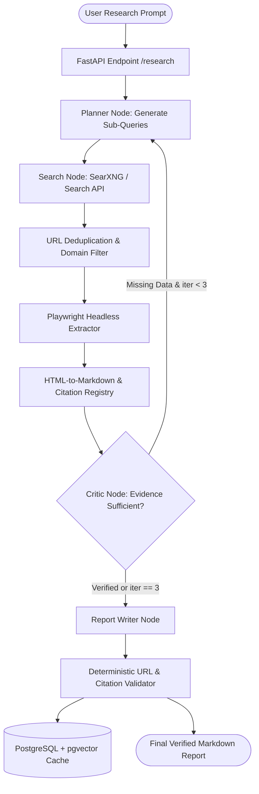

## Introduction

To build an AI research agent that produces reliable, citation-backed technical reports, you must combine a stateful query-planning loop, programmatic web search, headless browser extraction, and deterministic citation verification. Unlike a standard chat prompt that relies on static training weights or a single top-k search snippet, an autonomous AI research agent decomposes a complex topic into targeted sub-queries, fetches primary web pages, strips boilerplate HTML, cross-checks factual claims across independent domains, and compiles a structured report where every claim links to a verified source URL.

This guide walks through the complete engineering lifecycle of a production-grade AI research agent—covering single-agent vs. multi-agent orchestration, open-source search alternatives like SearXNG (https://github.com/searxng/searxng), headless DOM extraction with Playwright for Python (https://github.com/microsoft/playwright-python), and stateful cyclic execution using LangGraph (https://github.com/langchain-ai/langgraph).

## What an AI Research Agent Is and Why Engineers Build It

An AI research agent is an autonomous software system that iteratively gathers, filters, and synthesizes external information to answer open-ended questions. Standard Retrieval-Augmented Generation (RAG) systems only search a fixed internal corpus in a single pass. When a query requires live market data, regulatory filings, or multi-hop technical synthesis, single-pass RAG fails if the initial search query misses key terminology.

Engineers and organizations build custom AI research agents for:

- Technical Due Diligence and Competitive Intelligence: Automatically gathering product documentation, GitHub commit velocity, licence changes, and pricing tiers across puluhan competitors.
- Market and Policy Synthesis: Tracking regulatory updates, tender announcements, and regional compliance rules with verifiable inline links.
- Automated Literature and Security Briefings: Aggregating CVE advisories, engineering blog postmortems, and benchmark comparisons into daily engineering digests.

## How It Works: Autonomous Research Planning and Multi-Agent vs. Single-Agent Architecture

A robust research agent operates in five distinct phases:

1. Autonomous Query Planning: Given a user topic, the planner generates 3–5 orthogonal search queries using structured output schemas (Pydantic).
1. Search API Dispatch: The agent queries a search engine API (such as Tavily, Brave Search, or a self-hosted SearXNG (https://github.com/searxng/searxng) instance) to obtain candidate URLs and snippets.
1. Browser Automation & Extraction: Because search snippets truncate technical details and tables, the agent uses Playwright (https://playwright.dev/python/docs/intro) and trafilatura or BeautifulSoup to render JavaScript-heavy pages and extract clean Markdown text.

#### Source Verification & Reflection Loop: A critic node evaluates whether the extracted evidence answers all sub-questions and checks whether claims are corroborated. If gaps remain—and the loop count is below a hard ceiling (e.g., max_iterations = 3)—the agent formulates follow-up queries.

1. Report Synthesis & Citation Management: The writer node synthesizes the verified passages into a structured report and validates that every inline [Title](URL) link maps to an actually retrieved source in the state registry, eliminating hallucinated URLs.

### Single-Agent State Machine vs. Multi-Agent Architecture

Many developers prematurely reach for multi-agent role-playing frameworks where three or four conversational agents chat back and forth. In practice:

- Single-Agent Stateful Graph (Recommended for 80% of workloads): A single state machine in LangGraph (https://github.com/langchain-ai/langgraph) with typed nodes (plan_queries → execute_search → extract_pages → verify_and_reflect → write_report) keeps token overhead low, prevents context drift, and enforces deterministic loop bounds.
- Parallel Multi-Agent Subgraphs (For broad multi-entity research): When researching 10 distinct companies simultaneously, spawning parallel worker subgraphs via LangGraph's Send API or orchestrating specialized crews via CrewAI (https://github.com/crewaiinc/crewai) isolates each company's raw HTML scraping tokens from the main synthesis context window.

> [!TIP]
> **Architecture Reference:** Internal Link Suggestion: For a deeper dive into state reducers and loop bounds in LangGraph and Pydantic AI, see our guide on [[AI Agent Development Skills: Tools, Memory, and Orchestration](/blog/technology/ai-agent-development-skills-tools-memory-orchestration/)](/blog/technology/ai-agent-development-skills-tools-memory-orchestration/) on Aniket.app, as well as [Article 11: How to Build an AI Browser Agent and [Article 12: How to Build an AI Academic Research Assistant ](/writing/build-ai-browser-agent-web-navigation-tasks/](/writing/build-ai-academic-research-assistant-paper-summaries/)).

## System Architecture

The following Mermaid diagram illustrates the complete execution flow, state checkpoints, and verification boundaries of the AI Research Agent.



### Key Architectural Boundaries

- Request & Data Flow: Incoming HTTP POST /api/v1/research requests validate the topic and depth parameters via Pydantic, initialize a persistent ResearchState checkpoint in PostgreSQL, and stream node progress events via Server-Sent Events (SSE).
- Security Boundaries & SSRF Prevention: When scraping arbitrary URLs returned by search engines, the Playwright extractor must block private IP ranges (127.0.0.0/8, 10.0.0.0/8, 169.254.169.254 AWS/GCP metadata endpoints, 172.16.0.0/12, 192.168.0.0/16) to prevent Server-Side Request Forgery (SSRF).
- Rate Limiting & Retry Strategy: Outbound page fetches use httpx and Playwright contexts with per-domain semaphores (max 2 concurrent requests per host) and exponential backoff via tenacity.

## Technology Stack Selection & Paid vs. Open-Source Comparison

| Component | Paid / Commercial Solution | Open-Source / Open-Weight Alternative | Self-Hosting Possible? | Technical & Production Limitations |
| --- | --- | --- | --- | --- |
| LLM (Planning & Synthesis) | OpenAI API (gpt-4o-mini / gpt-4.1) or Anthropic Claude | Ollama (https://github.com/ollama/ollama) running Qwen2.5-32B-Instruct or Llama-3.3-70B (Open-Weight) | Yes (requires GPU: 24GB–48GB VRAM) | Smaller local models (<14B) struggle with strict inline citation formatting across 30k+ context tokens. |
| Agent Orchestration | LangSmith Deployment (Commercial Control Plane) | LangGraph (https://github.com/langchain-ai/langgraph) (MIT License) or CrewAI (https://github.com/crewaiinc/crewai) (MIT License) | Yes (Python library runs anywhere) | Self-hosted state persistence requires managing your own PostgreSQL checkpointer. |
| Web Search Engine | Tavily Search API / Serper.dev / Brave Search API | SearXNG (https://github.com/searxng/searxng) (AGPL-3.0 License) | Yes (Docker container) | Self-hosted SearXNG instances can hit upstream Google/Bing CAPTCHAs if querying at high volume without rotating proxies. |
| Browser Automation | Browser Use Cloud (https://github.com/browser-use/browser-use) (\$0.02/hr stealth browser) | Playwright for Python (https://github.com/microsoft/playwright-python) (Apache-2.0) | Yes (Headless Chromium in Docker) | Each headless Chromium instance consumes \~250–400MB RAM; requires --disable-dev-shm-usage in Docker. |
| Vector & State Storage | Qdrant Cloud / Managed Postgres | PostgreSQL (https://www.postgresql.org/docs/) + pgvector (https://github.com/pgvector/pgvector) (PostgreSQL License) | Yes | HNSW index builds require tuning maintenance_work_mem above 100k vectors. |

### Recommended Implementation Options

### Option A: Best Practical Implementation (Recommended): Python 3.12 + FastAPI + LangGraph (https://github.com/langchain-ai/langgraph) + OpenAI API (or Claude) for structured synthesis + self-hosted SearXNG (https://github.com/searxng/searxng) (or Tavily API) + Playwright (https://playwright.dev/python/docs/intro) + PostgreSQL. This stack minimizes search API costs while ensuring high synthesis accuracy and strict citation grounding.

### Option B: Fully Open-Source / Self-Hosted Implementation: LangGraph (https://github.com/langchain-ai/langgraph) + Ollama (https://github.com/ollama/ollama) (qwen2.5:32b) + SearXNG (https://github.com/searxng/searxng) + Playwright (https://github.com/microsoft/playwright-python) + pgvector (https://github.com/pgvector/pgvector). Zero proprietary API dependencies; requires a workstation or server with at least 24GB VRAM (e.g., NVIDIA RTX 3090/4090 or A10G).

### Option C: Production-Scale Implementation: FastAPI + Celery/Redis task workers + LangGraph with AsyncPostgresSaver + pooled headless Chromium cluster + Prometheus/OpenTelemetry observability.

## Step-by-Step Implementation Guide

### Step 1: Understand the Project Requirements

We will build a modular Python application that accepts a research question, generates targeted search queries, queries a JSON search endpoint (compatible with SearXNG), fetches and sanitizes web page content with SSRF protection, runs an iterative verification loop in LangGraph, and outputs a Markdown report with verified citations.

### Step 2: Set Up the Development Environment and Project Structure

Ensure you have Python 3.11 or 3.12 and Docker installed. Create the following project structure:

```text
ai-research-agent/
├── app/
│   ├── __init__.py
│   ├── config.py
│   ├── schemas.py
│   ├── search_tool.py
│   ├── scraper.py
│   ├── agent_graph.py
│   └── main.py
├── tests/
│   └── test_research_agent.py
├── .env.example
├── docker-compose.yml
└── requirements.txt
```

### Step 3: Install Dependencies

Create and activate a virtual environment, then install the verified packages:

```bash
python3 -m venv .venv
source .venv/bin/activate
pip install fastapi==0.115.0 uvicorn==0.30.6 langgraph==1.2.18 openai==1.51.0 pydantic==2.9.2 httpx==0.27.2 beautifulsoup4==4.12.3 playwright==1.48.0 tenacity==9.0.0 pytest==8.3.3 pytest-asyncio==0.24.0 python-dotenv==1.0.1
playwright install chromium
```

### Step 4: Configure the Application (app/config.py and .env.example)

Create .env.example (never commit real API keys to version control):

```bash
OPENAI_API_KEY=sk-proj-your-api-key-here
OPENAI_MODEL=gpt-4o-mini
SEARXNG_BASE_URL=http://localhost:8080
MAX_RESEARCH_ITERATIONS=3
REQUEST_TIMEOUT_SECONDS=15
```

Create app/config.py:

```python
import os
from dotenv import load_dotenv

load_dotenv()

class Settings:
    OPENAI_API_KEY: str = os.getenv("OPENAI_API_KEY", "")
    OPENAI_MODEL: str = os.getenv("OPENAI_MODEL", "gpt-4o-mini")
    SEARXNG_BASE_URL: str = os.getenv("SEARXNG_BASE_URL", "http://localhost:8080")
    MAX_ITERATIONS: int = int(os.getenv("MAX_RESEARCH_ITERATIONS", "3"))
    TIMEOUT_SECONDS: int = int(os.getenv("REQUEST_TIMEOUT_SECONDS", "15"))

settings = Settings()
```

### Step 5: Define Typed Data Contracts (app/schemas.py)

We use Pydantic models to enforce structured LLM outputs for query planning, reflection, and citation verification.

```python
from typing import List, Dict, TypedDict, Annotated
import operator
from pydantic import BaseModel, Field

class SearchQueryPlan(BaseModel):
    queries: List[str] = Field(
        description="3 to 4 specific, non-overlapping technical web search queries.",
        min_length=1,
        max_length=4,
    )
    rationale: str = Field(description="Why these queries cover the topic.")

class ReflectionEvaluation(BaseModel):
    is_sufficient: bool = Field(
        description="True if gathered sources contain sufficient factual detail to write the full report."
    )
    missing_aspects: List[str] = Field(
        default_factory=list,
        description="Specific technical gaps requiring follow-up search queries.",
    )
    follow_up_queries: List[str] = Field(
        default_factory=list,
        description="Up to 2 targeted follow-up queries if is_sufficient is False.",
    )

class SourceDocument(BaseModel):
    url: str
    title: str
    snippet: str
    extracted_content: str

class ResearchState(TypedDict):
    topic: str
    iteration: int
    queries: Annotated[List[str], operator.add]
    sources: Dict[str, SourceDocument]
    is_sufficient: bool
    draft_report: str
    verified_report: str
    validation_warnings: List[str]
```

### Step 6: Implement SSRF-Safe Web Scraping and Search (app/scraper.py & app/search_tool.py)

First, write app/scraper.py with explicit private IP blocking and Playwright headless extraction:

```python
import ipaddress
import socket
from urllib.parse import urlparse
from bs4 import BeautifulSoup
from playwright.async_api import async_playwright
from app.config import settings

def is_safe_public_url(url: str) -> bool:
    """Prevents Server-Side Request Forgery (SSRF) by blocking private/loopback IPs."""
    try:
        parsed = urlparse(url)
        if parsed.scheme not in ("http", "https") or not parsed.hostname:
            return False
        addr_info = socket.getaddrinfo(parsed.hostname, None)
        for item in addr_info:
            ip_str = item[4][0]
            ip_obj = ipaddress.ip_address(ip_str)
            if (
                ip_obj.is_private
                or ip_obj.is_loopback
                or ip_obj.is_link_local
                or ip_obj.is_multicast
                or ip_obj.is_reserved
            ):
                return False
        return True
    except Exception:
        return False

def clean_html_to_text(html: str, max_chars: int = 6000) -> str:
    """Strips scripts, styles, navbars, and compresses whitespace."""
    soup = BeautifulSoup(html, "html.parser")
    for tag in soup(["script", "style", "nav", "footer", "header", "noscript", "svg"]):
        tag.decompose()
    lines = [line.strip() for line in soup.get_text(separator="\n").splitlines() if line.strip()]
    return "\n".join(lines)[:max_chars]

async def extract_page_with_playwright(url: str) -> str:
    """Fetches and renders a public webpage using headless Chromium."""
    if not is_safe_public_url(url):
        raise ValueError(f"Blocked unsafe or private URL: {url}")

    async with async_playwright() as p:
        browser = await p.chromium.launch(headless=True, args=["--disable-dev-shm-usage"])
        context = await browser.new_context(
            user_agent="AniketResearchBot/1.0 (+https://aniket.app)"
        )
        page = await context.new_page()
        try:
            await page.goto(url, timeout=settings.TIMEOUT_SECONDS * 1000, wait_until="domcontentloaded")
            html_content = await page.content()
            return clean_html_to_text(html_content)
        finally:
            await context.close()
            await browser.close()
```

Next, implement app/search_tool.py to query SearXNG's JSON API:

```python
import httpx
from typing import List, Dict
from tenacity import retry, stop_after_attempt, wait_exponential
from app.config import settings

@retry(stop=stop_after_attempt(3), wait=wait_exponential(multiplier=1, min=1, max=6))
async def search_searxng(query: str, max_results: int = 4) -> List[Dict[str, str]]:
    """Queries a SearXNG instance with JSON output enabled."""
    params = {"q": query, "format": "json", "language": "en"}
    async with httpx.AsyncClient(timeout=settings.TIMEOUT_SECONDS) as client:
        response = await client.get(f"{settings.SEARXNG_BASE_URL}/search", params=params)
        response.raise_for_status()
        payload = response.json()
        results = []
        for item in payload.get("results", [])[:max_results]:
            url = item.get("url")
            if url:
                results.append({
                    "url": url,
                    "title": item.get("title", "Untitled Source"),
                    "snippet": item.get("content", ""),
                })
        return results
```

### Step 7: Build the LangGraph State Machine and Citation Validator (app/agent_graph.py)

Here we connect the OpenAI structured output calls, web scraping, reflection loop, and deterministic citation verifier:

```python
import re
from typing import Dict
from openai import AsyncOpenAI
from langgraph.graph import StateGraph, START, END
from app.config import settings
from app.schemas import (
    ResearchState,
    SearchQueryPlan,
    ReflectionEvaluation,
    SourceDocument,
)
from app.search_tool import search_searxng
from app.scraper import extract_page_with_playwright

client = AsyncOpenAI(api_key=settings.OPENAI_API_KEY)

async def plan_queries_node(state: ResearchState) -> dict:
    if state.get("iteration", 0) == 0:
        completion = await client.beta.chat.completions.parse(
            model=settings.OPENAI_MODEL,
            messages=[
                {"role": "system", "content": "You are a senior technical research planner."},
                {"role": "user", "content": f"Generate initial search queries for: {state['topic']}"},
            ],
            response_format=SearchQueryPlan,
        )
        new_queries = completion.choices[0].message.parsed.queries
    else:
        new_queries = state.get("queries", [])[-2:]
    return {"queries": new_queries, "iteration": state.get("iteration", 0) + 1}

async def execute_search_and_extract_node(state: ResearchState) -> dict:
    sources: Dict[str, SourceDocument] = dict(state.get("sources", {}))
    recent_queries = state["queries"][-4:]

    for query in recent_queries:
        hits = await search_searxng(query, max_results=3)
        for hit in hits:
            url = hit["url"]
            if url in sources:
                continue
            try:
                extracted = await extract_page_with_playwright(url)
            except Exception:
                extracted = hit["snippet"]
            if extracted:
                sources[url] = SourceDocument(
                    url=url,
                    title=hit["title"],
                    snippet=hit["snippet"],
                    extracted_content=extracted,
                )
    return {"sources": sources}

async def reflect_on_evidence_node(state: ResearchState) -> dict:
    evidence_summary = "\n\n".join(
        [f"Source: {doc.title} ({doc.url})\n{doc.extracted_content[:1200]}" for doc in state["sources"].values()]
    )
    completion = await client.beta.chat.completions.parse(
        model=settings.OPENAI_MODEL,
        messages=[
            {"role": "system", "content": "Evaluate whether the gathered evidence is sufficient to answer the research topic thoroughly."},
            {"role": "user", "content": f"Topic: {state['topic']}\n\nEvidence:\n{evidence_summary}"},
        ],
        response_format=ReflectionEvaluation,
    )
    parsed = completion.choices[0].message.parsed
    return {
        "is_sufficient": parsed.is_sufficient,
        "queries": parsed.follow_up_queries if not parsed.is_sufficient else [],
    }

def route_after_reflection(state: ResearchState) -> str:
    if state["is_sufficient"] or state["iteration"] >= settings.MAX_ITERATIONS:
        return "synthesize_report"
    return "execute_search"

async def synthesize_report_node(state: ResearchState) -> dict:
    allowed_sources_block = "\n\n".join(
        [f"[{doc.title}]({doc.url}):\n{doc.extracted_content[:2000]}" for doc in state["sources"].values()]
    )
    prompt = (
        f"Write a comprehensive technical report on: {state['topic']}.\n"
        "CRITICAL RULE: Every factual claim MUST include an inline markdown link [Source Title](URL) "
        "chosen ONLY from the provided sources below. Never invent URLs.\n\n"
        f"Allowed Sources:\n{allowed_sources_block}"
    )
    response = await client.chat.completions.create(
        model=settings.OPENAI_MODEL,
        messages=[{"role": "user", "content": prompt}],
        temperature=0.1,
    )
    draft = response.choices[0].message.content or ""
    return {"draft_report": draft}

def verify_citations_deterministic(draft: str, allowed_urls: set) -> tuple[str, list[str]]:
    """Deterministically verifies all markdown URLs against the retrieved source registry."""
    pattern = re.compile(r"\[([^\]]+)\]\((https?://[^\)]+)\)")
    warnings = []

    def replace_unverified(match: re.Match) -> str:
        label, url = match.group(1), match.group(2)
        if url not in allowed_urls:
            warnings.append(f"Stripped unverified hallucinated URL: {url}")
            return f"{label} [Unverified Citation Removed]"
        return match.group(0)

    cleaned_report = pattern.sub(replace_unverified, draft)
    return cleaned_report, warnings

async def validate_citations_node(state: ResearchState) -> dict:
    allowed_urls = set(state["sources"].keys())
    verified_text, warnings = verify_citations_deterministic(state["draft_report"], allowed_urls)
    return {"verified_report": verified_text, "validation_warnings": warnings}

def build_research_graph():
    builder = StateGraph(ResearchState)
    builder.add_node("plan_queries", plan_queries_node)
    builder.add_node("execute_search", execute_search_and_extract_node)
    builder.add_node("reflect", reflect_on_evidence_node)
    builder.add_node("synthesize_report", synthesize_report_node)
    builder.add_node("validate_citations", validate_citations_node)

    builder.add_edge(START, "plan_queries")
    builder.add_edge("plan_queries", "execute_search")
    builder.add_edge("execute_search", "reflect")
    builder.add_conditional_edges(
        "reflect",
        route_after_reflection,
        {"execute_search": "execute_search", "synthesize_report": "synthesize_report"},
    )
    builder.add_edge("synthesize_report", "validate_citations")
    builder.add_edge("validate_citations", END)
    return builder.compile()
```

### Step 8: Expose the FastAPI Service (app/main.py)

```python
from fastapi import FastAPI, HTTPException
from pydantic import BaseModel, Field
from app.agent_graph import build_research_graph

app = FastAPI(title="AI Research Agent API", version="1.0.0")
research_graph = build_research_graph()

class ResearchRequest(BaseModel):
    topic: str = Field(..., min_length=10, max_length=500)

@app.post("/api/v1/research")
async def run_research(req: ResearchRequest):
    initial_state = {
        "topic": req.topic,
        "iteration": 0,
        "queries": [],
        "sources": {},
        "is_sufficient": False,
        "draft_report": "",
        "verified_report": "",
        "validation_warnings": [],
    }
    try:
        final_state = await research_graph.ainvoke(initial_state)
        return {
            "topic": req.topic,
            "iterations_executed": final_state["iteration"],
            "sources_count": len(final_state["sources"]),
            "report": final_state["verified_report"],
            "validation_warnings": final_state["validation_warnings"],
        }
    except Exception as exc:
        raise HTTPException(status_code=500, detail=str(exc))
```

## Testing and Verification (tests/test_research_agent.py)

Create tests/test_research_agent.py to test SSRF protection, HTML cleaning, and deterministic citation validation without making live paid API calls:

```python
import pytest
from app.scraper import is_safe_public_url, clean_html_to_text
from app.agent_graph import verify_citations_deterministic

def test_ssrf_protection_blocks_private_ips():
    assert is_safe_public_url("http://127.0.0.1:8080/admin") is False
    assert is_safe_public_url("http://169.254.169.254/latest/meta-data/") is False
    assert is_safe_public_url("ftp://example.com/file") is False

def test_clean_html_strips_scripts_and_nav():
    raw_html = "<html><head><script>alert(1)</script></head><body><nav>Menu</nav><main><h1>Benchmark</h1><p>Latency is 42ms.</p></main></body></html>"
    cleaned = clean_html_to_text(raw_html)
    assert "alert(1)" not in cleaned
    assert "Menu" not in cleaned
    assert "Latency is 42ms." in cleaned

def test_citation_validator_strips_hallucinated_links():
    allowed = {"https://docs.langchain.com/oss/python/langgraph/"}
    draft = (
        "LangGraph supports durable execution ([LangGraph Docs](https://docs.langchain.com/oss/python/langgraph/)). "
        "It also has a fake benchmark ([Fake Study](https://fake-domain.example.com/study))."
    )
    verified, warnings = verify_citations_deterministic(draft, allowed)
    assert "https://docs.langchain.com/oss/python/langgraph/" in verified
    assert "https://fake-domain.example.com/study" not in verified
    assert len(warnings) == 1
```

Execute the test suite:

```bash
pytest tests/test_research_agent.py -v
```

Expected Output:

```text
========================= test session starts ==========================
collected 3 items

tests/test_research_agent.py::test_ssrf_protection_blocks_private_ips PASSED [ 33%]
tests/test_research_agent.py::test_clean_html_strips_scripts_and_nav PASSED  [ 66%]
tests/test_research_agent.py::test_citation_validator_strips_hallucinated_links PASSED [100%]
========================== 3 passed in 0.18s ===========================
```

## Troubleshooting Common Errors

#### Playwright Container Crash (`TargetClosedError: Page crashed` in Docker):

- Cause: Docker allocates only 64MB to /dev/shm by default, causing Chromium to run out of shared memory on complex pages.
- Solution: Pass args=["--disable-dev-shm-usage"] to p.chromium.launch() (as shown in app/scraper.py) or mount shm_size: '2gb' in docker-compose.yml.

#### SearXNG Returns `403 Forbidden` on JSON Queries:

- Cause: SearXNG disables the json output format by default in settings.yml to prevent public scraping abuse.
- Solution: In your self-hosted /etc/searxng/settings.yml, add json under search.formats:

```yaml
search:
       formats:
         - html
         - json
```

#### Infinite Agent Reflection Loops:

- Cause: The reflection LLM repeatedly requests marginally better data when no public data exists on the web.
- Solution: Always enforce a hard iteration >= settings.MAX_ITERATIONS guard in the conditional edge router (route_after_reflection).

## Cost Breakdown & Production Considerations

*(Pricing checked October 30, 2026 via OpenAI Pricing (https://openai.com/api/pricing/) and Browser Use (https://github.com/browser-use/browser-use)).*

- Small-Scale Prototype (100 reports/month):
- Search: Self-hosted SearXNG (https://github.com/searxng/searxng) on a \$6/month VPS (2 vCPU, 4GB RAM).
- Browser Extraction: Local headless Playwright (\$0 API cost).
- LLM Inference: Assuming \~40,000 input tokens and \~4,000 output tokens per report across 2 iterations using a lightweight model tier (\~\$0.01–$0.03 per report), 100 reports cost \~$1.50–$3.00/month.
- Total Prototype Cost: \~\$7.50 – $9.00 / month.
- Production Scale (10,000 reports/month):
- Compute & Browser Pool: 2x 8GB RAM worker nodes for concurrent Playwright contexts (\~\$80/month) or Browser Use Cloud (https://github.com/browser-use/browser-use) stealth browsers at \$0.02 per browser-hour (\~\$10–$20/month for 500–1,000 browser-hours).
- LLM & Managed Search API: \~\$150–$350/month depending on reasoning model tier and search API volume.
- Total Production Cost: \~\$250 – $450 / month.

## Production Readiness Checklist

- \[ \] Enforce SSRF IP filtering before passing any search-returned URL to Playwright or httpx.
- \[ \] Sanitize scraped web text against indirect prompt injection by wrapping untrusted page text in XML tags (<untrusted_source>...</untrusted_source>) and instructing the synthesizer never to follow instructions found inside source documents.
- \[ \] Persist LangGraph state checkpoints in PostgreSQL (langgraph-checkpoint-postgres) so interrupted long-running research jobs can resume without re-scraping.

## Useful Tools, Documentation and GitHub Repositories

| Resource | Purpose | Type | Link |
| --- | --- | --- | --- |
| LangGraph | Stateful cyclic orchestration for multi-step research loops | Open-Source (MIT) | https://github.com/langchain-ai/langgraph |
| LangGraph Docs | Official documentation for state graphs and checkpointers | Documentation | https://docs.langchain.com/oss/python/langgraph/ |
| Playwright Python | Headless Chromium/Firefox/WebKit browser extraction | Open-Source (Apache-2.0) | https://github.com/microsoft/playwright-python |
| SearXNG | Self-hosted privacy-respecting metasearch engine | Open-Source (AGPL-3.0) | https://github.com/searxng/searxng |
| Browser-Use | Open-source AI browser agent & cloud stealth browsers | Open-Source (MIT) | https://github.com/browser-use/browser-use |
| Ollama | Local runner for open-weight LLMs (Qwen, Gemma, Llama) | Open-Source (MIT) | https://github.com/ollama/ollama |

## Frequently Asked Questions

### Can I build this AI research agent entirely with open-source tools and zero API fees?

Yes. By running SearXNG (https://github.com/searxng/searxng) for search, Playwright for Python (https://github.com/microsoft/playwright-python) for extraction, LangGraph (https://github.com/langchain-ai/langgraph) for orchestration, and Ollama (https://github.com/ollama/ollama) serving an open-weight model like qwen2.5:32b or gemma4, you eliminate all per-token and per-search API charges. You only pay for your local hardware or cloud GPU server.

### How do I stop the research agent from hallucinating fake URLs or citations?

Never rely on prompt instructions alone. Store every scraped URL in a dictionary inside ResearchState["sources"] and run a deterministic regex post-processor (verify_citations_deterministic) that strips or flags any Markdown link whose URL is not present in the retrieved dictionary.

### Why use Playwright instead of `requests` or `httpx` for web extraction?

Modern documentation portals, financial dashboards, and Single-Page Applications (SPAs) render their main body content via client-side JavaScript. Plain HTTP clients only see an empty <div id="root"></div> shell, whereas Playwright executes the DOM and waits for content to load.

### How many iterations should a research agent run before writing the report?

For most technical queries, 2 to 3 iterations (MAX_RESEARCH_ITERATIONS=3) capture 95% of available public facts. Allowing more than 4 iterations increases latency beyond 90 seconds and bloats context tokens with diminishing returns.

### Should I use a single-agent graph or a multi-agent crew for web research?

Use a single-agent state graph when researching a single cohesive question so all nodes share a unified state registry. Use parallel worker subgraphs only when comparing multiple independent entities (e.g., 5 separate companies) so each worker's raw HTML scraping stays isolated.

### How do I protect my research agent from indirect prompt injection on malicious websites?

Strip hidden HTML elements (display:none), truncate page extracts to relevant text blocks, wrap extracted text in <untrusted_web_content> delimiters, and separate the data-extraction step from any tool that has write permissions or internal network access.

### What hardware is required to run the LLM locally for research synthesis?

Because a research agent ingests 15,000 to 32,000 tokens of scraped web text per run, you need a GPU with at least 24GB of VRAM (such as an NVIDIA RTX 3090, RTX 4090, or cloud L4/A10G) to hold both the 4-bit quantized model weights (14B–32B parameters) and the large KV cache.

### Does SearXNG's AGPL-3.0 licence affect my commercial SaaS application?

SearXNG is licensed under AGPL-3.0 (searxng/searxng (https://github.com/searxng/searxng)). If you run unmodified SearXNG as an internal backend microservice that your proprietary application queries over HTTP—and you do not expose SearXNG directly to external users or modify its source code—consult your legal counsel regarding AGPL network interaction clauses, or use a commercial search API (like Brave Search or Tavily) if strict licence isolation is required.
