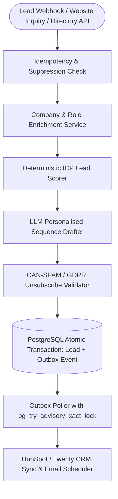

## Introduction

To build an AI sales agent that discovers high-intent prospects, enriches company data, scores Ideal Customer Profile (ICP) fit, and schedules personalised follow-ups without losing events or triggering spam blacklists, you must pair structured company enrichment with a durable PostgreSQL transactional outbox and strict anti-spam compliance checks. Many prototype sales bots wire a webhook directly to an LLM and an SMTP sender; when a third-party CRM API times out or a prospect replies *"Stop emailing me,"* stateless scripts drop the lead or continue sending unwanted follow-ups.

> [!TIP]
> **Architecture Reference:** Internal Link Suggestion: On Aniket.app (https://aniket.app/), see the [Signal Desk — Lead Agent](/projects/signal-desk/) engineering case study for how a PostgreSQL transactional outbox with advisory locks guarantees atomic lead routing and deduplication, and cross-reference [Article 3: How to Build an AI Email Assistant ](/writing/build-ai-email-assistant-replies-inbox-automation/).

## System Architecture: Enrichment, ICP Scoring & Transactional Outbox



### Consent, Privacy, and Anti-Spam Engineering Requirements

Automated outbound and inbound follow-up systems must enforce regulatory compliance in code:

1. Global Suppression & Unsubscribe Registry: Before scheduling or sending any follow-up step, query a suppression_list table. If the recipient clicked an List-Unsubscribe link or replied with negative intent, halt all future sequence steps atomically.
1. RFC 8058 One-Click Unsubscribe Headers: Every automated commercial email must include List-Unsubscribe and List-Unsubscribe-Post: List-Unsubscribe=One-Click headers plus a physical mailing address footer (CAN-SPAM / GDPR compliance).

#### Daily Per-Mailbox Rate Limits & Reply Detection: Poll IMAP/Gmail thread replies before firing Day-3 or Day-7 follow-ups so the agent never sends a "Just bumping this!" email after a prospect has already replied or booked a meeting.

## Technology Comparison: Paid vs. Open-Source Stack

| Component | Commercial / Managed Solution | Open-Source Alternative | Self-Hosting Possible? | Technical Limitations |
| --- | --- | --- | --- | --- |
| CRM Platform | HubSpot / Salesforce / Pipedrive | Twenty CRM (AGPL-3.0) / SuiteCRM / ERPNext | Yes | Requires webhook signature verification (HMAC-SHA256). |
| Company & Lead Discovery | Apollo.io / Clearbit / Clay | Playwright (https://github.com/microsoft/playwright-python) public company page extractor + OpenCorporates | Yes | Public scraping must respect robots.txt and avoid personal PII harvesting without lawful basis. |
| Durable Queue & State | AWS SQS / Managed EventBridge | PostgreSQL (https://www.postgresql.org/docs/) Transactional Outbox (FOR UPDATE SKIP LOCKED) | Yes | Eliminates dual-write bugs between database state and external CRM calls without needing Kafka. |
| Personalisation LLM | OpenAI (gpt-4o-mini) / Claude | Ollama (https://github.com/ollama/ollama) (Llama-3.3-70B / Qwen2.5-14B) | Yes | Must constrain output length (<120 words) and ban generic clichés. |

### Recommended Implementation Options

### Option A: Best Practical Implementation (Recommended): Python 3.12 + FastAPI + PostgreSQL Transactional Outbox + deterministic ICP scoring + OpenAI Structured Outputs + HubSpot/Twenty CRM REST API.

### Option B: Fully Open-Source Stack: FastAPI + PostgreSQL + Twenty CRM + Playwright (https://github.com/microsoft/playwright-python) company page enrichment + local Ollama (https://github.com/ollama/ollama).

### Option C: Production High-Volume Stack: Multi-worker FastAPI + PostgreSQL FOR UPDATE SKIP LOCKED outbox workers + HMAC webhook authentication + automated bounce/reply webhook handlers.

## Step-by-Step Implementation Guide

### Step 1: Project Structure

```text
ai-sales-agent/
├── app/
│   ├── __init__.py
│   ├── schemas.py
│   ├── scorer.py
│   └── outbox.py
├── tests/
│   └── test_sales_agent.py
└── requirements.txt
```

### Step 2: Define Lead Enrichment, ICP Scoring, and Cadence Schemas (app/schemas.py)

```python
from enum import Enum
from typing import List, Optional
from pydantic import BaseModel, Field

class LeadTier(str, Enum):
    TIER_1_HOT = "TIER_1_HOT"
    TIER_2_WARM = "TIER_2_WARM"
    TIER_3_NURTURE = "TIER_3_NURTURE"
    DISQUALIFIED = "DISQUALIFIED"

class EnrichedLead(BaseModel):
    lead_id: str
    email: str
    full_name: str
    job_title: str
    company_name: str
    company_domain: str
    employee_count: int = Field(..., ge=1)
    industry: str
    recent_company_news: str = ""
    has_consent_or_inbound_intent: bool = True
    is_unsubscribed: bool = False

class FollowUpStep(BaseModel):
    day_offset: int = Field(..., ge=0, le=30)
    subject: str
    body_text: str
    unsubscribe_footer: str

class QualifiedLeadPlan(BaseModel):
    lead_id: str
    icp_score: int = Field(..., ge=0, le=100)
    tier: LeadTier
    qualification_reasons: List[str]
    sequence_steps: List[FollowUpStep]
```

### Step 3: Implement Deterministic ICP Lead Scoring & Compliance Guards (app/scorer.py)

```python
from typing import Tuple, List
from app.schemas import EnrichedLead, LeadTier, FollowUpStep, QualifiedLeadPlan

TARGET_INDUSTRIES = {"saas", "fintech", "ai", "healthtech", "logistics"}
DECISION_MAKER_KEYWORDS = ("cto", "vp", "director", "head of", "founder", "chief", "principal")
FREE_WEBMAIL_DOMAINS = {"gmail.com", "yahoo.com", "hotmail.com", "outlook.com", "aol.com"}

def score_lead_icp(lead: EnrichedLead) -> Tuple[int, LeadTier, List[str]]:
    """Calculates a deterministic 0-100 ICP score and qualification tier."""
    if lead.is_unsubscribed or not lead.has_consent_or_inbound_intent:
        return 0, LeadTier.DISQUALIFIED, ["Lead is unsubscribed or lacks lawful outreach basis."]

    score = 0
    reasons: List[str] = []

    domain = lead.email.split("@")[-1].lower()
    if domain not in FREE_WEBMAIL_DOMAINS:
        score += 20
        reasons.append("Verified corporate email domain (+20)")

    if 25 <= lead.employee_count <= 2000:
        score += 30
        reasons.append(f"Ideal company size: {lead.employee_count} employees (+30)")
    elif lead.employee_count > 2000:
        score += 20
        reasons.append("Enterprise company size (+20)")

    title_lower = lead.job_title.lower()
    if any(k in title_lower for k in DECISION_MAKER_KEYWORDS):
        score += 30
        reasons.append(f"Decision-maker title '{lead.job_title}' (+30)")

    if lead.industry.strip().lower() in TARGET_INDUSTRIES:
        score += 20
        reasons.append(f"Target industry '{lead.industry}' (+20)")

    if score >= 75:
        tier = LeadTier.TIER_1_HOT
    elif score >= 50:
        tier = LeadTier.TIER_2_WARM
    elif score >= 25:
        tier = LeadTier.TIER_3_NURTURE
    else:
        tier = LeadTier.DISQUALIFIED

    return score, tier, reasons

def build_compliant_followup_step(
    day_offset: int,
    subject: str,
    body_text: str,
    unsubscribe_url: str,
    physical_address: str,
) -> FollowUpStep:
    """Appends mandatory anti-spam unsubscribe and physical address footer."""
    if len(body_text.split()) > 150:
        raise ValueError("Sales outreach body exceeds 150-word brevity guardrail.")
    footer = f"\n\n---\n{physical_address}\nOpt out of future messages: {unsubscribe_url}"
    return FollowUpStep(
        day_offset=day_offset,
        subject=subject.strip(),
        body_text=body_text.strip(),
        unsubscribe_footer=footer,
    )
```

### Step 4: Implement the Transactional Outbox Pattern (app/outbox.py)

Using SQLite/PostgreSQL transactional semantics, we store the lead record and its outbound CRM/email dispatch event inside a single atomic database transaction so zero leads are lost during network outages:

```python
import json
import sqlite3
from typing import List, Dict, Any

def init_outbox_db(conn: sqlite3.Connection) -> None:
    conn.executescript(
        """
        CREATE TABLE IF NOT EXISTS leads (
            lead_id TEXT PRIMARY KEY,
            email TEXT UNIQUE NOT NULL,
            icp_score INTEGER NOT NULL,
            tier TEXT NOT NULL
        );
        CREATE TABLE IF NOT EXISTS outbox_events (
            event_id INTEGER PRIMARY KEY AUTOINCREMENT,
            lead_id TEXT NOT NULL,
            event_type TEXT NOT NULL,
            payload_json TEXT NOT NULL,
            status TEXT NOT NULL DEFAULT 'PENDING',
            retry_count INTEGER NOT NULL DEFAULT 0
        );
        """
    )
    conn.commit()

def save_lead_with_outbox_atomic(
    conn: sqlite3.Connection,
    lead_id: str,
    email: str,
    icp_score: int,
    tier: str,
    sequence_payload: Dict[str, Any],
) -> None:
    """Atomically inserts the qualified lead and queues the outbound CRM/email sync event."""
    with conn:
        conn.execute(
            "INSERT INTO leads (lead_id, email, icp_score, tier) VALUES (?, ?, ?, ?)",
            (lead_id, email, icp_score, tier),
        )
        conn.execute(
            "INSERT INTO outbox_events (lead_id, event_type, payload_json, status) VALUES (?, ?, ?, 'PENDING')",
            (lead_id, "CRM_AND_CADENCE_SYNC", json.dumps(sequence_payload)),
        )
```

## Testing the Sales Agent (tests/test_sales_agent.py)

```python
import sqlite3
import pytest
from app.schemas import EnrichedLead, LeadTier
from app.scorer import score_lead_icp, build_compliant_followup_step
from app.outbox import init_outbox_db, save_lead_with_outbox_atomic

def test_icp_scoring_and_suppression():
    hot_lead = EnrichedLead(
        lead_id="L-100",
        email="cto@fintech-corp.io",
        full_name="Rohan Mehta",
        job_title="VP of Engineering",
        company_name="Fintech Corp",
        company_domain="fintech-corp.io",
        employee_count=180,
        industry="Fintech",
    )
    score, tier, _ = score_lead_icp(hot_lead)
    assert score == 100
    assert tier == LeadTier.TIER_1_HOT

    unsub_lead = hot_lead.model_copy(update={"is_unsubscribed": True})
    u_score, u_tier, _ = score_lead_icp(unsub_lead)
    assert u_score == 0
    assert u_tier == LeadTier.DISQUALIFIED

def test_transactional_outbox_atomic_commit():
    conn = sqlite3.connect(":memory:")
    init_outbox_db(conn)
    save_lead_with_outbox_atomic(
        conn,
        lead_id="L-100",
        email="cto@fintech-corp.io",
        icp_score=100,
        tier="TIER_1_HOT",
        sequence_payload={"steps": 3},
    )
    rows = conn.execute("SELECT lead_id, status FROM outbox_events").fetchall()
    assert len(rows) == 1
    assert rows[0] == ("L-100", "PENDING")
```

## Cost Considerations & Production Checklist

- Cost Breakdown: Scoring and drafting a 3-step personalised sequence for 2,000 leads/month (\~1,500 input tokens and \~500 output tokens per lead) costs \~\$1.20–$3.00/month on commercial mini LLMs or \$0 on local Ollama (https://github.com/ollama/ollama).
- Production Readiness: Always authenticate inbound lead webhooks using HMAC-SHA256 signatures, enforce exponential backoff with a dead-letter state (MAX_RETRIES = 5) on the outbox worker, and halt follow-up sequences immediately upon receiving an inbound reply.

## Useful Tools, Documentation and GitHub Repositories

| Resource | Purpose | Type | Link |
| --- | --- | --- | --- |
| PostgreSQL Documentation | Transactional outbox & FOR UPDATE SKIP LOCKED | Documentation | https://www.postgresql.org/docs/ |
| Playwright Python | Public company website enrichment | Open-Source (Apache-2.0) | https://github.com/microsoft/playwright-python |
| FastAPI | High-performance webhook ingestion API | Open-Source (MIT) | https://www.google.com/search?q=https://github.com/fastapi/fastapi |

## Frequently Asked Questions

### Why do I need a transactional outbox instead of calling the CRM API directly inside my webhook handler?

If your webhook saves the lead to PostgreSQL and then calls HubSpot or an email scheduler directly, a 502 Bad Gateway from the external API leaves your database and CRM out of sync. Writing both the leads row and the outbox_events row in one database transaction guarantees eventual delivery with zero lost leads.

### How do I prevent the AI sales agent from sounding like generic spam?

Inject concrete, verifiable signals from the company's public changelog, job postings, or engineering blog (recent_company_news), enforce a strict <120 words limit, and ban filler openings like *"I hope this email finds you well."*

### What happens when a prospect replies to Step 1 of a 3-step sequence?

Your reply webhook listener transitions the lead's sequence status from ACTIVE to REPLIED_PAUSED, cancelling all pending scheduled follow-up rows in the database.

### How do I comply with GDPR, CAN-SPAM, and India's DPDP Act?

Maintain a verifiable lawful basis (inbound inquiry or legitimate B2B interest where permitted), include a one-click List-Unsubscribe header and physical address in every message, and honour opt-out requests immediately across all pipelines.

### Why shouldn't the LLM calculate the numeric lead score?

Sales operations teams need predictable, auditable thresholds (e.g., corporate domain +20, 25–2000 employees +30, VP/C-level +30). Use the LLM to classify unstructured titles or industry descriptions, and calculate the point total in deterministic Python.

### How do I protect my sending domain reputation?

Configure SPF, DKIM, and DMARC (p=quarantine or p=reject), warm up dedicated sending subdomains gradually, and cap automated sends per mailbox at 40–50 per day.

### Can I use an open-source CRM with this agent?

Yes; self-hosted Twenty CRM or ERPNext exposes REST and GraphQL APIs that integrate directly with the outbox worker.

### How do I prevent duplicate leads if a user submits a web form twice?

Enforce a UNIQUE index on normalized email in the leads table and use INSERT ... ON CONFLICT (email) DO UPDATE upserts.
