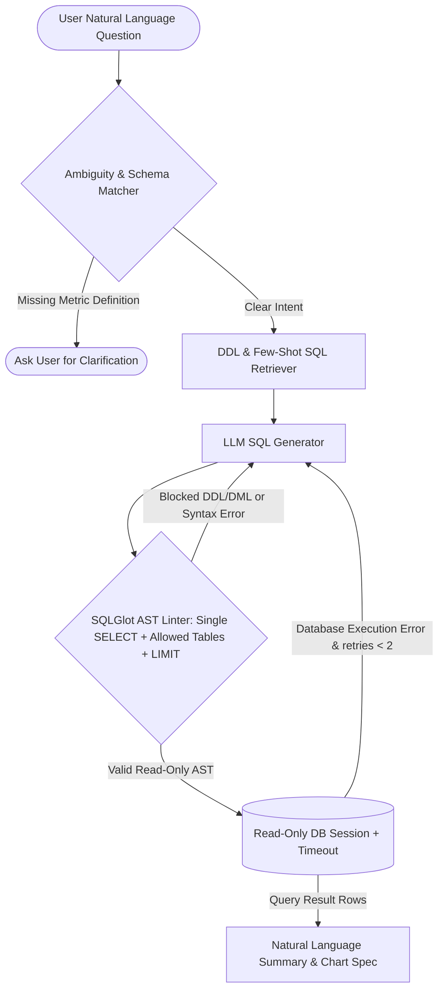

## Introduction

To build an AI SQL agent that translates natural-language questions into accurate PostgreSQL, MySQL, or SQLite queries without exposing your database to destructive mutations or runaway full-table scans, you must implement three mandatory defence-in-depth layers: (1) AST-level SQL parsing and linting using [SQLGlot](https://github.com/tobymao/sqlglot) to block any non-SELECT statement or unauthorized table access before execution, (2) database-enforced read-only transactions with statement timeouts, and (3) schema pruning with bounded self-correction loops.

> [!TIP]
> **Architecture Reference:** Internal Link Suggestion: On Aniket.app (https://aniket.app/), see the [[Prompt BI](/projects/prompt-bi/)](/projects/prompt-bi/) engineering system overview for how AST query linting blocks unsafe SQL mutations in production analytics pipelines, and cross-reference [Article 10: How to Build an AI Data Analyst ](/writing/build-ai-data-analyst-csv-charts-pandas/).

## Natural-Language-to-SQL Architecture & Security Boundaries



### Why Regex Filtering Fails and SQLGlot AST Validation Is Required

Many naive tutorials check if sql.upper().startswith("SELECT"): before executing LLM-generated SQL. That check is trivially bypassed by stacked queries (SELECT 1; DROP TABLE users;), writable Common Table Expressions (WITH deleted AS (DELETE FROM orders RETURNING *) SELECT * FROM deleted;), or system catalog functions (pg_read_file()). Parsing the query into an Abstract Syntax Tree (AST) with SQLGlot (https://github.com/tobymao/sqlglot) lets you inspect every node in the tree deterministically, verify that the root expression is strictly exp.Select, confirm zero Delete/Update/Drop/Insert/Command nodes exist anywhere in the tree, verify every exp.Table against an allowlist, and automatically inject a LIMIT 100 cap.

## Technology Comparison: Paid vs. Open-Source Stack

> Repository Verification Note: While vanna-ai/vanna (https://github.com/vanna-ai/vanna) (MIT License, 23.8k stars) is a well-known open-source Text-to-SQL framework, our repository audit on October 30, 2026 confirmed that `vanna-ai/vanna` was archived by its owner on March 29, 2026 and is now read-only. For actively maintained production systems in 2026, we recommend building a clean pipeline with **SQLGlot** (https://github.com/tobymao/sqlglot) + **SQLAlchemy** (https://www.google.com/search?q=https://github.com/sqlalchemy/sqlalchemy) + **LangGraph** (https://github.com/langchain-ai/langgraph) / Pydantic.

| Component | Commercial / Managed Service | Open-Source Alternative | Self-Hosting Possible? | Maintenance & Technical Notes |
| --- | --- | --- | --- | --- |
| SQL AST Parser & Linter | Proprietary BI Gateways | SQLGlot (https://github.com/tobymao/sqlglot) (MIT License, active, 9.7k stars) | Yes | Zero dependencies; parses and transpiles 30+ SQL dialects including Postgres, MySQL, SQLite, DuckDB, and Snowflake. |
| Text-to-SQL Orchestration | Snowflake Cortex Analyst / Databricks Genie | LangGraph (https://github.com/langchain-ai/langgraph) (MIT, active) / Vanna (https://github.com/vanna-ai/vanna) (MIT, *archived Mar 29, 2026*) | Yes | Custom LangGraph + SQLGlot gives full control over AST security and dialect transpilation. |
| Database Engine | AWS RDS / Supabase / Neon | PostgreSQL (https://www.postgresql.org/docs/) / MySQL / SQLite + SQLAlchemy (https://www.google.com/search?q=https://github.com/sqlalchemy/sqlalchemy) (MIT) | Yes | Always connect using a dedicated readonly_ai_user database role. |
| SQL Generation LLM | OpenAI (gpt-4o-mini / gpt-4.1) / Claude | Ollama (https://github.com/ollama/ollama) (Qwen2.5-Coder-32B / SeekCoder) | Yes | Coding-tuned open-weight models (Qwen2.5-Coder) match commercial models on multi-join SQL generation. |

### Recommended Implementation Options

### Option A: Best Practical Implementation (Recommended): Python 3.12 + FastAPI + SQLGlot (https://github.com/tobymao/sqlglot) AST validator + SQLAlchemy (https://www.google.com/search?q=https://github.com/sqlalchemy/sqlalchemy) read-only connection pool + OpenAI Structured Outputs (or Qwen2.5-Coder-32B).

### Option B: Fully Open-Source Local Implementation: SQLGlot (https://github.com/tobymao/sqlglot) + SQLAlchemy (https://www.google.com/search?q=https://github.com/sqlalchemy/sqlalchemy) + PostgreSQL/SQLite + local Ollama (https://github.com/ollama/ollama) (qwen2.5-coder:14b or 32b).

### Option C: Production Enterprise Analytics Stack: FastAPI + PostgreSQL read replica + SET LOCAL statement_timeout = '5000ms' + pgvector few-shot query bank + tenant row-level security (RLS).

## Step-by-Step Implementation Guide

### Step 1: Project Structure

```text
ai-sql-agent/
├── app/
│   ├── __init__.py
│   ├── ast_guard.py
│   ├── db_executor.py
│   └── sql_agent.py
├── tests/
│   └── test_sql_agent.py
└── requirements.txt
```

### Step 2: Install Dependencies

```bash
pip install sqlglot==25.24.0 sqlalchemy==2.0.35 pydantic==2.9.2 openai==1.51.0 pytest==8.3.3
```

### Step 3: Implement the SQLGlot AST Security Linter (app/ast_guard.py)

This module parses raw SQL into an AST, rejects multi-statement injections, bans DDL/DML mutations anywhere in the tree, verifies referenced tables against an allowlist, blocks dangerous system functions, and enforces a row limit:

```python
from typing import Set
import sqlglot
from sqlglot import exp

FORBIDDEN_AST_NODES = (
    exp.Insert,
    exp.Update,
    exp.Delete,
    exp.Drop,
    exp.Create,
    exp.Alter,
    exp.Command,
    exp.Grant,
    exp.Revoke,
    exp.Transaction,
    exp.Commit,
    exp.Rollback,
    exp.Copy,
    exp.Pragma,
)

FORBIDDEN_FUNCTIONS = {
    "pg_read_file",
    "pg_ls_dir",
    "pg_execute_server_program",
    "pg_sleep",
    "dblink",
    "lo_import",
    "lo_export",
    "load_extension",
}

def validate_and_rewrite_readonly_sql(
    raw_sql: str,
    allowed_tables: Set[str],
    dialect: str = "postgres",
    max_limit: int = 100,
) -> str:
    """Validates SQL via SQLGlot AST inspection and enforces a hard LIMIT cap."""
    try:
        parsed_statements = sqlglot.parse(raw_sql, read=dialect)
    except sqlglot.errors.ParseError as exc:
        raise ValueError(f"SQL syntax parse error: {exc}") from exc

    # 1. Block stacked multi-statement queries (e.g. SELECT 1; DROP TABLE x;)
    non_empty_stmts = [s for s in parsed_statements if s is not None]
    if len(non_empty_stmts) != 1:
        raise PermissionError("Exactly one SQL statement is permitted per query.")

    ast = non_empty_stmts[0]

    # 2. Root expression must be a SELECT or UNION of SELECTs
    if not isinstance(ast, (exp.Select, exp.Union)):
        raise PermissionError(f"Only SELECT queries are permitted. Found root: {type(ast).__name__}")

    # 3. Walk the entire AST to block writable CTEs or DDL/DML nodes
    for node in ast.walk():
        if isinstance(node, FORBIDDEN_AST_NODES):
            raise PermissionError(f"Forbidden SQL operation detected in AST: {type(node).__name__}")
        if isinstance(node, exp.Anonymous) and node.name.lower() in FORBIDDEN_FUNCTIONS:
            raise PermissionError(f"Forbidden database function called: {node.name}")
        if isinstance(node, exp.Func) and node.sql_name().lower() in FORBIDDEN_FUNCTIONS:
            raise PermissionError(f"Forbidden database function called: {node.sql_name()}")

    # 4. Allowlist check on every referenced table (excluding CTE aliases)
    cte_aliases = {cte.alias_or_name.lower() for cte in ast.find_all(exp.CTE)}
    allowed_lower = {t.lower() for t in allowed_tables}

    for table_node in ast.find_all(exp.Table):
        tbl_name = table_node.name.lower()
        if tbl_name not in cte_aliases and tbl_name not in allowed_lower:
            raise PermissionError(f"Query references unauthorized or unknown table: '{table_node.name}'")

    # 5. Enforce or cap LIMIT clause on top-level SELECT
    if isinstance(ast, exp.Select):
        existing_limit = ast.args.get("limit")
        if existing_limit is None:
            ast = ast.limit(max_limit)
        else:
            try:
                limit_val = int(existing_limit.expression.name)
                if limit_val > max_limit:
                    ast = ast.limit(max_limit)
            except (ValueError, AttributeError):
                ast = ast.limit(max_limit)

    return ast.sql(dialect=dialect)
```

### Step 4: Implement Read-Only Database Execution (app/db_executor.py)

For SQLite, we open the database using mode=ro URI or PRAGMA query_only = ON. For PostgreSQL, we execute SET LOCAL TRANSACTION READ ONLY; and SET LOCAL statement_timeout = '5000ms';:

```python
import sqlite3
from typing import List, Dict, Any, Set
from app.ast_guard import validate_and_rewrite_readonly_sql

def execute_safe_sqlite_query(
    db_path: str,
    raw_sql: str,
    allowed_tables: Set[str],
    max_limit: int = 100,
) -> Dict[str, Any]:
    """Validates SQL via SQLGlot AST and executes it against a read-only SQLite connection."""
    safe_sql = validate_and_rewrite_readonly_sql(
        raw_sql=raw_sql,
        allowed_tables=allowed_tables,
        dialect="sqlite",
        max_limit=max_limit,
    )
    conn = sqlite3.connect(db_path, timeout=5.0)
    conn.row_factory = sqlite3.Row
    try:
        conn.execute("PRAGMA query_only = ON;")
        cursor = conn.execute(safe_sql)
        rows = [dict(row) for row in cursor.fetchall()]
        columns = [desc[0] for desc in cursor.description] if cursor.description else []
        return {
            "executed_sql": safe_sql,
            "columns": columns,
            "row_count": len(rows),
            "rows": rows,
        }
    finally:
        conn.close()
```

## Testing the AI SQL Agent (tests/test_sql_agent.py)

```python
import sqlite3
import pytest
from app.ast_guard import validate_and_rewrite_readonly_sql
from app.db_executor import execute_safe_sqlite_query

ALLOWED = {"customers", "orders", "order_items"}

def test_ast_guard_blocks_stacked_queries_and_writable_ctes():
    # Block stacked DROP TABLE
    with pytest.raises(PermissionError, match="Exactly one SQL statement"):
        validate_and_rewrite_readonly_sql("SELECT * FROM orders; DROP TABLE orders;", ALLOWED)

    # Block writable CTE
    with pytest.raises(PermissionError, match="Forbidden SQL operation"):
        validate_and_rewrite_readonly_sql(
            "WITH d AS (DELETE FROM orders RETURNING *) SELECT * FROM d", ALLOWED
        )

    # Block unauthorized table (e.g., payroll_salaries)
    with pytest.raises(PermissionError, match="unauthorized or unknown table"):
        validate_and_rewrite_readonly_sql("SELECT * FROM payroll_salaries", ALLOWED)

def test_ast_guard_allows_cte_and_injects_limit():
    sql = """
    WITH regional_totals AS (
        SELECT customer_id, SUM(amount) AS total_spent
        FROM orders
        GROUP BY customer_id
    )
    SELECT c.name, r.total_spent
    FROM customers c
    JOIN regional_totals r ON c.id = r.customer_id
    ORDER BY r.total_spent DESC
    """
    safe_sql = validate_and_rewrite_readonly_sql(sql, ALLOWED, dialect="sqlite", max_limit=50)
    assert "LIMIT 50" in safe_sql

def test_end_to_end_readonly_sqlite_execution(tmp_path):
    db_file = str(tmp_path / "analytics.db")
    conn = sqlite3.connect(db_file)
    conn.executescript(
        """
        CREATE TABLE customers (id INTEGER PRIMARY KEY, name TEXT, region TEXT);
        CREATE TABLE orders (id INTEGER PRIMARY KEY, customer_id INTEGER, amount REAL);
        INSERT INTO customers VALUES (1, 'Acme Corp', 'APAC'), (2, 'Globex', 'NA');
        INSERT INTO orders VALUES (101, 1, 450.0), (102, 1, 550.0), (103, 2, 300.0);
        """
    )
    conn.close()

    res = execute_safe_sqlite_query(
        db_file,
        "SELECT c.name, SUM(o.amount) AS revenue FROM customers c JOIN orders o ON c.id = o.customer_id GROUP BY c.name",
        allowed_tables={"customers", "orders"},
    )
    assert res["row_count"] == 2
    assert res["rows"][0]["revenue"] == 1000.0
```

## Handling Ambiguous Questions, Query Optimisation & Cost

- Handling Ambiguous Questions: When a user asks *"Who are our top customers?"*, the term "top" could mean highest gross revenue, highest net margin, or highest order count. Include an ambiguity classification field (is_ambiguous: bool, clarification_question: Optional[str]) in the agent's structured output schema so it asks *"Would you like top customers ranked by gross order revenue or total order count?"* when metric definitions are unspecified.
- Schema Pruning for Large Databases: If an enterprise database has 400 tables, passing all 400 CREATE TABLE DDLs overflows the prompt and degrades join accuracy. Embed table descriptions into pgvector (https://github.com/pgvector/pgvector) and retrieve only the top 8–10 relevant table schemas plus foreign-key neighbours per query.

## Useful Tools, Documentation and GitHub Repositories

| Resource | Purpose | Type | Link |
| --- | --- | --- | --- |
| SQLGlot | Python SQL AST parser, linter, optimizer, and transpiler | Open-Source (MIT) | https://github.com/tobymao/sqlglot |
| SQLAlchemy | Python SQL toolkit and database connection pooling | Open-Source (MIT) | https://www.google.com/search?q=https://github.com/sqlalchemy/sqlalchemy |
| PostgreSQL Docs | Read-only roles, row-level security, and statement timeouts | Documentation | https://www.postgresql.org/docs/ |
| Vanna (Archived) | Historical Text-to-SQL reference (*archived Mar 29, 2026*) | Open-Source (MIT) | https://github.com/vanna-ai/vanna |

## Frequently Asked Questions

### Why is regex checking (`sql.startswith("SELECT")`) insufficient for SQL agent security?

Attackers or hallucinating LLMs can execute data-modifying statements inside a SELECT using PostgreSQL writable CTEs (WITH del AS (DELETE FROM users RETURNING *) SELECT * FROM del) or stacked queries (SELECT 1; DROP TABLE users). Only AST traversal via SQLGlot (https://github.com/tobymao/sqlglot) combined with a read-only database user blocks these vectors reliably.

### How do I prevent an AI-generated SQL query from locking up my production database with a Cartesian join?

Always run the AI SQL agent against a read replica, enforce SET LOCAL statement_timeout = '5000ms' inside the transaction, and run EXPLAIN (FORMAT JSON) prior to execution if the database contains multi-million-row tables.

### What happens if the LLM writes a column name that doesn't exist?

Wrap execute_safe_sqlite_query in a 2-attempt self-correction loop: catch OperationalError / ProgrammingError, pass the exact database error message (no such column: o.total_price) and the table DDL back to the LLM, and re-validate the repaired SQL through validate_and_rewrite_readonly_sql.

### How do I handle high-cardinality string filters (like `WHERE city = 'Bengaluru'` vs `'Bangalore'`)?

Index distinct categorical values of frequently filtered columns using trigram similarity (pg_trgm) or vector embeddings so the agent resolves the exact database string literal before generating the WHERE clause.

### Can SQLGlot translate queries if my LLM writes Postgres syntax for a SQLite or MySQL database?

Yes! Calling sqlglot.transpile(sql, read="postgres", write="sqlite")[0] automatically converts dialect-specific date arithmetic, type casts, and identifier quotes.

### Is Vanna AI still maintained in 2026?

Per its official GitHub repository (vanna-ai/vanna (https://github.com/vanna-ai/vanna)), the repository was archived by its owner on March 29, 2026 and is now read-only. New projects should build directly on actively maintained primitives like SQLGlot (https://github.com/tobymao/sqlglot), LangGraph (https://github.com/langchain-ai/langgraph), and SQLAlchemy (https://www.google.com/search?q=https://github.com/sqlalchemy/sqlalchemy).

### How do I enforce multi-tenant data isolation in a SaaS AI SQL Agent?

Use PostgreSQL Row-Level Security (CREATE POLICY tenant_isolation ON orders USING (tenant_id = current_setting('app.current_tenant_id')::uuid)) and set SET LOCAL app.current_tenant_id = '...' from your authenticated FastAPI session before executing the query.

### Which open-weight local model is best for Text-to-SQL?

Qwen2.5-Coder-32B-Instruct (or the 14B variant on 16GB GPUs) via Ollama (https://github.com/ollama/ollama) delivers outstanding multi-table join accuracy and adheres strictly to schema constraints.
