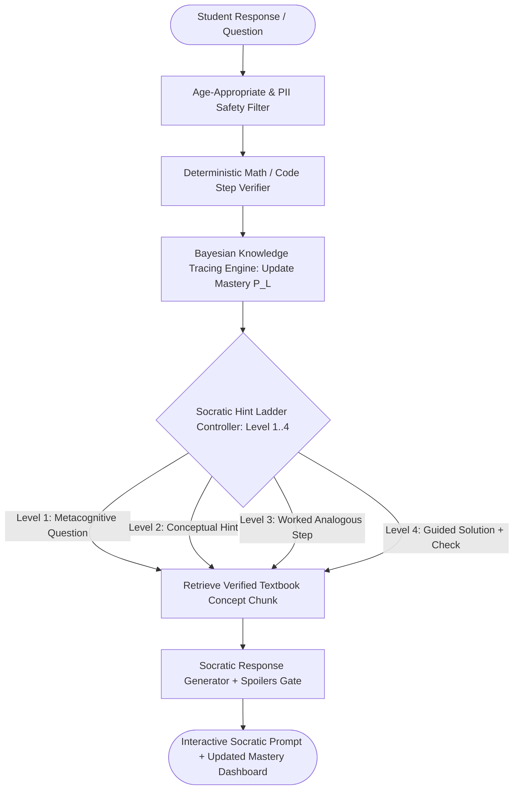

## Introduction

To build an AI tutor that genuinely helps students master mathematics, programming, or science through interactive conversations, you must solve the "Homework Vending Machine" Problem: out of the box, general-purpose LLMs immediately hand the student the final answer when asked a homework question, short-circuiting active learning. An effective AI tutor combines a Socratic Scaffolding State Machine (which withholds direct answers and walks the student through a 4-level hint ladder), Bayesian Knowledge Tracing (BKT) to track mastery probability $P(L_t)$ across curriculum skills, curriculum-grounded RAG, and deterministic mathematical/code verification.

## Personalised Socratic Tutoring & Knowledge Tracing Architecture



### How Bayesian Knowledge Tracing (BKT) Updates Skill Mastery

For every granular learning objective (e.g., quadratic_factoring or python_for_loops), Bayesian Knowledge Tracing maintains the probability $P(L_t)$ that the student has mastered the skill using four parameters:

- $P(L_0)$: Initial prior mastery probability (e.g., 0.20).
- $P(T)$: Probability of transitioning from unlearned to learned after a practice step (e.g., 0.15).
- $P(S)$: Slip probability — probability a student who knows the skill makes a careless mistake (e.g., 0.10).
- $P(G)$: Guess probability — probability a student who does not know the skill guesses right (e.g., 0.20).

After observing whether the student's current step is correct (obs = True) or incorrect (obs = False), we compute the posterior $P(L_t \mid \text{obs})$ via Bayes' Rule and update mastery:

$$

P(L_t) = P(L_t \mid \text{obs}) + \bigl(1 - P(L_t \mid \text{obs})\bigr) \cdot P(T)

$$

When $P(L_t) \ge 0.95$, the skill is marked as Mastered and the adaptive question generator unlocks the next prerequisite node in the curriculum DAG.

## Technology Comparison: Paid vs. Open-Source EdTech Stack

| Component | Commercial Solution | Open-Source Alternative | Self-Hosting Possible? | Pedagogical & Privacy Notes |
| --- | --- | --- | --- | --- |
| Tutoring & Hint LLM | OpenAI (gpt-4o-mini / gpt-4.1) / Claude | Ollama (https://github.com/ollama/ollama) (Gemma 4 / Qwen2.5-32B / Llama-3.3) | Yes | Pair with a deterministic post-check so the LLM never leaks the final numerical answer on Hint Levels 1–3. |
| Symbolic Math Verification | WolframAlpha API | SymPy (BSD-3-Clause, Python symbolic algebra library) | Yes | Deterministically checks whether a student's intermediate algebraic equation is equivalent to the target equation. |
| Curriculum Content Store | Commercial Textbook APIs | OpenStax (CC-BY 4.0 textbooks) + pgvector (https://github.com/pgvector/pgvector) | Yes | Ground explanations in the student's exact grade-level curriculum terminology. |
| Student Data Privacy | Managed Cloud DLP | Presidio (https://github.com/microsoft/presidio) (MIT) + Pseudonymous Student IDs | Yes | Essential for FERPA, COPPA, and GDPR-K compliance. |

### Recommended Implementation Options

### Option A: Best Practical Implementation (Recommended): Python 3.12 + FastAPI + Bayesian Knowledge Tracing (bkt.py) + SymPy step equivalence checker + LangGraph (https://github.com/langchain-ai/langgraph) Socratic Hint Ladder + OpenAI/Claude (or local Gemma 4).

### Option B: 100% Open-Source School Server Stack: Local Ollama (https://github.com/ollama/ollama) + SymPy + pgvector (https://github.com/pgvector/pgvector) indexed with OpenStax CC-BY textbooks + PostgreSQL.

### Option C: Production Multimodal Voice/Whiteboard Tutor: LiveKit Agents (https://github.com/livekit/agents) + KaTeX math rendering + BKT learning analytics dashboard for teachers.

## Step-by-Step Implementation Guide

### Step 1: Project Structure

```text
ai-socratic-tutor/
├── app/
│   ├── __init__.py
│   ├── bkt_engine.py
│   └── socratic_ladder.py
├── tests/
│   └── test_ai_tutor.py
└── requirements.txt
```

### Step 2: Implement the Bayesian Knowledge Tracing (BKT) Engine (app/bkt_engine.py)

```python
from pydantic import BaseModel, Field

class SkillMasteryState(BaseModel):
    skill_id: str
    p_mastery: float = Field(0.20, ge=0.0, le=1.0, description="Current P(L_t)")
    p_transit: float = Field(0.15, ge=0.0, le=1.0, description="P(T) learning rate")
    p_slip: float = Field(0.10, ge=0.0, le=0.49, description="P(S) careless slip rate")
    p_guess: float = Field(0.20, ge=0.0, le=0.49, description="P(G) lucky guess rate")
    attempts: int = 0
    consecutive_errors: int = 0

    @property
    def is_mastered(self) -> bool:
        return self.p_mastery >= 0.95

def update_bkt_mastery(state: SkillMasteryState, is_correct: bool) -> SkillMasteryState:
    """Updates student skill mastery probability P(L_t) using exact Bayesian Knowledge Tracing."""
    p_l = state.p_mastery
    p_t = state.p_transit
    p_s = state.p_slip
    p_g = state.p_guess

    if is_correct:
        # P(L | correct) = [P(L)*(1 - P(S))] / [P(L)*(1 - P(S)) + (1 - P(L))*P(G)]
        num = p_l * (1.0 - p_s)
        den = num + ((1.0 - p_l) * p_g)
        posterior = num / den if den > 0 else p_l
        consecutive_err = 0
    else:
        # P(L | incorrect) = [P(L)*P(S)] / [P(L)*P(S) + (1 - P(L))*(1 - P(G))]
        num = p_l * p_s
        den = num + ((1.0 - p_l) * (1.0 - p_g))
        posterior = num / den if den > 0 else p_l
        consecutive_err = state.consecutive_errors + 1

    new_p_mastery = posterior + ((1.0 - posterior) * p_t)
    return state.model_copy(
        update={
            "p_mastery": round(min(0.999, max(0.001, new_p_mastery)), 4),
            "attempts": state.attempts + 1,
            "consecutive_errors": consecutive_err,
        }
    )
```

### Step 3: Implement the Socratic Hint Ladder & Anti-Spoiler Guardrail (app/socratic_ladder.py)

```python
from enum import IntEnum
from pydantic import BaseModel

class HintLevel(IntEnum):
    LEVEL_1_SOCRATIC_QUESTION = 1
    LEVEL_2_CONCEPTUAL_HINT = 2
    LEVEL_3_WORKED_ANALOGY = 3
    LEVEL_4_GUIDED_STEP_SOLUTION = 4

def select_socratic_hint_level(consecutive_errors: int) -> HintLevel:
    """Escalates scaffolding support gradually based on consecutive student struggles."""
    if consecutive_errors <= 1:
        return HintLevel.LEVEL_1_SOCRATIC_QUESTION
    if consecutive_errors == 2:
        return HintLevel.LEVEL_2_CONCEPTUAL_HINT
    if consecutive_errors == 3:
        return HintLevel.LEVEL_3_WORKED_ANALOGY
    return HintLevel.LEVEL_4_GUIDED_STEP_SOLUTION

def verify_no_answer_spoiler(tutor_response: str, canonical_final_answer: str, current_level: HintLevel) -> bool:
    """Ensures the tutor does not leak the final answer string before HintLevel 4."""
    if current_level < HintLevel.LEVEL_4_GUIDED_STEP_SOLUTION:
        if canonical_final_answer.strip().lower() in tutor_response.lower():
            return False
    return True
```

## Testing the AI Tutor (tests/test_ai_tutor.py)

```python
from app.bkt_engine import SkillMasteryState, update_bkt_mastery
from app.socratic_ladder import (
    HintLevel,
    select_socratic_hint_level,
    verify_no_answer_spoiler,
)

def test_bkt_mastery_progression_reaches_mastery_after_correct_streak():
    state = SkillMasteryState(skill_id="linear_equations_1")
    for _ in range(6):
        state = update_bkt_mastery(state, is_correct=True)
    assert state.p_mastery >= 0.95
    assert state.is_mastered is True

def test_bkt_incorrect_answer_lowers_posterior_and_escalates_hint_level():
    state = SkillMasteryState(skill_id="fractions_add", p_mastery=0.50)
    state = update_bkt_mastery(state, is_correct=False)
    assert state.p_mastery < 0.50
    assert state.consecutive_errors == 1
    assert select_socratic_hint_level(state.consecutive_errors) == HintLevel.LEVEL_1_SOCRATIC_QUESTION

    state = update_bkt_mastery(state, is_correct=False)
    assert select_socratic_hint_level(state.consecutive_errors) == HintLevel.LEVEL_2_CONCEPTUAL_HINT

def test_anti_spoiler_gate_blocks_premature_answer_leak():
    assert verify_no_answer_spoiler(
        "What happens if you subtract 5 from both sides?",
        canonical_final_answer="x = 12",
        current_level=HintLevel.LEVEL_1_SOCRATIC_QUESTION,
    ) is True

    assert verify_no_answer_spoiler(
        "The answer is x = 12.",
        canonical_final_answer="x = 12",
        current_level=HintLevel.LEVEL_1_SOCRATIC_QUESTION,
    ) is False
```

## Student Data Privacy (FERPA / COPPA) & Cost Considerations

- Student Data Privacy: Never send student names, school emails, or demographic identifiers to external LLM APIs; map each student to a pseudonymous UUID (student_uuid), strip any accidental PII in chat inputs with Presidio (https://github.com/microsoft/presidio), and ensure zero model training on student transcripts.
- Cost Breakdown: A 30-turn interactive tutoring session costs \~\$0.008–$0.02 per session on commercial mini models or \$0 on local Ollama (https://github.com/ollama/ollama) (Gemma 4).

## Useful Tools, Documentation and GitHub Repositories

| Resource | Purpose | Type | Link |
| --- | --- | --- | --- |
| SymPy | Deterministic symbolic algebra verification in Python | Open-Source (BSD-3) | https://www.google.com/search?q=https://www.sympy.org/en/index.html |
| Presidio | Student PII redaction before LLM calls | Open-Source (MIT) | https://github.com/microsoft/presidio |
| Ollama | Local execution of open-weight models (Gemma 4, Qwen2.5) | Open-Source (MIT) | https://github.com/ollama/ollama |

## Frequently Asked Questions

### How do I stop the AI tutor from giving away the answer when a student says "Just tell me the answer, I'm in a rush"?

Enforce the Socratic Hint Ladder in code (select_socratic_hint_level) and run verify_no_answer_spoiler() on the generated response before sending it to the student. If verify_no_answer_spoiler() returns False at Levels 1–3, regenerate the response with a stricter hint constraint.

### Why shouldn't the LLM check whether the student's math step is correct?

LLMs can be persuaded by confident-sounding student errors (*"Isn't* $2^3 = 6$*?"*). Parse algebraic expressions with SymPy (sympy.simplify(student_expr - target_expr) == 0) so step correctness is verified deterministically before updating Bayesian Knowledge Tracing.

### What is the Zone of Proximal Development (ZPD) and how does the tutor use it?

The ZPD consists of skills whose prerequisite nodes in the curriculum DAG are mastered ($P(L) \ge 0.95$) while the target skill itself has $0.25 \le P(L) < 0.85$. Selecting practice problems from the ZPD keeps students challenged without overwhelming them.

### How many consecutive wrong attempts should trigger a worked example?

After 3 consecutive errors (HintLevel.LEVEL_3_WORKED_ANALOGY), asking more open-ended Socratic questions causes frustration. Show a worked step-by-step solution to a *similar analogous problem* and then ask the student to apply that same step to their current problem.

### Can this tutor adapt to different grade levels (e.g., Grade 5 vs. First-Year University)?

Yes; store reading_grade_level and preferred_analogies on the student profile and retrieve explanations exclusively from the matching OpenStax grade-level textbook collection in pgvector (https://github.com/pgvector/pgvector).

### How do teachers monitor which students need human intervention?

Flag any student-skill pair where attempts >= 6 and p_mastery < 0.35 ("Wheel-Spinning Alert") on the teacher's analytics dashboard so the teacher can provide 1-on-1 help.

### Is Bayesian Knowledge Tracing better than Deep Knowledge Tracing (DKT) for small cohorts?

Yes; BKT requires only 4 interpretable parameters per skill and works reliably from Day 1 without requiring 50,000 historical student interaction logs to train a recurrent neural network.

### Can I add voice interaction to this AI tutor for early readers?

Yes; wrap the Socratic tutor graph inside LiveKit Agents (https://github.com/livekit/agents) or Pipecat (https://github.com/pipecat-ai/pipecat) so younger learners can speak their reasoning aloud.
