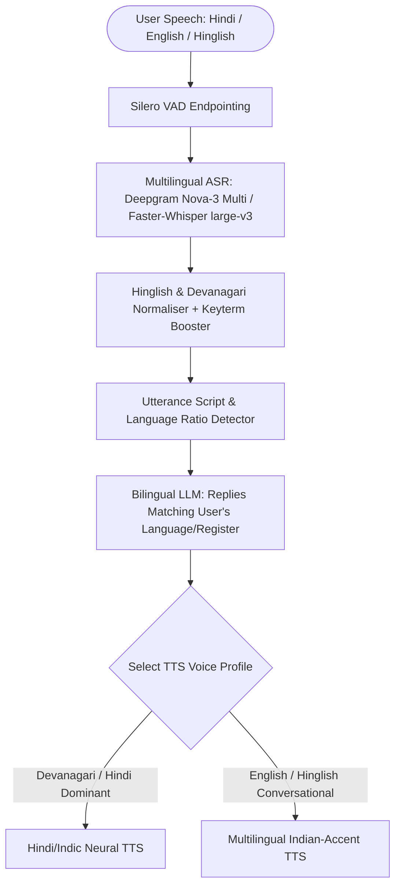

## Introduction

To build a multilingual AI voice assistant for Indian users who naturally blend Hindi and English within the same sentence (Hinglish code-switching, e.g., *"Mera order status check karo aur delivery address update karna hai"*), you cannot force the user to select a rigid "Hindi" or "English" language toggle at the start of the conversation. Standard monolingual ASR models garble English technical nouns (*"EMI"*, *"refund"*, *"account statement"*) when forced into pure Hindi mode, or transcribe Hindi verbs as nonsense English homophones when locked to en-US. To build a fluent Hindi-English voice assistant, you must configure code-switch-aware multilingual Speech Recognition, Devanagari/Roman script and numeric normalisation, bilingual system prompt grounding, and Indic-accent neural Text-to-Speech.

> [!TIP]
> **Architecture Reference:** Internal Link Suggestion: Combine this bilingual pipeline with [Article 17: How to Build an AI Phone Receptionist and [Article 19: How to Build a Real-Time AI Translation System ](/writing/build-ai-phone-receptionist-twilio-voice-calls/](/writing/build-real-time-ai-translation-voice-conversations/)).

## Bilingual & Code-Switching Voice Architecture



### Solving Code-Switching and Indian Accent Challenges

1. Never Force `language="en"` on Code-Switched Audio: In Deepgram Nova-3 (https://deepgram.com/pricing), set language="multi" (\$0.0092/min on Pay-as-you-go). In Faster-Whisper (https://github.com/SYSTRAN/faster-whisper) (large-v3 or turbo), leave language=None (or provide a bilingual initial_prompt containing both Devanagari and English domain terms: "नमस्ते, मेरा order status और payment receipt check कीजिए।"). That bilingual initial_prompt primes Whisper's decoder to emit Devanagari for Hindi words and Latin script for English technical terms rather than transliterating everything phonetically.
1. Script & Number Normalisation before TTS: If the LLM outputs "आपका रिफंड ₹1,250.00 कल तक आ जाएगा", verify that your TTS engine expands ₹1,250 naturally; otherwise normalise currency symbols and abbreviations in Python before synthesis.

#### Evaluating Transcription Quality (WER & CER): Because Hinglish utterances often mix scripts (e.g., "मेरा order" vs "मेरा आर्डर"), standard case-sensitive Word Error Rate (WER) over-penalises valid transcriptions. Always normalise Unicode (NFKC), strip punctuation, and compute both Word Error Rate (WER) and Character Error Rate (CER).

## Technology Comparison: Paid vs. Open-Source Multilingual Stack

| Component | Commercial API | Open-Source / Open-Weight Alternative | Self-Hosting Possible? | Hindi/Hinglish Technical Notes |
| --- | --- | --- | --- | --- |
| Multilingual Speech-to-Text | Deepgram Nova-3 Multilingual (https://deepgram.com/pricing) (\$0.0092/min) / Sarvam AI / Google Chirp | Faster-Whisper (https://github.com/SYSTRAN/faster-whisper) (large-v3, MIT) / AI4Bharat IndicConformer / IndicWhisper (MIT) | Yes | AI4Bharat's Indic models achieve low WER on regional Indian accents; Whisper large-v3 with a bilingual initial_prompt handles Hinglish code-switching well. |
| Bilingual LLM | OpenAI (gpt-4o-mini / gpt-4.1) / Gemini | Ollama (https://github.com/ollama/ollama) (Gemma 4 / Qwen2.5-32B / Llama-3.3-70B) | Yes | Instruct the LLM to mirror the user's language mix (pure Hindi, conversational Hinglish, or English). |
| Hindi & Indian-English TTS | Cartesia Sonic Multilingual / ElevenLabs / Azure hi-IN-SwaraNeural | AI4Bharat Indic-Parler-TTS (Apache-2.0) / OHF-Voice/piper1-gpl (https://github.com/OHF-Voice/piper1-gpl) (hi_IN voices) | Yes | Ensure TTS supports both Devanagari (\u0900-\u097F) and embedded English words. |

### Recommended Implementation Options

### Option A: Best Practical Implementation (Recommended): LiveKit Agents (https://github.com/livekit/agents) + Deepgram Nova-3 (language="multi") + gpt-4o-mini (or Gemma 4) + Cartesia/Indic-accent multilingual TTS.

### Option B: Fully Open-Source Self-Hosted Stack: Faster-Whisper (https://github.com/SYSTRAN/faster-whisper) (large-v3) or AI4Bharat IndicWhisper + local Ollama (https://github.com/ollama/ollama) (gemma4) + AI4Bharat Indic-Parler-TTS.

### Option C: Production Enterprise Contact Center (India): Pipecat (https://github.com/pipecat-ai/pipecat) + regional telephony serializer (Exotel/Plivo/Twilio) + streaming bilingual STT/TTS + WER evaluation harness.

## Step-by-Step Implementation Guide

### Step 1: Project Structure

```text
multilingual-voice-assistant/
├── app/
│   ├── __init__.py
│   ├── hinglish_normalizer.py
│   └── wer_evaluator.py
├── tests/
│   └── test_multilingual_assistant.py
└── requirements.txt
```

### Step 2: Implement Script Detection, Bilingual Prompting & TTS Text Normaliser (app/hinglish_normalizer.py)

```python
import re
import unicodedata
from enum import Enum
from pydantic import BaseModel

DEVANAGARI_RANGE = re.compile(r"[\u0900-\u097F]")
LATIN_WORD_RANGE = re.compile(r"[a-zA-Z]+")
COMMON_ROMAN_HINDI_TOKENS = {
    "mera", "meri", "kya", "hai", "nahi", "karo", "karna", "kab",
    "aayega", "paisa", "bhaiya", "kripya", "batao", "mujhe", "chahiye",
}

class UtteranceLanguageMode(str, Enum):
    HINDI_DEVANAGARI = "HINDI_DEVANAGARI"
    HINGLISH_CODE_SWITCH = "HINGLISH_CODE_SWITCH"
    ENGLISH_INDIAN = "ENGLISH_INDIAN"

class LanguageAnalysis(BaseModel):
    mode: UtteranceLanguageMode
    devanagari_char_count: int
    latin_word_count: int
    normalized_tts_text: str

def detect_and_normalize_utterance(text: str) -> LanguageAnalysis:
    """Detects Hindi/English/Hinglish mode and normalizes symbols for clean TTS pronunciation."""
    norm = unicodedata.normalize("NFKC", text).strip()
    dev_chars = len(DEVANAGARI_RANGE.findall(norm))
    latin_words = [w.lower() for w in LATIN_WORD_RANGE.findall(norm)]
    roman_hindi_hits = sum(1 for w in latin_words if w in COMMON_ROMAN_HINDI_TOKENS)

    if dev_chars > 0 and len(latin_words) > 0:
        mode = UtteranceLanguageMode.HINGLISH_CODE_SWITCH
    elif dev_chars > 0:
        mode = UtteranceLanguageMode.HINDI_DEVANAGARI
    elif roman_hindi_hits >= 1:
        mode = UtteranceLanguageMode.HINGLISH_CODE_SWITCH
    else:
        mode = UtteranceLanguageMode.ENGLISH_INDIAN

    # Expand ₹ currency symbol so TTS reads it naturally in the target register
    if mode in (UtteranceLanguageMode.HINDI_DEVANAGARI, UtteranceLanguageMode.HINGLISH_CODE_SWITCH):
        tts_text = re.sub(r"₹\s*([0-9,]+)", r"\1 रुपये", norm)
    else:
        tts_text = re.sub(r"₹\s*([0-9,]+)", r"\1 rupees", norm)

    return LanguageAnalysis(
        mode=mode,
        devanagari_char_count=dev_chars,
        latin_word_count=len(latin_words),
        normalized_tts_text=tts_text,
    )
```

### Step 3: Implement Dynamic Programming Word Error Rate (WER) & CER Evaluator (app/wer_evaluator.py)

To benchmark Whisper vs. Deepgram vs. IndicConformer on your own Hindi-English audio test set, use exact Levenshtein edit distance at both word and character levels:

```python
import re
import unicodedata
from typing import List

def normalize_for_asr_eval(text: str) -> str:
    """Normalizes Unicode, lowercases Latin characters, and strips punctuation for fair WER/CER."""
    norm = unicodedata.normalize("NFKC", text).lower()
    norm = re.sub(r"[^\w\s\u0900-\u097F]", "", norm)
    return " ".join(norm.split())

def _edit_distance(ref_seq: List[str], hyp_seq: List[str]) -> int:
    n, m = len(ref_seq), len(hyp_seq)
    dp = [[0] * (m + 1) for _ in range(n + 1)]
    for i in range(n + 1):
        dp[i][0] = i
    for j in range(m + 1):
        dp[0][j] = j
    for i in range(1, n + 1):
        for j in range(1, m + 1):
            cost = 0 if ref_seq[i - 1] == hyp_seq[j - 1] else 1
            dp[i][j] = min(
                dp[i - 1][j] + 1,      # deletion
                dp[i][j - 1] + 1,      # insertion
                dp[i - 1][j - 1] + cost # substitution
            )
    return dp[n][m]

def compute_wer_and_cer(reference: str, hypothesis: str) -> dict:
    """Computes normalized Word Error Rate (WER) and Character Error Rate (CER)."""
    clean_ref = normalize_for_asr_eval(reference)
    clean_hyp = normalize_for_asr_eval(hypothesis)

    ref_words = clean_ref.split()
    hyp_words = clean_hyp.split()
    word_edits = _edit_distance(ref_words, hyp_words)
    wer = round(word_edits / max(1, len(ref_words)), 4)

    ref_chars = list(clean_ref.replace(" ", ""))
    hyp_chars = list(clean_hyp.replace(" ", ""))
    char_edits = _edit_distance(ref_chars, hyp_chars)
    cer = round(char_edits / max(1, len(ref_chars)), 4)

    return {"wer": wer, "cer": cer, "word_edits": word_edits, "ref_word_count": len(ref_words)}
```

## Testing the Multilingual Voice Assistant (tests/test_multilingual_assistant.py)

```python
from app.hinglish_normalizer import detect_and_normalize_utterance, UtteranceLanguageMode
from app.wer_evaluator import compute_wer_and_cer

def test_hinglish_detection_and_rupee_expansion():
    mixed = detect_and_normalize_utterance("मेरा refund ₹1,500 कब आएगा?")
    assert mixed.mode == UtteranceLanguageMode.HINGLISH_CODE_SWITCH
    assert "1,500 रुपये" in mixed.normalized_tts_text

    roman_hinglish = detect_and_normalize_utterance("Bhaiya mera order status kya hai?")
    assert roman_hinglish.mode == UtteranceLanguageMode.HINGLISH_CODE_SWITCH

    english = detect_and_normalize_utterance("Please send the invoice for ₹2,000.")
    assert english.mode == UtteranceLanguageMode.ENGLISH_INDIAN
    assert "2,000 rupees" in english.normalized_tts_text

def test_wer_and_cer_calculation_on_bilingual_transcript():
    ref = "नमस्ते मेरा order status बताइए"
    hyp = "नमस्ते मेरा order स्टेटस बताइए"
    metrics = compute_wer_and_cer(ref, hyp)
    assert metrics["wer"] == 0.2  # 1 word script difference out of 5 words
    assert metrics["cer"] < 0.35
```

## Cost Considerations & Production Tuning

- Cost Breakdown (Checked October 30, 2026 via [Deepgram Pricing](https://deepgram.com/pricing)): Deepgram Nova-3 Multilingual streaming STT costs \$0.0092/min (\$0.55/hour) on Pay-as-you-go or \$0.0078/min (\$0.47/hour) on Growth, while self-hosted Faster-Whisper (https://github.com/SYSTRAN/faster-whisper) (large-v3) or AI4Bharat IndicConformer has \$0 per-minute API cost.

## Useful Tools, Documentation and GitHub Repositories

| Resource | Purpose | Type | Link |
| --- | --- | --- | --- |
| Faster-Whisper | Multilingual Whisper inference supporting 90+ languages | Open-Source (MIT) | https://github.com/SYSTRAN/faster-whisper |
| Pipecat | Real-time voice framework with Sarvam, Deepgram & Whisper plugins | Open-Source (BSD-2) | https://github.com/pipecat-ai/pipecat |
| LiveKit Agents | Voice agent framework supporting language="multi" | Open-Source (Apache-2.0) | https://github.com/livekit/agents |

## Frequently Asked Questions

### Why does Whisper sometimes transcribe Hindi speech into Urdu (Perso-Arabic) script instead of Devanagari?

Because spoken conversational Hindi and Urdu share similar phonology (Hindustani), Whisper's language token may pick ur if no script hint is provided. Passing a short Devanagari initial_prompt ("नमस्ते, आप कैसे हैं?") to model.transcribe(..., initial_prompt=...) anchors Whisper to Devanagari + Latin script without restricting vocabulary.

### How should the LLM respond when a user speaks Hinglish?

Instruct the LLM in the system prompt: *"Match the user's language register. If the user speaks conversational Hinglish, reply in natural conversational Hinglish using simple Hindi grammar with familiar English nouns (like 'order', 'payment', 'refund') rather than overly formal Sanskritised Hindi."*

### Why should I evaluate both Character Error Rate (CER) and Word Error Rate (WER) for Hindi?

In agglutinative or postpositional Indian languages and mixed-script Hinglish, a single matra (vowel sign) difference or compound word split ("ईमेल" vs "ई मेल") counts as a full 100% word error in WER even when 90% of characters are right. CER captures sub-word accuracy faithfully.

### How do I improve recognition of Indian proper nouns, city names, and brand names?

Use keyterm prompting in Deepgram Nova-3 (\$0.0013/min add-on) or pass domain vocabulary in Whisper's initial_prompt.

### Can [Pipecat](https://github.com/pipecat-ai/pipecat) connect directly to Indian telephony providers like Exotel or Plivo?

Yes! As verified in the Pipecat repository (https://github.com/pipecat-ai/pipecat), Pipecat includes built-in transport serializers for Exotel, Plivo, Twilio, Telnyx, Genesys, and Vonage.

### What open-source TTS models support natural Hindi and Indian English?

AI4Bharat's Indic-Parler-TTS (Apache-2.0) generates natural Hindi and Indian-accented English speech with controllable speaker descriptions.

### How do I prevent the voice assistant from switching to Spanish or Welsh on short 1-second utterances like "Haan" or "Okay"?

Constrain automatic language detection to an allowlist of expected languages (["hi", "en"]) rather than letting the detector search across all 99 languages on a 0.5-second audio clip.

### How much VRAM is needed to self-host `faster-whisper` `large-v3` for Hindi-English?

Per Faster-Whisper's official benchmarks (https://github.com/SYSTRAN/faster-whisper), large-v2/large-v3 with int8 quantization uses only \~2,926 MB to 4,500 MB of VRAM, fitting easily on an 8GB GPU.
