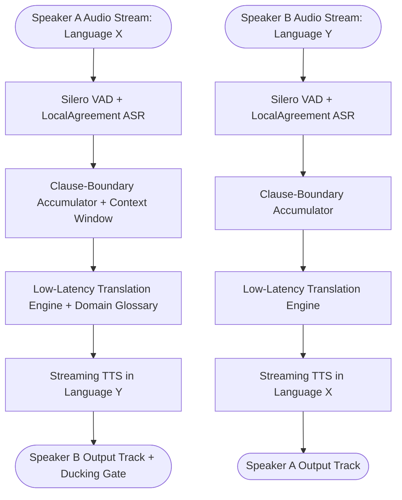

## Introduction

To build a real-time AI translation system for live voice conversations between two speakers speaking different languages, you must solve the Simultaneous Wait-$k$ / Clause-Boundary Dilemma: if you translate word-by-word as tokens arrive, differences in Subject-Verb-Object (SVO, like English) versus Subject-Object-Verb (SOV, like Hindi, Japanese, or German) word order produce garbled translations; if you wait for a speaker to finish a 30-second monologue, the conversation stalls. By combining LocalAgreement-2 streaming ASR (emitting confirmed transcript prefixes every 1.2–2.0 seconds), a rolling conversational context buffer with glossary constraints, and dual-channel speaker-isolated audio routing (to prevent acoustic feedback loops where Speaker A's translated TTS audio is re-transcribed by Speaker B's microphone stream), you can achieve sub-1.5-second simultaneous interpretation.

## Bidirectional Streaming Audio Translation Architecture



### Preventing Cross-Talk Echo & Preserving Conversational Context

1. Isolated Per-Participant Audio Tracks (WebRTC): In LiveKit (https://github.com/livekit/agents) or Pipecat (https://github.com/pipecat-ai/pipecat), subscribe to Speaker A's isolated input track (ParticipantA.audio_track) and publish the translated TTS audio on a dedicated translation track subscribed only by Speaker B. If both speakers are in the same physical room using a single speakerphone, apply a Half-Duplex Acoustic Ducking Gate that mutes inbound STT capture while translated TTS playback is active (plus a 150ms tail buffer).
1. Rolling Context & Pronoun Resolution: Spoken sentences frequently drop pronouns (*"Will ship tomorrow"*). Passing the last 3 translated utterance pairs alongside a domain glossary dictionary ensures consistent terminology and gender/formality agreement (tú vs usted, तुम vs आप).

## Technology Comparison: Paid vs. Open-Source Translation Stack

| Component | Commercial API | Open-Source / Open-Weight Alternative | Self-Hosting Possible? | Latency & Quality Trade-offs |
| --- | --- | --- | --- | --- |
| Streaming Speech Recognition | Deepgram Nova-3 Streaming (https://deepgram.com/pricing) (\$0.0092/min multilingual) | Faster-Whisper (https://github.com/SYSTRAN/faster-whisper) + LocalAgreement-2 (WhisperLiveKit / whisper_streaming) | Yes (GPU required for real-time) | LocalAgreement-2 confirms tokens when two consecutive sliding audio windows agree on the prefix. |
| Neural Translation Model | OpenAI (gpt-4o-mini) / DeepL API / Google Cloud Translate | Meta SeamlessM4T-v2 / NLLB-200-distilled-1.3B (CC-BY-NC-4.0 — *non-commercial*) / Qwen2.5-14B via Ollama (https://github.com/ollama/ollama) (Apache-2.0 — *commercial allowed*) | Yes | Critical Licence Check: Meta's NLLB-200 and SeamlessM4T weights are licensed under CC-BY-NC-4.0 (Non-Commercial). For commercial self-hosting, use Apache-2.0 licensed Qwen2.5 or Gemma models. |
| Streaming TTS | Deepgram Aura-2 (https://deepgram.com/pricing) / Cartesia Sonic / ElevenLabs Flash | OHF-Voice/piper1-gpl (https://github.com/OHF-Voice/piper1-gpl) / Kokoro-82M | Yes | Streaming TTS must support chunked PCM output at <180ms TTFB. |

### Recommended Implementation Options

### Option A: Best Practical Commercial Implementation (Recommended): LiveKit Agents (https://github.com/livekit/agents) WebRTC rooms + Deepgram Nova-3 Streaming STT + gpt-4o-mini (with rolling context & glossary) + Cartesia/Deepgram streaming TTS.

### Option B: Commercial-Permissive Open-Source Stack: Pipecat (https://github.com/pipecat-ai/pipecat) + Faster-Whisper (https://github.com/SYSTRAN/faster-whisper) LocalAgreement streaming + local Ollama (https://github.com/ollama/ollama) running Qwen2.5-14B-Instruct (Apache-2.0) + local TTS.

### Option C: Research & Non-Commercial Speech-to-Speech Stack: Meta SeamlessM4T-v2 or WhisperLiveKit (QUENTINFUXA/WHISPERLIVEKIT (https://github.com/QUENTINFUXA/WHISPERLIVEKIT)).

## Step-by-Step Implementation Guide

### Step 1: Project Structure

```text
realtime-voice-translator/
├── app/
│   ├── __init__.py
│   ├── local_agreement.py
│   └── context_translator.py
├── tests/
│   └── test_voice_translator.py
└── requirements.txt
```

### Step 2: Implement the LocalAgreement-2 Streaming Prefix Buffer (app/local_agreement.py)

When running streaming ASR over sliding audio chunks, the last few words at the right edge of an audio chunk often change as the next 0.5 seconds of audio arrives. The LocalAgreement-2 algorithm emits only the longest common word prefix agreed upon by two consecutive ASR hypotheses, preventing flickering mistranslations:

```python
from typing import List

class LocalAgreementBuffer:
    """Emits confirmed streaming ASR tokens using the LocalAgreement-2 prefix policy."""

    def __init__(self) -> None:
        self.prev_hypothesis: List[str] = []
        self.committed_words: List[str] = []

    def update_and_get_newly_confirmed(self, current_hypothesis_text: str) -> str:
        curr_words = current_hypothesis_text.strip().split()
        if not self.prev_hypothesis:
            self.prev_hypothesis = curr_words
            return ""

        # Find longest common prefix between prev_hypothesis and curr_words
        common_prefix_len = 0
        for w_prev, w_curr in zip(self.prev_hypothesis, curr_words):
            if w_prev.lower() == w_curr.lower():
                common_prefix_len += 1
            else:
                break

        already_committed_len = len(self.committed_words)
        if common_prefix_len > already_committed_len:
            new_words = curr_words[already_committed_len:common_prefix_len]
            self.committed_words.extend(new_words)
            self.prev_hypothesis = curr_words
            return " ".join(new_words)

        self.prev_hypothesis = curr_words
        return ""
```

### Step 3: Implement Rolling Context Translation & BLEU/chrF Quality Scoring (app/context_translator.py)

```python
from collections import deque
from typing import Dict, Deque, Tuple, Counter
import math

class RollingTranslationContext:
    def __init__(self, source_lang: str, target_lang: str, glossary: Dict[str, str] | None = None, max_turns: int = 4):
        self.source_lang = source_lang
        self.target_lang = target_lang
        self.glossary = glossary or {}
        self.history: Deque[Tuple[str, str]] = deque(maxlen=max_turns)

    def build_translation_prompt(self, new_utterance: str) -> str:
        glossary_lines = "\n".join(f"- '{k}' MUST be translated as '{v}'" for k, v in self.glossary.items())
        history_lines = "\n".join(f"Source: {s}\nTarget: {t}" for s, t in self.history)
        return (
            f"Translate spoken {self.source_lang} into natural spoken {self.target_lang}.\n"
            f"Glossary Rules:\n{glossary_lines or 'None'}\n\n"
            f"Recent Conversation Context:\n{history_lines or 'None'}\n\n"
            f"Current Utterance to Translate:\n{new_utterance}"
        )

    def record_turn(self, source_text: str, translated_text: str) -> None:
        self.history.append((source_text, translated_text))

def compute_chrf_score(reference: str, hypothesis: str, n_max: int = 6, beta: float = 2.0) -> float:
    """Computes character n-gram F-score (chrF) for evaluating translation quality across morphologies."""
    ref_clean = reference.strip()
    hyp_clean = hypothesis.strip()
    if not ref_clean or not hyp_clean:
        return 0.0

    total_prec = 0.0
    total_rec = 0.0
    valid_orders = 0

    for n in range(1, n_max + 1):
        if len(ref_clean) < n or len(hyp_clean) < n:
            continue
        ref_ngrams = Counter(ref_clean[i : i + n] for i in range(len(ref_clean) - n + 1))
        hyp_ngrams = Counter(hyp_clean[i : i + n] for i in range(len(hyp_clean) - n + 1))
        overlap = sum((ref_ngrams & hyp_ngrams).values())
        total_prec += overlap / sum(hyp_ngrams.values())
        total_rec += overlap / sum(ref_ngrams.values())
        valid_orders += 1

    if valid_orders == 0 or (total_prec + total_rec) == 0:
        return 0.0
    avg_p = total_prec / valid_orders
    avg_r = total_rec / valid_orders
    beta_sq = beta ** 2
    chrf = ((1 + beta_sq) * avg_p * avg_r) / ((beta_sq * avg_p) + avg_r)
    return round(chrf * 100.0, 2)
```

## Testing the Real-Time Translation Pipeline (tests/test_voice_translator.py)

```python
from app.local_agreement import LocalAgreementBuffer
from app.context_translator import RollingTranslationContext, compute_chrf_score

def test_local_agreement_commits_only_stable_prefixes():
    buf = LocalAgreementBuffer()
    # Window 1 partial hypothesis
    assert buf.update_and_get_newly_confirmed("We need to review the contract") == ""
    # Window 2 agrees on "We need to review" but changes "the contract" -> "the SLA terms"
    confirmed_1 = buf.update_and_get_newly_confirmed("We need to review the SLA terms")
    assert confirmed_1 == "We need to review the"
    # Window 3 agrees on "SLA terms tomorrow"
    confirmed_2 = buf.update_and_get_newly_confirmed("We need to review the SLA terms tomorrow")
    assert confirmed_2 == "SLA terms"

def test_rolling_context_and_chrf_metric():
    ctx = RollingTranslationContext("English", "Spanish", glossary={"Transactional Outbox": "Bandeja de salida transaccional"})
    ctx.record_turn("Good morning.", "Buenos días.")
    prompt = ctx.build_translation_prompt("We deployed the Transactional Outbox.")
    assert "Bandeja de salida transaccional" in prompt
    assert "Buenos días." in prompt

    score = compute_chrf_score("Buenos días, ¿cómo estás?", "Buenos días, ¿cómo está usted?")
    assert score > 55.0
```

## Cost Considerations & Production Checklist

- Licence Verification Reminder: Never deploy Meta's NLLB-200 or SeamlessM4T weights in a commercial paid product without a commercial licence, as their model cards specify CC-BY-NC-4.0 (Non-Commercial). Use Qwen2.5 (Apache-2.0), Gemma (Gemma Terms of Use), or commercial APIs (gpt-4o-mini / DeepL) for commercial products.
- Cost Breakdown: Bidirectional streaming STT + translation + TTS costs \~\$0.035/minute on commercial APIs or \$0 API cost on a single 24GB GPU server running Faster-Whisper + Qwen2.5 + Kokoro/Piper.

## Useful Tools, Documentation and GitHub Repositories

| Resource | Purpose | Type | Link |
| --- | --- | --- | --- |
| LiveKit Agents | Multi-participant WebRTC audio track routing | Open-Source (Apache-2.0) | https://github.com/livekit/agents |
| Pipecat | Streaming audio and translation pipeline orchestration | Open-Source (BSD-2) | https://github.com/pipecat-ai/pipecat |
| WhisperLiveKit | Real-time local speech-to-text with LocalAgreement | Open-Source | https://github.com/QUENTINFUXA/WHISPERLIVEKIT |
| Faster-Whisper | CTranslate2 Whisper inference engine | Open-Source (MIT) | https://github.com/SYSTRAN/faster-whisper |

## Frequently Asked Questions

### Why shouldn't I translate every word immediately as the STT model emits interim results?

Interim STT hypotheses change frequently as acoustic context arrives, and SOV/SVO languages invert verb positions. Translating unconfirmed interim tokens causes the TTS voice to repeat and contradict itself mid-sentence. Wait for either a clause boundary or a LocalAgreement-2 confirmed prefix.

### How do I prevent Speaker A's translated voice from being picked up by Speaker B's microphone and translated back?

In WebRTC calls, route separate directional audio tracks per participant. On shared speakerphones in a physical room, implement a half-duplex acoustic ducking gate that suppresses STT input while TTS playback is active.

### Can I use Meta's SeamlessM4T or NLLB-200 models in a commercial SaaS product?

No—both SeamlessM4T and NLLB-200 are released under the CC-BY-NC-4.0 (Non-Commercial) licence. For commercial self-hosting, use Apache-2.0 licensed LLMs like Qwen2.5-14B-Instruct via Ollama (https://github.com/ollama/ollama).

### How do I ensure company product names and medical/legal terms are translated accurately?

Inject a deterministic domain glossary (glossary={"Signal Desk": "Signal Desk"}) into both the STT keyterm list and the translation system prompt.

### Why is `chrF` preferred over standard word-level `BLEU` for evaluating translation quality?

Word-level BLEU penalises morphologically rich languages (like Hindi, German, Turkish, or Russian) harshly when a word stem is correct but an inflection suffix differs slightly, whereas character $n$-gram F-score (chrF) rewards partial morphological overlap and correlates better with human ratings.

### What is the ideal end-to-end ear-to-voice latency for live interpretation?

Professional human simultaneous interpreters operate at a 2.0 to 3.0-second lag ("ear-voice span") so they can hear the verb of the clause. Aim for 1.2 to 2.2 seconds of clause-buffered latency.

### How do I preserve the speaker's emotional tone or formality level?

Set a conversation register parameter (formal vs casual) in RollingTranslationContext so the translator consistently selects polite pronouns (usted / आप / Sie).

### How do I handle overlapping speech when both participants talk at the same time?

Because each participant streams on an independent WebRTC audio track (Track A and Track B), both STT+Translation pipelines run concurrently in full duplex without corrupting each other's audio.
