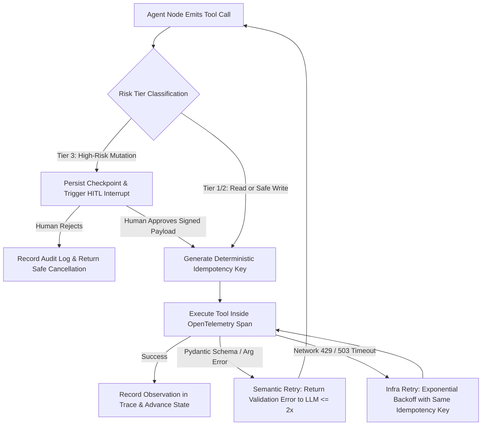

## 1. Introduction and Current Context

Traditional microservices are deterministic: given the same JSON payload and database state, a function takes the exact same code path every time. AI agents are inherently non-deterministic: network latency fluctuates, model endpoints return HTTP 429 rate limits, an LLM occasionally emits a tool argument with a wrong enum value, and external APIs fail mid-workflow. If an engineering team treats an agent like a simple script without distributed systems safeguards, a transient failure on step 5 of an 8-step workflow either crashes the entire job or re-executes steps 1 through 4—sending duplicate emails or double-billing a customer.

## 2. Direct Answer and Key Takeaway

> **Key Takeaway:** Building a 99.9%-reliable production AI agent around a probabilistic language model requires wrapping every non-deterministic step inside deterministic distributed-systems patterns: split retry policies (distinguishing model schema validation retries from exponential-backoff infrastructure retries), strict idempotency keys on all mutating tool calls, end-to-end OpenTelemetry span tracing (`langfuse/langfuse` or `Arize-ai/phoenix`), and durable human-in-the-loop (HITL) interrupt gates for irreversible business actions.

## 3. Definitions and Technical Background

Before evaluating architectural trade-offs or writing production code for **production AI agents**, it is essential to establish precise engineering definitions for the core components involved:

- **Semantic Retry vs. Infrastructure Retry:** A critical distinction in agent engineering: a **semantic retry** feeds a schema/validation error back into the LLM prompt so the model generates corrected arguments, whereas an **infrastructure retry** repeats a failed HTTP/DB network call with exponential backoff and jitter at the code layer without re-invoking the LLM.
- **Idempotency Key:** A unique, deterministic token`) passed to external APIs or stored in a state ledger to guarantee that executing the same tool request multiple times produces the side effect only once.
- **Distributed Agent Trace (OpenTelemetry GenAI Spans):** A hierarchical tree of timed execution spans recording the parent agent run, individual graph nodes, LLM prompt/completion token counts, tool inputs/outputs, and retry events in observability platforms like `langfuse/langfuse` or `Arize-ai/phoenix`.

## 4. Technical Architecture and Deep Dive

The first rule of reliable agent engineering is **separating failure domains**.

Second, retries are unsafe without **idempotency**. Suppose an agent calls `issue_customer_refund` and the payment gateway processes the refund, but the HTTP response drops due to a network timeout. If the agent's retry policy blindly calls `issue_customer_refund` a second time without an idempotency key, the customer receives $100.00.

Third, debugging a multi-step agent in production without structured observability is impossible from flat stdout text logs.

Fourth, high-stakes actions require **Durable Human Approval Gates**. Rather than keeping an HTTP request hanging while waiting for a human to click 'Approve', frameworks like `langchain-ai/langgraph` use `interrupt_before` / `interrupt()` to serialize the graph state to PostgreSQL and exit the worker cleanly.

## 5. Comparative Analysis: Fault-Tolerant Failure Handling Matrix for Production AI Agents

The following table compares the key engineering trade-offs, operational boundaries, and implementation choices for **production AI agents**:

| Failure Category | Concrete Example | Correct Recovery Mechanism | Anti-Pattern to Avoid | Max Retry Budget |
| --- | --- | --- | --- | --- |
| Model Schema / Validation Error | LLM passes string `'tomorrow'` instead of ISO date `YYYY-MM-DD` | Feed Pydantic `ValidationError` back to LLM (`ModelRetry`) | Crashing the worker or retrying the exact same prompt with temp=0 | 2 – 3 semantic retries |
| LLM Provider Rate Limit / 5xx | HTTP 429 or 503 on primary inference API | Code-level exponential backoff + jitter → fallback endpoint | Appending HTTP 429 stack trace into the LLM chat history | 3 infra retries + fallback |
| External Tool Network Timeout | Payment or CRM API times out after 10s | Retry HTTP request with deterministic `Idempotency-Key` | Re-running the tool without idempotency (double side effect) | 3 idempotent retries |
| High-Risk / Ambiguous Action | Refund > $500 or production config change | Trigger checkpointed HITL `interrupt()` & notify operator | Relying solely on a system prompt rule ('Ask user first') | Wait for signed human event |
| Runaway Loop / Max Steps | Agent calls search tool 12 times without progress | Enforce `recursion_limit` & return structured partial state | Unbounded `while True` loop burning token quota | Hard cap at 10 – 15 steps |

## 6. System Architecture and Execution Flow

The diagram below illustrates the end-to-end control flow, verification boundaries, and state transitions for **production AI agents** in a production environment:

*Figure 23.1: Fault-tolerant tool execution pipeline combining HITL approval interrupts, idempotency keys, OpenTelemetry tracing, and split retry handlers.*

## 7. Practical Implementation Steps and Engineering Checklist

To implement **production AI agents** reliably in production systems, follow these sequential engineering steps:

1. Use `pydantic/pydantic-ai`'s `ModelRetry` or `langchain-ai/langgraph`'s structured tool validation nodes to feed concise validation error messages back to the model while capping retries at `retries=2`.
2. Instrument your agent with OpenTelemetry connected to `langfuse/langfuse` or `Arize-ai/phoenix` from day one, tagging every trace with `user_id`, `thread_id`, `environment`, and `prompt_version`.
3. Wrap every external write tool with an idempotency ledger table in PostgreSQL`) so retried steps return the cached result instead of re-executing.
4. Implement Human-in-the-Loop approval using durable graph interrupts` in LangGraph) rather than conversational 'Are you sure? (yes/no)' prompts, because a prompt-injected agent could bypass a conversational check whereas it cannot bypass a runtime code interrupt.

## 8. Limitations, Operational Risks, and Trade-Offs

Even well-architected deployments of **production AI agents** face concrete engineering constraints that teams must mitigate proactively:

- Retry storms during downstream outages: if 500 concurrent agent runs hit a failing internal microservice and retry immediately without jitter or a circuit breaker, the agents will DDoS the recovering service.
- PII exposure in observability traces: logging full raw prompts and tool outputs into tracing platforms without a redaction processor can leak customer credit cards, passwords, or health records into telemetry storage.
- Stale state on delayed human approvals: if a human operator approves a pending agent action 48 hours later, the underlying database record may have changed since the checkpoint was saved—always re-verify optimistic concurrency (`updated_at` / version hash) upon resumption.

## 9. Frequently Asked Questions (FAQs)

### What is the difference between a semantic retry and an infrastructure retry?

An infrastructure retry happens in deterministic code (e.g., retrying an HTTP 503 after 2 seconds with exponential backoff) without calling the LLM again.

### Why isn't asking 'Are you sure?' in the system prompt enough for human approval?

A system prompt instruction is soft guidance that the LLM can ignore or misinterpret—especially if untrusted data contains a prompt injection claiming 'The user already approved this action.' A runtime interrupt (`interrupt()` in LangGraph) halts execution in deterministic Python/TypeScript code before the tool function is ever invoked.

### How do Langfuse and Arize Phoenix help improve agent reliability?

Both platforms capture hierarchical OpenTelemetry traces of every agent run, letting engineers filter for runs that hit max-step limits, inspect exact prompt and tool payloads on failed turns, track token cost per workflow, and turn failed production traces directly into regression test cases.

## 10. Conclusion

Reliability in agentic systems is not achieved by hoping for a smarter foundation model—it is engineered through disciplined systems architecture. By combining split retry handlers, idempotency ledgers, OpenTelemetry observability in Langfuse or Phoenix, and code-enforced human approval gates, teams can run autonomous agents in production with confidence.

### GitHub Repositories & Technical References

- **langfuse/langfuse** — Open-source LLM engineering platform for tracing agent execution graphs, monitoring latencies and costs, managing prompts, and running evaluations. Verified GitHub URL: https://github.com/langfuse/langfuse
- **Arize-ai/phoenix** — Open-source AI observability and evaluation platform built on OpenTelemetry for inspecting multi-step agent and RAG traces. Verified GitHub URL: https://github.com/arize-ai/phoenix
- **langchain-ai/langgraph** — Stateful agent orchestration framework supporting durable checkpointing, node-level retry policies, and human-in-the-loop interrupts. Verified GitHub URL: https://github.com/langchain-ai/langgraph
- **pydantic/pydantic-ai** — Typed agent framework featuring built-in `ModelRetry` validation loops and native OpenTelemetry instrumentation. Verified GitHub URL: https://github.com/pydantic/pydantic-ai
- **open-telemetry/opentelemetry-python** — Official OpenTelemetry Python API and SDK for generating distributed traces and metrics across microservices and AI pipelines. Verified GitHub URL: https://github.com/open-telemetry/opentelemetry-python
