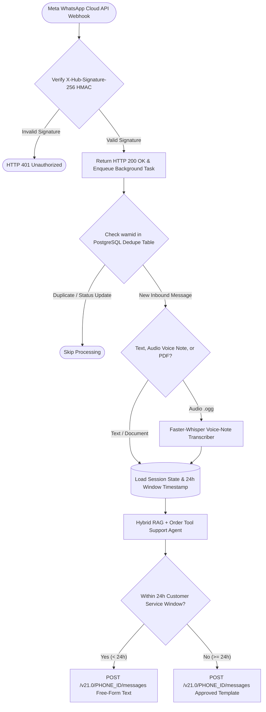

## Introduction

To build a WhatsApp AI chatbot for customer support that passes Meta's production review and handles real customer traffic reliably, you must engineer around three WhatsApp Business Platform constraints: (1) Webhook verification and `X-Hub-Signature-256` HMAC-SHA256 payload authentication, (2) immediate `<2.5s` HTTP `200 OK` acknowledgement with asynchronous message deduplication (since Meta retries unacknowledged webhooks and delivers status receipts on the same endpoint), and (3) strict enforcement of Meta's 24-hour Customer Service Window (switching automatically from free-form text replies to pre-approved Template Messages when more than 24 hours have elapsed since the user's last inbound message).

> [!TIP]
> **Architecture Reference:** Internal Link Suggestion: On Aniket.app (https://aniket.app/), see the [Signal Desk — Lead Agent](/projects/signal-desk/) case study for how an event-driven WhatsApp state machine with HMAC token authentication and PostgreSQL transactional outbox queues guarantees zero dropped messages, and cross-reference [Article 6: How to Build an AI Customer Support Agent ](/writing/build-ai-customer-support-agent-ticket-resolution/).

## WhatsApp Business Platform & Cloud API Architecture



### Critical WhatsApp Engineering Nuances

1. Handling Inbound Voice Notes (`audio/ogg; codecs=opus`): In markets like India, Brazil, and Europe, a high percentage of WhatsApp support inquiries arrive as voice notes rather than typed text. When message["type"] == "audio", fetch the temporary media download URL using GET https://graph.facebook.com/v21.0/{media_id} with your Bearer token, transcribe the .ogg buffer using Faster-Whisper (https://github.com/SYSTRAN/faster-whisper), and pass the transcript into the support agent.
1. Enforcing the 24-Hour Service Window: Meta allows free-form text/media replies only within 24 hours (86,400 seconds) of the customer's last inbound message timestamp. Outside that window, sending a "type": "text" payload fails with an API error; your dispatcher must automatically switch to "type": "template".

## Technology Comparison: Paid vs. Open-Source Stack

| Component | Commercial / BSP Solution | Direct / Open-Source Alternative | Self-Hosting Possible? | Pricing & Technical Notes |
| --- | --- | --- | --- | --- |
| WhatsApp API Access | Twilio WhatsApp / Wati / Interakt (adds per-message markup) | Direct Meta WhatsApp Cloud API (graph.facebook.com) | Cloud API hosted by Meta; webhook server self-hosted | Service conversations (user-initiated within 24h window) have \$0 Meta per-conversation fee in most tiers; template utility/marketing messages are billed per country rate card. |
| Inbox & Human Handoff UI | Zendesk / Intercom | Chatwoot (MIT License, native WhatsApp Cloud API channel) | Yes | Allows human agents to take over a conversation thread seamlessly when session_mode == "HUMAN_HANDOFF". |
| Voice Note Transcription | OpenAI Audio API / Deepgram Nova-3 (https://deepgram.com/pricing) | Faster-Whisper (https://github.com/SYSTRAN/faster-whisper) (MIT) | Yes | Decodes WhatsApp .ogg Opus audio natively via bundled PyAV. |

### Recommended Implementation Options

### Option A: Best Practical Implementation (Recommended): Direct Meta WhatsApp Cloud API + Python 3.12 FastAPI webhook server + PostgreSQL (wamid deduplication + 24h window tracker) + Faster-Whisper (https://github.com/SYSTRAN/faster-whisper) for voice notes + OpenAI/Claude with Qdrant (https://github.com/qdrant/qdrant) RAG.

### Option B: Open-Source Helpdesk Integration: Direct Meta Cloud API + self-hosted Chatwoot + FastAPI agent bot + local Ollama (https://github.com/ollama/ollama).

### Option C: High-Throughput Enterprise Architecture: FastAPI + PostgreSQL Transactional Outbox + Redis rate-limiter (respecting Meta's 80–1,000 messages/sec tier limits).

## Step-by-Step Implementation Guide

### Step 1: Project Structure

```text
whatsapp-support-bot/
├── app/
│   ├── __init__.py
│   ├── webhook_security.py
│   ├── parser_dispatcher.py
│   └── main.py
├── tests/
│   └── test_whatsapp_bot.py
└── requirements.txt
```

### Step 2: Implement Meta Webhook Verification & X-Hub-Signature-256 HMAC Validation (app/webhook_security.py)

```python
import hmac
import hashlib

def verify_meta_webhook_challenge(
    mode: str | None,
    token: str | None,
    challenge: str | None,
    expected_verify_token: str,
) -> str:
    """Validates Meta's GET /webhook subscription verification challenge."""
    if mode == "subscribe" and token and hmac.compare_digest(token, expected_verify_token):
        if challenge is None:
            raise ValueError("Missing hub.challenge parameter.")
        return challenge
    raise PermissionError("Webhook verification token mismatch.")

def verify_meta_hmac_signature(
    raw_body: bytes,
    signature_header: str | None,
    app_secret: str,
) -> bool:
    """Verifies X-Hub-Signature-256 header using constant-time HMAC-SHA256 comparison."""
    if not signature_header or not signature_header.startswith("sha256="):
        return False
    expected_sig = hmac.new(
        key=app_secret.encode("utf-8"),
        msg=raw_body,
        digestmod=hashlib.sha256,
    ).hexdigest()
    received_sig = signature_header.split("sha256=", 1)[1]
    return hmac.compare_digest(expected_sig, received_sig)
```

### Step 3: Implement Idempotent Webhook Parsing & 24-Hour Window Payload Builder (app/parser_dispatcher.py)

```python
from typing import Dict, Any, Optional, Set
from pydantic import BaseModel

class InboundWhatsAppMessage(BaseModel):
    wamid: str
    sender_phone: str
    timestamp_unix: int
    message_type: str
    text_body: Optional[str] = None
    media_id: Optional[str] = None

def extract_inbound_message(
    webhook_payload: Dict[str, Any],
    processed_wamids: Set[str],
) -> Optional[InboundWhatsAppMessage]:
    """Extracts a new user message while ignoring delivery/read status updates and duplicate wamids."""
    try:
        entries = webhook_payload.get("entry", [])
        if not entries:
            return None
        changes = entries[0].get("changes", [])
        if not changes:
            return None
        value = changes[0].get("value", {})

        # Ignore outbound delivery/read status receipts
        if "messages" not in value or not value["messages"]:
            return None

        msg = value["messages"][0]
        wamid = msg.get("id", "")
        if not wamid or wamid in processed_wamids:
            return None

        processed_wamids.add(wamid)
        msg_type = msg.get("type", "unknown")
        text_body = msg.get("text", {}).get("body") if msg_type == "text" else None
        media_id = msg.get(msg_type, {}).get("id") if msg_type in ("audio", "document", "image") else None

        return InboundWhatsAppMessage(
            wamid=wamid,
            sender_phone=msg.get("from", ""),
            timestamp_unix=int(msg.get("timestamp", 0)),
            message_type=msg_type,
            text_body=text_body,
            media_id=media_id,
        )
    except (KeyError, IndexError, ValueError):
        return None

def build_outbound_whatsapp_payload(
    recipient_phone: str,
    reply_text: str,
    last_inbound_unix: int,
    current_unix: int,
    fallback_template_name: str = "support_followup_update",
) -> Dict[str, Any]:
    """Builds a free-form text payload if within 24 hours (86,400s), else switches to a Template message."""
    elapsed_seconds = current_unix - last_inbound_unix
    if elapsed_seconds < 86400:
        return {
            "messaging_product": "whatsapp",
            "recipient_type": "individual",
            "to": recipient_phone,
            "type": "text",
            "text": {"preview_url": False, "body": reply_text[:4096]},
        }
    return {
        "messaging_product": "whatsapp",
        "to": recipient_phone,
        "type": "template",
        "template": {
            "name": fallback_template_name,
            "language": {"code": "en_US"},
            "components": [
                {
                    "type": "body",
                    "parameters": [{"type": "text", "text": reply_text[:1024]}],
                }
            ],
        },
    }
```

## Testing the WhatsApp Bot (tests/test_whatsapp_bot.py)

```python
import hmac
import hashlib
import pytest
from app.webhook_security import verify_meta_webhook_challenge, verify_meta_hmac_signature
from app.parser_dispatcher import extract_inbound_message, build_outbound_whatsapp_payload

def test_meta_hmac_signature_validation():
    secret = "my_meta_app_secret"
    body = b'{"object":"whatsapp_business_account"}'
    valid_sig = "sha256=" + hmac.new(secret.encode(), body, hashlib.sha256).hexdigest()

    assert verify_meta_hmac_signature(body, valid_sig, secret) is True
    assert verify_meta_hmac_signature(body, "sha256=deadbeef", secret) is False

def test_webhook_deduplication_and_status_filtering():
    seen = set()
    status_payload = {"entry": [{"changes": [{"value": {"statuses": [{"id": "wamid.1", "status": "delivered"}]}}]}]}
    assert extract_inbound_message(status_payload, seen) is None

    msg_payload = {
        "entry": [{
            "changes": [{
                "value": {
                    "messages": [{
                        "id": "wamid.abc123",
                        "from": "919876543210",
                        "timestamp": "1761800000",
                        "type": "text",
                        "text": {"body": "Where is my order?"},
                    }]
                }
            }]
        }]
    }
    first = extract_inbound_message(msg_payload, seen)
    assert first is not None
    assert first.wamid == "wamid.abc123"
    # Second delivery of same wamid must be ignored
    assert extract_inbound_message(msg_payload, seen) is None

def test_24_hour_window_switches_to_template():
    within_24h = build_outbound_whatsapp_payload("919876543210", "Your order shipped!", 1000, 1000 + 3600)
    assert within_24h["type"] == "text"

    after_24h = build_outbound_whatsapp_payload("919876543210", "Your order shipped!", 1000, 1000 + 90000)
    assert after_24h["type"] == "template"
```

## Deployment, Monitoring & Cost Considerations

- Avoiding Unofficial WhatsApp Scraping Libraries (`baileys` / `whatsapp-web.js`) in Production: While unofficial browser-automated libraries exist on GitHub, Meta actively bans phone numbers that use unofficial WebSocket clients for automated business support. Always use the official Meta WhatsApp Business Cloud API (graph.facebook.com), which provides a free tier for user-initiated service conversations and official webhook SLAs.
- Cost Breakdown: Meta Cloud API charges \$0 platform fee for user-initiated Customer Service Window replies in standard tiers; LLM inference + Faster-Whisper (https://github.com/SYSTRAN/faster-whisper) voice-note transcription for 5,000 conversations/month costs \~\$5.00–$12.00/month.

## Useful Tools, Documentation and GitHub Repositories

| Resource | Purpose | Type | Link |
| --- | --- | --- | --- |
| Meta WhatsApp Cloud API Docs | Official webhook, media, and template API reference | Documentation | https://www.google.com/search?q=https://developers.facebook.com/docs/whatsapp/cloud-api |
| Faster-Whisper | Transcribing inbound WhatsApp .ogg Opus voice notes | Open-Source (MIT) | https://github.com/SYSTRAN/faster-whisper |
| FastAPI | Async webhook endpoint with BackgroundTasks | Open-Source (MIT) | https://www.google.com/search?q=https://github.com/fastapi/fastapi |

## Frequently Asked Questions

### Why does Meta keep sending the same WhatsApp message to my webhook multiple times?

If your webhook endpoint waits for a slow LLM call (5–10 seconds) before returning HTTP 200 OK, Meta's webhook dispatcher times out and retries delivery exponentially. Always validate the HMAC signature, enqueue the job to a background task or outbox table, and return 200 OK within 200ms.

### Why does my bot trigger on its own outbound messages?

Meta sends statuses (sent, delivered, read) to the exact same /webhook URL as inbound user messages. Check if "messages" not in value: (as shown in extract_inbound_message) to ignore status receipts.

### How do I handle a human agent taking over a WhatsApp conversation?

Add a mode column (AI_ACTIVE vs HUMAN_HANDOFF) on your whatsapp_sessions table. When the user asks for a human or sentiment is negative, set mode = "HUMAN_HANDOFF" and forward subsequent webhook messages strictly to your helpdesk UI without triggering LLM replies.

### How do I download an image, PDF, or voice note sent by a user on WhatsApp?

The webhook only gives you a media_id. Make a GET request to https://graph.facebook.com/v21.0/{media_id} to retrieve the temporary url, then make a second GET request to that url with Authorization: Bearer {WHATSAPP_TOKEN} to download the binary file.

### What is the maximum character length of a WhatsApp text message?

4,096 characters. In practice, keep AI support replies under 600 characters formatted with bullet points so they are easy to read on a mobile screen.

### When do I need a pre-approved Meta Template Message?

Whenever you initiate a message to a user first (such as a shipping alert) or reply more than 24 hours after the user's last inbound message.

### Can I use interactive buttons (`Reply Buttons` and `List Messages`) with an AI bot?

Yes; when the agent needs the user to pick from 2–3 structured options (e.g., *"1. Track Order, 2. Return Item, 3. Talk to Human"*), send an "interactive" button payload so the user can tap once instead of typing.

### How do I protect customer PII in WhatsApp logs?

Mask phone numbers and redact credit card or government ID numbers using Presidio (https://github.com/microsoft/presidio) before storing transcripts or sending text to external LLM APIs.
