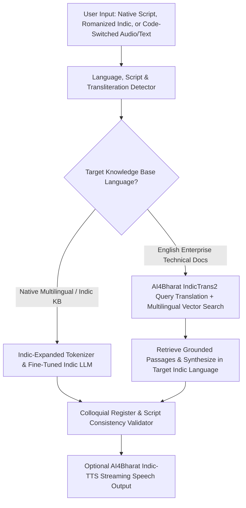

## 1. Introduction and Current Context

India does not speak a single language or write in a single script: its linguistic landscape spans Indo-Aryan (Hindi, Bengali, Marathi, Gujarati, Punjabi, Odia, Assamese), Dravidian (Tamil, Telugu, Kannada, Malayalam), Austroasiatic (Santali), and Sino-Tibetan (Manipuri/Bodo) families across Devanagari, Bengali-Assamese, Tamil, Telugu, Kannada, Malayalam, Odia, Gurmukhi, Gujarati, Perso-Arabic, and Ol Chiki scripts.

## 2. Direct Answer and Key Takeaway

> **Key Takeaway:** Building production AI for India's 22 scheduled languages and hundreds of dialects requires solving four deep technical bottlenecks that English-centric models overlook: (1) the **Tokenizer Fertility Tax** (where poorly trained Byte-Pair Encoding tokenizers split Indic scripts like Tamil, Malayalam, or Odia into 3x–6x more tokens per word, multiplying latency and cost), (2) **Romanized Code-Switching** (users typing Hindi, Tamil, or Telugu in Latin script mixed with English), (3) **Cultural vs. Literal Translation Bias**, and (4) **Low-Resource Script Hallucination**.

## 3. Definitions and Technical Background

Before evaluating architectural trade-offs or writing production code for **Indic LLMs**, it is essential to establish precise engineering definitions for the core components involved:

- **Tokenizer Fertility (Tokens per Word Ratio):** The average number of subword tokens required by a model's tokenizer to represent a single word in a given language. A fertility of ~1.2–1.4 is typical for English; poorly balanced tokenizers exhibit fertilities of 4.0–8.0+ on Indic scripts, decomposing words into individual UTF-8 bytes.
- **Code-Switching & Romanized Transliteration:** The ubiquitous Indian digital communication pattern where speakers blend an Indic language with English in the same sentence and type the Indic words phonetically using the Latin alphabet.
- **MILU (Multi-Task Indic Language Understanding Benchmark):** An open-source evaluation benchmark designed specifically to test cultural, historical, regional, and subject-matter reasoning across Indian languages rather than merely translating US-centric MMLU trivia.

## 4. Technical Architecture and Deep Dive

**The Hidden Economics of the Tokenizer Fertility Tax:** Why does an English-centric LLM run so slowly and expensively on Tamil, Telugu, Kannada, or Hindi? In a Transformer, both inference latency and API billing scale with the number of *tokens*, not the number of human words. If a model's BPE vocabulary was trained on 92% English and Western European text, an English word like `'infrastructure'` is encoded as **1 token**. An equivalent word in Tamil or Malayalam—composed of complex agglutinative morphology and UTF-8 multi-byte Unicode codepoints—may be shattered into **6 to 12 subword or byte tokens**. That means a 500-word Malayalam customer query consumes the context window and decoding time of a 3,000-word English essay!

**The Romanized Code-Switching Gap:** Academic Indic datasets historically consisted of formal government gazettes, Wikipedia pages, and classic literature written in pure native script. Real users on WhatsApp, UPI apps, and e-commerce support chats rarely write like a textbook: they use colloquial, spoken phrasing mixed with English domain nouns, often typed in Roman script.

**Why Translated English Benchmarks Mislead:** For years, labs evaluated Indic capability by taking English MMLU questions and machine-translating them into Hindi or Bengali. A model that fails a question about US tax law translated into Gujarati is not failing at Gujarati; conversely, a model that passes translated trivia may still hallucinate wildly regarding Indian agricultural seasons, RBI banking terminology, or regional legal frameworks.

**Practical Architecture Patterns for Indic AI:** In 2026, engineers deploy two complementary patterns depending on the task: (1) **Native Indic / Multilingual LLM Generation** for direct conversational interaction, and (2) **Translate-Retrieve-Translate / Hybrid Pipelines** using `AI4Bharat/IndicTrans2` when querying English-heavy enterprise documentation databases while serving answers in 22 scheduled languages.

## 5. Comparative Analysis: Engineering Challenges Across Indian Language Modalities and Verified Open-Source Solutions

The following table compares the key engineering trade-offs, operational boundaries, and implementation choices for **Indic LLMs**:

| Technical Bottleneck | Impact on Production System | Root Cause | Verified Engineering Mitigation |
| --- | --- | --- | --- |
| High Tokenizer Fertility (3x–6x tokens/word) | 3x–6x higher latency, rapid context exhaustion, and inflated API cost | UTF-8 byte fallback in English-skewed BPE tokenizers | Measure fertility; select Indic-expanded vocab models or sovereign Indic LLMs |
| Romanized & Code-Switched Input (Hinglish/Tanglish) | Intent misclassification and garbled script switching in replies | Pretraining limited to formal native-script Wikipedia/news | Fine-tune with `AI4Bharat/IndicLLMSuite` transliterated & code-switched splits |
| Overly Formal / Unnatural Output Tone | Users reject robotic 'textbook' translations in support chats | Literal translation from English synthetic instruction data | Include colloquial style exemplars & evaluate with native speakers |
| Cross-Lingual RAG Retrieval Failure | Query in Marathi fails to match English technical policy PDF | Weak cross-lingual alignment in monolingual embedding models | Use `AI4Bharat/IndicTrans2` query translation or multilingual embeddings + BM25 |
| Misleading Benchmark Scores | Model scores well on translated MMLU but fails Indian domain tasks | Western-centric evaluation sets | Benchmark on `AI4Bharat/MILU` and `AI4Bharat/indic-llm-eval-suite` |

## 6. System Architecture and Execution Flow

The diagram below illustrates the end-to-end control flow, verification boundaries, and state transitions for **Indic LLMs** in a production environment:

*Figure 39.1: Production multilingual Indic AI pipeline handling Romanized code-switching, cross-lingual RAG via IndicTrans2, and script-consistent synthesis.*

## 7. Practical Implementation Steps and Engineering Checklist

To implement **Indic LLMs** reliably in production systems, follow these sequential engineering steps:

1. Run a **Tokenizer Fertility Audit** before picking a model: tokenize 1,000 representative sentences in your target Indian languages and compute `total_tokens / total_words`; reject models that fall back to raw byte encoding.
2. Include **Romanized and code-switched** test cases in your evaluation suite alongside native Unicode scripts, explicitly instructing the system prompt whether to reply in native script or match the user's Romanized script.
3. Enforce Unicode Normalization`) across all text ingestion and search pipelines so composed vs. decomposed Indic vowel matras and nuktas do not break string matching or BM25 tokenization.
4. Use `AI4Bharat/IndicTrans2` for high-throughput, low-cost deterministic translation across all 22 scheduled Indian languages when bridging vernacular user queries to English backend databases.

## 8. Limitations, Operational Risks, and Trade-Offs

Even well-architected deployments of **Indic LLMs** face concrete engineering constraints that teams must mitigate proactively:

- Agglutinative morphology breaking keyword search: Dravidian languages (such as Malayalam, Tamil, and Telugu) fuse roots and multiple suffixes into single long words; standard whitespace BM25 tokenizers fail unless paired with subword/morphological analyzers or dense embeddings.
- Script-mixing hallucinations: mid-sized multilingual models occasionally slip Chinese, Cyrillic, or wrong Indic script characters (e.g., inserting a Devanagari word inside a Gujarati sentence) during high-temperature generation—add a deterministic Unicode character-range regex validator on outputs.
- Domain terminology over-translation: translating technical terms like `'UPI ID'`, `'IFSC Code'`, or `'Router'` into archaic literary equivalents confuses Indian users; keep established English technical nouns intact via glossary constraints.

## 9. Frequently Asked Questions (FAQs)

### What is 'tokenizer fertility' and why does it matter so much for Indian languages?

Tokenizer fertility is the average number of tokens needed to encode a single word.

### Should an Indic AI assistant translate English Technical nouns like 'OTP' or 'Bank Statement' into pure Hindi/Tamil?

No.

### How can I build RAG over English company PDFs when my users ask questions in Hindi, Telugu, or Bengali?

Pair a fast translation stage (`AI4Bharat/IndicTrans2`) or a strong multilingual embedding model with `qdrant/qdrant` so the user's regional query retrieves the exact English policy chunks, and then synthesize the grounded answer in the user's language.

## 10. Conclusion

Building AI for Indian languages requires moving beyond surface-level translation prompts to address tokenization efficiency, Unicode normalization, code-switching, and native evaluation. By leveraging open-source foundations like `AI4Bharat/IndicLLMSuite`, `IndicTrans2`, and `MILU`, developers can build fast, natural, and inclusive AI systems for a billion users.

### GitHub Repositories & Technical References

- **AI4Bharat/IndicLLMSuite** — Official blueprint and curated dataset collection from AI4Bharat (IIT Madras) for pretraining and fine-tuning Indic LLMs. Verified GitHub URL: https://github.com/AI4Bharat/IndicLLMSuite
- **AI4Bharat/IndicTrans2** — Official open-source transformer translation models supporting all 22 scheduled Indian languages. Verified GitHub URL: https://github.com/ai4bharat/IndicTrans2
- **AI4Bharat/MILU** — Multi-task Indic Language Understanding Benchmark evaluating language comprehension and India-specific domain knowledge. Verified GitHub URL: https://github.com/AI4Bharat/MILU
- **AI4Bharat/indic-llm-eval-suite** — Evaluation harness from AI4Bharat for standardized benchmarking of language models on Indic tasks. Verified GitHub URL: https://github.com/AI4Bharat/indic-llm-eval-suite
- **AI4Bharat/Indic-TTS** — Open-source Text-to-Speech models and synthesis tools for Indian languages. Verified GitHub URL: https://github.com/AI4Bharat/Indic-TTS
