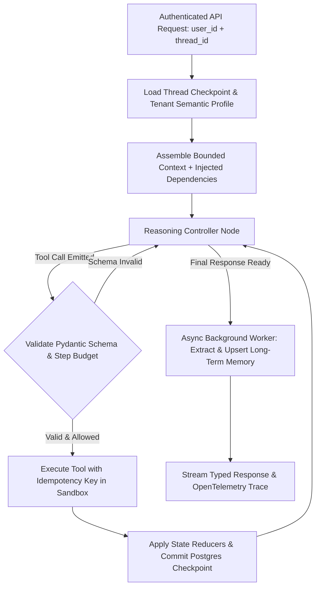

## 1. Introduction and Current Context

Most 'build an AI agent in 5 minutes' tutorials run an in-memory `while` loop that appends messages to a local Python list and calls `eval()` or an unguarded HTTP request. The moment that script is deployed behind a load-balanced web server with multiple worker processes, it breaks: if the user refreshes the page or a worker restarts mid-task, the agent's progress vanishes; if a tool times out, the agent double-charges a customer; and after 25 turns, the context window overflows. Designing a resilient production agent in 2026 requires a stateful systems blueprint built on frameworks like `langchain-ai/langgraph`, `pydantic/pydantic-ai`, and `pgvector/pgvector`.

## 2. Direct Answer and Key Takeaway

> **Key Takeaway:** A production-ready AI agent differs from a 30-line tutorial script in four structural ways: its working state is governed by an explicit typed schema rather than an unbounded text string; its execution state is checkpointed to a durable database (such as PostgreSQL) after every node transition; its long-term user memory is isolated in a tenant-scoped store separate from thread history; and its tools enforce idempotency keys, schema validation, and least-privilege permissions.

## 3. Definitions and Technical Background

Before evaluating architectural trade-offs or writing production code for **build AI agent**, it is essential to establish precise engineering definitions for the core components involved:

- **Thread-Scoped Checkpoint (`thread_id`):** A durable database record keyed by conversation or task ID that persists the exact node position, typed state fields, and message history after every step in an agent graph.
- **Namespace-Scoped Long-Term Store (`user_id` / `tenant_id`):** A persistent cross-session storage layer that retains structured user preferences, semantic facts, and episodic summaries across separate conversation threads.
- **State Reducer Function:** A deterministic rule attached to a state schema field (such as `add_messages` or a custom deduplicating reducer) that specifies how an output returned by an agent node merges into the existing checkpoint state.
- **Idempotent Tool Execution:** Designing mutating tools (such as creating an invoice or sending a notification) to accept a deterministic `idempotency_key` derived from the `thread_id` and `step_id`, ensuring that network retries never duplicate side effects.

## 4. Technical Architecture and Deep Dive

The foundation of a production agent architecture is its **Typed State Schema**. Instead of forcing the language model to infer application state by re-reading 50 messages of conversational prose, engineers define an explicit state object containing both a bounded message list and structured operational fields—such as `customer_id: str`, `verified_tier: Literal['free', 'pro', 'enterprise']`, `pending_approvals: list[ToolCall]`, and `step_count: int`.

Second, production agents separate **short-term thread persistence** from **long-term semantic memory**. Thread persistence—implemented via a PostgreSQL checkpointer in `langchain-ai/langgraph`—saves a serialized snapshot of the state graph at every super-step.

Long-term memory, by contrast, must survive across different threads over months. Rather than dumping old transcripts into a new thread, the architecture exposes two mechanisms: a fast relational key-value profile loaded at session start (containing core user facts like timezone, role, and preferred programming language), and an episodic hybrid search tool backed by `pgvector/pgvector` or `qdrant/qdrant`.

Finally, tool execution and failure recovery must be engineered defensively. When a tool fails due to a validation error (the model passed a malformed date string), the runtime catches the Pydantic `ValidationError` and returns a concise corrective message to the model so it can self-correct on the next turn.

## 5. Comparative Analysis: Prototype Agent Script vs. Production-Ready Stateful Agent Architecture

The following table compares the key engineering trade-offs, operational boundaries, and implementation choices for **build AI agent**:

| Architectural Component | Toy / Prototype Agent Script | Production-Ready Agent Architecture (2026) | Primary Open-Source Building Blocks |
| --- | --- | --- | --- |
| State Representation | In-memory Python `messages = []` list | Typed state schema + reducer functions + step budget | `langchain-ai/langgraph`, `pydantic/pydantic-ai` |
| Crash & Restart Recovery | None (state lost on process restart) | Transactional Postgres checkpoint after every node step | `langgraph-checkpoint-postgres`, PostgreSQL |
| Cross-Session Memory | None or naive full-history concatenation | Tenant-isolated semantic KV store + `pgvector` episodic search | `pgvector/pgvector`, `qdrant/qdrant` |
| Tool Authorization | Global API key shared across all calls | Per-request dependency injection of scoped user RBAC context | `pydantic/pydantic-ai` (`RunContext`), FastAPI |
| Error Handling | Uncaught exception crashes request | Split handling: schema retry to LLM vs. infra backoff with idempotency | Tenacity retries + structured tool error wrappers |

## 6. System Architecture and Execution Flow

The diagram below illustrates the end-to-end control flow, verification boundaries, and state transitions for **build AI agent** in a production environment:

*Figure 20.1: Production agent architecture integrating PostgreSQL thread checkpointing, tenant-isolated long-term memory, and idempotent tool execution.*

## 7. Practical Implementation Steps and Engineering Checklist

To implement **build AI agent** reliably in production systems, follow these sequential engineering steps:

1. Pass security-critical identifiers (`user_id`, `tenant_id`, `org_role`) through an out-of-band dependency context (`RunContext` in Pydantic AI or `RunnableConfig` in LangGraph) directly to your database tools—never let the LLM pass `user_id` as a tool argument that could be spoofed via prompt injection.
2. Attach an explicit `step_count` counter to your agent state and enforce a hard conditional edge that exits gracefully with a partial summary if `step_count >= max_steps` (e.g., 10 steps).
3. Implement a rolling message trimmer or state compaction node that summarizes tool observations older than 6 turns into structured state fields while keeping the full raw audit trail in PostgreSQL.
4. Generate a deterministic `idempotency_key = sha256(f'{thread_id}:{step_id}:{tool_name}')` for every mutating tool call so automatic network retries never execute duplicate writes.
5. Move long-term memory extraction out of the critical user-facing response path: return the assistant's reply immediately, and run memory consolidation asynchronously in a background task queue.

## 8. Limitations, Operational Risks, and Trade-Offs

Even well-architected deployments of **build AI agent** face concrete engineering constraints that teams must mitigate proactively:

- Checkpoint payload bloat: storing multi-megabyte base64 images or raw 5MB JSON blobs directly inside the LangGraph state dictionary slows down every PostgreSQL checkpoint read/write—store large blobs in object storage (S3/GCS) and keep only URI pointers in agent state.
- Concurrent thread race conditions: if a user double-clicks 'Send' and triggers two parallel executions on the exact same `thread_id`, concurrent graph runs can overwrite each other's checkpoints unless protected by a per-thread distributed lock or queue policy.
- Unbounded memory growth: writing a new semantic memory vector on every single turn without deduplication or consolidation quickly fills the vector index with contradictory or trivial fragments.

## 9. Frequently Asked Questions (FAQs)

### Why shouldn't I let the LLM pass `user_id` as an argument to my database tools?

If `user_id` is an LLM-controlled tool argument, a prompt injection attack can trick the model into passing another customer's `user_id`, causing a severe cross-tenant data breach.

### What is the difference between a Checkpointer and a Memory Store in LangGraph?

A Checkpointer saves the state of a *single conversation thread* (`thread_id`) at every step so it can pause, resume, or recover from crashes.

### How do I handle a tool error without crashing the agent or confusing the LLM?

Catch expected domain/validation errors inside the tool wrapper and return a concise, actionable string (e.g., `'Error: start_date must be YYYY-MM-DD format'`) with `isError=True` so the LLM can fix its parameters.

## 10. Conclusion

Building a production-ready AI agent is fundamentally an exercise in distributed state systems engineering. By combining typed schemas in Pydantic AI, durable PostgreSQL checkpointing in LangGraph, server-enforced tenant isolation in `pgvector`, and idempotent tool wrappers, teams can ship agents that handle real-world traffic reliably.

### GitHub Repositories & Technical References

- **langchain-ai/langgraph** — Official framework for building stateful, durable AI agents with PostgreSQL checkpointing and cross-thread memory stores. Verified GitHub URL: https://github.com/langchain-ai/langgraph
- **pydantic/pydantic-ai** — Official Python agent framework featuring typed dependency injection (`RunContext`), structured output validation, and streaming. Verified GitHub URL: https://github.com/pydantic/pydantic-ai
- **pgvector/pgvector** — Open-source vector similarity search for PostgreSQL, allowing teams to keep relational checkpoints and semantic memory in one database. Verified GitHub URL: https://github.com/pgvector/pgvector
- **fastapi/fastapi** — High-performance Python web framework for serving authenticated, streaming AI agent APIs. Verified GitHub URL: https://github.com/fastapi/fastapi
