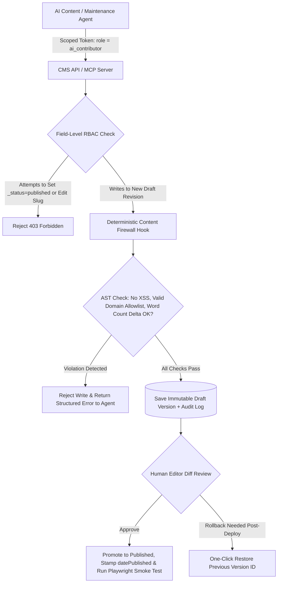

## 1. Introduction and Current Context

As organizations connect autonomous agents (`anthropics/claude-code`, `openai/codex`, `langchain-ai/langgraph`) to their websites and CMS backends via Model Context Protocol (MCP) servers or REST APIs, a dangerous temptation arises: handing the agent an Administrator API key so it can update live pages automatically. In a world of indirect prompt injection, hallucinated URLs, and schema drift, giving an AI agent unrestricted write access to a live public website is an operational time bomb. Designing a zero-trust publishing control plane allows teams to automate 90% of content maintenance without risking public defacement or data loss.

## 2. Direct Answer and Key Takeaway

> **Key Takeaway:** AI agents can safely prepare, validate, and stage website updates—such as fixing broken links, updating API documentation tables, or creating new article drafts—only when they are treated as **untrusted junior contributors** governed by deterministic infrastructure controls. A safe automated publishing architecture enforces five non-negotiable controls: (1) dedicated agent service identities with field-level RBAC (`draft`-only writes), (2) schema and policy validation hooks that block prohibited external links or XSS payloads, (3) immutable version snapshots with one-click rollback, (4) isolated secret management, and (5) human or deterministic CI approval gates before production cache invalidation.

## 3. Definitions and Technical Background

Before evaluating architectural trade-offs or writing production code for **AI website agents**, it is essential to establish precise engineering definitions for the core components involved:

- **Least-Privilege Agent Service Principal:** A dedicated, non-admin CMS or Git identity assigned exclusively to an AI agent, restricted via Role-Based and Field-Level Access Control to modify only approved collections in `_status: 'draft'`.
- **Field-Level Write Lock:** A CMS schema permission rule that prevents an agent identity from modifying sensitive fields—such as `slug`, `canonicalUrl`, `author`, `datePublished`, `_status`, or custom script injection fields.
- **Pre-Publish Policy Firewall:** A deterministic server-side validator that parses every proposed content update and rejects any diff containing unauthorized external domains, `<script>` tags, broken internal slugs, or PII.

## 4. Technical Architecture and Deep Dive

What goes wrong when an AI agent is granted direct admin access to a CMS or website repository? Consider three realistic failure scenarios. First, **accidental destructive overwrites**: asked to 'add a FAQ item to Article 12,' a poorly prompted agent calls `PATCH /api/articles/12` with *only* the new FAQ in the `body` field, wiping out the existing 1,300-word article. Second, **URL & SEO destruction**: an agent 'optimizes' an existing published article's `slug` without setting up a 301 redirect, instantly breaking all inbound backlinks and search rankings.

To eliminate these risks at the architectural root, engineers implement **Defense-in-Depth Publishing Controls** across either a **CMS Staging Workflow** or a **GitOps Pull Request Workflow**. In the CMS Staging Workflow, the agent authenticates using a scoped service token. Inside Payload CMS's collection access control, `update` permission for `ai_contributor` writes strictly to a new **Draft Version** while leaving the currently published version untouched for public visitors.

Next, every agent write passes through a **Deterministic Content Firewall**.

Finally, when a human editor reviews the side-by-side visual diff in the CMS admin UI and clicks 'Approve & Publish,' an immutable audit log records `agent_run_id`, `approved_by_user_id`, and `git_sha`/`version_id`, and a post-deploy smoke test verifies the live URL.

## 5. Comparative Analysis: Permission & Control Matrix for AI Website Agents (Role: `ai_contributor` vs. `human_editor`)

The following table compares the key engineering trade-offs, operational boundaries, and implementation choices for **AI website agents**:

| CMS / Website Operation | AI Agent (`ai_contributor` Role) | Human Editor (`human_editor` Role) | Enforcing Technical Mechanism |
| --- | --- | --- | --- |
| Create New Article Draft | Allowed (`_status: 'draft'` only) | Allowed (`draft` or `published`) | Collection-level RBAC in `payloadcms/payload` |
| Propose Edit to Published Page | Creates new unmerged Draft Version | Reviews diff & promotes version to live | `versions: { drafts: true }` + `_status` field lock |
| Modify `slug` or `datePublished` | Denied (`HTTP 403` / Field Ignored) | Allowed (auto-creates 301 redirect) | Field-level `access.update` function |
| Insert External Hyperlinks | Restricted strictly to verified allowlist (`github.com`) | Allowed per editorial policy | AST link-extractor in `beforeValidate` hook |
| Production Cache Purge / Deploy | Denied (cannot trigger prod webhook) | Triggered automatically upon human publish | Server-only `afterChange` check on `_status` transition |

## 6. System Architecture and Execution Flow

The diagram below illustrates the end-to-end control flow, verification boundaries, and state transitions for **AI website agents** in a production environment:

*Figure 35.1: Zero-trust CMS publishing pipeline for AI website agents featuring field-level RBAC, AST link/XSS firewalls, immutable draft versions, and instant rollback.*

## 7. Practical Implementation Steps and Engineering Checklist

To implement **AI website agents** reliably in production systems, follow these sequential engineering steps:

1. Never share a human administrator's API key or personal access token (`PAT`) with an AI agent; provision a dedicated `ai-agent-bot` account with the minimum required permissions and rotate its credentials stored in your secret manager.
2. Enable `versions: { drafts: true, maxPerDoc: 50 }` in `payloadcms/payload` so every agent edit creates a non-destructive draft revision rather than overwriting live database columns in place.
3. Lock `_status`, `slug`, `canonicalUrl`, `author`, and `datePublished` at the field-schema level so only authenticated human editors can mutate publication state or URL routing.
4. Write a deterministic AST link validator in your CMS `beforeValidate` hook that parses all links in the article body and blocks any unauthorized external domains or broken internal paths.

## 8. Limitations, Operational Risks, and Trade-Offs

Even well-architected deployments of **AI website agents** face concrete engineering constraints that teams must mitigate proactively:

- Full-document replacement data loss: if an agent tool exposes a naive `update_article_body(id, full_markdown)` interface, the LLM may truncate long sections to save output tokens—prefer targeted section-level patch tools or enforce a minimum word-count retention guard.
- Leaking preview/staging URLs to search engines: if your CMS generates preview URLs for agent drafts (`preview.yoursite.com/draft-123`), ensure preview routes emit `X-Robots-Tag: noindex, nofollow` and require authentication so search crawlers never index unapproved agent drafts.
- Prompt injection via scraped external sources: if an agent updates a page after browsing external web content, untrusted text in those sources can attempt to trick the agent into inserting malicious links—making the deterministic AST domain allowlist mandatory.

## 9. Frequently Asked Questions (FAQs)

### Can an AI agent safely fix typos or update code snippets on a live documentation site?

Yes, provided the agent submits its changes as a CMS Draft Version or a GitHub Pull Request (`anthropics/claude-code-action`) that runs through deterministic CI tests (linting, link checking, code compilation) and human review before going live.

### How do I prevent an AI agent from accidentally deleting half of an existing article during an update?

First, enable immutable version history in your CMS (`payloadcms/payload`) so nothing is ever permanently overwritten.

### How do I stop an AI agent from inserting prohibited external links into an article?

Do not rely on prompt instructions alone.

## 10. Conclusion

AI agents can be trusted to maintain and prepare website content when the underlying publishing platform enforces strict cryptographic and architectural boundaries. By combining draft-only RBAC, field-level locks, AST link and XSS firewalls, immutable versioning in Payload CMS or Git, and Playwright smoke tests, engineering teams get effortless content automation with zero loss of control.

### GitHub Repositories & Technical References

- **payloadcms/payload** — Open-source headless CMS providing built-in draft versioning (`versions.drafts`), field-level RBAC functions, and `beforeValidate` lifecycle hooks. Verified GitHub URL: https://github.com/payloadcms/payload
- **strapi/strapi** — Open-source headless CMS supporting role-based access control, draft/publish states, and webhook automation. Verified GitHub URL: https://github.com/strapi/strapi
- **anthropics/claude-code-action** — Official GitHub Action enabling coding and documentation agents to submit website updates as reviewed Pull Requests rather than direct commits to `main`. Verified GitHub URL: https://github.com/anthropics/claude-code-action
- **microsoft/playwright** — End-to-end browser testing framework for post-deployment verification and automated rollback triggers. Verified GitHub URL: https://github.com/microsoft/playwright
