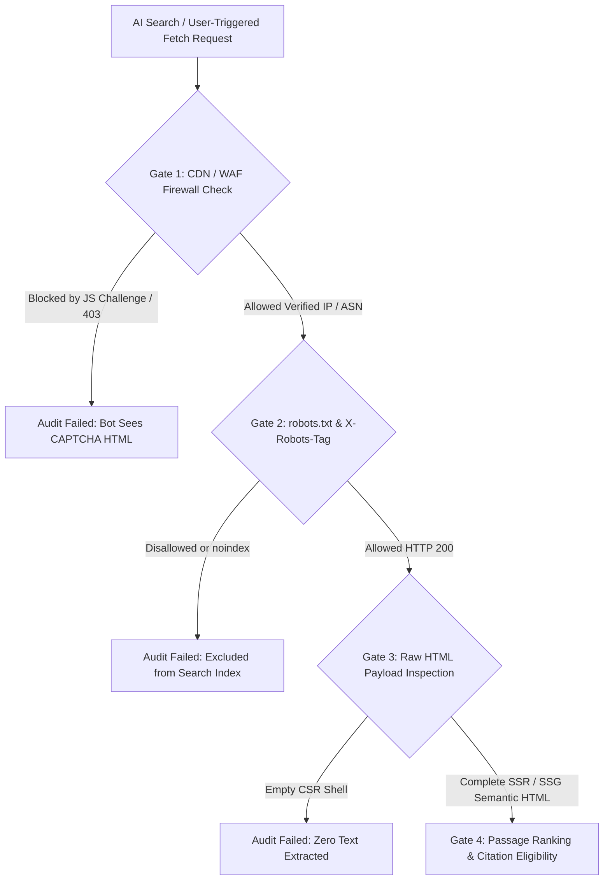

## 1. Introduction and Current Context

Between 2023 and 2024, many system administrators and CDN providers reflexively added blanket blocks against every AI-related user-agent in `robots.txt` or Cloudflare WAF rules to prevent unauthorized model pretraining. By 2026, those same organizations frequently ask why their documentation, product pages, and technical blogs are completely invisible when customers ask ChatGPT Search, Claude, or Perplexity for recommendations.

## 2. Direct Answer and Key Takeaway

> **Key Takeaway:** For ChatGPT, Claude, or any generative search engine to cite your website, your pages must clear four sequential technical gates: **Network & WAF Access** (not blocked by CDN bot-fight rules), **Robots.txt Permission** (allowing search/citation user-agents independently from bulk training crawlers), **Initial HTML Renderability** (delivering complete text in the server-rendered HTML response without requiring client-side JavaScript execution), and **Index & Retrieval Eligibility** (canonical URLs, sitemap discovery, and high passage quality). Importantly, granting crawler *access* is a necessary prerequisite, never a guarantee of *citation inclusion*.

## 3. Definitions and Technical Background

Before evaluating architectural trade-offs or writing production code for **ChatGPT website visibility**, it is essential to establish precise engineering definitions for the core components involved:

- **Model Training Crawler (`GPTBot`, `ClaudeBot`, `Google-Extended`):** Automated user-agents or robots.txt tokens used by AI vendors to control whether scraped web content may be included in future foundation model pretraining or fine-tuning datasets.
- **Search Index & Live Retrieval User-Agents (`OAI-SearchBot`, `ChatGPT-User`, `Claude-SearchBot`, `Claude-User`, `PerplexityBot`):** Distinct user-agents used specifically to index pages for search citations or to fetch a live webpage in response to an active user's search query.
- **WAF / CDN Bot-Fight False Positives:** Security firewall rules that block legitimate AI search fetchers with `HTTP 403 Forbidden` or `429` before `robots.txt` is even evaluated.

## 4. Technical Architecture and Deep Dive

**Gate 1: Separating Training Opt-Out from Search Citation Access in `robots.txt`.** Many website owners want their articles cited with clickable links in AI search results while opting out of having their proprietary content absorbed into foundational model weights. Major AI providers explicitly support separate `robots.txt` user-agent tokens for these two functions. For OpenAI, `GPTBot` governs model training data collection, whereas `OAI-SearchBot` governs indexing for ChatGPT Search citations and `ChatGPT-User` governs live user-triggered page fetches. If your `robots.txt` blocks `*` or blocks `OAI-SearchBot`, ChatGPT Search cannot index your page content for rich synthesis.

**Gate 2: Auditing CDN and WAF Firewalls.** Updating `robots.txt` is useless if your CDN edge firewall blocks the crawler's TCP/HTTP connection with a `403 Forbidden` or a visual CAPTCHA challenge page. Security teams frequently enable generic 'Block AI Scrapers' or 'Managed Challenge for Non-Browser ASNs' toggles in their CDN dashboard, which indiscriminately drops requests from `OAI-SearchBot`, `ChatGPT-User`, and `Claude-User`.

**Gate 3: Server-Side Rendering (SSR) vs. Client-Side JavaScript (CSR).** While Googlebot runs a headless Chromium renderer queue to execute client-side JavaScript, most real-time AI retrieval fetchers operate under a strict sub-second latency budget during a live chat turn. They fetch the raw HTTP response and parse the initial HTML DOM directly—they do **not** wait 3 seconds for a client-side React SPA to download a 2MB bundle and fetch article text from an XHR API. If `curl -s https://yoursite.com/article` returns `
Loading...
`, your page is invisible to live AI retrieval.

**Gate 4: Canonicalization, HTTP Headers, and Content Quality.** Finally, verify that pages do not accidentally emit `X-Robots-Tag: noindex` HTTP headers from staging environments, that `<link rel="canonical">` points to the exact public HTTPS URL, and that your XML sitemap includes accurate `<lastmod>` timestamps.

## 5. Comparative Analysis: 2026 AI Crawler & Fetcher User-Agent Matrix: Purpose and Access Controls

The following table compares the key engineering trade-offs, operational boundaries, and implementation choices for **ChatGPT website visibility**:

| User-Agent / Token | Ecosystem | Primary Technical Function | Impact of Disallowing in `robots.txt` |
| --- | --- | --- | --- |
| `OAI-SearchBot` | OpenAI / ChatGPT | Indexes web pages for search results and citations in ChatGPT | Prevents full page indexing for ChatGPT Search summaries |
| `ChatGPT-User` | OpenAI / ChatGPT | Live page fetch triggered when a user asks ChatGPT to read/search | Blocks real-time browsing of your URLs during user chats |
| `GPTBot` | OpenAI | Crawls content for generative AI foundation model training | Opts content out of future OpenAI model training runs |
| `Claude-SearchBot` / `Claude-User` | Anthropic / Claude | Search indexing and user-triggered live page retrieval in Claude | Prevents Claude from retrieving/citing live page content |
| `ClaudeBot` | Anthropic | Model training data collection crawler | Opts content out of Anthropic model training |
| `Google-Extended` | Google | Controls use of content for Gemini model training / grounding | Does not block standard `Googlebot` search indexing |

## 6. System Architecture and Execution Flow

The diagram below illustrates the end-to-end control flow, verification boundaries, and state transitions for **ChatGPT website visibility** in a production environment:

*Figure 28.1: Four-gate technical audit flowchart determining whether an AI search engine or assistant can crawl, extract, and cite a webpage.*

## 7. Practical Implementation Steps and Engineering Checklist

To implement **ChatGPT website visibility** reliably in production systems, follow these sequential engineering steps:

1. Run a terminal raw-HTML audit on your target URLs: verify that the response status is `200 OK`, that no `X-Robots-Tag: noindex` header is present, and that the complete article body and tables appear in the raw HTML source.
2. Configure `robots.txt` with explicit, granular user-agent blocks rather than blanket wildcards—for example, explicitly allowing `OAI-SearchBot`, `ChatGPT-User`, `Claude-SearchBot`, `Claude-User`, and `Googlebot` on `/articles/` even if you disallow training bots or private `/api/` routes.
3. Audit your CDN/WAF security events log for `403` or `429` responses returned to verified OpenAI, Anthropic, and Google crawler IP CIDRs, and exempt public documentation/article routes from interactive browser JS challenges.
4. Pre-render all public article content on the server using Next.js Static Site Generation or Server Components so time-to-first-byte (TTFB) is under 200ms and zero client-side JS is required to read the text.

## 8. Limitations, Operational Risks, and Trade-Offs

Even well-architected deployments of **ChatGPT website visibility** face concrete engineering constraints that teams must mitigate proactively:

- Confusing access with guaranteed citations: fixing a `robots.txt` block or WAF rule makes your site *readable*, but AI search engines will still skip thin, repetitive, or unoriginal pages during passage reranking.
- IP spoofing by rogue scrapers: never whitelist crawler `User-Agent` strings in your firewall without also verifying the request's source IP against the provider's published IP JSON ranges or reverse DNS (`rDNS`), as any scraper can forge a `User-Agent` header.
- Paywall and cookie-modal occlusion: server-side overlays that replace the article HTML with a 'Sign in to continue reading' DOM payload when no session cookie is present will prevent search crawlers from indexing the underlying article.

## 9. Frequently Asked Questions (FAQs)

### Can I block AI model training while still allowing ChatGPT to cite my website in search?

Yes.

### Why can Google index my React Single-Page Application (SPA) while AI search tools return empty summaries?

Googlebot runs a deferred headless Chromium rendering queue that executes client-side JavaScript bundles.

### How can I verify that requests claiming to be `OAI-SearchBot` are genuinely from OpenAI?

Do not rely on the `User-Agent` string alone.

## 10. Conclusion

Ensuring ChatGPT, Claude, and generative search engines can cite your website starts with unblocking the network and HTML fundamentals. By distinguishing search user-agents from training crawlers in `robots.txt`, removing WAF false positives, and serving fast server-rendered HTML via Next.js, you make your technical content fully accessible to modern discovery pipelines.

### GitHub Repositories & Technical References

- **vercel/next.js** — Official React framework supporting Server Components, Server-Side Rendering (SSR), and Static Site Generation (SSG) for crawler-accessible HTML. Verified GitHub URL: https://github.com/vercel/next.js/
- **microsoft/playwright** — Automation framework capable of testing pages with `javaScriptEnabled: false` to verify raw server-rendered HTML extractability. Verified GitHub URL: https://github.com/microsoft/playwright
- **schemaorg/schemaorg** — Official Schema.org repository for structured metadata markup inside server-rendered HTML pages. Verified GitHub URL: https://github.com/schemaorg/schemaorg
