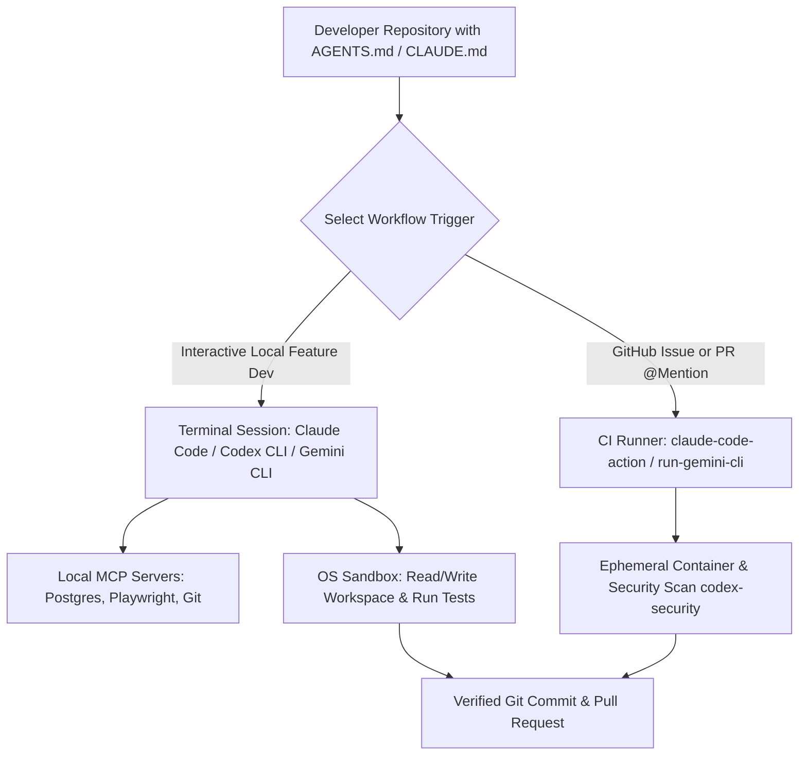

## 1. Introduction and Current Context

Software engineers no longer want to copy-paste stack traces between a terminal window and a browser tab. By October 2026, the command-line interface (CLI) has become the primary control plane for agentic software engineering. Because terminal agents live directly inside the developer's working directory, they can invoke standard Unix tools (`ripgrep`, `git`, `make`, `docker`), inspect compiler diagnostics in real time, and orchestrate multi-file changes across monorepos. Selecting the right CLI agent—or combining them across local and CI workflows—requires comparing their verified technical capabilities, sandboxing models, and repository integrations.

## 2. Direct Answer and Key Takeaway

> **Key Takeaway:** In 2026, terminal-native AI coding agents have converged around three flagship ecosystems: Anthropic's Claude Code (`anthropics/claude-code`), OpenAI's Codex CLI (`openai/codex`), and Google's Gemini CLI (`google-gemini/gemini-cli`). While all three navigate local git repositories, execute shell commands, connect to Model Context Protocol (MCP) servers, and run in GitHub Actions, they differ in architectural philosophy: Claude Code emphasizes deep multi-file reasoning, sub-agent delegation, and managed PR review (`claude-code-action`); OpenAI Codex CLI prioritizes lightweight open-source terminal execution with OS-level sandboxing and companion security auditing (`openai/codex-security`); and Gemini CLI leverages massive 1M-token context windows and native Google Cloud / GitHub Actions integration (`run-gemini-cli`).

## 3. Definitions and Technical Background

Before evaluating architectural trade-offs or writing production code for **AI coding agent comparison**, it is essential to establish precise engineering definitions for the core components involved:

- **Terminal-Native Coding Agent:** A command-line agent that runs inside the user's shell session, maintaining awareness of the local git worktree, environment variables, and project instruction files (`CLAUDE.md`, `AGENTS.md`, `GEMINI.md`).
- **OS-Level Process Sandboxing:** Security enforcement used by CLI agents (such as macOS Seatbelt `sandbox-exec` or Linux container/Landlock profiles in `openai/codex`) to block network egress and restrict file writes outside the active repository without requiring a heavy VM.
- **Headless CI Execution Mode:** A non-interactive CLI flag (e.g., `claude -p` or `gemini` in CI) that allows a coding agent to execute inside a GitHub Actions workflow (`anthropics/claude-code-action` or `google-github-actions/run-gemini-cli`) triggered by `@mentions`, issues, or pull requests.
- **Project Instruction Manifest (`AGENTS.md` / `CLAUDE.md` / `GEMINI.md`):** A version-controlled Markdown file committed to the repository root that defines build commands, test runners, code conventions, and architectural boundaries for coding agents.

## 4. Technical Architecture and Deep Dive

**Anthropic's Claude Code (`anthropics/claude-code`)** is architected as a deeply integrated terminal collaborator optimized for complex, multi-file architectural refactoring and autonomous debugging loops. It reads `CLAUDE.md` files hierarchically across directories, supports custom slash commands and official plugins (`anthropics/claude-plugins-official`), and spawns isolated sub-agents to investigate large codebases without polluting the primary context window. On the CI/CD side, `anthropics/claude-code-action` integrates directly into GitHub pull requests and issues, responding to `@claude` mentions to implement fixes or run automated inline code reviews.

**OpenAI's Codex CLI (`openai/codex`)** is an open-source, lightweight terminal coding agent (`npm i -g @openai/codex`) that has seen rapid community adoption (exceeding 67,000 GitHub stars and 600+ releases by 2026). Codex CLI distinguishes itself through explicit, defense-in-depth sandboxing modes: developers can toggle between read-only suggestions, workspace-auto-write (where the agent can edit repo files and run tests inside a network-disabled OS sandbox), and full access.

**Google's Gemini CLI (`google-gemini/gemini-cli`)** is an open-source terminal agent that brings Gemini models—and their 1-million-token context window—directly into local shells and Google Cloud Shell.

Rather than locking an engineering organization into a single tool, many 2026 teams standardize their repositories around shared conventions.

## 5. Comparative Analysis: Verified Feature Comparison: Claude Code vs. OpenAI Codex CLI vs. Gemini CLI (October 2026)

The following table compares the key engineering trade-offs, operational boundaries, and implementation choices for **AI coding agent comparison**:

| Feature / Dimension | Claude Code (`anthropics/claude-code`) | OpenAI Codex CLI (`openai/codex`) | Gemini CLI (`google-gemini/gemini-cli`) |
| --- | --- | --- | --- |
| Repository & Distribution | Official Anthropic CLI & plugin ecosystem | Open-source CLI in Rust/TypeScript (`@openai/codex`) | Open-source TypeScript CLI (`@google/gemini-cli`) |
| Instruction File Convention | `CLAUDE.md` (hierarchical root & subdirs) | `AGENTS.md` (standard cross-tool markdown) | `GEMINI.md` (project & user-level context) |
| GitHub CI/CD Integration | `anthropics/claude-code-action` + managed PR review | CLI headless execution + `openai/codex-security` | `google-github-actions/run-gemini-cli` + Security ext |
| Local Sandboxing Model | Tiered tool approval prompts + container mode | Built-in OS Seatbelt / Landlock / container modes | Confirmation gates + Docker/Podman sandbox support |
| MCP Protocol Support | Native MCP client & server configuration | Native MCP tool integration | Native MCP client & extension architecture |
| Primary Workflow Strength | Complex multi-file refactoring & sub-agent search | Fast terminal iteration, strict OS sandboxing, security | Massive 1M-token repo ingestion & Cloud/CI workflows |

## 6. System Architecture and Execution Flow

The diagram below illustrates the end-to-end control flow, verification boundaries, and state transitions for **AI coding agent comparison** in a production environment:

*Figure 16.1: Unified developer workflow integrating terminal coding agents locally with headless CI/CD actions and MCP servers.*

## 7. Practical Implementation Steps and Engineering Checklist

To implement **AI coding agent comparison** reliably in production systems, follow these sequential engineering steps:

1. Create a single authoritative `AGENTS.md` file in your repository root detailing build, lint, and single-file test commands, and symlink `CLAUDE.md` and `GEMINI.md` to it so all three CLI agents read identical operational instructions.
2. Configure local OS sandboxing (such as Codex CLI's workspace-write sandbox or Docker devcontainers) so terminal agents can run unit tests autonomously without network access to production credentials.
3. Connect your preferred CLI agent to `microsoft/playwright-mcp` for frontend tasks so the agent can launch a headless browser, inspect live DOM state, and verify UI fixes automatically.
4. Integrate `anthropics/claude-code-action`, `google-github-actions/run-gemini-cli`, or `openai/codex-security` into your GitHub pull request pipeline to automate initial security and style reviews before human sign-off.
5. Use `/compact` or fresh session boundaries between unrelated tasks in terminal agents to prevent stale file diffs from inflating token consumption.

## 8. Limitations, Operational Risks, and Trade-Offs

Even well-architected deployments of **AI coding agent comparison** face concrete engineering constraints that teams must mitigate proactively:

- Unbounded token burn on monorepos: letting a terminal agent recursively read hundreds of large files or unminified build artifacts (`dist/`, `node_modules/`) rapidly exhausts API quotas—always configure `.gitignore` and agent ignore files.
- Accidental destructive shell commands: running any CLI agent in `--dangerously-skip-permissions` or full-access mode outside an isolated container risks unintended `git reset --hard` or local file deletion.
- Tier and authentication changes: as seen with the June 2026 consumer tier transition on `geminicli.com`, teams must verify current API key, Workspace, or Cloud IAM billing tiers rather than relying on outdated free-tier blog posts.

## 9. Frequently Asked Questions (FAQs)

### Can I use Claude Code, OpenAI Codex CLI, and Gemini CLI on the same project?

Yes.

### How do these terminal agents differ from Cursor or GitHub Copilot in VS Code?

IDE extensions focus on inline editor buffers, visual diffs, and tab-autocomplete.

### Are OpenAI Codex CLI and Gemini CLI open source?

Yes, both `openai/codex` and `google-gemini/gemini-cli` publish their CLI source code on GitHub under open-source licenses, while `anthropics/claude-code` provides an official repository for issues, releases, plugins, and GitHub Actions alongside its distributable CLI.

## 10. Conclusion

Claude Code, OpenAI Codex CLI, and Gemini CLI have elevated the command line into an intelligent engineering cockpit. By pairing Claude Code's deep multi-file reasoning, Codex CLI's lightweight sandboxing and security tooling, and Gemini CLI's large-context and CI integrations with shared `AGENTS.md` standards, developers can match the best agent to every stage of the software lifecycle.

### GitHub Repositories & Technical References

- **anthropics/claude-code** — Anthropic's official repository for Claude Code, a terminal-native agentic coding tool supporting codebase navigation, git workflows, and MCP. Verified GitHub URL: https://github.com/anthropics/claude-code
- **openai/codex** — OpenAI's official open-source lightweight coding agent that runs in the terminal with built-in sandboxing. Verified GitHub URL: https://github.com/openai/codex
- **google-gemini/gemini-cli** — Google's official open-source AI agent bringing Gemini models directly into local and Cloud Shell terminals. Verified GitHub URL: https://github.com/google-gemini/gemini-cli
- **anthropics/claude-code-action** — Official GitHub Action for running Claude Code in CI workflows to automate issue resolution and pull request code reviews. Verified GitHub URL: https://github.com/anthropics/claude-code-action
- **google-github-actions/run-gemini-cli** — Official GitHub Action invoking Gemini CLI for automated repository triage, code review, and CI tasks. Verified GitHub URL: https://github.com/google-github-actions/run-gemini-cli
