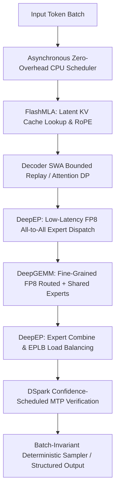

## 1. Introduction and Current Context

Many AI laboratories design model architectures purely for training loss curves, leaving inference engineers to struggle with massive key-value (KV) caches and communication bottlenecks after release. DeepSeek took a fundamentally different systems-first path. Beginning with the architectural innovations in `deepseek-ai/DeepSeek-V3` and `deepseek-ai/DeepSeek-R1`, and expanding through open-source kernel releases (`FlashMLA`, `DeepEP`, `DeepGEMM`) and the October 2026 release of the `deepseek-ai/DeepInfer` production inference framework (supporting `DeepSeek-V4.1-Flash`), DeepSeek demonstrated how co-designing attention compression, expert parallelism, and speculative verification transforms large-scale serving economics.

## 2. Direct Answer and Key Takeaway

> **Key Takeaway:** DeepSeek's inference efficiency stems from co-designing model architecture and low-level GPU kernel libraries rather than treating model training and serving as separate silos. Across its open-source stack—culminating in the October 2026 release of `deepseek-ai/DeepInfer` alongside `FlashMLA`, `DeepGEMM`, and `DeepEP`—DeepSeek slashes KV-cache memory via Multi-Head Latent Attention (MLA), accelerates fine-grained Mixture-of-Experts (MoE) routing with low-latency all-to-all dispatch kernels, overlaps CPU batch scheduling with device execution, and uses Multi-Token Prediction (MTP) with confidence-scheduled verification (`DSpark`) to accelerate decoding.

## 3. Definitions and Technical Background

Before evaluating architectural trade-offs or writing production code for **DeepSeek inference**, it is essential to establish precise engineering definitions for the core components involved:

- **Multi-Head Latent Attention (MLA):** An attention architecture introduced by DeepSeek that compresses key and value tensors into a low-rank joint latent vector before caching, drastically reducing KV-cache memory footprint while maintaining superior modeling quality over aggressive Grouped-Query Attention (GQA).
- **DeepInfer:** DeepSeek's open-source high-performance inference framework (released under Apache-2.0 in October 2026, built initially on vLLM with inspiration from SGLang and TensorRT-LLM) featuring FlashMLA, DeepGEMM, DeepEP, DSpark confidence-scheduled verification, SWA bounded replay, and batch-invariant deterministic inference.
- **DeepEP (DeepEveryParallel):** A specialized communication library providing high-throughput and low-latency GPU all-to-all kernels (including FP8 dispatch and NVLink/RDMA primitives) for Mixture-of-Experts (MoE) token dispatch and combine stages.
- **DSpark & Confidence-Scheduled Verification:** DeepInfer's speculative decoding runtime mechanism (`DEEPINFER_ENABLE_MTP_VARLEN=1`) that accelerates decoding using Multi-Token Prediction (MTP) draft tokens and schedules verification dynamically based on confidence estimates.

## 4. Technical Architecture and Deep Dive

The first pillar of DeepSeek's inference architecture is **Multi-Head Latent Attention (MLA)**, accelerated at the hardware level by `deepseek-ai/FlashMLA`. In standard Multi-Head Attention (MHA), caching uncompressed keys and values for every head across long contexts rapidly exhausts GPU High-Bandwidth Memory (HBM). While many models resort to Grouped-Query Attention (GQA) by sharing keys and values across groups of query heads, MLA projects the keys and values down into a compact latent vector $c_t^{KV}$ during inference. Because the up-projection matrices can be mathematically absorbed into the query and output projection weights during decoding, the inference engine only stores the compressed latent vector and a small decoupled Rotary Position Embedding (RoPE) key in the KV cache—shrinking memory footprint while preserving expressive attention capacity.

The second pillar addresses the communication bottleneck of fine-grained **Mixture-of-Experts (MoE)** architectures. Instead of using a handful of massive experts, DeepSeek models partition feed-forward networks into many fine-grained routed experts plus shared experts. During inference across multiple GPUs, tokens must be routed to whichever GPU holds their selected experts (dispatch) and returned after computation (combine). Standard collective communication routines stall on small token payloads. `deepseek-ai/DeepEP` solves this with custom low-latency all-to-all kernels, FP8 token dispatch, and Expert Parallelism Load Balancing (EPLB) to prevent 'hot' experts from stalling the entire decode batch.

The third pillar is low-precision matrix multiplication via `deepseek-ai/DeepGEMM`.

In October 2026, DeepSeek unified these runtime innovations in `deepseek-ai/DeepInfer` (supporting `DeepSeek-V4.1-Flash` on NVIDIA SM100 GPUs and Huawei Ascend 950 NPUs).

## 5. Comparative Analysis: Core Components of DeepSeek's Open-Source Inference Stack and Their Engineering Functions

The following table compares the key engineering trade-offs, operational boundaries, and implementation choices for **DeepSeek inference**:

| Component / Repository | Target System Layer | Key Technical Mechanism | Production Serving Benefit |
| --- | --- | --- | --- |
| FlashMLA | Attention & KV Cache | Low-rank latent KV compression with matrix absorption | Massive reduction in KV-cache VRAM and HBM bandwidth per token |
| DeepEP | Multi-GPU MoE Communication | FP8 all-to-all dispatch/combine kernels & DeepJIT | Minimizes cross-node/NVLink latency during expert routing |
| DeepGEMM | Dense & MoE Matrix Compute | Fine-grained block-scaled FP8 GEMM tensor kernels | Near-BF16 accuracy at FP8 compute throughput and memory footprint |
| DeepInfer (DSpark / MTP) | Speculative Decode Runtime | Variable-length Multi-Token Prediction with confidence scheduling | Accelerates per-user token generation speed without quality loss |
| DeepInfer (Batch Invariance) | Numerical Reproducibility | Deterministic reduction order (`DEEPINFER_BATCH_INVARIANT=1`) | Eliminates output drift across varying concurrent batch sizes |

## 6. System Architecture and Execution Flow

The diagram below illustrates the end-to-end control flow, verification boundaries, and state transitions for **DeepSeek inference** in a production environment:

*Figure 7.1: Execution flow inside the DeepSeek DeepInfer stack combining FlashMLA, DeepEP expert parallelism, DeepGEMM FP8 compute, and DSpark MTP verification.*

## 7. Practical Implementation Steps and Engineering Checklist

To implement **DeepSeek inference** reliably in production systems, follow these sequential engineering steps:

1. When serving DeepSeek-family models on existing clusters, upgrade to versions of `vllm-project/vllm` or `sgl-project/sglang` that integrate `FlashMLA` and `DeepGEMM` kernels rather than falling back to generic attention implementations.
2. Enable Multi-Token Prediction (MTP) speculative decoding in your serving engine to take advantage of the native draft heads trained directly into DeepSeek checkpoints.
3. For reproducible evaluation, auditing, or debugging pipelines on supported hardware, enable batch-invariant mode (`DEEPINFER_BATCH_INVARIANT=1` with a fixed `seq_seed`) so concurrent traffic does not alter floating-point reduction order.
4. Use native grammar-constrained structured outputs (`so_args` supporting regex, JSON Schema, or EBNF grammar in DeepInfer, or equivalent guided decoding in SGLang/vLLM) when connecting DeepSeek models to agent tool-calling loops.
5. Note the architectural boundary of the initial `deepseek-ai/DeepInfer` offline engine release: as documented in its official README, a complete online multi-node service additionally requires pairing the engine with a distributed KV cache manager, Prefill/Decode disaggregation router, and data-parallel load balancer.

## 8. Limitations, Operational Risks, and Trade-Offs

Even well-architected deployments of **DeepSeek inference** face concrete engineering constraints that teams must mitigate proactively:

- Strict hardware generation requirements: cutting-edge kernel libraries like `DeepInfer`, `FlashMLA`, and `DeepGEMM` target specific accelerator generations (such as NVIDIA Hopper SM90 / Blackwell SM100 with CUDA 13 or Huawei Ascend 950 with CANN 9.2) and do not run natively on older consumer GPUs.
- High total parameter memory footprint: even though fine-grained MoE models activate only a small fraction of parameters per token, all expert weights must still reside in aggregate cluster VRAM to avoid catastrophic PCIe swapping.
- Operational complexity of disaggregated serving: running separate prefill and decode pools with Expert Parallelism (EP) and Data Parallelism (DP) requires high-bandwidth RDMA/InfiniBand or NVLink fabrics and careful expert load balancing.

## 9. Frequently Asked Questions (FAQs)

### What is DeepInfer and what does the October 2026 open-source release include?

DeepInfer (`deepseek-ai/DeepInfer`) is DeepSeek's Apache-2.0 licensed high-performance inference framework supporting `DeepSeek-V4.1-Flash`.

### How does Multi-Head Latent Attention (MLA) differ from Grouped-Query Attention (GQA)?

GQA reduces the KV cache by forcing multiple query heads to share a single key and value head, which can reduce expressive capacity.

### Why is batch-invariant inference important for developers?

In standard GPU inference, floating-point addition is non-associative, meaning a prompt's output can change slightly depending on how many other users are batched with it.

## 10. Conclusion

DeepSeek's inference stack proves that algorithm-system co-design is the most effective lever for scaling large language models. Even for developers who do not manage raw SM100 GPU clusters directly, understanding how MLA compresses KV caches, how DeepEP routes fine-grained MoE tokens, and how MTP accelerates decoding helps teams configure vLLM, SGLang, and cloud endpoints for maximum efficiency.

### GitHub Repositories & Technical References

- **deepseek-ai/DeepInfer** — DeepSeek's official high-performance inference framework featuring DSpark MTP verification, SWA bounded replay, and batch-invariant deterministic sampling. Verified GitHub URL: https://github.com/deepseek-ai/deepinfer
- **deepseek-ai/FlashMLA** — Official efficient Multi-Head Latent Attention (MLA) decoding kernels designed for variable-length sequences on modern GPUs. Verified GitHub URL: https://github.com/deepseek-ai/FlashMLA
- **deepseek-ai/DeepEP** — Official expert-parallel communication library providing high-throughput and low-latency all-to-all GPU kernels for MoE inference and training. Verified GitHub URL: https://github.com/deepseek-ai/DeepEP
- **deepseek-ai/DeepGEMM** — Official clean and efficient FP8 General Matrix Multiplication (GEMM) kernel library with fine-grained scaling. Verified GitHub URL: https://github.com/deepseek-ai/DeepGEMM
- **deepseek-ai/DeepSeek-V3** — Official repository for DeepSeek-V3 detailing the Multi-Head Latent Attention (MLA) and Multi-Token Prediction (MTP) architecture. Verified GitHub URL: https://github.com/deepseek-ai/deepseek-v3
