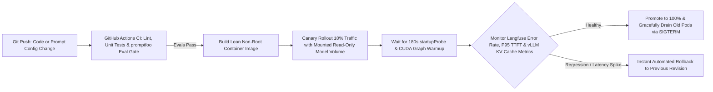

## 1. Introduction and Current Context

A standard stateless Node.js or Go container weighs 80MB, boots in 400 milliseconds, and autoscales cleanly when CPU utilization crosses 70%. When a DevOps engineer applies that exact same Kubernetes configuration to an AI inference service (`vllm-project/vllm`) or a stateful streaming agent backend (`fastapi/fastapi`), everything breaks: baking 20GB of model weights into the Dockerfile crashes CI runners; a 10-second `livenessProbe` kills the pod repeatedly while `vllm` is still compiling CUDA graphs; CPU-based autoscaling never triggers because the CPU sits at 8% while GPU KV-cache memory is 100% full; and a rolling deploy severs 200 active user SSE streams mid-sentence.

## 2. Direct Answer and Key Takeaway

> **Key Takeaway:** Deploying and operating AI applications in 2026 requires extending classic DevOps with four AI-specific infrastructure skills: (1) **Decoupling Model Weights from Container Images** (mounting pre-warmed read-only weight volumes so Docker images stay 2GB instead of 45GB), (2) **Split Startup/Readiness/Liveness Probes** that account for 60-to-180-second GPU model loading and CUDA graph compilation in `vllm-project/vllm`, (3) **Queue-Depth & KV-Cache Utilization Autoscaling** (rather than naive CPU%), and (4) **Versioned Prompt/Model Canary Rollouts** with instant rollback and zero-downtime graceful stream draining (`SIGTERM`).

## 3. Definitions and Technical Background

Before evaluating architectural trade-offs or writing production code for **AI deployment**, it is essential to establish precise engineering definitions for the core components involved:

- **Startup Probe vs. Readiness Probe (`startupProbe` / `readinessProbe`):** Kubernetes health-check primitives where `startupProbe` gives a GPU container up to 3–5 minutes to load multi-gigabyte weights and compile CUDA graphs without being killed by `livenessProbe`, while `readinessProbe` withholds live user traffic until `/health` returns `200 OK`.
- **Graceful Stream Draining (`SIGTERM` + `preStop` Hook):** Allowing an AI backend pod receiving a termination signal during a deployment to stop accepting *new* requests immediately while giving already-streaming SSE connections 30–60 seconds to finish generating cleanly.
- **KV-Cache & Queue-Depth Autoscaling:** Triggering horizontal pod autoscaling based on inference metrics exported by `vllm` rather than host CPU utilization.

## 4. Technical Architecture and Deep Dive

**Prerequisites & Required Tools:** Docker, GitHub Actions, `vllm-project/vllm`, `fastapi/fastapi`, and `langfuse/langfuse` or Prometheus/OpenTelemetry.

**Step-by-Step Learning Path:**
1. **Beginner — Multi-Stage Non-Root Containers & Secret Isolation:** Package your Python/TypeScript AI backend in a lean multi-stage `Dockerfile` running as a non-root UID, inject API keys exclusively via runtime secret stores, and configure `terminationGracePeriodSeconds: 60`.
2. **Intermediate — CI/CD Eval Gates & Self-Hosted GPU Serving (`vLLM`):** Add a GitHub Actions gate that blocks deployment if `promptfoo` or `pytest` evals fail; deploy `vllm-project/vllm` mounting model weights from a shared read-only volume with proper `startupProbe` timeouts.
3.

**Minimal Production Code Example (Production Multi-Stage Dockerfile & vLLM Compose Service with Health Probes):**

```dockerfile
# File: Dockerfile.ai-backend
# Multi-stage non-root build for FastAPI AI Orchestrator
FROM python:3.12-slim AS builder
WORKDIR /build
COPY requirements.txt .
RUN pip install --no-cache-dir --prefix=/install -r requirements.txt

FROM python:3.12-slim AS runtime
RUN groupadd -g 10001 appgroup && useradd -u 10001 -g appgroup -m appuser
WORKDIR /app
COPY --from=builder /install /usr/local
COPY --chown=appuser:appgroup ./app ./app
USER 10001:10001
EXPOSE 8000
# Graceful timeout (--timeout-graceful-shutdown 45) allows active SSE streams to finish on deploy
CMD ["uvicorn", "app.main:app", "--host", "0.0.0.0", "--port", "8000", "--timeout-graceful-shutdown", "45"]
```

```yaml
# File: docker-compose.vllm-prod.yml
# Production vLLM service mounting weights from host volume (never baked into image)
services:
  vllm-engine:
    image: vllm/vllm-openai:latest
    ipc: host
    restart: unless-stopped
    volumes:
      - /mnt/nvme-models-cache:/root/.cache/huggingface:ro
    environment:
      - HF_HUB_OFFLINE=1
    command: >
      --model Qwen/Qwen3-8B
      --quantization fp8
      --max-model-len 16384
      --enable-prefix-caching
      --enable-chunked-prefill
      --gpu-memory-utilization 0.90
      --port 8001
    healthcheck:
      test: ["CMD", "curl", "-f", "http://localhost:8001/health"]
      interval: 15s
      timeout: 5s
      retries: 3
      start_period: 180s
```

## 5. Comparative Analysis: DevOps & Infrastructure Differences: Standard Web Services vs. Production AI & GPU Services

The following table compares the key engineering trade-offs, operational boundaries, and implementation choices for **AI deployment**:

| Infrastructure Layer | Standard Stateless Web App | Production AI / GPU Service (2026) | Critical DevOps Configuration |
| --- | --- | --- | --- |
| Container Artifacts | 50–200 MB code binary | Code image (2GB) + External Model Weights (10–80GB) | Mount weights via read-only PVC / NVMe cache (`HF_HUB_OFFLINE=1`) |
| Startup & Health Probes | Boots in < 2s; simple 10s liveness check | Weight load + CUDA graph compile takes 45–180s | Configure `start_period: 180s` / `startupProbe` so pod isn't crash-looped |
| Autoscaling Signal | Host CPU % or RAM % | GPU KV-cache usage % & waiting request queue depth | Autoscale on Prometheus `vllm:num_requests_waiting` & `gpu_cache_usage_perc` |
| Rolling Deployment | Instant connection drain (< 5s) | Long-lived SSE streams & agent runs (10–45s) | Set `terminationGracePeriodSeconds: 60` + `--timeout-graceful-shutdown 45` |
| Release Verification | Unit tests + HTTP 200 smoke test | Deterministic + semantic eval gate (`promptfoo`) + shadow canary | Block CI/CD deploy if golden eval suite regresses |

## 6. System Architecture and Execution Flow

The diagram below illustrates the end-to-end control flow, verification boundaries, and state transitions for **AI deployment** in a production environment:



*Figure 57.1: AI CI/CD and zero-downtime deployment pipeline incorporating `promptfoo` eval gates, externalized model volumes, startup probes, and graceful SSE draining.*

## 7. Practical Implementation Steps and Engineering Checklist

To implement **AI deployment** reliably in production systems, follow these sequential engineering steps:

1. Never bake multi-gigabyte `.safetensors` or `.gguf` model weights inside your application `Dockerfile`; pre-populate weights onto a shared read-only cloud disk or host NVMe cache and start inference containers with `HF_HUB_OFFLINE=1` so pod startups do not depend on external Hugging Face downloads.
2. Set `ipc: host` on multi-GPU `vllm-project/vllm` and PyTorch containers so NCCL shared-memory tensor communication does not crash with `bus error` inside Docker's default 64MB `/dev/shm`.
3. Configure `start_period: 180s` or a generous `startupProbe` on GPU inference containers so the orchestrator waits for weight loading and CUDA graph compilation before enforcing liveness checks.
4. Pass `--timeout-graceful-shutdown 45` to Uvicorn and `terminationGracePeriodSeconds: 60` to Kubernetes pods so rolling deployments never chop off active customer streaming responses.

## 8. Limitations, Operational Risks, and Trade-Offs

Even well-architected deployments of **AI deployment** face concrete engineering constraints that teams must mitigate proactively:

- Downloading weights from the internet on every pod scale-up: if an autoscaler spins up 4 new GPU nodes during a traffic spike and each node tries to download 30GB over the public internet simultaneously, startup takes 15 minutes and fails if the upstream hub rate-limits your IP.
- Default 64MB `/dev/shm` crashing multi-GPU inference: forgetting `ipc: host` or `--shm-size` in Docker/Kubernetes causes sudden `SIGBUS` crashes when PyTorch/NCCL allocates shared memory for tensor parallelism.
- Hardcoding prompts inside compiled frontend bundles: keeping prompts only in client code forces a full frontend rebuild to fix a prompt issue—manage prompt versions on the backend or via versioned configs in `langfuse/langfuse`.

## 9. Frequently Asked Questions (FAQs)

### Why does my vLLM Kubernetes pod keep restarting every 30 seconds during startup?

Because loading a 16GB–40GB model into VRAM and capturing CUDA graphs takes 60 to 150 seconds.

### Why did my multi-GPU Docker container crash with a `Bus error (core dumped)` in PyTorch/NCCL?

Docker allocates only 64MB to `/dev/shm` (shared memory) by default.

### Why doesn't CPU-based Kubernetes Horizontal Pod Autoscaling (HPA) work for LLM services?

An AI orchestrator or GPU inference server is I/O and GPU-memory bound, not host-CPU bound.

## 10. Conclusion

DevOps for AI applications bridges cloud-native container engineering with the physical realities of GPU memory and long-lived token streams. By externalizing model weights, sizing `/dev/shm` and `startupProbe` windows accurately, autoscaling on KV-cache metrics in `vllm`, and draining streams gracefully, engineers achieve rock-solid production uptime.

### GitHub Repositories & Technical References

- **vllm-project/vllm** — Production LLM inference engine exposing OpenAI-compatible HTTP servers and Prometheus `/metrics` for Kubernetes autoscaling. Verified GitHub URL: https://github.com/vllm-project/vllm
- **fastapi/fastapi** — High-performance async Python framework for building containerized AI orchestrators with graceful shutdown support. Verified GitHub URL: https://github.com/fastapi/fastapi
- **langfuse/langfuse** — Self-hostable Docker/Kubernetes observability and prompt-version management platform for AI deployments. Verified GitHub URL: https://github.com/langfuse/langfuse
- **promptfoo/promptfoo** — CLI evaluation runner that integrates into GitHub Actions CI/CD pipelines to gate deployments. Verified GitHub URL: https://github.com/promptfoo/promptfoo
