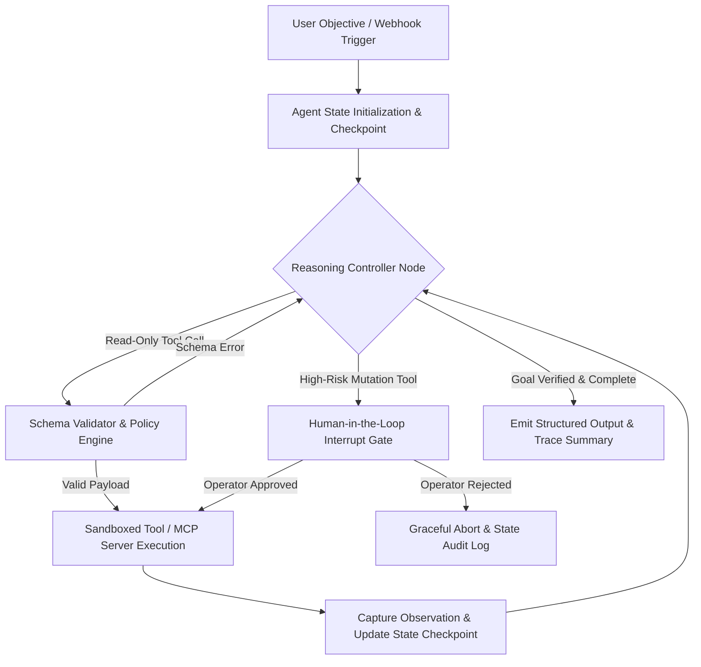

## 1. Introduction and Current Context

Between 2023 and 2025, enterprise AI deployments centered heavily on conversational interfaces wrapped around stateless large language model (LLM) completions. Engineers quickly discovered that while conversational assistants excel at drafting prose or summarizing text provided directly in a prompt, they fail when asked to resolve multi-step operational workflows—such as diagnosing a production outage, reconciling an invoice discrepancy across two databases, or opening a verified pull request. By October 2026, engineering teams have largely separated conversational interfaces from autonomous runtime loops, adopting typed agent frameworks such as LangGraph and Pydantic AI Alongside standardized tool interfaces like the Model Context Protocol (MCP).

## 2. Direct Answer and Key Takeaway

> **Key Takeaway:** The defining shift from AI chatbots to autonomous AI agents in 2026 is not larger parameter counts, but the transition from single-turn text prediction to stateful execution loops. Where an ordinary chatbot responds to a prompt and terminates its execution cycle, an autonomous AI agent decomposes a goal into sub-tasks, invokes typed external tools via standardized protocols, inspects environment feedback, persists state across checkpoints, and pauses at deterministic human-approval boundaries before executing irreversible side effects.

## 3. Definitions and Technical Background

Before evaluating architectural trade-offs or writing production code for **autonomous AI agents**, it is essential to establish precise engineering definitions for the core components involved:

- **Stateless Conversational Chatbot:** A request-response interface that maps an input message history to a text completion in a single forward pass without maintaining an independent execution graph, durable working memory, or environment feedback loop.
- **Autonomous AI Agent:** A bounded software system that uses a foundation model as a reasoning controller inside a while-loop to formulate plans, invoke external tools with typed schemas, evaluate execution results, recover from tool errors, and persist checkpointed state until a termination condition is met.
- **Deterministic Checkpoint:** A serialized snapshot of an agent's graph state, message history, and pending tool invocations stored in a relational or key-value database, enabling durable resumption after process restarts or human review.

## 4. Technical Architecture and Deep Dive

To understand why agentic systems behave differently in production, engineers must examine the underlying control loop. In a standard chat completion architecture, the application server receives a user string, appends it to an array of historical messages, sends the payload to an inference endpoint, and streams the generated tokens back to the browser. The model has no agency over the execution lifecycle; once the stop token is emitted, computation ends.

In contrast, an autonomous AI agent operates inside a cyclic state machine—often implemented as a directed graph in frameworks like `langchain-ai/langgraph` or a strongly typed validation loop in `pydantic/pydantic-ai`. When an objective arrives, the controller node evaluates the current state and decides whether to emit a final response or dispatch one or more structured tool calls.

Crucially, 2026 agent architectures separate planning from execution. Rather than allowing an unconstrained model to loop indefinitely—which risks runaway token consumption and cascading side effects—production agents enforce explicit step budgets, schema validation retries, and state transitions.

Another foundational advancement in 2026 is standardized tool interoperability through the Model Context Protocol. Historically, every agent framework required bespoke glue code for GitHub, PostgreSQL, Slack, or internal REST APIs.

## 5. Comparative Analysis: Architectural Comparison: Stateless AI Chatbots vs. Production Autonomous AI Agents (2026)

The following table compares the key engineering trade-offs, operational boundaries, and implementation choices for **autonomous AI agents**:

| Architectural Dimension | Stateless AI Chatbot | Autonomous AI Agent | Engineering Impact in Production |
| --- | --- | --- | --- |
| Control Topology | Single-pass linear request-response | Cyclic state graph with conditional routing | Agents recover from transient tool or syntax failures automatically |
| External World Interaction | Passive text generation or single function call | Multi-step tool execution via MCP or typed SDKs | Enables end-to-end task completion across external APIs and CLIs |
| State & Memory Persistence | Client-held or session-scoped chat transcript | Checkpointed graph state with thread & cross-session stores | Supports long-running asynchronous jobs spanning minutes or hours |
| Validation & Type Safety | Unstructured Markdown or best-effort JSON | Strict schema validation (Pydantic / JSON Schema) with retry loops | Prevents malformed payloads from corrupting downstream microservices |
| Safety & Governance | Prompt-level refusal filters only | Scoped RBAC tokens, sandboxing, and HITL interrupt gates | Bounds blast radius when handling untrusted third-party inputs |
| Primary Failure Mode | Factual hallucination in prose | Infinite retry loops, prompt injection, or unauthorized side effects | Requires step budgets, OpenTelemetry tracing, and policy enforcement |

## 6. System Architecture and Execution Flow

The diagram below illustrates the end-to-end control flow, verification boundaries, and state transitions for **autonomous AI agents** in a production environment:

*Figure 1.1: Production execution loop for a stateful autonomous AI agent incorporating schema validation, checkpointed state, and a human-in-the-loop approval gate.*

## 7. Practical Implementation Steps and Engineering Checklist

To implement **autonomous AI agents** reliably in production systems, follow these sequential engineering steps:

1. Define explicit task boundaries before selecting an architecture: if a workflow maps deterministically from input A to API B, implement a standard microservice or workflow pipeline rather than an autonomous agent.
2. Adopt a typed agent framework such as `pydantic/pydantic-ai` or `langchain-ai/langgraph` to enforce strict input and output schemas on every tool definition and final agent response.
3. Categorize all agent tools into three permission tiers: Tier 1, Tier 2, and Tier 3.
4. Configure durable checkpointing backed by PostgreSQL or Redis so that long-running agent runs can pause for webhook callbacks or human review without holding open HTTP connections.

## 8. Limitations, Operational Risks, and Trade-Offs

Even well-architected deployments of **autonomous AI agents** face concrete engineering constraints that teams must mitigate proactively:

- Compounding reliability decay: even if an agent achieves 95% reliability on each individual step, a 10-step sequential workflow without intermediate verification drops to roughly 59.8% end-to-end success ($0.95^{10}$), making deterministic validation nodes mandatory.
- Indirect prompt injection via tool observations: when an agent reads untrusted external data (such as public GitHub issues, incoming emails, or scraped webpages), adversarial instructions embedded in that data can hijack the agent's next tool call unless strict privilege separation is enforced.
- Latency and cost multiplication: multi-step reasoning loops re-read growing context windows on every turn, increasing time-to-completion and token expenditure compared to single-pass classifiers or deterministic pipelines.

## 9. Frequently Asked Questions (FAQs)

### What is the main technical difference between an AI chatbot and an AI agent?

A chatbot generates a text reply in a single pass and waits for the user's next message.

### Do autonomous AI agents require frontier reasoning models for every step?

No.

### How do engineering teams prevent an autonomous agent from deleting production data?

Teams enforce defense-in-depth at the infrastructure layer rather than relying on system prompts: agents authenticate with least-privilege scoped tokens, execute code inside ephemeral containers, and hit mandatory human-in-the-loop pause gates before any destructive tool call is executed.

## 10. Conclusion

The transition from chatbots to autonomous AI agents in 2026 represents a maturation of software architecture rather than magic. By surrounding foundation models with typed tool contracts, durable state checkpoints, strict iteration budgets, and human approval gates, engineering teams can automate complex multi-step workflows while maintaining the observability and safety guarantees required by production systems.

### GitHub Repositories & Technical References

- **langchain-ai/langgraph** — Official low-level orchestration framework for building stateful, multi-step AI agents with durable checkpointing, conditional graph routing, and human-in-the-loop interrupts. Verified GitHub URL: https://github.com/langchain-ai/langgraph
- **pydantic/pydantic-ai** — Official Python agent framework by the Pydantic team providing end-to-end type safety, structured output validation, and dependency-injected tool execution. Verified GitHub URL: https://github.com/pydantic/pydantic-ai
- **modelcontextprotocol/modelcontextprotocol** — Official specification and documentation repository for the Model Context Protocol (MCP), standardizing how AI agents connect to external tools and data resources. Verified GitHub URL: https://github.com/modelcontextprotocol/modelcontextprotocol
- **langfuse/langfuse** — Open-source LLM engineering and observability platform for tracing multi-step agent execution graphs, tool latencies, token costs, and evaluation metrics. Verified GitHub URL: https://github.com/langfuse/langfuse
