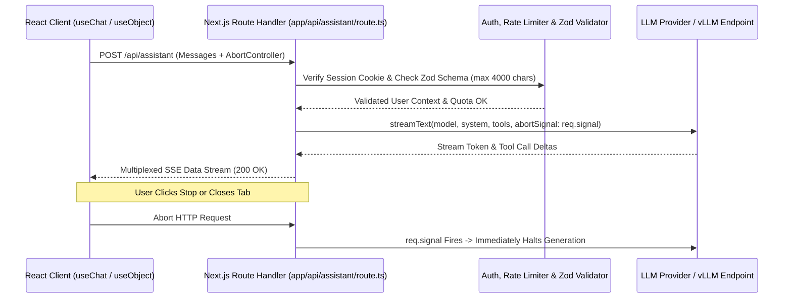

## 1. Introduction and Current Context

Next.js and TypeScript form the dominant full-stack web architecture for AI-native products in 2026. Yet many prototypes fail when moving from localhost to production because developers call LLM SDKs without streaming, forget to wire client-side abort signals (continuing to pay for generated tokens after a user closes the tab), or fail to validate input payload sizes and user quotas before invoking the model.

## 2. Direct Answer and Key Takeaway

> **Key Takeaway:** Shipping production-ready AI features in Next.js (`vercel/next.js`) requires strict separation between client UI state and server-side model execution.

## 3. Definitions and Technical Background

Before evaluating architectural trade-offs or writing production code for **Next.js AI integration**, it is essential to establish precise engineering definitions for the core components involved:

- **Server-Side Route Handler (`app/api/.../route.ts`):** A Next.js App Router server endpoint built on standard Web `Request` and `Response` APIs that executes exclusively on the server, keeping LLM API keys invisible to client browser bundles.
- **Data Stream Protocol (SSE Streaming):** A multiplexed Server-Sent Events wire format used by `vercel/ai` to stream incremental text deltas, reasoning tokens, tool-call arguments, and tool results over a single HTTP connection.
- **Structured Object Streaming (`streamObject` / `Output.object`):** A technique that validates and streams partial JSON objects matching a TypeScript `Zod` schema as tokens arrive, allowing React components to render progressive cards, tables, or UI skeletons before generation completes.

## 4. Technical Architecture and Deep Dive

The first non-negotiable rule of Next.js AI development is **strict server-boundary isolation**. LLM provider API keys must never be prefixed with `NEXT_PUBLIC_`, which would inline them into client-side JavaScript bundles where any visitor can extract them in two seconds via browser DevTools.

Before the server route ever touches an LLM SDK, it must execute four deterministic defensive checks: (1) **Session Authentication**, (2) **Input Schema & Length Validation** using `Zod`, (3) **Tenant Rate Limiting & Quota Check**, and (4) **Server-Controlled System Prompt Assembly**.

Once validated, the route invokes `streamText` or `generateObject` from `vercel/ai`. Why is streaming mandatory for interactive Next.js features? A complex 800-token response or 3-step tool-calling loop takes 4 to 12 seconds to complete.

Here is a concise, production-hardened Next.js App Router Route Handler (`app/api/assistant/route.ts`) demonstrating authentication, Zod input validation, bounded tool calling (`maxSteps`), and `abortSignal` propagation using `vercel/ai`:

```typescript
// File: app/api/assistant/route.ts
// Prerequisites: next >= 15, ai (@vercel/ai), zod
import { streamText, tool } from 'ai';
import { openai } from '@ai-sdk/openai';
import { z } from 'zod';

const RequestSchema = z.object({
  messages: z.array(z.object({
    role: z.enum(['user', 'assistant']),
    content: z.string().min(1).max(4000),
  })).max(20),
});

export async function POST(req: Request) {
  // 1. Verify authenticated user session on the server
  const userId = req.headers.get('x-authenticated-user-id');
  if (!userId) {
    return new Response(JSON.stringify({ error: 'Unauthorized' }), { status: 401 });
  }

  // 2. Validate untrusted client payload shape and size
  const parsed = RequestSchema.safeParse(await req.json());
  if (!parsed.success) {
    return new Response(JSON.stringify({ error: 'Invalid payload' }), { status: 400 });
  }

  // 3. Stream response with server-pinned system prompt, tools, and abortSignal
  const result = streamText({
    model: openai('gpt-4o-mini'),
    system: 'You are a concise technical assistant. Cite verified status codes.',
    messages: parsed.data.messages,
    maxSteps: 3,
    maxTokens: 1024,
    abortSignal: req.signal,
    tools: {
      lookupServiceStatus: tool({
        description: 'Check operational status of an internal microservice by slug',
        parameters: z.object({
          serviceSlug: z.enum(['auth-api', 'billing-worker', 'search-index']),
        }),
        execute: async ({ serviceSlug }) => {
          return { serviceSlug, status: 'operational', p95LatencyMs: 42 };
        },
      }),
    },
  });

  return result.toDataStreamResponse();
}
```

## 5. Comparative Analysis: Next.js AI Integration Patterns Using the Vercel AI SDK (`vercel/ai`)

The following table compares the key engineering trade-offs, operational boundaries, and implementation choices for **Next.js AI integration**:

| UI / Backend Pattern | Core SDK Primitive | Streaming Behavior | Best-Fit Application Use Case |
| --- | --- | --- | --- |
| Interactive Chat & Multi-Step Tools | `streamText` + `useChat` hook | Streams text deltas, reasoning, and tool execution states | Conversational assistants, coding helpers, support bots |
| Progressive Structured UI Cards | `streamObject` + `useObject` hook | Streams partial validated JSON matching a `Zod` schema | Generating dashboards, itineraries, quiz sets, or form drafts |
| Server-to-Server / Webhook Task | `generateObject` or `generateText` | Awaits complete validated JSON/text before returning | Background data extraction, triage routing, cron jobs |
| Server Actions (`'use server'`) | Typed async function + `createStreamableValue` | Streams RSC UI nodes or state deltas over POST | Tightly integrated form-to-AI workflows inside App Router |

## 6. System Architecture and Execution Flow

The diagram below illustrates the end-to-end control flow, verification boundaries, and state transitions for **Next.js AI integration** in a production environment:



*Figure 25.1: Production Next.js App Router AI streaming sequence enforcing server-side auth, Zod validation, and cooperative `AbortSignal` cancellation.*

## 7. Practical Implementation Steps and Engineering Checklist

To implement **Next.js AI integration** reliably in production systems, follow these sequential engineering steps:

1. Filter incoming client message arrays using `Zod` to allow only `'user'` and `'assistant'` roles—never allow a client request body to inject or override a `'system'` role message.
2. Always wire `abortSignal: req.signal` and an explicit `maxTokens` ceiling into every `streamText` or `streamObject` call so disconnected browsers cannot rack up unbilled background token usage.
3. Set `maxSteps` when enabling tools in `streamText` so the SDK automatically loops tool execution results back to the model within a deterministic bound.
4. Persist the final assistant message and token usage inside the `onFinish` server callback on `streamText` rather than relying on the client browser to send a second POST request to save chat history.

## 8. Limitations, Operational Risks, and Trade-Offs

Even well-architected deployments of **Next.js AI integration** face concrete engineering constraints that teams must mitigate proactively:

- Unbounded input array replay: by default, `useChat` sends the entire conversation history array from the client on every turn; if you do not slice or summarize the message array on the server (`messages.slice(-12)`), a 50-turn chat will send huge payloads and spike input token bills.
- Serverless execution timeouts: on serverless hosting platforms, ensure your route exports `export const maxDuration = 60;` (or appropriate timeout) if your AI route executes multi-step tool calls or reasoning models.
- Client-state tampering: because client-held message history can be edited in browser memory before POSTing, never trust historical assistant messages in the client payload as proof of authorization or payment—always load authoritative state from your database by `chatId`.

## 9. Frequently Asked Questions (FAQs)

### Should I use Next.js Route Handlers (`route.ts`) or Server Actions for AI streaming?

Standard Route Handlers (`app/api/.../route.ts`) are generally preferred for streaming chat and object endpoints because they work naturally with standard HTTP `Request.signal` cancellation, custom status codes (401/429), and framework-agnostic hooks like `useChat`.

### How do I stop users from running up huge OpenAI or Anthropic bills on my Next.js app?

Combine four server-side controls: (1) require authentication before calling the route, (2) validate `max(4000)` characters per message and slice history to the last $N$ turns with `Zod`, (3) set `maxTokens` and `maxSteps` in `streamText`, and (4) enforce per-user daily token quotas in Redis or PostgreSQL.

### Can I use the Vercel AI SDK (`vercel/ai`) with self-hosted open-weight models like vLLM or Ollama?

Yes.

## 10. Conclusion

Shipping AI features in Next.js from prompt to production requires treating the LLM call with the same engineering rigor as a database transaction or payment gateway. By isolating secrets in App Router server routes, validating inputs and outputs with Zod, wiring `req.signal` cancellation, and streaming via `vercel/ai`, developers deliver responsive, secure user experiences.

### GitHub Repositories & Technical References

- **vercel/ai** — Official open-source TypeScript AI SDK by the creators of Next.js for streaming text, structured objects, and tool calls across React and Node.js. Verified GitHub URL: https://github.com/vercel/ai
- **vercel/next.js** — Official repository for the Next.js React framework providing App Router, Route Handlers, and Server Actions. Verified GitHub URL: https://github.com/vercel/next.js/
- **microsoft/playwright** — Browser testing framework used to run automated end-to-end tests on streaming Next.js AI interfaces. Verified GitHub URL: https://github.com/microsoft/playwright
