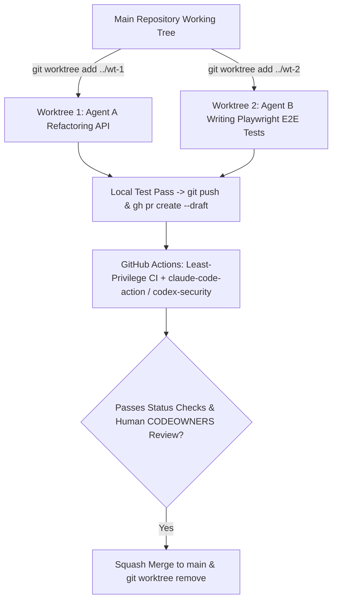

## 1. Introduction and Current Context

In a pre-AI workflow, one human developer typed in one working directory on one feature branch at a time. In 2026, a single engineer frequently dispatches one terminal agent to refactor a database migration while a second agent writes Playwright E2E tests for a UI bug and a third agent runs inside GitHub Actions triaging an issue. If two local agents run simultaneously inside the same working directory, they overwrite each other's unstaged edits and corrupt `.git/index.lock`.

## 2. Direct Answer and Key Takeaway

> **Key Takeaway:** When coding with autonomous CLI and CI agents (`anthropics/claude-code`, `openai/codex`, `google-gemini/gemini-cli`), traditional single-branch Git habits break down.

## 3. Definitions and Technical Background

Before evaluating architectural trade-offs or writing production code for **GitHub skills**, it is essential to establish precise engineering definitions for the core components involved:

- **Git Worktree Isolation (`git worktree add`):** A built-in Git feature that checks out multiple separate branches of the same repository into distinct sibling folders on disk sharing a single `.git` object database, allowing multiple AI coding agents to edit and run tests concurrently with zero file collisions.
- **Repository Agent Manifest (`AGENTS.md` / `CLAUDE.md` / `GEMINI.md`):** A concise Markdown file committed to version control that gives every local and CI coding agent deterministic instructions on build commands, test runners, module boundaries, and commit conventions.
- **Workflow Token Least Privilege (`permissions:` Block):** Explicitly scoping the ephemeral `GITHUB_TOKEN` inside `.github/workflows/*.yml` rather than inheriting permissive read/write defaults across all repository scopes.

## 4. Technical Architecture and Deep Dive

**Prerequisites & Required Tools:** Git $\ge 2.38$, GitHub CLI `gh` (`cli/cli`), and one or more terminal/CI coding agents.

**Step-by-Step Learning Path:**
1. **Beginner — Checkpointing & `AGENTS.md` Hygiene:** Commit a root `AGENTS.md`, make micro-commits before each major agent prompt so `git diff` and `git restore` are instant, and use `gh pr create` / `gh pr checks` (`cli/cli`) from the terminal.
2.

**Minimal Production Code Example (Parallel `git worktree` Agent Launcher & Hardened GitHub Actions Workflow):**

```bash
#!/usr/bin/env bash
# File: scripts/spawn_agent_worktree.sh
# Create an isolated git worktree so an AI coding agent can work in parallel safely
set -euo pipefail

TASK_SLUG="${1:?Usage: ./spawn_agent_worktree.sh <task-slug>}"
BRANCH_NAME="agent/${TASK_SLUG}"
WORKTREE_DIR="../wt-${TASK_SLUG}"

git fetch origin main
git worktree add -b "${BRANCH_NAME}" "${WORKTREE_DIR}" origin/main
echo "Created isolated worktree at ${WORKTREE_DIR} on branch ${BRANCH_NAME}"
echo "Run your agent inside ${WORKTREE_DIR}, then clean up with: git worktree remove ${WORKTREE_DIR}"
```

```yaml
# File: .github/workflows/ai-pr-review.yml
# Hardened least-privilege GitHub Actions workflow for automated PR review
name: AI Security & Code Review
on:
  pull_request:
    types: [opened, synchronize]

# Principle of least privilege: default to read-only contents
permissions:
  contents: read
  pull-requests: write
  issues: read

jobs:
  security-and-review:
    runs-on: ubuntu-latest
    # Prevent running privileged secrets on untrusted external forks
    if: github.event.pull_request.head.repo.full_name == github.repository
    steps:
      - name: Checkout PR Branch
        uses: actions/checkout@v4
        with:
          fetch-depth: 0

      - name: Run Deterministic Lint & Unit Tests First
        run: npm ci && npm test

      - name: Automated Claude Code PR Review
        uses: anthropics/claude-code-action@v1
        with:
          anthropic_api_key: ${{ secrets.ANTHROPIC_API_KEY }}
          direct_prompt: |
            Review the git diff for tenant authorization bugs, swallowed exceptions,
            and tautological tests. Post concise inline findings.
```

## 5. Comparative Analysis: Git & GitHub Practices: Solo Manual Coding vs. AI-Assisted Engineering (2026)

The following table compares the key engineering trade-offs, operational boundaries, and implementation choices for **GitHub skills**:

| Workflow Area | Fragile Practice with AI Agents (Avoid) | Production Git/GitHub Skill (2026) | CLI Command / Mechanism |
| --- | --- | --- | --- |
| Parallel Agent Tasks | Running 2 agents in the same folder (corrupts index) | Dedicated `git worktree` per agent task | `git worktree add ../wt-task -b feat/task` |
| Unwanted Agent Edits | Prompting 'Undo what you just did' (wastes tokens & drifts) | Commit checkpoint before prompt; revert via Git | `git restore -SW .` or `git reset --keep` |
| Repo Context Onboarding | Re-explaining test/lint commands in every chat session | Version-controlled `AGENTS.md` + `CLAUDE.md` symlink | Keep root `AGENTS.md` under 150 lines |
| GitHub Actions Permissions | `permissions: write-all` on `issue_comment` triggers | Explicit scoped `permissions:` + member/repo check | `contents: read`, `pull-requests: write` |
| Merge Governance | Allowing agent token to merge its own PR to `main` | Branch protection: require CI checks + human `CODEOWNERS` | GitHub Rulesets + `openai/codex-security` |

## 6. System Architecture and Execution Flow

The diagram below illustrates the end-to-end control flow, verification boundaries, and state transitions for **GitHub skills** in a production environment:



*Figure 58.1: Parallel AI development workflow using `git worktree` isolation, `gh` CLI draft PRs, least-privilege GitHub Actions reviews, and branch protection.*

## 7. Practical Implementation Steps and Engineering Checklist

To implement **GitHub skills** reliably in production systems, follow these sequential engineering steps:

1. Never ask an LLM coding agent to 'undo your last change' via natural language when an edit goes wrong—it costs tokens and often leaves stray edits behind; instead, commit a clean Git checkpoint before each step and run `git restore .` or `git checkout -- <file>` deterministically.
2. Use `git worktree` whenever you want an AI agent to work on a background refactoring or test suite while you continue coding in your primary editor window.
3. Install and authenticate the official GitHub CLI so both you and your terminal agents can inspect failing CI logs, view PR review comments, and open draft PRs without leaving the terminal.
4. Never interpolate untrusted GitHub issue titles or PR bodies directly inside a `run: |` shell script in GitHub Actions—pass them via environment variables or action inputs to prevent shell command injection.

## 8. Limitations, Operational Risks, and Trade-Offs

Even well-architected deployments of **GitHub skills** face concrete engineering constraints that teams must mitigate proactively:

- Public repository `@mention` abuse in GitHub Actions: if you configure an AI action (`claude-code-action` or `run-gemini-cli`) on a public repo without restricting triggers to trusted `author_association` (`OWNER`, `MEMBER`, `COLLABORATOR`), any anonymous internet user can comment `@claude` to burn your API credits or probe your repo.
- Force-pushing (`git push --force`) from an agent session: forbid `--force` and `--no-verify` in your `AGENTS.md` rules and block force-pushes via GitHub branch rulesets so an agent never wipes out pre-commit hooks or peer commits.
- Worktree port and database collisions: while two `git worktree` folders isolate files on disk, if two agents both run `npm run dev` on port `3000` or migrate the same local database name simultaneously, they will collide—use dynamic ports (`PORT=0`) and per-branch test database schemas.

## 9. Frequently Asked Questions (FAQs)

### Why is `git worktree` so useful when working with Claude Code, Codex CLI, or Gemini CLI?

Normally, a Git repository folder can only have one branch checked out at a time.

### What should I put inside `AGENTS.md` / `CLAUDE.md` in my GitHub repository?

Keep it concise (under 100–150 lines) and actionable: exact commands to build, lint, typecheck, and run a *single* test file; directory layout overview; architectural invariants (e.g., 'all DB queries must include `tenant_id`'); and forbidden actions (e.g., 'never use `--no-verify` or edit migrations in place').

### How do I prevent an AI GitHub Action from being exploited via prompt injection in public issues?

First, restrict the workflow `if:` condition so the AI action only triggers when the actor is an organization `OWNER`, `MEMBER`, or `COLLABORATOR`.

## 10. Conclusion

Git and GitHub are the safety rails that make high-velocity AI coding possible. By isolating parallel agents with `git worktree`, documenting repo standards in `AGENTS.md`, driving workflows with `cli/cli`, and locking down GitHub Actions permissions with `claude-code-action`, `run-gemini-cli`, and `codex-security`, developers move fast without ever losing control of their codebase.

### GitHub Repositories & Technical References

- **cli/cli** — GitHub's official command-line tool (`gh`) for managing pull requests, issues, releases, and GitHub Actions workflow runs from the terminal. Verified GitHub URL: https://github.com/cli/cli
- **anthropics/claude-code-action** — Official GitHub Action for integrating Claude Code into pull request reviews and automated issue workflows. Verified GitHub URL: https://github.com/anthropics/claude-code-action
- **google-github-actions/run-gemini-cli** — Official GitHub Action for running Gemini CLI inside repository automation pipelines. Verified GitHub URL: https://github.com/google-github-actions/run-gemini-cli
- **openai/codex-security** — OpenAI's official security CLI and SDK for automated vulnerability discovery and patching in Git workflows. Verified GitHub URL: https://github.com/openai/codex-security
