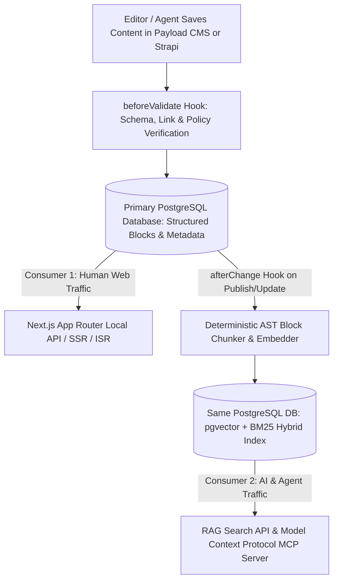

## 1. Introduction and Current Context

Over the past decade, engineering teams migrated from monolithic coupled platforms (like legacy WordPress templates) to **Headless CMS** architectures that store structured content in a database and deliver it via REST or GraphQL APIs to modern frontends like `vercel/next.js`. In 2026, a new architectural question has emerged: as content is consumed not only by human browsers but also by internal RAG pipelines, customer-support agents, and MCP clients, should teams adopt a purpose-built 'AI-Native CMS' or extend an established open-source headless CMS?

## 2. Direct Answer and Key Takeaway

> **Key Takeaway:** The distinction between a traditional **Headless CMS** and an **AI-Native CMS** in 2026 comes down to whether AI capabilities are bolted onto the admin UI as a text-box sidebar or integrated into the core data layer via automatic chunking, vector embeddings (`pgvector`), schema-constrained agent hooks, and Model Context Protocol (MCP) endpoints. For most engineering teams, the strongest architecture is not a closed proprietary SaaS 'AI CMS,' but an extensible open-source code-first headless CMS (`payloadcms/payload` or `strapi/strapi`) backed by PostgreSQL + `pgvector` and a custom MCP server.

## 3. Definitions and Technical Background

Before evaluating architectural trade-offs or writing production code for **headless CMS**, it is essential to establish precise engineering definitions for the core components involved:

- **Headless CMS:** A backend-only content management system that decouples the content repository and editorial admin UI from the frontend presentation layer, exposing content via typed REST, GraphQL, or Local Node.js APIs.
- **AI-Native CMS Architecture:** A content architecture where every content mutation automatically maintains semantic vector embeddings, structured knowledge-graph relations, agent-accessible MCP resources/tools, and automated editorial validation pipelines alongside standard web APIs.
- **Dual-Consumer Content Delivery:** Designing a CMS data layer to serve two distinct consumers simultaneously: (1) low-latency HTML/JSON rendering for human web visitors, and (2) clean, chunked, citation-anchored passages for RAG and AI agents.
- **Code-First Schema Definition:** Defining CMS collections, fields, validation rules, and lifecycle hooks directly in version-controlled TypeScript code rather than clicking through a proprietary browser dashboard.

## 4. Technical Architecture and Deep Dive

First, engineers must look past superficial marketing labels. Many SaaS products marketed as 'AI-Native CMSs' in 2026 are simply basic headless CMS platforms with an LLM text-generation button embedded in the rich-text toolbar and a hefty markup on per-seat pricing.

In a standard Headless CMS setup, when an editor publishes or updates a technical documentation page, the CMS updates a row in PostgreSQL and triggers a Next.js Incremental Static Regeneration (ISR) webhook.

In an **AI-Native CMS architecture**—which can be built cleanly on top of `payloadcms/payload` + PostgreSQL with `pgvector/pgvector`—the CMS *is* the unified source of truth for both the website and the AI knowledge base. When an article transitions to `_status: 'published'`, an `afterChange` lifecycle hook reads the structured AST blocks directly, splits the content cleanly by section heading, computes embeddings, and upserts them transactionally into a `content_chunks` table in the exact same PostgreSQL database (`pgvector`).

Furthermore, exposing your headless CMS via a read-only or draft-scoped **Model Context Protocol (MCP) server** turns your content repository into an interactive resource for developer and editorial agents.

## 5. Comparative Analysis: Architectural Comparison: Standard Headless CMS vs. Proprietary SaaS AI CMS vs. Open-Source Composable AI-Native Stack

The following table compares the key engineering trade-offs, operational boundaries, and implementation choices for **headless CMS**:

| Architectural Dimension | Standard Headless CMS (Out of the Box) | Proprietary SaaS 'AI-Native' CMS | Composable Open-Source Stack (Payload/Strapi + pgvector + MCP) |
| --- | --- | --- | --- |
| Primary Delivery Interfaces | REST, GraphQL, Next.js Local API | Proprietary REST API + bundled chat widget | REST/GraphQL/Local API + `pgvector` hybrid search + MCP Server |
| RAG & Vector Synchronization | Requires separate external ETL / scraper pipeline | Built-in black-box indexing (fixed chunking rules) | Transactional `afterChange` hook syncing AST blocks to `pgvector` |
| Schema & Code Ownership | 100% owned TypeScript/JS schemas in Git | Vendor-hosted schema; migration lock-in risk | 100% owned TypeScript code, Postgres DB, and custom embeddings |
| AI Editorial Guardrails | Manual human entry + standard field validators | Prompt templates in UI; limited custom code hooks | Full programmatic `beforeValidate` hooks + `promptfoo` CI checks |
| Total Cost of Ownership | Low (self-hosted Postgres + Node/Next.js) | High per-seat + metered AI token/vector markups | Low & predictable (direct DB hosting + direct LLM API/vLLM rates) |

## 6. System Architecture and Execution Flow

The diagram below illustrates the end-to-end control flow, verification boundaries, and state transitions for **headless CMS** in a production environment:

*Figure 30.1: Composable AI-native headless CMS architecture unifying Next.js web rendering, transactional `pgvector` chunk indexing, and MCP access on a single PostgreSQL database.*

## 7. Practical Implementation Steps and Engineering Checklist

To implement **headless CMS** reliably in production systems, follow these sequential engineering steps:

1. Start with a mature, open-source code-first headless CMS backed by PostgreSQL rather than locking your content into a closed, single-vendor 'AI CMS' startup.
2. Store rich text in a structured JSON Abstract Syntax Tree rather than raw HTML strings, so your `afterChange` hooks can chunk content cleanly by `H2`/`H3` headings and table nodes.
3. Enable the `pgvector/pgvector` extension on your CMS PostgreSQL database and create a companion `article_chunks` table with a foreign key to your parent `articles` table so vector embeddings are always 100% synchronized with live published status.
4. Expose your CMS schema and search index through a lightweight internal MCP server so coding agents can automatically cross-check code changes against product documentation.

## 8. Limitations, Operational Risks, and Trade-Offs

Even well-architected deployments of **headless CMS** face concrete engineering constraints that teams must mitigate proactively:

- Synchronous embedding latency on save: if you compute embeddings for a 3,000-word article synchronously inside the main HTTP save request, the editor's 'Save' button will hang for 3 seconds—always offload embedding generation to an asynchronous background job queue after committing the transaction.
- Indexing unpublished drafts into public RAG: a critical security bug occurs if your vector search query forgets to join or filter on `_status = 'published'`, causing your public AI search widget to leak confidential draft announcements.
- Proprietary SaaS lock-in: adopting a closed SaaS AI CMS that stores your content in proprietary block formats makes exporting and migrating your historical articles painful if the vendor raises prices or shuts down.

## 9. Frequently Asked Questions (FAQs)

### What is the difference between a Headless CMS and an AI-Native CMS?

A Headless CMS decouples content storage from the frontend website via REST/GraphQL APIs.

### Should I buy a specialized SaaS AI CMS or build on Payload CMS / Strapi?

For engineering teams, building on an open-source headless CMS like `payloadcms/payload` or `strapi/strapi` with PostgreSQL and `pgvector` is almost always superior: you get full TypeScript type safety, zero per-token SaaS markups, transactional synchronization between articles and vectors, and zero vendor lock-in.

### Why is storing content as a JSON AST (like Lexical) better for AI than storing raw HTML?

A JSON Abstract Syntax Tree (AST) preserves explicit semantic node types (headings, paragraphs, code blocks, comparison tables, callouts) without presentation markup noise.

## 10. Conclusion

The best CMS architecture for modern websites in 2026 is a composable, code-first Headless CMS augmented with native vector indexing and agent protocols. By pairing `payloadcms/payload` or `strapi/strapi` with `pgvector/pgvector`, `vercel/next.js`, and MCP, teams serve both human readers and AI systems from a single, authoritative database.

### GitHub Repositories & Technical References

- **payloadcms/payload** — Open-source Next.js-native headless CMS with code-first TypeScript schemas, Lexical AST rich text, and lifecycle hooks. Verified GitHub URL: https://github.com/payloadcms/payload
- **strapi/strapi** — Leading open-source JavaScript/TypeScript headless CMS with customizable content types and extensible plugin architecture. Verified GitHub URL: https://github.com/strapi/strapi
- **pgvector/pgvector** — Open-source vector similarity search extension for PostgreSQL, enabling unified CMS content and RAG vector storage. Verified GitHub URL: https://github.com/pgvector/pgvector
- **vercel/next.js** — React framework that integrates directly with headless CMS APIs for SSR, SSG, and Incremental Static Regeneration. Verified GitHub URL: https://github.com/vercel/next.js/
