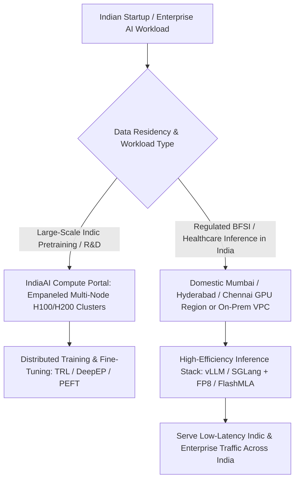

## 1. Introduction and Current Context

AI models do not run on policy announcements—they run on megawatts of uninterrupted power, high-density liquid-cooled server racks, InfiniBand/RoCEv2 fabrics, and globally sourced silicon accelerators. Over the past 18 months, headlines across India have featured massive colocation and hyperscaler pledges alongside the central government's IndiaAI Mission.

## 2. Direct Answer and Key Takeaway

> **Key Takeaway:** By October 2026, India has moved from compute scarcity toward an operational public-private GPU federation under the **IndiaAI Mission** (backed by a verified outlay of ₹10,371.92 crore, with over **38,000 GPUs** already onboarded via empaneled Compute Service Providers on the IndiaAI Compute Portal and a High-Performance AI Compute System being established at the NIC Data Centre in Shastri Park, Delhi). However, technical leaders must strictly distinguish **multi-billion-dollar multi-year investment announcements** from **currently energized, liquid-cooled high-density GPU racks**.

## 3. Definitions and Technical Background

Before evaluating architectural trade-offs or writing production code for **AI infrastructure India**, it is essential to establish precise engineering definitions for the core components involved:

- **IndiaAI Compute Portal (Empaneled CSP Federation):** A federated compute-as-a-service marketplace under the Ministry of Electronics and Information Technology (MeitY) IndiaAI Mission that aggregates GPUs procured by empaneled private and public Compute Service Providers (CSPs) and offers subsidized access to approved Indian startups, researchers, and sovereign model builders.
- **Announced Capacity vs. Operational IT Load:** A critical infrastructure distinction: **announced capacity** reflects MOUs, land acquisition, or 5-to-10-year megawatt (MW) expansion pledges, whereas **operational IT load** represents energized data centre halls with installed cooling, redundant power, and commissioned GPU interconnects available for immediate SSH/API workloads.
- **Rack Power Density (Legacy Colocation vs. AI Factory):** Traditional enterprise cloud racks draw 5–10 kW per rack using standard raised-floor air cooling; modern AI training and high-throughput inference clusters require 40–120+ kW per rack, demanding direct-to-chip liquid cooling or rear-door heat exchangers.

## 4. Technical Architecture and Deep Dive

**Verified State of India's Sovereign & Domestic Compute:** According to official submissions by the Ministry of Electronics and Information Technology (MeitY) in Lok Sabha (August 2026) and IndiaAI Mission progress disclosures, the IndiaAI Mission carries a cabinet-approved budget of **₹10,371.92 crore**. Rather than waiting years for a single monolithic state-owned facility to be built from scratch, India operationalized a federated **compute-as-a-service model** via the IndiaAI Compute Portal. By late 2026, more than **38,000 GPUs** have been onboarded through empaneled Compute Service Providers—exceeding the initial 10,000-GPU target and progressing toward a target of roughly one lakh (100,000) GPUs.

**Separating Announced Megawatts from Commissioned GPU Racks:** Alongside public initiatives, major domestic data centre operators and global hyperscalers in Mumbai, Navi Mumbai, Chennai, Hyderabad, and Noida have announced multi-billion-dollar campus expansions. However, engineers procuring capacity in 2026 must audit three physical bottlenecks before signing multi-year colocation or cloud contracts. First, **retrofitting air-cooled halls**: much of India's existing data centre footprint was built for 6–8 kW enterprise racks; hosting dense 8-GPU nodes interconnected with 400G/800G InfiniBand or RoCE requires high-density power distribution and liquid cooling retrofits. Second, **import lead times and global silicon allocation**: domestic data centres still draw on globally fabricated GPUs, meaning delivery schedules depend on international foundry allocations.

**How Indian Engineering Teams Maximize Domestic GPU ROI:** When a domestic startup receives an allocation of H100 or L40S GPUs, hardware is only half the equation.

By standardizing domestic deployments on open-source high-throughput serving stacks—specifically `vllm-project/vllm` and `sgl-project/sglang` with `deepseek-ai/FlashMLA` and `DeepGEMM` FP8 kernels—an Indian enterprise can serve 4x to 8x more concurrent citizens or banking customers on the exact same physical GPU rack in Mumbai or Delhi.

## 5. Comparative Analysis: India AI Compute Infrastructure Landscape in 2026: Verified Tiers & Engineering Considerations

The following table compares the key engineering trade-offs, operational boundaries, and implementation choices for **AI infrastructure India**:

| Infrastructure Tier | Verified Status & Mechanism (2026) | Primary Workload Fit | Due-Diligence Check for Engineering Teams |
| --- | --- | --- | --- |
| IndiaAI Compute Portal (Empaneled CSPs) | Operational (>38,000 GPUs onboarded; ₹10,371.92 Cr mission budget) | Subsidized sovereign pretraining, Indic fine-tuning, startup R&D | Verify specific GPU SKU (H100 vs L40S), interconnect bandwidth, and voucher eligibility |
| NIC Data Centre (Shastri Park, Delhi) & AIRAWAT | Public HPC & Sovereign AI Compute System under establishment/expansion | Government digital public infrastructure (DPI), public-sector AI | Designed for public/research workloads rather than general commercial SaaS |
| Domestic Hyperscaler & Colocation Regions (Mumbai/Chennai/Hyd) | Operational enterprise regions + multi-GW multi-year expansion pipeline | Low-latency production inference (<30ms RTT) & DPDP data residency | Distinguish live bookable GPU instances from 2028–2030 announced MW pledges |
| Edge / On-Premises Enterprise Clusters | Single-node L40S / A100 / consumer workstation deployments | Regulated BFSI (RBI FREE-AI), hospitals, defense, local branch voice | Maximize throughput per card using `vLLM`, `SGLang`, and 4-bit/FP8 quantization |

## 6. System Architecture and Execution Flow

The diagram below illustrates the end-to-end control flow, verification boundaries, and state transitions for **AI infrastructure India** in a production environment:

*Figure 36.1: Compute procurement and deployment architecture for Indian engineering teams combining IndiaAI Compute Portal capacity with domestic low-latency inference regions.*

## 7. Practical Implementation Steps and Engineering Checklist

To implement **AI infrastructure India** reliably in production systems, follow these sequential engineering steps:

1. When evaluating domestic GPU cloud providers or colocation partners in India, demand concrete SLAs on **inter-node fabric bandwidth** versus single-node PCIe setups.
2. Apply for the **IndiaAI Compute Portal** subsidy programs if your organization is registered in India and building foundational Indic models, public-good applications, or deep-tech research.
3. Deploy production inference inside Mumbai, Hyderabad, or Chennai regions to eliminate the 150ms–250ms network round-trip latency penalty of routing Indian voice and chat traffic to US or European data centres.
4. Stretch every domestic GPU by deploying `vllm-project/vllm` or `sgl-project/sglang` with prefix caching, chunked prefill, and FP8 quantization before renting additional hardware nodes.

## 8. Limitations, Operational Risks, and Trade-Offs

Even well-architected deployments of **AI infrastructure India** face concrete engineering constraints that teams must mitigate proactively:

- Confusing MOU headlines with immediate availability: a press release announcing a '$10B, 1GW AI data centre in Maharashtra by 2030' does not provide GPUs for your Q4 2026 product launch—always verify live inventory.
- Power and cooling grid constraints: high-density AI clusters place heavy localized demand on municipal power grids and water-cooling systems during peak Indian summer months, making PUE (Power Usage Effectiveness) and closed-loop liquid cooling critical.
- Import and supply-chain dependency: as noted in MeitY's August 2026 parliamentary response, India's compute ecosystem currently relies on globally sourced GPUs procured through empaneled providers while domestic semiconductor initiatives mature.

## 9. Frequently Asked Questions (FAQs)

### How many GPUs are available under the IndiaAI Mission in 2026?

Per official government disclosures in 2026, more than 38,000 GPUs have been onboarded through empaneled Compute Service Providers on the IndiaAI Compute Portal under the ₹10,371.92 crore IndiaAI Mission, with ongoing expansion toward roughly 100,000 GPUs.

### Why can't every existing data centre in India immediately host H100 or Blackwell AI clusters?

Traditional enterprise data centres were engineered for 5 to 10 kW of power per rack with standard air conditioning.

### Does hosting AI models in Indian data centres improve application performance?

Yes, significantly for interactive workloads.

## 10. Conclusion

India's AI infrastructure race in 2026 is defined by pragmatic execution: combining the federated 38,000+ GPU pool of the IndiaAI Compute Portal and expanding domestic colocation campuses with disciplined software optimization. Teams that verify live rack capacity and maximize tokens-per-GPU via open-source engines like vLLM and SGLang will scale sustainably as domestic capacity grows.

### GitHub Repositories & Technical References

- **vllm-project/vllm** — High-throughput open-source LLM serving engine essential for maximizing concurrent user capacity per physical GPU in domestic data centres. Verified GitHub URL: https://github.com/vllm-project/vllm
- **sgl-project/sglang** — Serving framework with RadixAttention prefix caching and multi-node prefill-decode disaggregation. Verified GitHub URL: https://github.com/sgl-project/sglang
- **deepseek-ai/FlashMLA** — Efficient Multi-Head Latent Attention decoding kernels that slash KV-cache HBM usage on datacenter GPUs. Verified GitHub URL: https://github.com/deepseek-ai/FlashMLA
- **AI4Bharat/IndicLLMSuite** — Open-source Indic language dataset and training blueprint from IIT Madras's AI4Bharat lab used across domestic compute clusters. Verified GitHub URL: https://github.com/AI4Bharat/IndicLLMSuite
