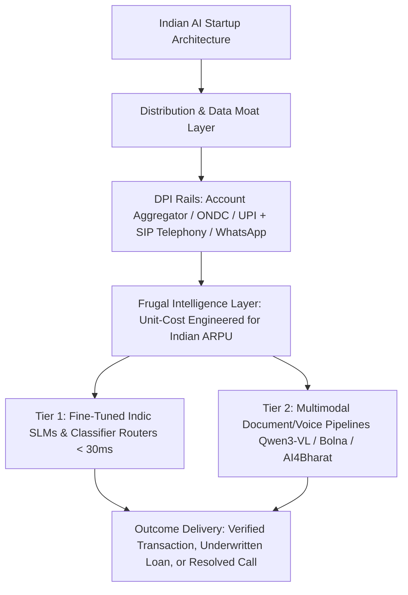

## 1. Introduction and Current Context

With over 200 generative AI startups founded in India and the country ranking 3rd globally in AI ecosystem vibrancy (per the Stanford Global AI Vibrancy Report cited by MeitY in 2026), the first wave of thin wrapper startups—generic 'ChatGPT for marketing copy' or 'PDF chat' web apps—has faced brutal commoditization as foundation model providers bundled those features natively. Technical founders building in 2026 must anchor their startups in deep workflow ownership, proprietary domain feedback loops, India's unique voice/DPI distribution rails, or extreme unit-cost engineering.

## 2. Direct Answer and Key Takeaway

> **Key Takeaway:** In 2026, the highest-conviction opportunities in India's AI startup ecosystem lie far beyond generic English text chatbots. Durable venture and enterprise value is concentrating in four structural layers: (1) **Multilingual Voice & Telephony Automation** (`bolna-ai/bolna`, `AI4Bharat`) serving 800M+ non-English-first citizens over phone and WhatsApp, (2) **Digital Public Infrastructure (DPI) & Regulated BFSI Workflows** (integrating with UPI, Account Aggregator, and ONDC), (3) **Global Vertical B2B Agentic Workflows** (autonomous QA, DevSecOps, clinical/legal ops built from India for global markets), and (4) **Sovereign & Cost-Optimized Indic Foundation Models** (backed by the IndiaAI Mission).

## 3. Definitions and Technical Background

Before evaluating architectural trade-offs or writing production code for **AI startups India**, it is essential to establish precise engineering definitions for the core components involved:

- **Voice-First Bharat Interface:** An application architecture where the primary user interface is a low-latency, code-switched regional-language voice call rather than a desktop text keyboard.
- **DPI-Integrated AI Workflow:** Coupling agentic extraction and decision models with India's Digital Public Infrastructure—such as Account Aggregator, UPI, DigiLocker, and ONDC.
- **Service-as-Software (Outcome-Priced Vertical AI):** A business model shift where Indian B2B startups sell completed, verified operational outcomes rather than per-seat software licenses.
- **Frugal Inference Engineering:** Architecting multi-tier SLM and MoE pipelines so an AI interaction remains profitable even at Indian ARPU price points of ₹1 to ₹5 per transaction.

## 4. Technical Architecture and Deep Dive

**Opportunity 1: Sovereign & Indic Foundation Infrastructure.** At the foundational layer, Indian startups such as Sarvam AI and Krutrim—alongside open-source academic powerhouses like IIT Madras's `AI4Bharat` (`AI4Bharat/IndicLLMSuite`, `AI4Bharat/IndicTrans2`) and government initiatives like Bhashini—are closing the tokenization and acoustic gap across India's 22 scheduled languages. Under the IndiaAI Mission, sovereign model builders have received substantial GPU compute subsidies (for example, Sarvam AI's allocation of 4,096 NVIDIA H100 GPUs with a commitment to open-source resulting models under permissive licenses).

**Opportunity 2: Voice Telephony & vernacular Operations for High-Volume Commerce.** For hundreds of millions of Indian consumers, MSME merchants, gig workers, and logistics drivers, typing English paragraphs into a web browser is unnatural; business happens via phone calls and voice notes in Hindi, Tamil, Telugu, Marathi, Bengali, and Hinglish.

**Opportunity 3: Regulated BFSI & DPI-Native Underwriting/Compliance.** India's financial ecosystem processes billions of monthly UPI transactions and Account Aggregator (AA) data flows.

**Opportunity 4: Building 'Service-as-Software' from India for Global Enterprises.** India's historic strength in IT services and Global Capability Centres gives Indian technical founders deep insight into enterprise back-office bottlenecks: legacy COBOL/Java migration, automated QA testing (`microsoft/playwright-mcp`), cybersecurity triage (`openai/codex-security`), and healthcare revenue-cycle management.

## 5. Comparative Analysis: 2026 Indian AI Startup Opportunity Matrix: Commoditized Traps vs. Defensible Moats

The following table compares the key engineering trade-offs, operational boundaries, and implementation choices for **AI startups India**:

| Market Segment | Commoditized 'Thin Wrapper' Trap (Avoid) | Defensible 2026 Startup Opportunity (Build) | Core Technical Moat & Open-Source Stack |
| --- | --- | --- | --- |
| Customer & Citizen Engagement | Generic English website chat widget | Code-switched Indic SIP/telephony voice agents (`Hinglish`/`Tamil`) | `bolna-ai/bolna`, `livekit/agents`, `AI4Bharat` ASR/TTS |
| Fintech & MSME Lending | Basic chatbot answering loan FAQs | Account Aggregator + vernacular bank-statement & GST underwriting engine | `Qwen3-VL`, `dottxt-ai/outlines`, RBI FREE-AI auditability |
| Global Enterprise Software | Generic prompt templates for developers | Autonomous legacy code migration, E2E QA (`Playwright`), & SecOps agents | `langchain-ai/langgraph`, `playwright-mcp`, `codex-security` |
| Supply Chain & Commerce | Static catalog translation scripts | Multimodal catalog onboarding (photo/voice → ONDC schema) & logistics calls | `Qwen3-VL`, `pydantic-ai`, fine-tuned 8B SLMs (`peft`) |
| Inference & Unit Economics | Routing every ₹2 query to frontier US APIs | Frugal cascade routing (90% on local/VPC quantized SLMs via `vLLM`) | `vllm-project/vllm`, `sgl-project/sglang`, `huggingface/peft` |

## 6. System Architecture and Execution Flow

The diagram below illustrates the end-to-end control flow, verification boundaries, and state transitions for **AI startups India** in a production environment:

*Figure 38.1: Architectural stack of a defensible Indian AI startup combining DPI/telephony distribution rails with frugal multi-tier SLM inference.*

## 7. Practical Implementation Steps and Engineering Checklist

To implement **AI startups India** reliably in production systems, follow these sequential engineering steps:

1. Design your unit economics for **Indian ARPU realities** from day one: if a workflow earns ₹3 ($0.035) in revenue, you cannot spend $0.08 on a multi-turn frontier LLM call—architect a cascade where 90% of routine extraction and routing runs on fine-tuned 4B–8B open-weight models via `vllm`.
2. Integrate directly into existing system-of-record workflows (SIP telephony trunks, WhatsApp Business APIs, ERP/Tally exports, Account Aggregator schemas) rather than asking Indian MSMEs to learn a new standalone browser dashboard.
3. Benchmark your Indic language accuracy on real-world **code-switched and noisy inputs** (such as Hinglish voice notes recorded in traffic or photographed handwritten kirana invoices) using `AI4Bharat` datasets rather than clean English academic benchmarks.
4. Build compliance into your core architecture—strict VPC data residency in Mumbai/Chennai/Hyderabad, DPDP Act consent logs, and deterministic human-in-the-loop audit trails—to shorten enterprise sales cycles with Indian banks and conglomerates.
5. When targeting global US/EU enterprise markets from India, price around **verified work outcomes** (e.g., per resolved ticket, per migrated module, per verified E2E test suite) rather than easily churned copilot seats.

## 8. Limitations, Operational Risks, and Trade-Offs

Even well-architected deployments of **AI startups India** face concrete engineering constraints that teams must mitigate proactively:

- High token costs destroying gross margins: startups that scale top-line usage rapidly on subsidized venture capital while paying negative gross margins on unoptimized third-party API calls hit a wall at Series A.
- Enterprise procurement cycles in traditional Indian sectors: selling to domestic banks, insurance carriers, and public-sector undertakings requires passing rigorous infosec, on-prem/VPC deployment, and pilot PoC gates.
- Platform risk on foundational features: building a startup whose sole feature is 'summarize meeting transcripts' or 'translate English to Hindi text' will be squeezed by free OS-level and frontier model features unless embedded deeply inside a vertical transaction loop.

## 9. Frequently Asked Questions (FAQs)

### Why are voice AI startups growing so fast in India compared to text chatbots?

In India, voice over phone calls and messaging apps is the natural interface for commerce, logistics, banking support, and healthcare across hundreds of millions of speakers of regional languages.

### How can an Indian AI startup compete if it doesn't train its own multi-billion-dollar frontier model?

Startups win at the **vertical workflow and data layer**, not by out-spending hyperscalers on generic pretraining.

### What role does the IndiaAI Mission play for Indian AI startups?

The IndiaAI Mission provides subsidized GPU compute access through the IndiaAI Compute Portal, supports indigenous foundation datasets and models (which are mandated to be open-sourced under permissive licenses), and funds application-level innovation challenges across healthcare, agriculture, and governance.

## 10. Conclusion

India's AI startup opportunity in 2026 is defined by applied systems depth: multilingual voice telephony, DPI-integrated financial and commerce automation, sovereign Indic models, and outcome-driven global B2B software. Founders who pair deep domain integration with frugal open-source inference engineering will build enduring category leaders.

### GitHub Repositories & Technical References

- **bolna-ai/bolna** — Open-source orchestration framework for building production voice-driven conversational AI agents across telephony and WebRTC. Verified GitHub URL: https://github.com/bolna-ai/bolna
- **AI4Bharat/IndicLLMSuite** — Comprehensive open-source blueprint and dataset suite for pretraining and fine-tuning Indic language models. Verified GitHub URL: https://github.com/AI4Bharat/IndicLLMSuite
- **AI4Bharat/IndicTrans2** — Open-source machine translation models covering all 22 scheduled Indian languages. Verified GitHub URL: https://github.com/ai4bharat/IndicTrans2
- **vllm-project/vllm** — High-throughput LLM serving engine enabling startups to achieve sustainable unit economics on open-weight models. Verified GitHub URL: https://github.com/vllm-project/vllm
