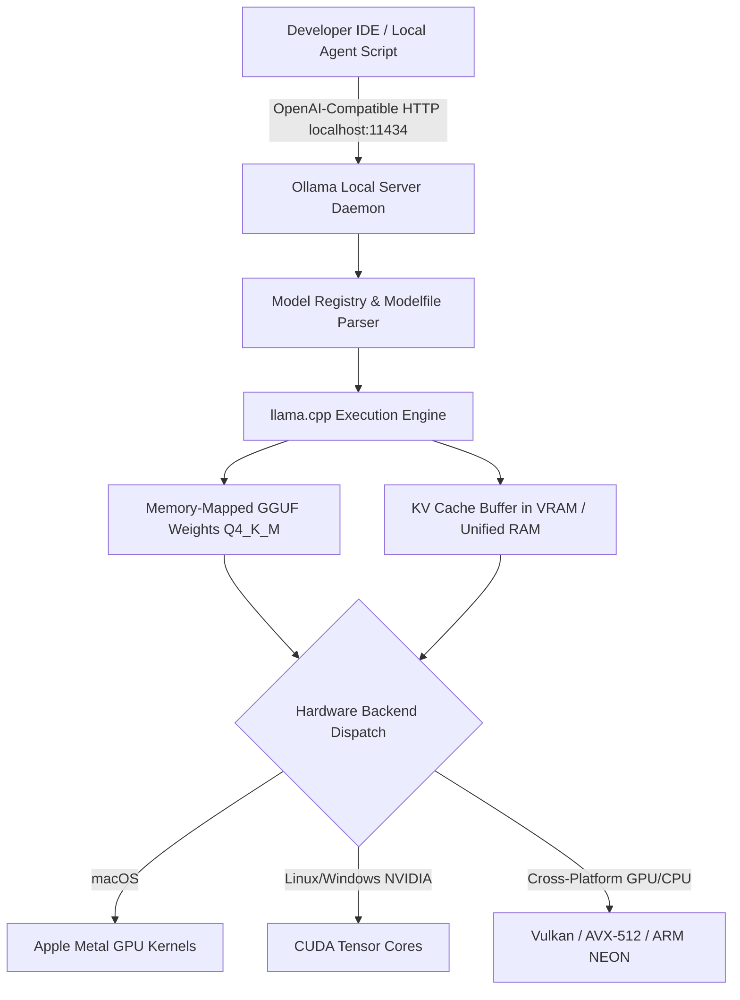

## 1. Introduction and Current Context

When generative AI first entered mainstream software development, running a capable language model required datacenter-grade GPUs with 80GB of high-bandwidth memory (HBM). Developers had little choice but to route every prompt over the public internet to metered cloud APIs. By 2026, two converging trends have made local AI inference a standard fixture on developer laptops and workstations: the maturity of hardware-accelerated runtimes (`ggml-org/llama.cpp` and `ollama/ollama`) across Apple Silicon Metal, NVIDIA CUDA, and Vulkan backends, and the high reasoning density of compact open-weight model families such as Qwen3, Gemma, and Llama.

## 2. Direct Answer and Key Takeaway

> **Key Takeaway:** Developers run large language models locally in 2026 to guarantee zero-data-egress privacy, eliminate per-token API billing during iterative development, and achieve predictable sub-50ms time-to-first-token for local tools. Powered by C/C++ tensor engines like `llama.cpp`, desktop wrappers like `Ollama`, and 4-bit GGUF quantization alongside capable 4B-to-32B open-weight models, modern consumer workstations with 16GB to 64GB of unified memory or VRAM can handle coding assistance, document extraction, and offline agent testing without cloud connectivity.

## 3. Definitions and Technical Background

Before evaluating architectural trade-offs or writing production code for **local LLM**, it is essential to establish precise engineering definitions for the core components involved:

- **Memory Bandwidth Bottleneck:** The physical constraint governing single-user autoregressive token generation, where decoding speed is determined primarily by how fast model weights can be read from RAM/VRAM into compute cores on each token step.
- **Unified Memory Architecture (UMA):** A hardware design—prominent in Apple Silicon M-series chips and modern AMD/Intel APUs—where CPU and GPU cores share a single high-bandwidth pool of system memory, enabling large models to load without PCIe copy bottlenecks.
- **GGUF (GGML Universal File):** A binary file format designed for fast memory-mapped (`mmap`) loading and quantized execution of language models across heterogeneous CPU and GPU backends.
- **KV Cache Footprint:** The dynamic memory allocation required to store key and value attention tensors for all tokens in the active context window, which grows linearly with sequence length and batch size unless compressed.

## 4. Technical Architecture and Deep Dive

To understand why local inference performs well for single-user workflows, engineers must distinguish between the two phases of LLM execution: prefill (processing the input prompt in parallel, which is compute-bound) and decode (generating output tokens one by one, which is memory-bandwidth-bound). During decoding, generating a single token requires reading every active parameter of the model from memory.

Quantization bridges the gap between frontier model sizes and consumer hardware. By compressing 16-bit floating-point weights into 4-bit integer representations, developers reduce both the static memory footprint and the bytes transferred per token by roughly 70% to 75%.

From an engineering workflow perspective, local inference solves three acute pain points that cloud APIs cannot easily address. First, strict data residency and compliance: when debugging proprietary source code, analyzing hospital records, or parsing legal contracts, routing payloads to `localhost:11434` guarantees that sensitive text never traverses an external network. Second, zero marginal cost for high-volume batch processing and CI testing: developers can run thousands of local classification or synthetic data generation loops overnight without incurring surprise API invoices.

However, local runtimes have clear architectural boundaries. Single-user wrappers like `ollama/ollama` excel at concurrency levels of 1 to 4 requests.

## 5. Comparative Analysis: Hardware Tiers and Practical Local LLM Capacities Using 4-Bit (Q4_K_M) Quantization

The following table compares the key engineering trade-offs, operational boundaries, and implementation choices for **local LLM**:

| Hardware Tier | Available VRAM / Unified RAM | Recommended Model Parameter Range | Practical Context Window | Primary Developer Workloads |
| --- | --- | --- | --- | --- |
| Entry Laptop (Integrated / 8GB RAM) | 4 GB – 6 GB usable | 1B – 4B parameters (~1.5–2.8 GB weights) | 4K – 8K tokens | Fast text classification, regex generation, commit messages |
| Standard Dev Machine (16GB RAM / 8–12GB GPU) | 8 GB – 12 GB usable | 7B – 14B parameters (~4.8–9.0 GB weights) | 8K – 16K tokens | Local coding autocomplete, RAG prototyping, JSON extraction |
| Pro Workstation (32GB–64GB Unified / 24GB GPU) | 24 GB – 48 GB usable | 27B – 32B dense or 30B-A3B MoE (~18–22 GB) | 16K – 32K tokens | Agentic coding loops, multi-file refactoring, offline code review |
| High-End Local Studio (96GB–192GB Unified / Dual GPU) | 64 GB – 128 GB+ usable | 70B dense or large MoE models (~42–80 GB) | 32K – 64K tokens | Complex architectural reasoning, local red-teaming, synthetic data |

## 6. System Architecture and Execution Flow

The diagram below illustrates the end-to-end control flow, verification boundaries, and state transitions for **local LLM** in a production environment:

*Figure 3.1: Local LLM execution stack showing how developer tools communicate with Ollama and llama.cpp across heterogeneous hardware accelerators.*

## 7. Practical Implementation Steps and Engineering Checklist

To implement **local LLM** reliably in production systems, follow these sequential engineering steps:

1. Audit your available memory budget before downloading weights: reserve at least 3GB to 4GB of headroom for the host OS and browser, and calculate model memory as `(Parameters in Billions × 0.65 GB) + KV Cache overhead` for 4-bit quantization.
2. Install `ollama/ollama` for frictionless lifecycle management or build `ggml-org/llama.cpp` directly (`llama-server`) when you need fine-grained control over flash attention, speculative decoding, and KV cache quantization (`-ctk q8_0 -ctv q8_0`).
3. Prefer Mixture-of-Experts (MoE) checkpoints (such as 30B total parameters with 3B active parameters) on unified-memory laptops: while all weights must fit in RAM, only the active parameters are read per token, delivering 3B-class decoding speeds with 30B-class knowledge capacity.
4. Explicitly cap the context window (`num_ctx` in Ollama or `-c` in `llama.cpp`) to match your actual task—such as `8192` or `16384`—rather than defaulting to `131072`, which can immediately exhaust VRAM via KV cache allocation.
5. Bind local inference servers strictly to `127.0.0.1` rather than `0.0.0.0` unless protected by an authentication reverse proxy, preventing unauthorized devices on local Wi-Fi networks from querying your workstation.

## 8. Limitations, Operational Risks, and Trade-Offs

Even well-architected deployments of **local LLM** face concrete engineering constraints that teams must mitigate proactively:

- Long-context prefill latency: while consumer hardware decodes tokens briskly, prefilling a 32,000-token repository context on a laptop GPU can take tens of seconds before the first output token appears.
- Thermal throttling on sustained workloads: running continuous batch extraction or agent loops on thin laptops causes sustained GPU/SoC power draw, leading to clock-speed throttling and reduced tokens-per-second over time.
- Quantization degradation on edge cases: aggressive sub-4-bit quantization (`Q2_K`, `Q3_K_S`) noticeably degrades complex multi-step tool-calling syntax and mathematical precision compared to `Q4_K_M` or `Q8_0`.

## 9. Frequently Asked Questions (FAQs)

### What is the difference between Ollama and llama.cpp?

llama.cpp is the core C/C++ inference engine and tensor library that executes GGUF models on CPUs and GPUs.

### How much RAM do I need to run a useful local LLM in 2026?

A machine with 16GB of RAM (or an 8GB dedicated GPU) comfortably runs 7B to 8B parameter models in 4-bit quantization (`Q4_K_M`).

### Does running an LLM locally guarantee 100% privacy?

Running inference via `llama.cpp` or `ollama` keeps model weights and prompt processing entirely on your local hardware with zero network egress.

## 10. Conclusion

Local AI inference has evolved from a hobbyist experiment into a practical pillar of modern software engineering. By understanding the memory-bandwidth economics of decoding, choosing 4-bit GGUF models or sparse MoE architectures, and pairing local runtimes with cloud APIs for heavy parallel workloads, developers achieve privacy, cost control, and architectural resilience.

### GitHub Repositories & Technical References

- **ollama/ollama** — Official repository for Ollama, providing a local daemon, CLI, and REST API to run open-weight language and multimodal models on macOS, Linux, and Windows. Verified GitHub URL: https://github.com/ollama/ollama
- **ggml-org/llama.cpp** — Official C/C++ LLM inference engine supporting GGUF quantization, CPU/GPU hybrid execution, Apple Metal, CUDA, and Vulkan backends. Verified GitHub URL: https://github.com/ggml-org/llama.cpp
- **vllm-project/vllm** — High-throughput LLM serving engine featuring PagedAttention and continuous batching for scaling beyond single-user local runtimes. Verified GitHub URL: https://github.com/vllm-project/vllm
