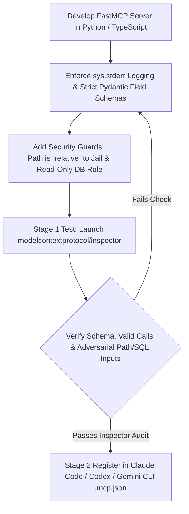

## 1. Introduction and Current Context

In Article 18, we explored the high-level architecture of the Model Context Protocol (`modelcontextprotocol/modelcontextprotocol`). In this practical skill tutorial, we shift to hands-on implementation: how to write, secure, test, and debug your own custom MCP server from scratch so it plugs cleanly into Claude Code, OpenAI Codex CLI, Gemini CLI, or your custom `pydantic-ai`/`langgraph` backend.

## 2. Direct Answer and Key Takeaway

> **Key Takeaway:** Building a production-grade Model Context Protocol (MCP) server in 2026 using `modelcontextprotocol/python-sdk` (`FastMCP`) or the TypeScript SDK requires mastering five engineering rules: (1) **Separate Read-Only `@mcp.resource` URIs from Executable `@mcp.tool` Functions**, (2) **Enforce Strict Pydantic/JSON Schema Constraints** on every parameter, (3) **Never Write Debug Logs to `stdout` in `stdio` Mode** (route all logging to `stderr` so JSON-RPC 2.0 wire frames are never corrupted), (4) **Validate Path Traversal & SQL Injection Inside the Server**, and (5) **Test Standalone with `modelcontextprotocol/inspector`** before connecting to any LLM host.

## 3. Definitions and Technical Background

Before evaluating architectural trade-offs or writing production code for **MCP development**, it is essential to establish precise engineering definitions for the core components involved:

- **`FastMCP` High-Level Server API:** The ergonomic decorator-based server interface in the official `modelcontextprotocol/python-sdk` that automatically inspects Python type hints and docstrings to generate MCP JSON Schemas.
- **`stdio` Wire Purity Invariant:** The strict protocol rule that when an MCP server runs over standard input/output (`stdio`), `sys.stdout` carries *exclusively* newline-delimited JSON-RPC 2.0 frames; any diagnostic log must be written to `sys.stderr`.
- **Path Canonicalization & Root Jail (`Path.resolve()`):** Resolving symlinks and relative `../` segments on any file path argument and verifying `resolved_path.is_relative_to` before reading or writing files inside an MCP server.

## 4. Technical Architecture and Deep Dive

**Prerequisites & Required Tools:** Python $\ge 3.11$, the official MCP Python SDK, and Node.js $\ge 20$ to run `npx @modelcontextprotocol/inspector`.

**Step-by-Step Learning Path:**
1. **Beginner — First `FastMCP` Server & Inspector Test:** Create a server with `@mcp.resource()` for static/URI data and `@mcp.tool()` with strict Pydantic `Field` constraints, route `logging` to `sys.stderr`, and test it visually with `mcp dev server.py`.
2.

**Minimal Production Code Example (Hardened Python MCP Server Using `modelcontextprotocol/python-sdk`):**

```python
# File: release_notes_mcp_server.py
# Prerequisites: pip install "mcp[cli]" pydantic
import logging
import sys
from pathlib import Path
from typing import Literal
from pydantic import Field
from mcp.server.fastmcp import FastMCP

# CRITICAL: Configure all logging to sys.stderr so stdout remains pure JSON-RPC 2.0
logging.basicConfig(
    level=logging.INFO,
    format="%(asctime)s [%(levelname)s] %(message)s",
    stream=sys.stderr,
)
logger = logging.getLogger("release-notes-mcp")

ALLOWED_DOCS_ROOT = Path("/tmp/safe_release_docs").resolve()
ALLOWED_DOCS_ROOT.mkdir(parents=True, exist_ok=True)

mcp = FastMCP("AniketReleaseNotesServer")

@mcp.resource("releases://manifest/{environment}")
def get_release_manifest(environment: str) -> str:
    """Read-only resource returning the current deployment manifest for an environment."""
    if environment not in {"staging", "production"}:
        return "Error: environment must be 'staging' or 'production'."
    logger.info("Reading manifest resource for env=%s", environment)
    return f"Environment: {environment}\nActive Version: v2026.10.25\nStatus: Healthy"

@mcp.tool()
def read_release_note(
    filename: str = Field(..., description="Markdown filename inside release docs (e.g. 'v2.4.md')", pattern=r"^[a-zA-Z0-9._-]+\.md$"),
    max_chars: int = Field(default=2000, ge=200, le=8000, description="Maximum characters to return"),
    severity_filter: Literal["all", "breaking", "security"] = "all",
) -> str:
    """Safely read a release note markdown file within the approved directory jail."""
    candidate = (ALLOWED_DOCS_ROOT / filename).resolve()
    # Enforce strict directory jail against ../ or symlink traversal
    if not candidate.is_relative_to(ALLOWED_DOCS_ROOT):
        logger.warning("Blocked path traversal attempt: %s", filename)
        return "Error: Access denied. Path is outside the allowed release documentation root."

    if not candidate.is_file():
        return f"No release note found named '{filename}'. Available files: {[p.name for p in ALLOWED_DOCS_ROOT.glob('*.md')]}"

    content = candidate.read_text(encoding="utf-8")[:max_chars]
    return f"[Filter: {severity_filter}]\n{content}"

if __name__ == "__main__":
    mcp.run(transport="stdio")
```

**Testing & Verification Steps:**
1. **Interactive Inspector Verification:** Run `npx @modelcontextprotocol/inspector python3 release_notes_mcp_server.py`. In the Inspector UI, click **Connect**, inspect the generated JSON Schema under the **Tools** tab, and test calling `read_release_note` with `filename: "../../etc/passwd"`—verifying that the regex pattern and `is_relative_to` jail block the call cleanly.
2.

## 5. Comparative Analysis: MCP Server Engineering Checklist: Common Bugs vs. Production Best Practices

The following table compares the key engineering trade-offs, operational boundaries, and implementation choices for **MCP development**:

| MCP Server Layer | Common Developer Bug | Symptom in Host / Agent | Production Fix |
| --- | --- | --- | --- |
| Logging in `stdio` Mode | Using `print('Starting...')` or default `stdout` logger | Client fails handshake with `SyntaxError: Unexpected token` | Always pass `stream=sys.stderr` to `logging.basicConfig` |
| Parameter Schemas | Untyped args `def query(q)` with no docstring | LLM guesses wrong arg formats or never selects the tool | Use `Field(description=..., pattern=..., ge=..., le=...)` & `Literal` |
| Filesystem / DB Access | Doing `open(base_dir + '/' + filename)` directly | Prompt injection reads `~/.ssh/id_rsa` via `../../` | Use `Path.resolve()` + `candidate.is_relative_to(ALLOWED_ROOT)` |
| Error Handling | Raising unhandled internal traceback on missing record | Cryptic stack trace wastes tokens; agent retries blindly | Return concise actionable string listing valid options |
| Payload Size | Returning a 10MB log file or 5,000 DB rows | Host context window overflows or crashes UI | Enforce `max_chars` / `limit` parameter with pagination metadata |

## 6. System Architecture and Execution Flow

The diagram below illustrates the end-to-end control flow, verification boundaries, and state transitions for **MCP development** in a production environment:



*Figure 59.1: End-to-end development, security hardening, and `modelcontextprotocol/inspector` verification workflow for custom MCP servers.*

## 7. Practical Implementation Steps and Engineering Checklist

To implement **MCP development** reliably in production systems, follow these sequential engineering steps:

1. Make `stream=sys.stderr` the very first line of your logging configuration in every Python `stdio` MCP server, and set environment variables if imported packages print startup banners to `stdout`.
2. Include available valid options inside 'not found' tool responses so the LLM succeeds on its very next turn without guessing.
3. Always bound tool output sizes by adding a `limit: int = Field` or `max_chars` parameter and appending `"... [Truncated, use offset=20 for more]"` when results exceed the cap.
4. Separate read-only tools from write/destructive tools into distinct MCP servers so developers can attach the read-only mode safely during exploratory debugging.

## 8. Limitations, Operational Risks, and Trade-Offs

Even well-architected deployments of **MCP development** face concrete engineering constraints that teams must mitigate proactively:

- Exposing a generic `run_arbitrary_sql(sql: str)` or `run_bash(cmd: str)` tool over a remote HTTP MCP server: never expose raw arbitrary query/command execution over a shared network MCP server; expose parameterized, domain-specific tools backed by a read-only database user.
- Hardcoding machine-specific paths in committed `.mcp.json` files: committing `/Users/aniket/venv/bin/python` breaks for every teammate—use relative workspace variables or `uv run` / `npx` commands.
- Long-running synchronous calls blocking the MCP server event loop: if an `async def` tool inside `FastMCP` calls a synchronous blocking HTTP or database driver, concurrent resource reads and heartbeats stall.

## 9. Frequently Asked Questions (FAQs)

### Why does my MCP server work when I run it in the terminal, but fail immediately inside Claude Code or Codex CLI?

Because when you run it manually in a terminal, you don't notice a 1-line startup message printed to `stdout`. When an MCP client connects over `stdio`, it parses every line of `stdout` as JSON-RPC 2.0.

### When should I use `@mcp.resource` vs `@mcp.tool` in FastMCP?

Use `@mcp.resource` for static or URI-addressable read-only context (like configuration manifests, database schemas, or style guides) that the host application or user can attach directly.

### How do I test an MCP server without connecting it to an LLM first?

Run `npx @modelcontextprotocol/inspector python3 your_server.py` (from `modelcontextprotocol/inspector`).

## 10. Conclusion

Developing custom Model Context Protocol servers is one of the highest-leverage skills in modern software engineering—allowing you to connect internal databases, test runners, and documentation to every AI agent in your organization through a single clean interface. By enforcing `stderr` logging purity, strict Pydantic schemas, directory jails, and `modelcontextprotocol/inspector` verification, your MCP servers will run reliably everywhere.

### GitHub Repositories & Technical References

- **modelcontextprotocol/python-sdk** — Official Python SDK for the Model Context Protocol, providing the `FastMCP` server decorator framework and client libraries. Verified GitHub URL: https://github.com/modelcontextprotocol/python-sdk
- **modelcontextprotocol/inspector** — Official visual testing and debugging tool for inspecting and invoking MCP servers locally. Verified GitHub URL: https://github.com/modelcontextprotocol/inspector
- **modelcontextprotocol/servers** — Official collection of reference MCP server implementations demonstrating security and schema best practices. Verified GitHub URL: https://github.com/modelcontextprotocol/servers
- **modelcontextprotocol/modelcontextprotocol** — Official specification and protocol documentation for the Model Context Protocol. Verified GitHub URL: https://github.com/modelcontextprotocol/modelcontextprotocol
