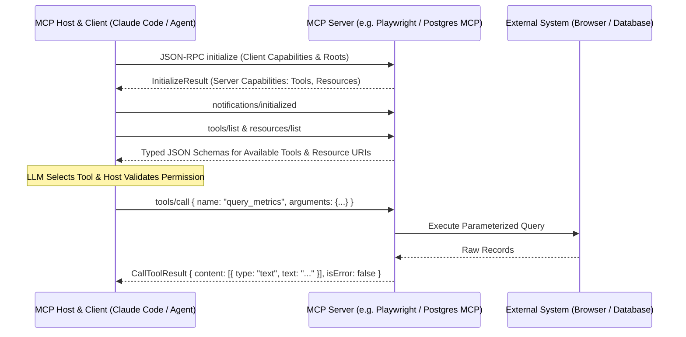

## 1. Introduction and Current Context

Before the widespread adoption of the Model Context Protocol, connecting $M$ different AI applications (IDEs, chat interfaces, CLI agents, custom LangGraph backends) to $N$ different data sources (PostgreSQL, GitHub, Playwright, Jira, internal microservices) required $M \times N$ bespoke integration plugins. Each plugin reinvented authentication, schema discovery, error formatting, and session lifecycle management. By October 2026, MCP has become the universal USB-C port for AI context and tool execution, backed by official SDKs in Python (`modelcontextprotocol/python-sdk`), TypeScript, Rust (`modelcontextprotocol/rust-sdk`), and C#, plus a shared server registry (`modelcontextprotocol/registry`).

## 2. Direct Answer and Key Takeaway

> **Key Takeaway:** The Model Context Protocol (MCP)—maintained openly under `modelcontextprotocol/modelcontextprotocol`—solves the $M \times N$ integration bottleneck between AI applications and external systems by defining a universal, stateful JSON-RPC 2.0 protocol across three core primitives: **Resources** (read-only context data), **Tools** (executable functions with JSON Schema validation), and **Prompts** (reusable interaction templates). Instead of writing custom connector code for every LLM host and every SaaS or local tool, developers build a single MCP server that works seamlessly across Claude Code, OpenAI Codex CLI, Gemini CLI, IDEs, and custom agent runtimes.

## 3. Definitions and Technical Background

Before evaluating architectural trade-offs or writing production code for **Model Context Protocol**, it is essential to establish precise engineering definitions for the core components involved:

- **MCP Host:** The user-facing AI application (such as Claude Code, an IDE, or a custom backend service) that manages one or more MCP clients, enforces security consent policies, and orchestrates LLM interactions.
- **MCP Client:** A protocol connector instantiated inside the Host that maintains a dedicated 1:1 stateful connection with a specific MCP Server, negotiating capabilities and routing JSON-RPC messages.
- **MCP Server:** A lightweight program that exposes specific capabilities—Tools, Resources, and Prompts—from a local data source (like a Git repo or SQLite DB) or remote API over standard transports.
- **Resources vs. Tools vs. Prompts:** The three core server primitives: **Resources** are application-controlled read-only data URIs (like `postgres://schema/users`); **Tools** are model-controlled executable functions with side effects or dynamic queries; and **Prompts** are user-controlled templated workflows.

## 4. Technical Architecture and Deep Dive

To understand MCP at the protocol layer, developers should examine its wire format and lifecycle. Every MCP session communicates via **JSON-RPC 2.0** messages (`request`, `result`, `error`, and one-way `notification`). When an MCP Host starts up, each MCP Client initiates a capability negotiation handshake (`initialize` request) with its paired MCP Server. The server responds with its supported protocol version and declares whether it offers `tools`, `resources` (including optional resource change subscriptions), or `prompts`. Once the client sends the `notifications/initialized` message, the session enters active operation.

Why does MCP distinguish **Resources** from **Tools** when standard LLM APIs only have `tools`? In a naive tool-calling setup, every piece of reference context—such as reading a database schema or viewing a configuration file—must be invoked by the LLM as a function call, wasting reasoning turns and mixing passive read context with mutating actions.

MCP supports two primary transport mechanisms tailored to local versus distributed deployments. For local developer tools—such as connecting `anthropics/claude-code` or `openai/codex` to `microsoft/playwright-mcp` or a local Git server—the **Stdio transport** spawns the MCP server as a local child subprocess and exchanges newline-delimited JSON-RPC messages over `stdin` and `stdout` with zero network exposure.

Furthermore, the MCP ecosystem includes dedicated developer observability tooling.

## 5. Comparative Analysis: The Three Core Primitives of the Model Context Protocol (MCP) and Their Execution Boundaries

The following table compares the key engineering trade-offs, operational boundaries, and implementation choices for **Model Context Protocol**:

| MCP Primitive | Control Authority | JSON-RPC Discovery & Invocation Methods | Side-Effect Profile | Canonical Engineering Example |
| --- | --- | --- | --- | --- |
| Resources | Application / Host Controlled | `resources/list`, `resources/read`, `resources/subscribe` | Strictly Read-Only (GET semantics) | Exposing DB table schemas, log files, or architecture docs |
| Tools | Model (LLM) Controlled (with Host approval) | `tools/list`, `tools/call` | Compute, Query, or State Mutation (POST semantics) | Running a SQL query, clicking a Playwright selector, opening a PR |
| Prompts | User / Operator Controlled | `prompts/list`, `prompts/get` | Read-Only Template Assembly | Slash command `/security-audit` pre-filling git diff & rubric |
| Roots & Sampling | Client-to-Server Capabilities | `roots/list`, `sampling/createMessage` | Scoped Workspace Boundaries | Restricting server file access to approved project directories |

## 6. System Architecture and Execution Flow

The diagram below illustrates the end-to-end control flow, verification boundaries, and state transitions for **Model Context Protocol** in a production environment:

*Figure 18.1: Complete JSON-RPC 2.0 handshake, capability discovery, and tool execution sequence between an MCP Client and MCP Server.*

## 7. Practical Implementation Steps and Engineering Checklist

To implement **Model Context Protocol** reliably in production systems, follow these sequential engineering steps:

1. Build MCP servers using the official SDKs (`modelcontextprotocol/python-sdk` with `FastMCP` or `@modelcontextprotocol/sdk` in TypeScript) so protocol handshakes, JSON-RPC framing, and schema generation are handled automatically.
2. Write crystal-clear, concise docstrings and strict parameter constraints (enums, regex patterns, min/max bounds) on every MCP tool—because the LLM reads your `tools/list` JSON Schema directly to decide when and how to call the tool.
3. When running MCP servers over the `stdio` transport, **never** write debug logs using `print()` or `console.log()` to `stdout`, as any non-JSON text on `stdout` corrupts the JSON-RPC wire stream; always log to `stderr` or a file.
4. Test every MCP server standalone using `npx @modelcontextprotocol/inspector` (`modelcontextprotocol/inspector`) to verify schema definitions and error handling before connecting it to an LLM agent.
5. Enforce least-privilege security inside the MCP server itself: validate all file paths against the client's allowed `roots`, use read-only database roles for query tools, and never trust the LLM to enforce multi-tenant access controls in its arguments.

## 8. Limitations, Operational Risks, and Trade-Offs

Even well-architected deployments of **Model Context Protocol** face concrete engineering constraints that teams must mitigate proactively:

- Context bloat from excessive MCP servers: connecting an agent to 15 MCP servers that each expose 30 tools dumps 450 verbose JSON Schemas into the prompt prefix, consuming 30,000+ tokens before the user types a word and degrading tool-selection accuracy.
- Tool-poisoning & rug-pull risks in unverified third-party servers: downloading unverified community MCP servers gives those processes access to local environment variables or credentials, and malicious tool descriptions can inject hidden prompt instructions into the host LLM.
- Stdout corruption in stdio servers: third-party libraries imported inside an MCP server that emit warning banners to `stdout` on startup will break the client handshake unless redirected to `stderr`.

## 9. Frequently Asked Questions (FAQs)

### Does the Model Context Protocol (MCP) only work with Anthropic's Claude?

No.

### What is the difference between MCP and a standard OpenAPI / REST API?

OpenAPI describes stateless HTTP endpoints primarily for human developers or code generators.

### Why did my local MCP server fail to connect with a JSON parse error?

In 95% of cases, a local `stdio` MCP server failed because a `print()` or `console.log()` statement—or a noisy library import—wrote plain text to `stdout`.

## 10. Conclusion

The Model Context Protocol has standardized how AI systems perceive and act upon the outside world. By separating read-only Resources from executable Tools, validating schemas with `modelcontextprotocol/inspector`, and enforcing least-privilege boundaries inside each server, developers can build modular integrations once and reuse them across every agent in their stack.

### GitHub Repositories & Technical References

- **modelcontextprotocol/modelcontextprotocol** — Official specification and user documentation repository for the Model Context Protocol. Verified GitHub URL: https://github.com/modelcontextprotocol/modelcontextprotocol
- **modelcontextprotocol/python-sdk** — Official Python SDK for building Model Context Protocol (MCP) servers and clients, including the FastMCP interface. Verified GitHub URL: https://github.com/modelcontextprotocol/python-sdk
- **modelcontextprotocol/servers** — Reference implementations of official and community Model Context Protocol servers for Git, filesystem, databases, and web tools. Verified GitHub URL: https://github.com/modelcontextprotocol/servers
- **modelcontextprotocol/inspector** — Official visual testing and debugging tool for inspecting MCP server capabilities, schemas, and JSON-RPC messages. Verified GitHub URL: https://github.com/modelcontextprotocol/inspector
- **microsoft/playwright-mcp** — Microsoft's official Model Context Protocol server providing browser automation capabilities via Playwright. Verified GitHub URL: https://github.com/microsoft/playwright-mcp
