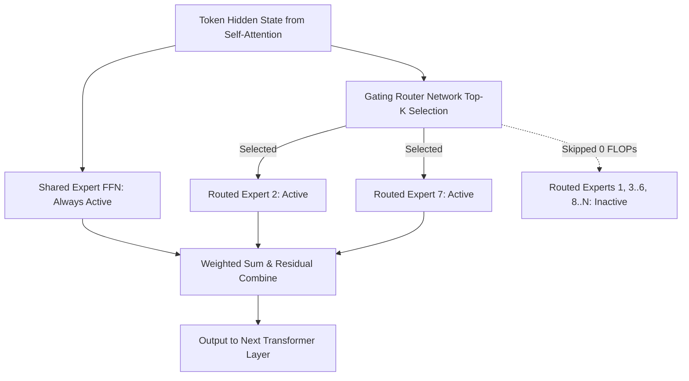

## 1. Introduction and Current Context

In a traditional dense Transformer, every single parameter in the network participates in computing every single token—whether the token is a simple English preposition like 'the' or a complex Rust borrow-checker expression. Scaling a dense model to 400 billion parameters means paying a 400-billion-parameter compute and memory-bandwidth tax on every generated token. By 2026, most frontier and leading open-weight model families—including `deepseek-ai/DeepSeek-V3`, `QwenLM/Qwen3` (such as 30B-A3B), and `meta-llama/llama-models` (Llama 4)—have transitioned to sparse Mixture of Experts (MoE) architectures to achieve high model capacity with fast inference decoding.

## 2. Direct Answer and Key Takeaway

> **Key Takeaway:** Mixture of Experts (MoE) decouples a language model's total knowledge capacity from its per-token computation cost by replacing monolithic dense Feed-Forward Networks (FFNs) with multiple specialized sub-networks ('experts') controlled by a learned gating router. For each token, only a small subset of experts (for example, 3B active parameters out of 30B total parameters) is executed. For developers, this creates a critical hardware rule: MoE inference speed scales with the low *active* parameter count, but VRAM capacity requirements still scale with the high *total* parameter count.

## 3. Definitions and Technical Background

Before evaluating architectural trade-offs or writing production code for **mixture of experts**, it is essential to establish precise engineering definitions for the core components involved:

- **Total vs. Active Parameters:** Total parameters represent the complete set of weights stored in the model checkpoint, whereas active parameters represent the subset of weights actually multiplied for a single token during a forward pass.
- **Gating Network (Router):** A lightweight linear projection followed by a softmax or sigmoid function that scores which $k$ experts are best suited to process each token's hidden state at a given Transformer layer.
- **Fine-Grained vs. Coarse-Grained Experts:** An architectural design choice: coarse-grained MoEs use a small number of large experts, whereas modern fine-grained MoEs split FFNs into dozens or hundreds of smaller experts to enable richer combinatorial specialization.
- **Shared Experts:** Dedicated FFN blocks that are bypassed by the dynamic router and activated deterministically for every single token to capture common, universal linguistic patterns without duplicating them across routed experts.

## 4. Technical Architecture and Deep Dive

To understand how an MoE model works inside a Transformer block, note that the self-attention layers remain shared across all tokens. The sparsity occurs in the Feed-Forward Network (FFN) sub-layer that follows attention. Instead of one wide MLP matrix, the layer contains $N$ independent expert MLPs $[E_1, E_2, \dots, E_N]$ and a learned router matrix $W_g$.

Modern 2026 MoE architectures improve upon early Switch Transformer and Mixtral designs in two crucial ways. First, they combine **fine-grained routed experts with always-on shared experts** (as documented in `deepseek-ai/DeepSeek-V3` and `QwenLM/Qwen3`). When common grammar and syntax are handled by shared experts, the routed experts are free to specialize deeply in narrow domains like SQL syntax, Indic scripts, or formal logic.

For systems engineers deploying MoE models, the hardware trade-off behaves very differently between single-user local inference and high-concurrency cloud serving. In single-user decoding (batch size = 1) on an Apple Silicon Mac Studio or workstation running `ggml-org/llama.cpp`, once the entire model (say, a 30B-A3B model occupying ~18GB in 4-bit quantization) fits into RAM, generating each token only reads the 3B active parameters from memory.

In high-concurrency datacenter serving (batch size = 64 or 128), however, the picture shifts. Because 64 different tokens in a batch will statistically trigger almost all experts in every layer, the GPU ends up loading nearly all total parameters from HBM anyway.

## 5. Comparative Analysis: Architectural & Deployment Comparison: Dense LLMs vs. Sparse Mixture-of-Experts (MoE) LLMs

The following table compares the key engineering trade-offs, operational boundaries, and implementation choices for **mixture of experts**:

| Engineering Metric | Dense 32B Model | Sparse MoE 30B-A3B (30B Total / 3B Active) | Dense 3B Model |
| --- | --- | --- | --- |
| Total Weights Stored in VRAM (Q4_K_M) | ~19.5 GB | ~18.5 GB (all experts must reside in memory) | ~2.0 GB |
| Parameters Read per Token (Batch = 1) | 32B parameters (~19.5 GB read/token) | ~3B parameters (~2.0 GB read/token) | 3B parameters (~2.0 GB read/token) |
| Single-User Decoding Speed (Tokens/sec) | Baseline (1.0x) | ~5x–8x faster than Dense 32B | ~6x–9x faster than Dense 32B |
| Knowledge & Reasoning Capacity | High (32B capacity) | High (approaches dense 20B–32B capacity) | Low-to-Moderate (3B capacity) |
| Multi-GPU Scaling Strategy | Tensor Parallelism (TP) | Expert Parallelism (EP) + Data Parallelism (DP) | Single GPU / Data Parallelism |

## 6. System Architecture and Execution Flow

The diagram below illustrates the end-to-end control flow, verification boundaries, and state transitions for **mixture of experts** in a production environment:

*Figure 10.1: Forward-pass routing inside a modern Mixture-of-Experts (MoE) layer combining an always-active shared expert with sparse top-k routed experts.*

## 7. Practical Implementation Steps and Engineering Checklist

To implement **mixture of experts** reliably in production systems, follow these sequential engineering steps:

1. Size your hardware VRAM for an MoE model based on its **total** parameter count plus KV cache—never its active parameter count (for example, a `30B-A3B` model still requires ~18GB+ of memory for weights in 4-bit precision, not 2GB).
2. On hybrid CPU+GPU workstations with limited VRAM (such as a 12GB GPU + 64GB DDR5 system RAM), use `ggml-org/llama.cpp`'s expert-offloading flags (`-ot` tensor override rules) to keep shared attention layers and KV caches on the fast GPU while offloading sparse routed experts to CPU RAM.
3. When serving large MoE models across multiple GPUs in production, enable Expert Parallelism (`--enable-expert-parallel` in `vllm-project/vllm` or `sgl-project/sglang`) backed by `deepseek-ai/DeepEP` kernels to minimize all-to-all dispatch overhead.
4. Exercise caution when fine-tuning MoE models with LoRA: attach adapters to attention projections and shared experts first, or stabilize router logits so fine-tuning on a small dataset does not cause router collapse onto a single expert.
5. Benchmark MoE throughput at your actual target concurrency (e.g., 1, 16, or 64 concurrent users) since active expert activation ratios climb rapidly as batch size increases.

## 8. Limitations, Operational Risks, and Trade-Offs

Even well-architected deployments of **mixture of experts** face concrete engineering constraints that teams must mitigate proactively:

- High static VRAM capacity cost: cloud instances with small VRAM per chip cannot host large MoE models without multi-node sharding, even though per-token compute FLOPs are tiny.
- Expert load imbalance ('straggler GPU' problem): in multi-GPU Expert Parallelism, if a burst of coding prompts routes 80% of tokens to the same two coding-specialized experts on GPU 0, GPUs 1 through 7 sit idle waiting for GPU 0 to finish.
- Router instability during fine-tuning: naive full-parameter or unconstrained router fine-tuning on narrow datasets can destabilize the gating distribution and degrade general reasoning.

## 9. Frequently Asked Questions (FAQs)

### What does a model name like '30B-A3B' mean?

It indicates a Mixture-of-Experts model with 30 billion total parameters stored in the checkpoint, of which only 3 billion ('A3B' = Active 3B) are activated for any individual token during a forward pass.

### Why can't I load only the 3B active parameters into GPU memory?

Because the router decides dynamically at every layer and every token which experts to activate based on the token's context.

### Are individual MoE experts specialized by human-labeled topics like 'Math' or 'History'?

No. Experts are not hand-assigned to human categories.

## 10. Conclusion

Mixture of Experts has redefined the Pareto frontier between model intelligence and inference latency. By grasping the distinction between total memory footprint and active compute parameters, developers can select sparse MoE checkpoints that deliver frontier-grade performance at small-model decoding speeds.

### GitHub Repositories & Technical References

- **QwenLM/Qwen3** — Official repository for the Qwen3 family, including open-weight Mixture-of-Experts architectures such as Qwen3-30B-A3B and Qwen3-235B-A22B. Verified GitHub URL: https://github.com/qwenLM/qwen3
- **deepseek-ai/DeepSeek-V3** — Official repository for DeepSeek-V3 detailing fine-grained routed experts, shared experts, and auxiliary-loss-free load balancing. Verified GitHub URL: https://github.com/deepseek-ai/deepseek-v3
- **deepseek-ai/DeepEP** — High-performance GPU communication library specifically engineered for MoE all-to-all token dispatch and expert combine stages. Verified GitHub URL: https://github.com/deepseek-ai/DeepEP
- **vllm-project/vllm** — Production LLM inference engine supporting fused MoE Triton/CUTLASS kernels and distributed Expert Parallelism. Verified GitHub URL: https://github.com/vllm-project/vllm
