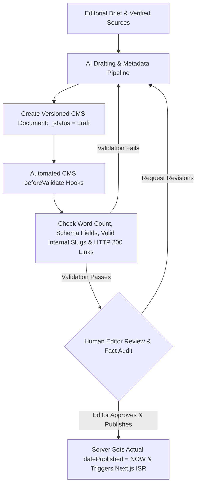

## 1. Introduction and Current Context

Traditional content management systems acted as passive form-to-database storage: a human writer typed text into a WYSIWYG box, manually filled out 15 SEO metadata fields, pasted JSON-LD snippets by hand, and clicked 'Publish.' By October 2026, developer-first CMS platforms (`payloadcms/payload` and `strapi/strapi`) integrate LLM pipelines directly into collection lifecycle hooks (`beforeValidate`, `beforeChange`, `afterChange`) and MCP servers. Understanding which CMS tasks should be automated by AI and which require hard human editorial gates separates high-trust engineering publications from low-quality content farms.

## 2. Direct Answer and Key Takeaway

> **Key Takeaway:** In 2026, an AI-powered Content Management System (CMS) can reliably automate structured metadata drafting, schema validation, internal link discovery, translation localization, and technical linting—but allowing an autonomous AI to execute end-to-end research, drafting, and live production publishing without human editorial sign-off degrades brand credibility and introduces factual and legal liabilities. Modern engineering teams build AI workflows inside code-first headless CMS platforms (`payloadcms/payload`, `strapi/strapi`) where AI agents write strictly to versioned `draft` states behind mandatory human approval hooks.

## 3. Definitions and Technical Background

Before evaluating architectural trade-offs or writing production code for **AI CMS**, it is essential to establish precise engineering definitions for the core components involved:

- **Collection Lifecycle Hook (`beforeValidate` / `beforeChange`):** A server-side function in a headless CMS that intercepts a document save operation to validate fields, enrich structured metadata, or enforce workflow state transitions before committing to the database.
- **Structured Content Modeling (Blocks & Fields):** Representing an article not as a single unstructured HTML blob, but as a strongly typed schema of discrete components.
- **Draft vs. Published State Machine:** A database versioning control where AI agents and background pipelines are granted write permissions exclusively to `draft` revisions, while transitioning `_status` to `'published'` requires an authenticated human editor role.
- **Provenance & Timestamp Integrity:** Maintaining strict separation in CMS records between internal planning metadata, future queue times, and the immutable timestamp when the record actually went live.

## 4. Technical Architecture and Deep Dive

Why does structured content modeling change what AI can do inside a CMS? When a legacy CMS stores an entire article as one giant WYSIWYG HTML string, asking an LLM to update a single comparison table or regenerate the FAQ section requires parsing and rewriting the entire document—risking accidental edits to surrounding paragraphs or broken HTML tags. In a modern structured CMS like `payloadcms/payload` or `strapi/strapi`, the article schema is decomposed into typed blocks and arrays.

Let us examine each stage of the editorial lifecycle—**Research, Drafting, Metadata, and Publishing**—to see where AI adds genuine value versus where it fails without oversight.

During **Drafting**, AI excels at scaffolding structured sections, converting raw engineering notes into clear prose, and generating formatting-compliant comparison tables. However, unconstrained zero-shot drafting without domain-expert input produces generic, repetitive explanations and risks fabricating benchmarks or first-hand testing claims.

During **Metadata & Pre-Publish QA**, AI and deterministic validators shine brightest: automatically generating Open Graph summaries, checking heading hierarchy, verifying that internal links point only to existing published slugs in the CMS database, and ensuring that `datePublished` is set dynamically by the server clock at the moment of actual publication—never falsely backdated to an earlier planning date.

## 5. Comparative Analysis: CMS Lifecycle Automation Matrix: AI Capability vs. Mandatory Editorial Governance

The following table compares the key engineering trade-offs, operational boundaries, and implementation choices for **AI CMS**:

| CMS Workflow Stage | What AI Can Automate Reliably | What AI Cannot Safely Own Alone | Required Technical & Editorial Control |
| --- | --- | --- | --- |
| Research & Sourcing | Fetching repo READMEs, release notes, and clustering subtopics | Judging source credibility or verifying unstated constraints | Require clickable primary source URLs per claim |
| Content Drafting | Structuring outlines, tables, code formatting, and first drafts | Original engineering judgment, first-hand testing claims | Write to `_status: 'draft'`; ban fabricated 'we tested' claims |
| SEO & Schema Metadata | Drafting meta titles/descriptions (length-checked) & JSON-LD | Inventing author credentials, image URLs, or fake dates | Derive JSON-LD deterministically from verified CMS fields |
| Internal Linking | Querying CMS DB for published slugs with matching topic tags | Guessing URL paths from memory (causes 404 broken links) | Validate every internal href against the live `articles` table |
| Publishing & Updates | Pre-publish lint checks, broken-link scans, sitemap ping | Unreviewed live publishing or backdating `datePublished` | RBAC rule: only `role === 'editor'` can set `_status: 'published'` |

## 6. System Architecture and Execution Flow

The diagram below illustrates the end-to-end control flow, verification boundaries, and state transitions for **AI CMS** in a production environment:

*Figure 29.1: Controlled AI-assisted CMS pipeline enforcing draft isolation, deterministic `beforeValidate` hooks, human sign-off, and server-stamped publication dates.*

## 7. Practical Implementation Steps and Engineering Checklist

To implement **AI CMS** reliably in production systems, follow these sequential engineering steps:

1. Model your CMS collections in `payloadcms/payload` or `strapi/strapi` using granular, strongly typed fields (`title`, `metaTitle`, `metaDescription`, `directTakeaway`, `body`, `faqs`, `githubReferences`) rather than a single monolithic text field.
2. Configure Role-Based Access Control (RBAC) on your CMS API keys so the service token used by AI pipelines can execute `create` and `update` only when `_status === 'draft'`, returning `403 Forbidden` if the token attempts to set `_status: 'published'`.
3. Generate `Article` / `BlogPosting` JSON-LD deterministically in your frontend template from the verified CMS database fields (`title`, `metaDescription`, `author.name`, `datePublished`, `dateModified`) rather than asking an LLM to write raw JSON-LD strings that could drift from visible page content.
4. Store `editorialDate`, `scheduledPublishAt`, and `datePublished` as three separate database columns, and wire a server-side hook that stamps `datePublished = new Date().toISOString()` only on first transition to `published`.
5. Implement a `beforeValidate` hook that extracts all internal and external hyperlinks from the article body and rejects the save if any internal slug does not exist in the CMS or any external link violates your domain allowlist.

## 8. Limitations, Operational Risks, and Trade-Offs

Even well-architected deployments of **AI CMS** face concrete engineering constraints that teams must mitigate proactively:

- Hallucinated internal links: if an LLM drafts an article and guesses an internal link like `[See our RAG guide](/blog/rag-guide)` without querying the actual CMS slug table, your site ships broken 404 links.
- Timestamp misrepresentation: copying an internal editorial planning date (`2026-10-01`) into the public `<time datetime>` and `datePublished` schema field when the article was actually published on `2026-10-25` creates conflicting crawl history and violates structured-data truthfulness guidelines.
- Unreviewed mass-publishing spam: removing the human editorial review gate to publish hundreds of unverified AI drafts simultaneously degrades site quality and risks sitewide search demotion.

## 9. Frequently Asked Questions (FAQs)

### Can an AI agent publish articles directly to a live CMS without human review?

Technically an API token can be given publish permissions, but doing so in production is an editorial and security anti-pattern.

### Should an LLM generate the JSON-LD structured data for each CMS article?

No. JSON-LD should be serialized deterministically by your application code (e.g., in a Next.js component) directly from the validated CMS database fields (`title`, `datePublished`, `author`, `canonicalUrl`).

### How do I prevent an AI CMS pipeline from inventing broken internal links?

Never let the LLM guess URL paths from memory.

## 10. Conclusion

The modern AI-powered CMS is not an autonomous content factory that replaces editors—it is a structured engineering workbench that eliminates mechanical toil. By combining typed collections in Payload CMS or Strapi with automated validation hooks, strict draft-only AI permissions, and human editorial sign-off, teams scale high-quality technical publishing safely.

### GitHub Repositories & Technical References

- **payloadcms/payload** — Open-source, code-first Next.js and TypeScript headless CMS featuring collection lifecycle hooks, draft versioning, and granular field-level access control. Verified GitHub URL: https://github.com/payloadcms/payload
- **strapi/strapi** — Open-source JavaScript/TypeScript headless CMS supporting customizable content types, REST/GraphQL APIs, and draft-and-publish workflows. Verified GitHub URL: https://github.com/strapi/strapi
- **pydantic/pydantic-ai** — Typed agent framework for generating schema-validated content blocks and metadata payloads for CMS ingestion. Verified GitHub URL: https://github.com/pydantic/pydantic-ai
