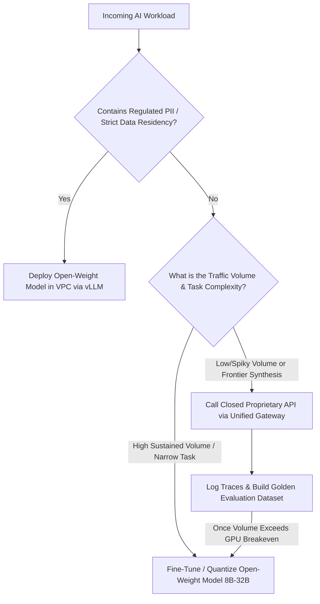

## 1. Introduction and Current Context

Two years ago, choosing an open-weight language model meant accepting a steep capability penalty compared to proprietary frontier APIs. By October 2026, open-weight releases across `QwenLM/Qwen3`, `meta-llama/llama-models`, `google-deepmind/gemma`, and `deepseek-ai/DeepSeek-R1` have closed the gap on coding, multilingual translation, structured extraction, and mathematical reasoning. As a result, engineering leaders now evaluate model selection as a systems engineering and licensing trade-off across data sovereignty, traffic predictability, fine-tuning requirements, and version stability.

## 2. Direct Answer and Key Takeaway

> **Key Takeaway:** In 2026, the choice between open-weight models (such as Qwen3, Llama, Gemma, and DeepSeek) and closed proprietary APIs is rarely an all-or-nothing ideological commitment; production systems overwhelmingly use a hybrid routing architecture. Closed frontier APIs remain the fastest path for zero-infrastructure launch, spiky traffic, and complex multi-domain synthesis, while open-weight models win decisively on strict data residency, weight permanence, LoRA customization, latency control, and unit economics once sustained volume justifies dedicated GPU capacity.

## 3. Definitions and Technical Background

Before evaluating architectural trade-offs or writing production code for **open-weight AI models**, it is essential to establish precise engineering definitions for the core components involved:

- **Open-Weight AI Model:** A model whose trained neural network parameters (checkpoints) are publicly downloadable for local inspection, fine-tuning, and self-hosted execution, even if its full pretraining dataset and data-filtering pipeline remain undisclosed.
- **OSI-Compliant Open-Source License vs. Custom Community License:** A crucial legal distinction: permissive licenses such as Apache-2.0 or MIT (used by Qwen3 and DeepSeek) allow unrestricted commercial use and modification, whereas custom community licenses (such as the Llama Community License or Gemma Terms of Use) impose specific acceptable-use policies, attribution rules, or monthly active user (MAU) thresholds.
- **Weight Permanence:** The operational guarantee that a pinned model checkpoint (`SHA-256` digest) will produce identical behavior indefinitely, protecting production pipelines from silent vendor model updates or forced endpoint deprecations.
- **Utilization Breakeven Point:** The sustained tokens-per-second threshold at which renting dedicated GPU instances (`vllm` / `sglang`) costs less per million tokens than paying metered per-token fees on a proprietary cloud API.

## 4. Technical Architecture and Deep Dive

First, developers must clarify terminology: 'open-weight' is not identical to 'open-source' in the traditional software sense. While projects like `AI4Bharat/IndicLLMSuite` publish both data blueprints and training code, most major model families release their trained weights without releasing their multi-trillion-token pretraining corpora. Within the open-weight ecosystem itself, legal teams must audit the exact license file in each repository. Checkpoints released under **Apache-2.0** or **MIT** (such as `QwenLM/Qwen3` and `deepseek-ai/DeepSeek-R1`) grant broad patent and commercial freedoms. By contrast, models governed by custom agreements—such as `meta-llama/llama-models` (which includes a 700-million monthly active user commercial threshold and naming conventions) or NVIDIA's Open Model License—require explicit compliance review before embedding weights into redistributed commercial software.

Second, unit economics depend entirely on traffic shape. Proprietary APIs charge strictly by input and output tokens consumed. If an early-stage startup processes 500 requests per day concentrated during business hours, paying a few dollars per month for a closed API is vastly cheaper than renting an idle $2.00/hour GPU instance 24/7 ($1,440/month).

Third, weight permanence and data governance often override raw benchmark scores in regulated industries. When an enterprise builds a complex clinical extraction or financial underwriting pipeline against a closed API, a silent provider update or a 90-day model deprecation notice can invalidate months of prompt calibration and compliance sign-offs.

Finally, open-weight models unlock deep architectural customization.

## 5. Comparative Analysis: Decision Matrix: Open-Weight Self-Hosted Models vs. Closed Proprietary Model APIs (2026)

The following table compares the key engineering trade-offs, operational boundaries, and implementation choices for **open-weight AI models**:

| Evaluation Criterion | Open-Weight Models (Self-Hosted / VPC) | Closed Proprietary Models (Metered API) | Hybrid Architecture Best Practice |
| --- | --- | --- | --- |
| Data Privacy & Residency | 100% VPC/on-prem isolation; zero third-party egress | Requires vendor DPA / Zero-Data-Retention enterprise tier | Route PII/regulated payloads to VPC open-weight endpoints |
| Cost Structure | Fixed hourly GPU compute cost (utilization-driven) | Variable per-million-token cost (volume-driven) | Self-host steady base load; burst peak spikes to cloud APIs |
| Version Permanence | Immutable checkpoint weights owned by your team | Subject to vendor checkpoint updates & lifecycle deprecations | Maintain automated eval suites (`promptfoo`) for all endpoints |
| Customization Depth | Full LoRA/QLoRA fine-tuning, distillation, custom grammars | Prompting, RAG, or vendor-locked black-box fine-tuning | Distill frontier API traces into compact 8B–14B open models |
| Operational Overhead | Requires GPU orchestration, autoscaling, and vLLM ops | Zero infrastructure management; instant global scale | Prototype on closed APIs; migrate high-volume paths to open weights |

## 6. System Architecture and Execution Flow

The diagram below illustrates the end-to-end control flow, verification boundaries, and state transitions for **open-weight AI models** in a production environment:

*Figure 8.1: Architectural decision tree for routing workloads between closed proprietary APIs and self-hosted open-weight models.*

## 7. Practical Implementation Steps and Engineering Checklist

To implement **open-weight AI models** reliably in production systems, follow these sequential engineering steps:

1. Abstract all model invocations behind a unified provider-agnostic interface (such as OpenAI-compatible SDK schemas, `pydantic/pydantic-ai`, or `vercel/ai`) so switching between a closed API and a self-hosted `vllm` endpoint requires changing only an environment variable.
2. Verify the exact `LICENSE` file in the upstream GitHub repository (`QwenLM/Qwen3`, `meta-llama/llama-models`, `google-deepmind/gemma`) before deploying open weights in commercial products.
3. Launch new product features using frontier closed APIs (or managed serverless open-weight endpoints) to validate user demand and collect real-world interaction traces before committing to dedicated GPU reservations.
4. Calculate your GPU utilization breakeven point using realistic token volumes across both peak and off-peak hours, factoring in DevOps engineering time and multi-AZ redundancy.
5. Use teacher-student distillation (`huggingface/trl` and `huggingface/peft`) to train an 8B open-weight model on verified outputs from a frontier model for repetitive production tasks.

## 8. Limitations, Operational Risks, and Trade-Offs

Even well-architected deployments of **open-weight AI models** face concrete engineering constraints that teams must mitigate proactively:

- Underutilized GPU waste: provisioning dedicated H100 or L40S instances for a workload that sits idle 16 hours a day results in higher effective cost per token than a metered proprietary API.
- Operational burden of self-hosting: running production inference requires managing CUDA driver updates, container image sizes, health checks, KV-cache OOM recovery, and autoscaling warm-up times.
- License compliance oversight: treating all downloadable weights as unrestricted public domain can violate attribution clauses, acceptable-use policies, or commercial scale restrictions in custom community licenses.

## 9. Frequently Asked Questions (FAQs)

### What is the difference between an open-weight model and an open-source model?

An open-weight model provides downloadable neural network parameters so anyone can run or fine-tune the model, but the creator may not release the proprietary training dataset or training pipeline.

### Are Qwen3, Llama, and Gemma free for commercial use?

Qwen3 (`QwenLM/Qwen3`) and DeepSeek (`deepseek-ai/DeepSeek-R1`) use permissive Apache-2.0 or MIT licenses suitable for broad commercial use.

### When does self-hosting an open-weight model become cheaper than a closed API?

Self-hosting becomes cheaper when your application sustains enough continuous token throughput to keep rented GPUs utilized at 35%–50%+ capacity round-the-clock, or when you replace expensive frontier API calls with a fine-tuned 8B–14B open-weight model.

## 10. Conclusion

The 2026 model landscape rewards pragmatic engineering over dogma. By combining the instant elasticity and broad reasoning of closed frontier APIs with the data sovereignty, weight permanence, and unit-cost efficiency of open-weight models like Qwen3, Llama, and Gemma, developers can optimize every route in their AI stack.

### GitHub Repositories & Technical References

- **QwenLM/Qwen3** — Official repository for the Apache-2.0 licensed Qwen3 dense and Mixture-of-Experts open-weight language model family. Verified GitHub URL: https://github.com/qwenLM/qwen3
- **meta-llama/llama-models** — Official Meta repository containing model cards, licenses, and utilities for the Llama open-weight model series. Verified GitHub URL: https://github.com/meta-llama/llama-models
- **google-deepmind/gemma** — Official Google DeepMind repository for the Gemma open-weight LLM library and checkpoints. Verified GitHub URL: https://github.com/google-deepmind/gemma
- **vllm-project/vllm** — Standard open-source serving engine for deploying open-weight models behind OpenAI-compatible HTTP endpoints. Verified GitHub URL: https://github.com/vllm-project/vllm
