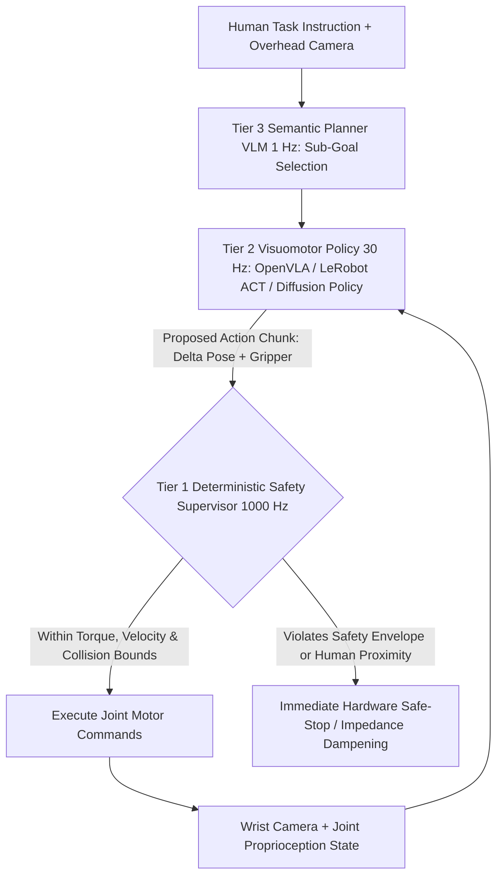

## 1. Introduction and Current Context

For decades, industrial robots excelled at one thing: welding the exact same spot on a car chassis inside a bolted safety cage with sub-millimeter precision, provided lighting and part positions never varied by a centimeter. The moment an object slipped or a warehouse bin contained an unfamiliar item, rigid hand-coded inverse kinematics scripts halted. By October 2026, open-source robotics ecosystems—led by `huggingface/lerobot` and `openvla/openvla`—have brought visual generalization and natural-language instruction following to affordable robotic arms and mobile manipulators. Understanding how neural policies interact with real-time control loops is essential for engineers entering Physical AI.

## 2. Direct Answer and Key Takeaway

> **Key Takeaway:** Physical AI (Embodied AI) extends foundation models from generating digital tokens to outputting continuous physical motor trajectories ($\Delta x, \Delta y, \Delta z$, roll, pitch, yaw, gripper state) via **Vision-Language-Action (VLA)** architectures (`openvla/openvla`) and imitation-learning policies (`huggingface/lerobot`). However, physical hardware obeys strict Newtonian physics and safety laws: because a 500ms cloud LLM latency spike or a hallucinated trajectory can damage equipment or injure humans, 2026 robotic architectures strictly decouple **high-level semantic task planning (1–5 Hz VLM/VLA)** from **low-level deterministic real-time joint control and collision safety loops (50–1,000 Hz on-device)**.

## 3. Definitions and Technical Background

Before evaluating architectural trade-offs or writing production code for **physical AI**, it is essential to establish precise engineering definitions for the core components involved:

- **Vision-Language-Action (VLA) Model:** A multimodal foundation model that takes camera image frames, proprioceptive joint states, and a natural-language task instruction as input, and directly outputs tokenized or continuous robot action chunks.
- **Action Chunking with Transformers (ACT) & Diffusion Policies:** Imitation-learning architectures that predict a smooth sequence (chunk) of future motor actions over the next $k$ timesteps rather than a single jittery step, handling multimodal human demonstrations gracefully.
- **Hierarchical Control Frequency Split:** The mandatory systems architecture separating slow semantic reasoning from fast visuomotor policy execution and hard real-time PID/torque/safety controllers.
- **Sim-to-Real Gap:** The discrepancy between simulated physics engines and the real physical world, addressed via domain randomization and real-world teleoperation fine-tuning.

## 4. Technical Architecture and Deep Dive

**Why Physical AI Is Harder Than Digital LLMs:** When a text LLM makes a 1% token prediction error, a sentence contains a minor typo that a human reader barely notices. When a robotic arm executing a 50Hz control loop makes a 1% trajectory error at step 10, the gripper misses the object handle; by step 20, the arm is in an out-of-distribution visual state it never saw during training; and by step 30, it knocks the cup off the table. Furthermore, the internet did not naturally contain trillions of tokens of robot joint-torque recordings the way it contained text and photos.

**Inside OpenVLA and LeRobot Architectures:** How does a Vision-Language-Action model like `openvla/openvla` actually move a robot? OpenVLA fuses dual visual encoders with a language model backbone and maps continuous robot end-effector deltas into discrete action bins.

**The Non-Negotiable Safety Envelope:** No responsible robotics engineer wires the output of a neural network directly to high-torque motor currents without an independent deterministic safety layer. In production 2026 deployments, the VLA or Diffusion Policy proposes a target waypoint or velocity trajectory. Before any actuator moves, a **deterministic real-time C++/Rust controller running at 500–1,000 Hz** checks joint torque limits, workspace bounding boxes, self-collision kinematics, and LiDAR/depth-camera human proximity zones.

## 5. Comparative Analysis: Three-Tier Hierarchical Control Architecture in Modern Physical AI & Robotics (2026)

The following table compares the key engineering trade-offs, operational boundaries, and implementation choices for **physical AI**:

| Control Tier | Target Frequency / Latency | Model / Algorithm Class | Hardware Execution Target | Primary Responsibility |
| --- | --- | --- | --- | --- |
| Tier 3: Task Planner (System 2) | 0.5 Hz – 2 Hz (500ms–2s) | VLM / LLM (`Qwen3-VL`) decomposing multi-step goals | Local Edge Server or Cloud VPC | Decompose 'Clean the table' into ordered sub-goals & verify completion |
| Tier 2: Visuomotor Policy (System 1) | 10 Hz – 50 Hz (20ms–100ms) | VLA (`OpenVLA`), Diffusion Policy, or ACT (`LeRobot`) | On-Board Edge GPU (Jetson Thor / Workstation) | Generate smooth 6-DoF action chunks from live wrist/overhead cameras |
| Tier 1: Real-Time Safety & Joint Control | 500 Hz – 1,000 Hz (<1–2ms) | Deterministic PID, Impedance Control, Control Barrier Functions | Real-Time MCU / RTOS (C++ / Rust) | Enforce torque limits, collision bounding boxes, and emergency stop |

## 6. System Architecture and Execution Flow

The diagram below illustrates the end-to-end control flow, verification boundaries, and state transitions for **physical AI** in a production environment:

*Figure 49.1: Three-tier embodied robotics architecture isolating slow VLM task planning and 30Hz VLA/Diffusion policies from a 1000Hz deterministic safety supervisor.*

## 7. Practical Implementation Steps and Engineering Checklist

To implement **physical AI** reliably in production systems, follow these sequential engineering steps:

1. Start hands-on Physical AI development with `huggingface/lerobot`, which standardizes dataset formats, simulation benchmarks, and hardware drivers for low-cost teleoperated arms.
2. Always predict **Action Chunks** rather than independent single-step actions to prevent high-frequency motor jitter and compounding drift.
3. Keep Tier-2 visuomotor inference **100% on local on-board or LAN edge GPUs**—never control a moving physical robot arm over a public internet HTTP connection where a Wi-Fi packet drop or cloud rate limit leaves the actuator moving blindly.
4. Fine-tune generalist VLA models using LoRA on 25 to 100 clean teleoperated demonstrations collected in your specific physical workspace lighting and camera mount geometry.

## 8. Limitations, Operational Risks, and Trade-Offs

Even well-architected deployments of **physical AI** face concrete engineering constraints that teams must mitigate proactively:

- Camera mount and calibration fragility: if an overhead or wrist camera is bumped by 3 degrees after training a visuomotor policy, pixel-to-workspace coordinates shift and grasp success rates can drop sharply unless calibrated or trained with camera-pose augmentation.
- Tactile and force blindness in vision-only models: cameras alone cannot feel when a fragile object (like a berry or thin plastic cup) is about to be crushed or when a peg is binding in a tight hole—force-torque / motor-current proprioception inputs are essential for contact-rich manipulation.
- Physical safety hazards: testing unvalidated neural policies on heavy industrial arms without torque/velocity clamps and physical safety perimeters risks severe hardware damage or injury.

## 9. Frequently Asked Questions (FAQs)

### What is a Vision-Language-Action (VLA) model in robotics?

A VLA model (such as `openvla/openvla`) is a multimodal foundation model that accepts camera images and a natural-language instruction (e.g., *'pick up the red screwdriver and place it in the grey bin'*) and directly outputs robot control actions (end-effector position/rotation deltas and gripper state).

### Can a cloud LLM like GPT or Claude control a robot's motors directly in real time?

No. Cloud LLMs have latencies of hundreds of milliseconds to seconds and operate in text space.

### How many real-world demonstrations are needed to teach a robot a new task with LeRobot or OpenVLA?

Using modern imitation learning (`ACT` or `Diffusion Policy` in `huggingface/lerobot`) or LoRA fine-tuning on `openvla/openvla`, a single task in a fixed workspace can often be learned from **30 to 100 high-quality human teleoperation episodes** (roughly 20–45 minutes of recording).

## 10. Conclusion

Physical AI is bridging the divide between digital intelligence and the physical economy. By combining open-source visuomotor policies (`huggingface/lerobot`, `openvla/openvla`) with action chunking, local edge inference, and uncompromising 1,000Hz deterministic safety envelopes, engineers can deploy adaptable robotic systems safely in the real world.

### GitHub Repositories & Technical References

- **huggingface/lerobot** — Official Hugging Face PyTorch library for real-world robotics, providing datasets, simulation environments, and ACT/Diffusion Policy implementations. Verified GitHub URL: https://github.com/huggingface/lerobot
- **openvla/openvla** — Official open-source 7B Vision-Language-Action (VLA) model pretrained on 970k robot episodes with LoRA fine-tuning support. Verified GitHub URL: https://github.com/openvla/openvla
- **huggingface/peft** — Parameter-Efficient Fine-Tuning library used with OpenVLA to adapt generalist robotic policies to custom hardware setups. Verified GitHub URL: https://github.com/huggingface/peft
