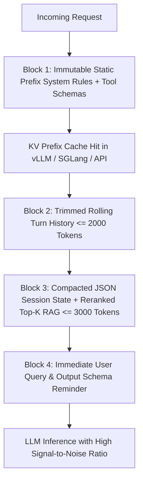

## 1. Introduction and Current Context

In 2023, developers treated LLM optimization like spellcasting: tweaking adjectives (*'You are a world-class expert...'*, *'Take a deep breath...'*) in a 200-word prompt string. By October 2026, modern foundation models follow clear, direct instructions reliably without theatrical flattery. Yet complex enterprise applications still fail when an agent attempts to debug a repository or resolve a customer claim. Why?

## 2. Direct Answer and Key Takeaway

> **Key Takeaway:** **Prompt Engineering** is the static craft of phrasing instructions, personas, and few-shot examples inside a template string; **Context Engineering** is the dynamic systems discipline of programmatically retrieving, filtering, ordering, compressing, and budgeting the entire information state (system instructions, tool schemas, user memory, RAG passages, and compacted history) that enters an LLM's context window at runtime.

## 3. Definitions and Technical Background

Before evaluating architectural trade-offs or writing production code for **prompt engineering**, it is essential to establish precise engineering definitions for the core components involved:

- **Prompt Engineering (Static Instruction Design):** Authoring clear role definitions, task constraints, edge-case rules, output schemas, and representative few-shot exemplars that remain constant across requests.
- **Context Engineering (Dynamic State Assembly):** The runtime pipeline that allocates a finite token budget across competing information sources—system rules, tool definitions, user profile facts, reranked RAG chunks, and compacted conversation state—before each inference call.
- **Prefix-Cache-Aware Ordering:** Structuring the assembled context array so 100% static bytes sit at the very front, semi-static session context sits in the middle, and volatile per-turn inputs sit at the very end—maximizing KV-cache hit rates in `vllm` and `sglang`.

## 4. Technical Architecture and Deep Dive

**Prerequisites & Required Tools:** Python $\ge 3.11$ or TypeScript, `run-llama/llama_index` or `langchain-ai/langgraph` for context pipelines, `promptfoo/promptfoo` for A/B testing context layouts, and `langfuse/langfuse` for inspecting assembled runtime prompts.

**Why Wording Tweaks Hit a Ceiling When Context Is Broken:** Suppose a customer support agent gives the wrong refund eligibility answer.

**The Four Laws of Production Context Engineering:**
1. **Enforce Explicit Per-Section Token Budgets:** Never let one noisy component starve the rest of the window. Allocate deterministic ceilings.
2. **Design for Prefix-Cache Hits:** Never inject a dynamic timestamp or per-user name on **Line 1** of a 5,000-token system prompt! Changing Line 1 invalidates the entire KV prefix cache for all 5,000 tokens that follow.

**Minimal Production Code Example (Deterministic Token-Budgeted & Prefix-Cache-Aligned Context Assembler):**

```python
# File: context_assembler.py
# Prerequisites: Python >= 3.11
from dataclasses import dataclass

def estimate_tokens(text: str) -> int:
    # Fast conservative heuristic (~4 chars/token for English/code; use tiktoken/HF tokenizer in prod)
    return max(1, len(text) // 4)

@dataclass
class ContextBudget:
    max_rag_tokens: int = 3000
    max_history_tokens: int = 2000

def assemble_context(
    static_system_prompt: str,
    session_state_json: str,
    ranked_rag_chunks: list[str],
    recent_turns: list[dict[str, str]],
    current_user_query: str,
    budget: ContextBudget = ContextBudget(),
) -> list[dict[str, str]]:
    """Assemble messages with strict prefix-cache alignment and token budgets."""
    # 1. Static prefix FIRST (100% cacheable across all users and turns)
    messages: list[dict[str, str]] = [{"role": "system", "content": static_system_prompt}]

    # 2. Pack top-ranked RAG chunks within strict token ceiling
    selected_chunks: list[str] = []
    used_rag = 0
    for idx, chunk in enumerate(ranked_rag_chunks, start=1):
        cost = estimate_tokens(chunk)
        if used_rag + cost > budget.max_rag_tokens:
            break
        selected_chunks.append(f"[Source {idx}]\n{chunk}")
        used_rag += cost

    # 3. Trim rolling turn history from oldest to newest to fit budget
    trimmed_turns: list[dict[str, str]] = []
    used_hist = 0
    for turn in reversed(recent_turns):
        cost = estimate_tokens(turn["content"])
        if used_hist + cost > budget.max_history_tokens:
            break
        trimmed_turns.insert(0, turn)
        used_hist += cost

    messages.extend(trimmed_turns)

    # 4. Dynamic state + grounded evidence placed immediately before current query (recency)
    evidence_block = "\n\n".join(selected_chunks) if selected_chunks else "No external sources retrieved."
    final_user_payload = (
        f"<session_state>\n{session_state_json}\n</session_state>\n\n"
        f"<grounded_evidence>\n{evidence_block}\n</grounded_evidence>\n\n"
        f"<user_query>\n{current_user_query}\n</user_query>"
    )
    messages.append({"role": "user", "content": final_user_payload})
    return messages
```

## 5. Comparative Analysis: Prompt Engineering vs. Context Engineering: Scope, Failure Modes, and Optimization Levers

The following table compares the key engineering trade-offs, operational boundaries, and implementation choices for **prompt engineering**:

| Dimension | Prompt Engineering (Static Craft) | Context Engineering (Dynamic Systems Pipeline) | Production Measurement Metric |
| --- | --- | --- | --- |
| Primary Artifact | A static template string (`SYSTEM_PROMPT`) | A runtime data-assembly pipeline with token budgets | Promptfoo / Ragas evaluation score |
| What It Controls | Tone, persona, reasoning instructions, output schema | Which facts, memories, tool results, and history turns are visible | Context Precision & Context Recall (`ragas`) |
| Typical Failure Mode | Ambiguous instructions or conflicting formatting rules | Missing facts, stale history ('context rot'), or prefix-cache busting | Inspect full assembled payload in `Langfuse` |
| KV Prefix Cache Impact | Neutral if static; breaks cache if dynamic vars put at Line 1 | Explicitly orders static prefix → semi-static state → volatile turn | Cache hit rate (>75%) & P95 TTFT in `vLLM`/`SGLang` |
| Scaling Complexity | O(1) authoring effort | Crucial as conversations cross 10+ turns & 20+ tools | Accuracy stability across Turns 1 to 50 |

## 6. System Architecture and Execution Flow

The diagram below illustrates the end-to-end control flow, verification boundaries, and state transitions for **prompt engineering** in a production environment:



*Figure 54.1: Prefix-cache-aligned context assembly architecture ordering immutable instructions first and placing budgeted state and RAG evidence at the recency boundary.*

## 7. Practical Implementation Steps and Engineering Checklist

To implement **prompt engineering** reliably in production systems, follow these sequential engineering steps:

1. Audit your system prompts for **Prefix-Cache Busting**: move `current_date`, `user_name`, and `request_id` out of the top of your system prompt and place them after the static instructions and tool schemas so `vllm-project/vllm`, `sgl-project/sglang`, and cloud APIs cache the static prefix across all requests.
2. Wrap distinct sections of your assembled context in unambiguous XML tags so the model clearly separates reference data from user instructions.
3. Rerank and filter RAG chunks down to the top 3 to 6 high-precision passages rather than stuffing 25 low-relevance chunks into the window.
4. Summarize or prune verbose tool outputs into a structured state dictionary after each turn so raw scratchpad noise does not accumulate across a 20-turn session.

## 8. Limitations, Operational Risks, and Trade-Offs

Even well-architected deployments of **prompt engineering** face concrete engineering constraints that teams must mitigate proactively:

- Truncating the wrong end of a stack trace: naive character slicing (`log[:2000]`) keeps the generic startup banner at the top of a log file and chops off the actual Python exception traceback at the very bottom—always slice stack traces from the *tail* (`log[-2000:]`).
- Over-compressing exact identifiers: summarizing a tool output into prose can accidentally drop an exact commit SHA or UUID needed in the next tool call—keep exact IDs in a structured JSON state field.
- Prompt injection via unescaped XML tags: if an untrusted user query contains `</user_query><system_override>`, sanitize or escape closing XML delimiter tags in user inputs before interpolating them into your context template.

## 9. Frequently Asked Questions (FAQs)

### Has Context Engineering replaced Prompt Engineering?

Context Engineering has not erased Prompt Engineering; it encompasses it.

### Why does putting today's timestamp on Line 1 of my system prompt double my latency and cost?

Inference engines (`vllm`, `sglang`, and commercial APIs) cache the KV attention tensors of identical prompt prefixes.

### How do I know if an AI failure is a Prompt Engineering bug or a Context Engineering bug?

Open the failed trace in `langfuse/langfuse` or `Arize-ai/phoenix` and read the exact assembled prompt yourself.

## 10. Conclusion

Moving from Prompt Engineering to Context Engineering marks the transition from tweaking strings to architecting information systems. By enforcing per-section token budgets, aligning layouts for KV prefix caching, pruning stale turn noise, and verifying context recall with `ragas` and `langfuse`, developers unlock reliable performance from every model.

### GitHub Repositories & Technical References

- **langfuse/langfuse** — Open-source observability platform for inspecting exact assembled context windows, prefix cache hit rates, and token breakdowns. Verified GitHub URL: https://github.com/langfuse/langfuse
- **explodinggradients/ragas** — Evaluation framework for measuring Context Precision, Context Recall, and Noise Sensitivity in assembled RAG contexts. Verified GitHub URL: https://github.com/explodinggradients/ragas
- **promptfoo/promptfoo** — CLI toolkit for A/B testing prompt templates and context-assembly strategies against golden datasets. Verified GitHub URL: https://github.com/promptfoo/promptfoo
- **sgl-project/sglang** — High-performance serving engine featuring RadixAttention for automatic prefix-cache reuse on well-ordered contexts. Verified GitHub URL: https://github.com/sgl-project/sglang
