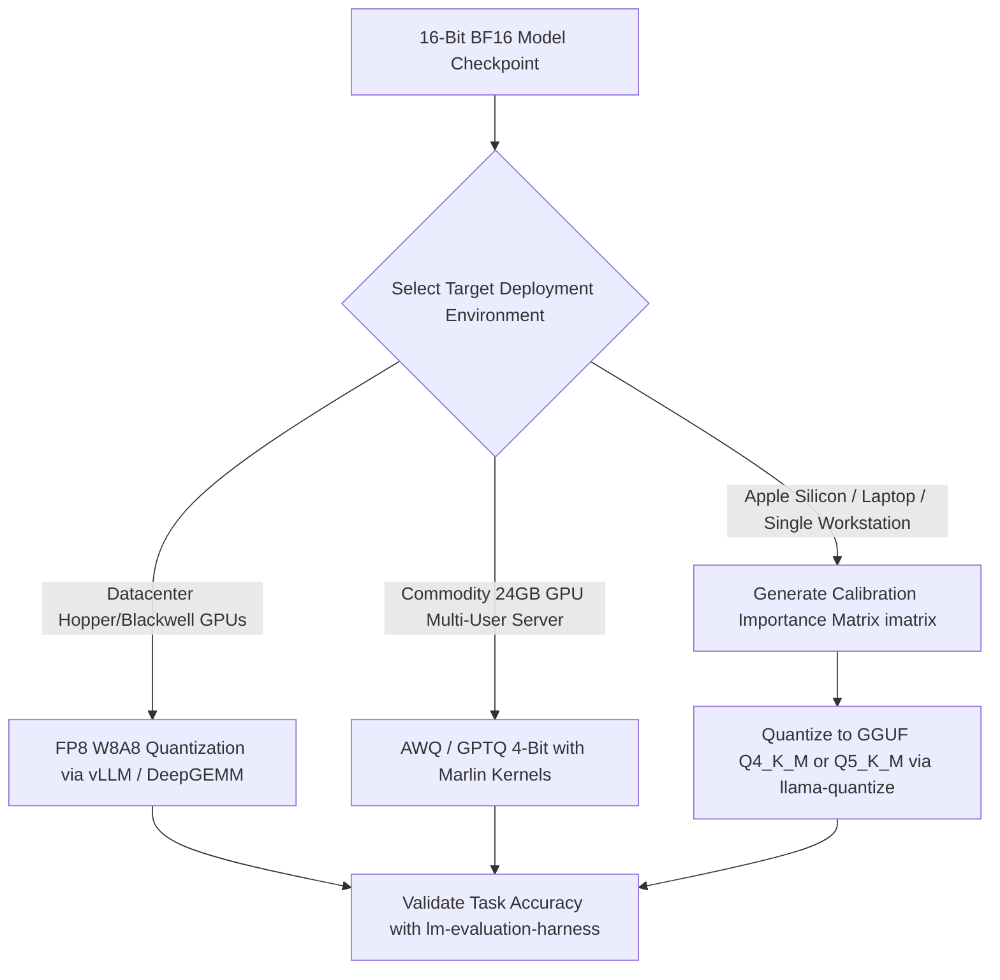

## 1. Introduction and Current Context

Every parameter in a standard `BF16` or `FP16` language model consumes 2 bytes of memory. That simple arithmetic means a 70-billion-parameter model requires 140GB of VRAM just to hold its static weights—exceeding the capacity of a single 80GB H100 GPU before a single token of user context is processed. Quantization solves this bottleneck by mapping continuous floating-point distributions onto discrete low-bit grids with block-wise scaling factors.

## 2. Direct Answer and Key Takeaway

> **Key Takeaway:** LLM quantization compresses high-precision neural network weights and activations (typically 16-bit `BF16` or `FP16`) into lower-bit representations (8-bit `FP8`/`INT8` or 4-bit `INT4`/`Q4_K_M`/`AWQ`), cutting memory footprint by 50% to 75% and accelerating memory-bound token decoding. In 2026, engineering teams follow two proven rules: a 4-bit quantized 32B model consistently outperforms an unquantized 16-bit 8B model occupying the same VRAM budget, and quantizing down to 8-bit (`FP8`/`Q8_0`) is virtually lossless across all benchmarks, while 4-bit (`Q4_K_M` or `AWQ`) preserves ~98%+ accuracy when paired with importance matrices or activation-aware scaling.

## 3. Definitions and Technical Background

Before evaluating architectural trade-offs or writing production code for **LLM quantization**, it is essential to establish precise engineering definitions for the core components involved:

- **Post-Training Quantization (PTQ):** Converting an already trained 16-bit checkpoint into a lower-bit format using either zero-shot block scaling or a small calibration dataset of a few hundred tokens, without retraining the full model.
- **Weight-Only vs. Weight-Activation Quantization:** Weight-only quantization stores weights in 4 bits to save HBM bandwidth and dequantizes them to 16 bits in GPU registers during multiplication; weight-activation quantization quantizes both weights and activations to execute natively on low-precision hardware Tensor Cores.
- **Activation-Aware Weight Quantization (AWQ) & Importance Matrices (imatrix):** Calibration techniques that identify the ~1% of weight channels corresponding to large activation outliers and protect them with higher scaling precision so 4-bit compression does not corrupt critical reasoning pathways.

## 4. Technical Architecture and Deep Dive

First, every AI engineer should master the deterministic memory estimation formula for quantized models. A model's total memory requirement is the sum of its static weight footprint, its dynamic KV cache, and an activation workspace buffer: $$\text{Total Memory} \approx \left + \left$$ where $P$ is total parameters, $b_w$ is bits per weight, $L$ is layer count, $n_{kv}$ is KV heads, $d_h$ is head dimension, $S$ is sequence length, $B$ is batch size, and $b_{kv}$ is bits per KV cache element.

Second, developers must choose the quantization format that matches their target inference engine and hardware architecture. **GGUF** is designed specifically for `ggml-org/llama.cpp` and `ollama/ollama` across Apple Silicon Metal, CPUs, and single consumer GPUs. **AWQ** and **GPTQ** are `W4A16` formats optimized for high-throughput multi-user serving in `vllm-project/vllm` on NVIDIA GPUs.

Why do outlier channels matter so much in quantization? Neural network weights follow a roughly bell-shaped distribution, but hidden-state activations in large Transformers contain extreme outliers that are 10x to 100x larger than typical values. Naive uniform quantization stretches the quantization grid to cover those extreme outliers, crushing all normal values into a tiny handful of buckets and destroying model coherence.

Finally, evaluating quantized models solely by aggregate perplexity (PPL) on WikiText-2 can mislead production teams. While perplexity degrades smoothly from `FP16` to `Q4_K_M`, downstream capabilities such as multi-step coding, strict JSON tool-call syntax, and long-context retrieval are far more sensitive to extreme compression.

## 5. Comparative Analysis: Comparison of Major LLM Quantization Formats in 2026 (Illustrated for a 32B Parameter Model)

The following table compares the key engineering trade-offs, operational boundaries, and implementation choices for **LLM quantization**:

| Quantization Format | Effective Bits / Weight | Approx. 32B Weight Size | Primary Inference Engine | Quality vs. FP16 Baseline & Best Use Case |
| --- | --- | --- | --- | --- |
| BF16 / FP16 (Unquantized) | 16.0 bpw | ~64.0 GB | vLLM, SGLang, PyTorch | 100% baseline reference; training & multi-GPU clusters |
| FP8 (E4M3 / Dynamic Block) | 8.0 – 8.5 bpw | ~33.0 GB | vLLM, SGLang, DeepInfer | ~99.8% lossless; enterprise Hopper/Blackwell GPU serving |
| GGUF Q8_0 | 8.5 bpw | ~34.0 GB | llama.cpp, Ollama | ~99.8% lossless; high-RAM workstations & coding precision |
| GGUF Q4_K_M (with imatrix) | 4.8 bpw | ~19.3 GB | llama.cpp, Ollama, vLLM | ~98.5%+ retention; sweet spot for 24GB GPUs & MacBooks |
| AWQ / GPTQ (Marlin W4A16) | 4.2 – 4.5 bpw | ~17.5 GB | vLLM, SGLang | ~98.5% retention; high-throughput 4-bit GPU serving |
| GGUF Q2_K / IQ2_XS | 2.4 – 2.8 bpw | ~10.5 GB | llama.cpp | Noticeable reasoning & syntax degradation; emergency RAM fit only |

## 6. System Architecture and Execution Flow

The diagram below illustrates the end-to-end control flow, verification boundaries, and state transitions for **LLM quantization** in a production environment:

*Figure 11.1: Engineering workflow for selecting and validating LLM quantization formats across datacenter and local hardware targets.*

## 7. Practical Implementation Steps and Engineering Checklist

To implement **LLM quantization** reliably in production systems, follow these sequential engineering steps:

1. Follow the Iso-VRAM Scaling Law: if you have a fixed 24GB VRAM budget, always prefer a 32B model quantized to 4-bit over an 8B model in unquantized 16-bit.
2. When quantizing custom fine-tuned models to 4-bit or lower in `ggml-org/llama.cpp`, always compute an importance matrix using a representative sample of your target domain prompts first.
3. On Hopper and Blackwell GPUs in production, default to **FP8** rather than 4-bit weight-only formats when VRAM permits, as FP8 accelerates both prefill compute and decode bandwidth.
4. Quantize your KV cache strictly to 8-bit to double your effective context window capacity before considering 4-bit KV quantization, which can degrade attention retrieval precision.

## 8. Limitations, Operational Risks, and Trade-Offs

Even well-architected deployments of **LLM quantization** face concrete engineering constraints that teams must mitigate proactively:

- Severe degradation below 4 bits on small models: while a 70B model can survive 3-bit quantization reasonably well due to parameter redundancy, quantizing a compact 3B or 7B dense model below `Q4_K_M` causes sharp drops in coding and math accuracy.
- Calibration dataset bias: if you calibrate AWQ or an `imatrix` exclusively on English prose and then deploy the quantized model on Python code or Hindi transliteration, activation outliers in the target domain may clip and degrade output quality.
- Dequantization compute overhead at large batch sizes: in `W4A16` formats (GGUF/AWQ), weights must be unpacked to 16-bit on the fly; at very high concurrent batch sizes where the GPU becomes compute-bound, `W4A16` can run slower than native `W8A8` (`FP8`).

## 9. Frequently Asked Questions (FAQs)

### What does the 'K_M' in GGUF Q4_K_M stand for?

'K' refers to k-quants, a block-quantization scheme in `llama.cpp` that groups weights into super-blocks with nested scaling factors, and 'M' stands for Medium—a mixed-precision profile that keeps most layers at 4 bits while upgrading critical attention and feed-forward down-projection tensors to 5 or 6 bits.

### Is a 4-bit 32B model better than a 16-bit 8B model?

Yes.

### Why do cloud providers prefer FP8 over GGUF in datacenter clusters?

Datacenter GPUs (such as NVIDIA H100, H200, and B200) contain dedicated hardware FP8 Tensor Cores that multiply 8-bit floating-point matrices directly at double the FLOPs of BF16, accelerating both prompt prefill and high-batch decoding.

## 10. Conclusion

Quantization is the foundational bridge between massive neural network architectures and finite physical memory. By selecting `Q4_K_M` with importance matrices for local workstations, `AWQ`/`Marlin` for commodity 24GB GPU servers, and native `FP8` for datacenter clusters, developers maximize model intelligence per gigabyte of VRAM.

### GitHub Repositories & Technical References

- **ggml-org/llama.cpp** — Official repository defining the GGUF format, K-quant mixed-precision schemes, importance matrix (`llama-imatrix`) tools, and quantized CPU/GPU kernels. Verified GitHub URL: https://github.com/ggml-org/llama.cpp
- **vllm-project/vllm** — Production serving engine supporting FP8, AWQ, GPTQ, Marlin, compressed-tensors, and quantized KV caches. Verified GitHub URL: https://github.com/vllm-project/vllm
- **EleutherAI/lm-evaluation-harness** — Standard open-source evaluation framework for benchmarking perplexity and downstream task accuracy across quantized model checkpoints. Verified GitHub URL: https://github.com/eleutherai/lm-evaluation-harness
