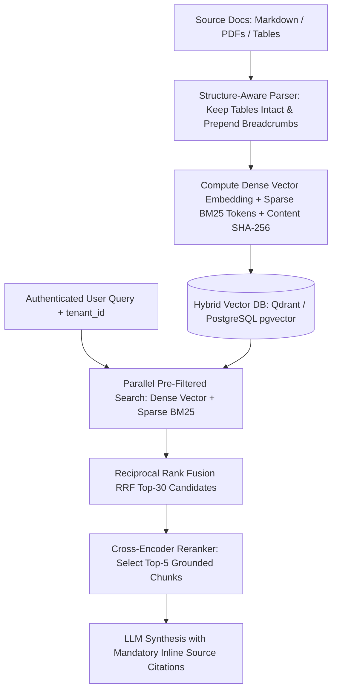

## 1. Introduction and Current Context

Anyone can build a 5-line RAG demo that loads a clean text file and answers a softball question. When that same demo is pointed at an enterprise repository of 10,000 technical manuals, release notes, and pricing tables, it breaks immediately: fixed-character splitting slices a Markdown pricing table in half so the column headers are in Chunk #41 and the numbers are in Chunk #42; pure vector search confuses `Model v2.4` with `Model v2.5`; and stale deleted documents remain in the vector index.

## 2. Direct Answer and Key Takeaway

> **Key Takeaway:** Production RAG engineering in 2026 is 80% **data ingestion, structure-aware chunking, hybrid retrieval, and metadata filtering**, and only 20% LLM prompting. Naive RAG pipelines that split documents every 500 characters and run cosine similarity over dense vectors alone fail on financial tables, exact product SKUs, and multi-tenant permissions.

## 3. Definitions and Technical Background

Before evaluating architectural trade-offs or writing production code for **RAG engineering**, it is essential to establish precise engineering definitions for the core components involved:

- **Structure-Aware & Contextual Chunking:** Splitting documents along semantic Markdown/HTML boundaries and prepending the parent document title and section breadcrumb path to every chunk before embedding.
- **Hybrid Search with Reciprocal Rank Fusion (RRF):** Executing both a **Dense Vector Search** and a **Sparse Lexical/BM25 Search** in parallel and merging their ranked lists via the deterministic RRF formula: $\text{RRF\_Score}(d) = \sum_{m} \frac{1}{k + \text{rank}_m(d)}$.
- **Cross-Encoder Reranking:** A second-stage scoring pass that takes the top 25–50 candidate chunks from fast hybrid retrieval and evaluates `` jointly through a cross-encoder transformer to select the top 5–8 highest-precision passages for the LLM.

## 4. Technical Architecture and Deep Dive

**Prerequisites & Required Tools:** Python $\ge 3.11$, `run-llama/llama_index`, `qdrant-client` or `pgvector/pgvector`, and `explodinggradients/ragas`.

**Step-by-Step Learning Path:**
1. **Beginner — Structure-Aware Ingestion & Metadata Tagging:** Parse documents into clean Markdown, chunk by heading hierarchy while keeping tables atomic, prepend breadcrumbs to each chunk, and attach mandatory metadata.
2. **Intermediate — Hybrid Search & ACL Filtering:** Configure a collection supporting both dense embeddings and sparse BM25 vectors, enforce `tenant_id` pre-filtering, and fuse results with Reciprocal Rank Fusion.
3.

**Minimal Production Code Example (Deterministic Breadcrumb Chunker + Reciprocal Rank Fusion Hybrid Merger):**

```python
# File: rag_hybrid_pipeline.py
# Prerequisites: Python >= 3.11
import hashlib
from dataclasses import dataclass

@dataclass
class KnowledgeChunk:
    chunk_id: str
    doc_id: str
    tenant_id: str
    breadcrumb: str
    text: str
    content_sha256: str

def build_contextual_chunk(doc_id: str, tenant_id: str, doc_title: str, h2_heading: str, raw_section: str) -> KnowledgeChunk:
    """Prepend document and section breadcrumb so chunk is never orphaned from context."""
    breadcrumb = f"{doc_title} > {h2_heading}"
    contextualized_text = f"Context: {breadcrumb}\n\n{raw_section.strip()}"
    digest = hashlib.sha256(contextualized_text.encode("utf-8")).hexdigest()
    chunk_id = f"{tenant_id}:{doc_id}:{digest[:12]}"
    return KnowledgeChunk(
        chunk_id=chunk_id,
        doc_id=doc_id,
        tenant_id=tenant_id,
        breadcrumb=breadcrumb,
        text=contextualized_text,
        content_sha256=digest,
    )

def reciprocal_rank_fusion(
    dense_ranked_ids: list[str],
    sparse_bm25_ranked_ids: list[str],
    k: int = 60,
    top_n: int = 5,
) -> list[tuple[str, float]]:
    """Fuse dense semantic rankings and sparse lexical BM25 rankings via RRF."""
    scores: dict[str, float] = {}
    for rank, cid in enumerate(dense_ranked_ids, start=1):
        scores[cid] = scores.get(cid, 0.0) + 1.0 / (k + rank)
    for rank, cid in enumerate(sparse_bm25_ranked_ids, start=1):
        scores[cid] = scores.get(cid, 0.0) + 1.0 / (k + rank)
    return sorted(scores.items(), key=lambda item: item[1], reverse=True)[:top_n]

if __name__ == "__main__":
    chunk = build_contextual_chunk("doc_01", "tenant_in", "vLLM Guide", "FP8 Quantization", "Enable --quantization fp8 on H100.")
    fused = reciprocal_rank_fusion(["c1", "c2", "c3"], ["c3", "c1", "c4"], top_n=3)
    assert fused[0][0] in {"c1", "c3"}
    print("Chunk ID:", chunk.chunk_id, "| Top RRF Hits:", fused)
```

**Testing & Verification Steps:** Run `python3 rag_hybrid_pipeline.py` to verify contextual breadcrumb generation and RRF ranking math.

## 5. Comparative Analysis: RAG Pipeline Architecture: Naive Prototype RAG vs. Production Hybrid RAG (2026)

The following table compares the key engineering trade-offs, operational boundaries, and implementation choices for **RAG engineering**:

| RAG Stage | Naive Prototype RAG (Fails in Prod) | Production Hybrid RAG Architecture (2026) | Open-Source Implementation |
| --- | --- | --- | --- |
| Document Chunking | Fixed 500-char splitter (cuts tables & code in half) | Markdown/AST header splitter + atomic tables + breadcrumb prefix | `run-llama/llama_index` MarkdownNodeParser |
| Retrieval Mechanism | Dense vector cosine similarity only | Hybrid Search: Dense Embeddings + Sparse BM25 fused via RRF | `qdrant/qdrant`, `pgvector` + `tsvector` |
| Candidate Filtering | Pass top-10 raw vector hits directly to LLM | Retrieve top-30 via Hybrid RRF → Cross-Encoder Rerank to top-5 | BGE/Cohere/local Cross-Encoder reranker |
| Access Control (ACL) | None or post-retrieval filtering in Python | Pre-retrieval indexed payload filter (`tenant_id`, `role`) + HNSW iterative scan | Qdrant Payload Filter / `pgvector` 0.8+ iterative scan |
| Index Freshness | Append-only index (duplicates stale chunks on edit) | Content-hash diffing + transactional delete/upsert by `doc_id` | Postgres foreign key cascade / Qdrant filter delete |

## 6. System Architecture and Execution Flow

The diagram below illustrates the end-to-end control flow, verification boundaries, and state transitions for **RAG engineering** in a production environment:



*Figure 55.1: End-to-end production RAG architecture combining breadcrumb-enriched chunking, ACL-filtered hybrid search (Dense + BM25 RRF), and cross-encoder reranking.*

## 7. Practical Implementation Steps and Engineering Checklist

To implement **RAG engineering** reliably in production systems, follow these sequential engineering steps:

1. Never embed an orphan paragraph like *'It costs $45/month and supports 10 seats'* without prepending its parent document title and H2 heading—otherwise the embedding has no idea what `'It'` refers to.
2. Keep Markdown and HTML tables intact as single chunks rather than allowing a character splitter to separate `<thead>` from `<tbody>`.
3. Enable **iterative index scanning** in `pgvector/pgvector` or indexed payload filtering in `qdrant/qdrant` so strict multi-tenant `WHERE tenant_id = $1` filters never suffer from HNSW over-filtering recall drops.
4. Never change your embedding model checkpoint in production without re-indexing your entire vector collection into a new shadow collection and swapping aliases—vectors from two different embedding models occupy incompatible geometric spaces.

## 8. Limitations, Operational Risks, and Trade-Offs

Even well-architected deployments of **RAG engineering** face concrete engineering constraints that teams must mitigate proactively:

- Silent embedding space mismatch: querying an index built with `bge-large-en-v1.5` using query vectors generated by `text-embedding-3-small` (even if truncated to the same dimension) returns random garbage.
- Orphaned chunks from deleted documents: if your ingestion pipeline appends new chunks whenever a Confluence/CMS page is edited without deleting the old `doc_id` chunks first, the retriever will return both the old 2024 policy and the new 2026 policy simultaneously.
- Latency overhead of oversized reranking batches: passing 100 long 1,500-token chunks into a cross-encoder reranker on CPU adds seconds of latency—cap reranker candidates at the top 20–30 RRF hits.

## 9. Frequently Asked Questions (FAQs)

### Why do RAG systems fail when a user asks about a specific table or code snippet?

Because naive fixed-size chunkers slice right through the middle of tables and functions, separating the table's column headers from its data rows.

### What is Reciprocal Rank Fusion (RRF) and why is it used in hybrid search?

Dense vector search outputs cosine similarity scores (e.g., `0.81`), while BM25 keyword search outputs unbounded lexical scores (e.g., `14.7`).

### What is 'over-filtering' in HNSW vector indexes and how do Qdrant and pgvector solve it?

If you run a vector search first and filter by `tenant_id` afterward, and a small tenant owns only 0.1% of the rows in the database, the top 50 global vector hits might contain 0 rows for that tenant!

## 10. Conclusion

World-class RAG systems are built on disciplined information retrieval engineering. By preserving document hierarchy and breadcrumbs during chunking, fusing dense vectors with BM25 via RRF in `qdrant` or `pgvector`, reranking candidates, and auditing precision with `ragas`, engineers build knowledge systems that users can genuinely trust.

### GitHub Repositories & Technical References

- **run-llama/llama_index** — Official open-source framework for structure-aware document parsing, indexing, and RAG orchestration. Verified GitHub URL: https://github.com/run-llama/llama_index
- **qdrant/qdrant** — High-performance vector and hybrid search engine supporting dense vectors, sparse BM25 vectors, RRF fusion, and tenant payload filtering. Verified GitHub URL: https://github.com/qdrant/qdrant
- **pgvector/pgvector** — Open-source vector similarity search extension for PostgreSQL featuring HNSW indexing and iterative filtered scans. Verified GitHub URL: https://github.com/pgvector/pgvector
- **explodinggradients/ragas** — Standard open-source evaluation library for measuring RAG retrieval precision/recall and generation faithfulness. Verified GitHub URL: https://github.com/explodinggradients/ragas
