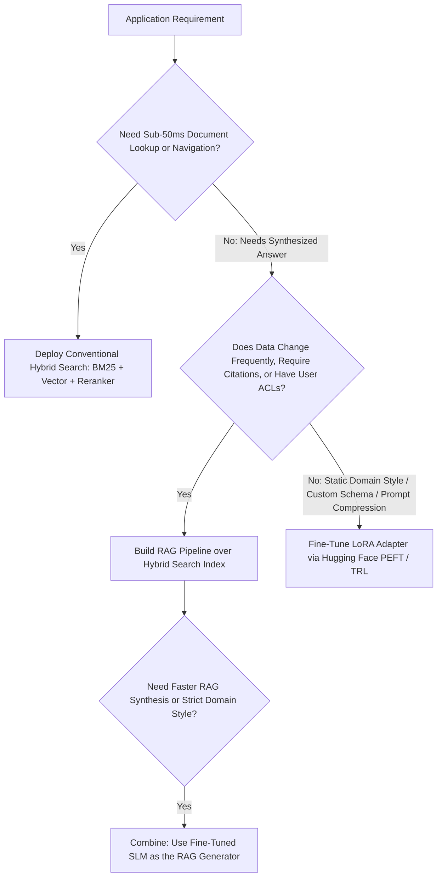

## 1. Introduction and Current Context

One of the most expensive architectural mistakes in enterprise AI is running a multi-thousand-dollar fine-tuning job (`huggingface/peft`, `huggingface/trl`) to 'teach the model our company documentation and product catalog,' only to discover a week later that the fine-tuned model hallucinates outdated prices, cannot cite which PDF a policy came from, and leaks confidential executive documents to regular employees. Conversely, other teams build slow, expensive RAG pipelines (`run-llama/llama_index`) when users simply wanted a fast 30ms keyword/vector search bar (`qdrant/qdrant`, `pgvector/pgvector`).

## 2. Direct Answer and Key Takeaway

> **Key Takeaway:** In 2026, engineering teams follow a clear architectural rule to separate **Conventional Search**, **Retrieval-Augmented Generation (RAG)**, and **Fine-Tuning**: **Fine-Tuning is for form, style, and narrow task behavior; RAG is for dynamic, cited facts and access-controlled knowledge; and Conventional Hybrid Search is for sub-50ms deterministic document discovery.** Attempting to teach an LLM frequently changing company facts via fine-tuning fails because weight updates cannot enforce per-user document permissions (ACLs), cannot delete a retracted fact instantly, and do not provide verifiable source citations.

## 3. Definitions and Technical Background

Before evaluating architectural trade-offs or writing production code for **RAG vs fine-tuning**, it is essential to establish precise engineering definitions for the core components involved:

- **Conventional Hybrid Search (BM25 + Dense Vectors):** A retrieval system that combines exact keyword matching with semantic embedding similarity and cross-encoder reranking to return ranked document snippets in 10–50ms without calling a generative LLM.
- **Retrieval-Augmented Generation (RAG):** An architecture that retrieves top-$k$ permission-filtered passages from a search index at query time and injects them into an LLM's context window to synthesize a grounded, cited answer.
- **Parameter-Efficient Fine-Tuning (PEFT / LoRA):** Updating a small set of low-rank adapter weights on a language model using curated input-output pairs so the model internalizes a specific output schema, domain tone, coding DSL, or classification rubric.

## 4. Technical Architecture and Deep Dive

**When Conventional Search Wins Without an LLM:** Before adding a generative LLM step to a search bar, ask whether the user is looking for *navigation and exact records* or *multi-document synthesis*. If an engineer types `Order #88412` or `FastAPI CORS middleware docs` into a search box, waiting 2.5 seconds for an LLM to stream a chatty paragraph is a worse user experience than returning the top 5 hybrid search hits in 25 milliseconds at 1/100th the compute cost.

**Why RAG Wins for Dynamic and Regulated Facts:** Suppose your enterprise knowledge base has 50,000 Notion pages, PDFs, and Jira tickets that change every hour, where Engineering documents are visible to developers and HR salary bands are visible only to HR directors. In a RAG architecture, when a document is updated or deleted, updating its vector chunks takes 200 milliseconds. When a user queries the system, the vector database applies a mandatory metadata filter *before* any passage reaches the LLM, and the LLM cites the exact document URL and paragraph.

**Why Fine-Tuning Wins for Behavior, Format, and Latency:** If RAG handles facts, what is fine-tuning for? Fine-tuning excels when you need to change *how* a model behaves or reduce prompt token overhead. For example, if you have to include a 4,000-token system prompt explaining your company's custom GraphQL DSL, medical coding abbreviations, or JSON output schema on every single API call, fine-tuning an 8B model on 1,500 verified examples internalizes those rules into the weights.

**The Production Power Pattern:** Mature 2026 architectures do not treat these three tools as mutually exclusive.

## 5. Comparative Analysis: Architectural Decision Matrix: Conventional Hybrid Search vs. RAG vs. LoRA Fine-Tuning

The following table compares the key engineering trade-offs, operational boundaries, and implementation choices for **RAG vs fine-tuning**:

| Engineering Requirement | Conventional Hybrid Search | Retrieval-Augmented Generation (RAG) | LoRA / SFT Fine-Tuning |
| --- | --- | --- | --- |
| Knowledge Freshness | Real-time (ms/seconds via index upsert) | Real-time (ms/seconds via index upsert) | Static (requires retraining & redeploying weights) |
| Per-User Access Control (ACLs) | Native metadata filtering per query | Native metadata filtering prior to LLM context | Impossible (weights cannot filter facts by user role) |
| Verifiable Citations & Audit | Returns exact source documents & offsets | Inline links & quotes grounded in retrieved chunks | None (black-box recall from parametric weights) |
| Teaching Style, Tone & DSL Format | Not applicable (no generation) | Costs prompt tokens on every call (few-shot) | Excellent (internalizes schema & style in weights) |
| P95 Latency & Compute Cost | 15 ms – 60 ms / fraction of a cent | 800 ms – 3,000 ms / moderate token cost | Fast inference (short prompts); upfront GPU training cost |

## 6. System Architecture and Execution Flow

The diagram below illustrates the end-to-end control flow, verification boundaries, and state transitions for **RAG vs fine-tuning** in a production environment:

*Figure 33.1: Decision flowchart for choosing between Conventional Hybrid Search, RAG, LoRA Fine-Tuning, or a combined RAG + Fine-Tuned SLM pipeline.*

## 7. Practical Implementation Steps and Engineering Checklist

To implement **RAG vs fine-tuning** reliably in production systems, follow these sequential engineering steps:

1. Build and evaluate your **Hybrid Search** layer before writing a single line of LLM RAG prompt code—if your retriever doesn't surface the right chunk in the top 5 hits, no LLM can fix it.
2. Enforce document permissions (ACLs) inside the vector database query filter)])`)—never retrieve across all tenants and ask the LLM to 'ignore confidential results.'
3. Use RAG whenever facts change weekly/daily, when users require clickable source citations, or when GDPR/DPDP data-deletion requests require instant removal of specific records.
4. Reserve LoRA fine-tuning for compressing long, repetitive few-shot prompts, learning proprietary code/DSL syntax, or distilling a frontier model's behavior into a fast 7B–8B model.

## 8. Limitations, Operational Risks, and Trade-Offs

Even well-architected deployments of **RAG vs fine-tuning** face concrete engineering constraints that teams must mitigate proactively:

- Fine-tuning on facts causes hallucination amplification: training an LLM on new factual documents via SFT without RAG often teaches the model to mimic the confident style of those documents while hallucinating dates and numbers.
- Naive vector-only RAG misses exact identifiers: pure dense embedding search often fails when users search for exact SKU codes (`ERR_SSL_PROTOCOL_ERROR`, `Part #A-992-X`)—always combine dense vectors with sparse lexical BM25 search.
- Catastrophic forgetting during aggressive fine-tuning: setting the learning rate or rank too high during SFT can overwrite a base model's general instruction-following and safety guardrails.

## 9. Frequently Asked Questions (FAQs)

### Should I fine-tune an LLM on my company's internal wiki so employees can ask questions?

No.

### When should I combine RAG and Fine-Tuning together?

Combine them when you need dynamic, cited facts from a knowledge base (handled by RAG) *and* you want a compact 8B model to follow a strict domain output format, medical/legal terminology, or SQL dialect without needing a 3,000-token system prompt on every turn (handled by LoRA fine-tuning).

### Why is hybrid search (BM25 + Vectors) better than vector search alone for RAG?

Dense vector embeddings capture conceptual similarity ('laptop overheating' matches 'thermal throttling'), but they compress whole sentences into a single vector and often miss exact string matches like error codes, function names, or invoice IDs.

## 10. Conclusion

Conventional Search, RAG, and Fine-Tuning are complementary building blocks, not rivals. Keep facts in your hybrid search index where they can be updated, permission-filtered, and cited via RAG, and use LoRA fine-tuning to sharpen your model's formatting, domain language, and inference efficiency.

### GitHub Repositories & Technical References

- **run-llama/llama_index** — Comprehensive open-source framework for document ingestion, chunking, indexing, and Retrieval-Augmented Generation (RAG) workflows. Verified GitHub URL: https://github.com/run-llama/llama_index
- **qdrant/qdrant** — Open-source vector and hybrid search engine supporting dense vectors, sparse BM25 vectors, and strict payload ACL filtering. Verified GitHub URL: https://github.com/qdrant/qdrant
- **huggingface/peft** — Official Hugging Face library for Parameter-Efficient Fine-Tuning (LoRA, QLoRA) of language models. Verified GitHub URL: https://github.com/huggingface/peft
- **explodinggradients/ragas** — Standard evaluation toolkit for measuring retrieval precision/recall and generation faithfulness in RAG pipelines. Verified GitHub URL: https://github.com/explodinggradients/ragas
