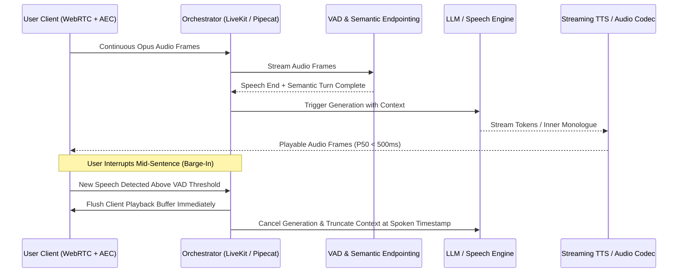

## 1. Introduction and Current Context

Human conversation is inherently full-duplex: speakers overlap, emit brief backchannel cues ('uh-huh', 'right'), pause mid-sentence to think, and interrupt one another when a point is understood. Traditional voice assistants built on sequential half-duplex pipelines—recording audio until silence is detected, transcribing speech to text (STT), waiting for an LLM completion, and synthesizing speech (TTS)—suffered from 1.5-to-3-second turn-taking delays and brittle interruption handling. By October 2026, advances in streaming neural audio codecs, semantic endpoint detection, WebRTC agent orchestration (`livekit/agents`, `pipecat-ai/pipecat`), and native full-duplex models (`kyutai-labs/moshi`) have reshaped how engineers build conversational speech systems.

## 2. Direct Answer and Key Takeaway

> **Key Takeaway:** Real-time voice AI in 2026 operates along two distinct architectural paths: low-latency streaming cascades (ASR → LLM → TTS orchestrated over WebRTC via frameworks like LiveKit Agents and Pipecat) and native speech-to-speech full-duplex models (such as Kyutai's Moshi) that process incoming and outgoing audio tokens simultaneously. While native full-duplex models eliminate intermediate text transcription latency and preserve acoustic paralinguistics, production enterprise voice agents frequently combine streaming cascades or hybrid dual-channel models to guarantee deterministic tool calling, strict transcript auditability, and reliable interruption recovery.

## 3. Definitions and Technical Background

Before evaluating architectural trade-offs or writing production code for **voice AI models**, it is essential to establish precise engineering definitions for the core components involved:

- **Full-Duplex Speech System:** An architecture capable of listening to user audio and generating spoken output simultaneously across parallel streams, rather than enforcing rigid half-duplex turn boundaries.
- **Streaming Neural Audio Codec:** An encoder-decoder network that compresses continuous waveforms into low-frame-rate discrete acoustic and semantic tokens that a temporal Transformer can model directly.
- **Barge-In (Interruption Handling):** The ability of a voice agent to detect genuine user speech while the agent is speaking, immediately flush its outbound audio playback buffer, truncate its internal generation state to match what the user actually heard, and respond to the new input.

## 4. Technical Architecture and Deep Dive

To engineer a responsive voice agent, developers must first understand where latency accumulates in a conventional three-stage cascade. Even when each stage streams partial outputs, total turn-around latency is the sum of endpointing wait time, streaming ASR finalization, LLM time-to-first-token (TTFT), TTS first-chunk synthesis, and network transport jitter.

Native speech-to-speech full-duplex architectures—pioneered in open weights by Kyutai's `kyutai-labs/moshi`—attack this bottleneck by removing the explicit text transcription boundary. Moshi pairs a 7B temporal Transformer with the Mimi streaming neural audio codec and models two parallel audio streams continuously: the user's incoming audio and the system's outgoing audio, alongside an internal text monologue stream that stabilizes linguistic reasoning.

However, end-to-end audio modeling is not a universal replacement for streaming cascades in enterprise production. As recent October 2026 engineering evaluations highlight, full-duplex models that model speech tokens directly face tougher challenges when executing deterministic external tools, adhering to strict compliance scripts, or providing verbatim text audit logs for regulated industries.

In a modern Pipecat or LiveKit Agents pipeline, audio travels over WebRTC to handle packet loss and acoustic echo cancellation (AEC) at the client edge. A local Silero VAD paired with a lightweight semantic turn-detection model distinguishes genuine barge-in interruptions from background coughs or backchannel acknowledgments.

## 5. Comparative Analysis: Architectural Trade-Offs: Streaming Cascaded Pipelines vs. Native Full-Duplex Speech Models

The following table compares the key engineering trade-offs, operational boundaries, and implementation choices for **voice AI models**:

| Engineering Dimension | Streaming Cascade (ASR → LLM → TTS) | Native Full-Duplex Speech Model (e.g., Moshi) | Production Selection Guidance |
| --- | --- | --- | --- |
| Turn-Taking Latency | Typically 450 ms – 800 ms end-to-end | ~160 ms – 250 ms frame-synchronous | Full-duplex excels at natural rhythm; cascades suffice for task workflows |
| Acoustic & Emotion Awareness | Lost at STT boundary unless metadata tags added | Preserved natively via neural audio codec tokens | Native S2S captures prosody, hesitation, and non-verbal cues |
| Tool Calling & Guardrails | Deterministic schema validation on LLM text stream | Requires auxiliary text/tool channel or hybrid routing | Cascades offer stricter compliance & policy filtering prior to TTS |
| Interruption State Recovery | Explicit word-level timestamp truncation | Continuous joint stream conditioning | Cascades provide exact auditability of what text was spoken |
| Modularity & Cost | Swap STT, LLM, or TTS independently per language | Monolithic checkpoint requiring dedicated GPU residency | Cascades allow mixing Indic/regional ASR with specialized LLMs |

## 6. System Architecture and Execution Flow

The diagram below illustrates the end-to-end control flow, verification boundaries, and state transitions for **voice AI models** in a production environment:

*Figure 4.1: Real-time full-duplex voice orchestration sequence illustrating WebRTC streaming, semantic endpointing, and state-consistent barge-in cancellation.*

## 7. Practical Implementation Steps and Engineering Checklist

To implement **voice AI models** reliably in production systems, follow these sequential engineering steps:

1. Use WebRTC rather than raw WebSockets for client-to-server audio transport: WebRTC provides built-in UDP packet-loss concealment, jitter buffering, and hardware-accelerated Acoustic Echo Cancellation (AEC) so the agent does not hear its own speaker output and interrupt itself.
2. Measure voice latency using four distinct, paired telemetry metrics rather than a single number: (1) Endpoint Wait Time, (2) Time to First Playable Audio at Client, (3) Interruption Stop Latency, and (4) Post-Interruption Task Completion Rate.
3. Separate VAD voice detection from semantic interruption triggers so brief user backchannels do not abort a multi-sentence explanation or tool execution.
4. When building with `livekit/agents` or `pipecat-ai/pipecat`, synchronize TTS word-level alignment timestamps with your conversation state manager so interrupted responses only record the exact words the user actually heard.

## 8. Limitations, Operational Risks, and Trade-Offs

Even well-architected deployments of **voice AI models** face concrete engineering constraints that teams must mitigate proactively:

- Acoustic echo self-interruption: if a user participates on speakerphone without functioning client-side echo cancellation, the agent's own synthesized voice feeds back into the microphone and triggers false barge-in cancellations.
- Premature cutoff on numerical or dictated inputs: users naturally pause when reading addresses, phone numbers, or booking codes; overly aggressive low-latency endpointing interrupts them mid-sequence.
- High GPU residency costs for native S2S models: unlike stateless text APIs that multiplex hundreds of users via continuous batching, stateful full-duplex audio streams maintain continuous per-session state on GPU memory.

## 9. Frequently Asked Questions (FAQs)

### Does full-duplex voice AI require an end-to-end speech-to-speech model?

No. Full-duplex describes whether a system can listen and speak simultaneously and handle overlapping turns gracefully.

### What is Kyutai's Moshi and why is it significant for voice AI?

Moshi (`kyutai-labs/moshi`) is an open-weight speech-text foundation model that uses the Mimi streaming neural audio codec to model user and assistant audio streams in parallel alongside an inner text monologue, achieving ~200ms practical latency on an L4 GPU.

### Why should voice agents use WebRTC instead of WebSockets for user audio?

WebSockets run over TCP, where a single dropped packet causes head-of-line blocking and audible latency spikes.

## 10. Conclusion

Real-time voice AI has progressed beyond slow, turn-based transcription loops into fluid, full-duplex conversation. Whether engineering teams deploy native speech-to-speech models like Moshi for expressive dialogue or modular WebRTC pipelines with LiveKit Agents and Pipecat for tool-heavy enterprise workflows, rigorous latency instrumentation and barge-in state management remain the keys to natural voice experiences.

### GitHub Repositories & Technical References

- **kyutai-labs/moshi** — Official repository for Moshi, a real-time full-duplex speech-text foundation model and the Mimi streaming neural audio codec. Verified GitHub URL: https://github.com/kyutai-labs/moshi
- **livekit/agents** — Official framework for building real-time multimodal and voice AI agents over WebRTC with programmable turn detection and tool orchestration. Verified GitHub URL: https://github.com/livekit/agents
- **pipecat-ai/pipecat** — Open-source Python framework for orchestrating real-time voice and multimodal conversational pipelines across ASR, LLM, and TTS services. Verified GitHub URL: https://github.com/pipecat-ai/pipecat
- **QwenLM/Qwen3-TTS** — Official open-source series of multilingual streaming Text-to-Speech models supporting voice cloning, voice design, and low-latency synthesis. Verified GitHub URL: https://github.com/QwenLM/Qwen3-TTS
