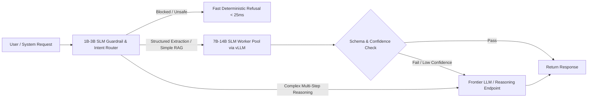

## 1. Introduction and Current Context

A persistent anti-pattern in enterprise AI engineering is routing every microservice call to a multi-hundred-billion-parameter frontier model. When an application only needs to parse a shipping address into JSON, classify a customer support ticket into one of 25 queues, or summarize three retrieved documentation paragraphs, a frontier model brings 99% unused world knowledge—such as 18th-century poetry or quantum electrodynamics—at the cost of high latency and steep token bills. By 2026, curated pretraining datasets and distillation pipelines have made 3B-to-14B SLMs across the Qwen3, Gemma, Llama, and DeepSeek-R1-Distill families remarkably capable workhorses.

## 2. Direct Answer and Key Takeaway

> **Key Takeaway:** Small Language Models (SLMs)—typically defined in 2026 as models between 1 billion and 14 billion active parameters—consistently outperform massive frontier models on latency-per-dollar and task-specific ROI when the workload is bounded, structured, or grounded in provided context. While frontier models remain necessary for open-ended cross-domain reasoning and zero-shot synthesis, SLMs win on intent classification, structured JSON extraction, RAG synthesis over retrieved chunks, guardrail filtering, and on-device execution—especially when paired with LoRA fine-tuning or grammar-constrained decoding.

## 3. Definitions and Technical Background

Before evaluating architectural trade-offs or writing production code for **small language models**, it is essential to establish precise engineering definitions for the core components involved:

- **Small Language Model (SLM):** A neural language model ranging from roughly 1B to 14B parameters (or a Mixture-of-Experts model with 1B–4B active parameters per token) designed to run on a single consumer/commodity GPU or edge device with sub-20ms inter-token latency.
- **Frontier AI Model:** A large-scale foundation model (often 100B+ parameters or deep test-time compute reasoning ensembles) trained for broad world knowledge, complex multi-step deduction, and zero-shot generalization across novel tasks.
- **Knowledge Distillation:** A training method where a compact student SLM is trained via supervised fine-tuning (`SFT`) or reinforcement learning (`huggingface/trl`) on high-quality reasoning traces and structured outputs generated by a larger teacher model.
- **In-Context Grounding vs. Parametric Knowledge:** The architectural separation between tasks where the answer is already present in the input prompt (in-context grounding, where SLMs excel) versus tasks requiring the model to recall obscure facts from its weights (parametric knowledge, where large models excel).

## 4. Technical Architecture and Deep Dive

Why have SLMs improved so dramatically between 2023 and 2026? Early small models were trained on the same noisy, unfiltered web scrapes as large models and stopped training once compute budgets ran out. Modern SLMs—such as the compact checkpoints in `QwenLM/Qwen3`, `google-deepmind/gemma`, and the distilled reasoning models in `deepseek-ai/DeepSeek-R1`—are trained for many trillions of tokens on heavily filtered, textbook-grade synthetic data and distilled teacher trajectories.

To decide between an SLM and a frontier model, architects should apply the **In-Context vs. Parametric Test**. If the prompt already contains the facts required to produce the answer—for example, transforming an unstructured medical transcript into a FHIR JSON object, rewriting a paragraph to match a brand style guide, or answering a user question strictly from five retrieved RAG chunks—the model does not need vast parametric memory.

Furthermore, SLMs shine when adapted to a single narrow task using Parameter-Efficient Fine-Tuning (`huggingface/peft` LoRA or QLoRA). With 500 to 2,000 curated domain examples, a fine-tuned 7B or 8B SLM learns exact output formatting, domain abbreviations, and edge-case classification boundaries, eliminating the need to prepend 3,000 tokens of few-shot examples to every single API call.

Conversely, engineers must recognize where SLMs fail. When a task requires synthesizing disparate concepts across multiple unstated domains, debugging subtle concurrency bugs across a 50,000-token codebase without clear stack traces, or answering open-ended questions without RAG context, SLMs exhibit higher hallucination rates and brittle reasoning chains.

## 5. Comparative Analysis: Workload Suitability Matrix: Small Language Models (1B–14B) vs. Frontier Models

The following table compares the key engineering trade-offs, operational boundaries, and implementation choices for **small language models**:

| Workload Category | Recommended Model Class | Primary Technical Justification | Recommended Optimization Pattern |
| --- | --- | --- | --- |
| Structured JSON / Entity Extraction | SLM (3B – 8B) | All data is in-context; needs syntactic transformations only | Pair with `dottxt-ai/outlines` grammar constraints |
| PII Redaction & Guardrail Filtering | SLM (1B – 4B) | Must execute inline under <50ms latency budget before main LLM | Run quantized on local CPU/GPU or edge worker |
| RAG Synthesis over Top-5 Chunks | SLM (7B – 14B) | Knowledge comes from retriever (`qdrant`/`pgvector`), not weights | Enforce strict citation grounding prompts |
| Domain-Specific SQL / API Translation | Fine-Tuned SLM (7B – 14B) | LoRA adapter internalizes proprietary schema without long prompts | Fine-tune with `huggingface/peft` + execution retry |
| Greenfield Architecture & Complex Debugging | Frontier Model | Requires broad cross-domain synthesis & deep multi-step planning | Reserve for high-value interactive or escalated turns |

## 6. System Architecture and Execution Flow

The diagram below illustrates the end-to-end control flow, verification boundaries, and state transitions for **small language models** in a production environment:

*Figure 9.1: Tiered SLM-to-Frontier routing pipeline that handles routine guardrails and extraction on compact models while escalating complex reasoning.*

## 7. Practical Implementation Steps and Engineering Checklist

To implement **small language models** reliably in production systems, follow these sequential engineering steps:

1. Decompose monolithic 'mega-prompts' that ask a frontier model to classify, extract, reason, and format all at once into discrete pipeline stages where SLMs handle classification and formatting.
2. Benchmark 4B, 8B, and 14B open-weight models (`QwenLM/Qwen3`, `google-deepmind/gemma`, `meta-llama/llama-models`) on your exact task using `promptfoo/promptfoo` before assuming a frontier model is required.
3. When an SLM struggles with complex JSON schemas in zero-shot mode, attach grammar-constrained decoding (`dottxt-ai/outlines` or `vllm` guided decoding) before escalating to a larger parameter count.
4. Collect production input/output pairs from a frontier model during your initial launch weeks, filter them for quality, and use `huggingface/peft` and `huggingface/trl` to fine-tune a LoRA adapter on an 8B SLM to replace the expensive call.
5. Monitor downstream fallback rates in your router so you can detect if new user query patterns are causing excessive escalations from the SLM tier to the frontier tier.

## 8. Limitations, Operational Risks, and Trade-Offs

Even well-architected deployments of **small language models** face concrete engineering constraints that teams must mitigate proactively:

- Hallucination on ungrounded factual queries: asking a 3B or 7B SLM open-book trivia or obscure regulatory questions without RAG context frequently yields plausible-sounding fabrications.
- Instruction degradation under multi-constraint prompts: if a system prompt contains 25 conflicting conditional rules, smaller models are more likely to drop constraints than frontier models—requiring prompt simplification or fine-tuning.
- Multilingual tail drop-off: while top SLMs handle high-resource languages and code well, low-resource regional languages often require specialized checkpoints (such as `AI4Bharat` models for Indic languages) rather than generic English-centric SLMs.

## 9. Frequently Asked Questions (FAQs)

### What parameter size counts as a Small Language Model (SLM) in 2026?

In practical engineering terms, SLMs encompass models from 1B to 14B dense parameters (or Mixture-of-Experts models with 1B to 4B active parameters) that can run efficiently on a single commodity GPU or modern laptop.

### Can an 8B SLM outperform a frontier model on a specific enterprise task?

Yes.

### Why are SLMs well-suited for Retrieval-Augmented Generation (RAG)?

In a well-designed RAG system, the vector/hybrid database retrieves the exact factual passages needed to answer the query.

## 10. Conclusion

Small Language Models are the key to turning experimental AI prototypes into profitable, low-latency production services. By reserving frontier models for open-ended reasoning and routing bounded classification, extraction, and RAG synthesis to right-sized SLMs, engineering teams achieve both speed and sustainable unit economics.

### GitHub Repositories & Technical References

- **google-deepmind/gemma** — Official repository for Google DeepMind's Gemma family of compact open-weight models engineered for workstation and single-GPU deployment. Verified GitHub URL: https://github.com/google-deepmind/gemma
- **QwenLM/Qwen3** — Official repository for the Qwen3 series, providing compact dense (0.6B–14B) and sparse MoE checkpoints. Verified GitHub URL: https://github.com/qwenLM/qwen3
- **huggingface/peft** — Official Parameter-Efficient Fine-Tuning (PEFT) library for training lightweight LoRA and QLoRA adapters on small language models. Verified GitHub URL: https://github.com/huggingface/peft
- **huggingface/trl** — Official Transformer Reinforcement Learning library supporting Supervised Fine-Tuning (SFT), DPO, and distillation workflows. Verified GitHub URL: https://github.com/huggingface/trl
