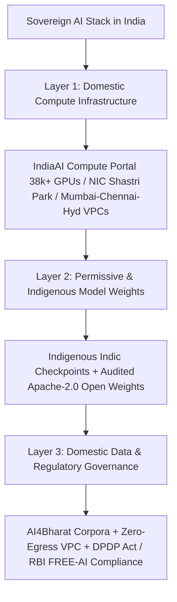

## 1. Introduction and Current Context

When critical national infrastructure—banking, agricultural subsidies, healthcare registries, judicial transcription, and tax administration—depends on AI, relying exclusively on closed, foreign-hosted APIs introduces three systemic vulnerabilities: (1) sensitive citizen data leaving Indian legal jurisdiction, (2) sudden pricing changes, rate limits, or geopolitical export restrictions cutting off access, and (3) linguistic and cultural blind spots across India's regional languages.

## 2. Direct Answer and Key Takeaway

> **Key Takeaway:** Sovereign AI in India does not mean digital isolationism or banning global models; it means ensuring strategic autonomy across three stack layers—**Compute** (domestic GPU infrastructure under the IndiaAI Mission and NIC), **Data** (jurisdictional residency under the DPDP Act and sectoral RBI/SEBI rules plus rich Indic datasets via AI4Bharat and AIKosh), and **Models** (open-weight checkpoints whose weights can be audited, fine-tuned, and served domestically without foreign API kill-switches).

## 3. Definitions and Technical Background

Before evaluating architectural trade-offs or writing production code for **sovereign AI India**, it is essential to establish precise engineering definitions for the core components involved:

- **Three-Layer AI Sovereignty (Compute, Data, Model):** The architectural framework requiring that (1) physical GPU execution occurs within domestic borders, (2) training and operational datasets remain under domestic legal governance, and (3) model weights are locally owned or permissively licensed so external vendors cannot revoke runtime access.
- **Operational Autonomy (Zero External Kill-Switch):** The guarantee that an enterprise or government AI service can continue running indefinitely inside a domestic data centre even if international submarine cables are disrupted or a foreign SaaS vendor terminates an API key.
- **IndiaAI Open-Source Subsidy Mandate:** The policy direction under the IndiaAI Mission—confirmed by IndiaAI leadership in 2026 regarding government-subsidized foundation models such as Sarvam AI's sovereign LLM effort—that models funded by public compute subsidies are released under permissive open-source licenses for public and developer benefit.

## 4. Technical Architecture and Deep Dive

**Layer 1: Compute Sovereignty.** As verified in August 2026 parliamentary disclosures by MeitY, India's Sovereign AI strategy addresses the compute bottleneck through two parallel tracks: onboarding over 38,000 GPUs via empaneled Compute Service Providers on the IndiaAI Compute Portal for immediate researcher and startup access, and establishing dedicated state-controlled capacity such as the High-Performance AI Compute System at the NIC Data Centre in Shastri Park, Delhi, alongside participation in the Pax Silica silicon supply-chain coalition.

**Layer 2: Data Sovereignty and Digital Public Goods.** A model is only as sovereign as the data it learns from. For decades, low-resource Indian languages lacked clean, permissively licensed digital corpora, forcing researchers to rely on noisy web scrapes dominated by Western text. Initiatives like IIT Madras's `AI4Bharat/IndicLLMSuite`, `AI4Bharat/MILU`, Bhashini, and the IndiaAI Datasets Platform (AIKosh) treat linguistic datasets across all 22 scheduled languages as digital public goods.

**Layer 3: Model Sovereignty vs. Autarky.** A common misconception among enterprise IT buyers is that 'Sovereign AI' means every company must refuse to use global open-weight architectures and wait for a 100% domestically invented neural architecture. In practice, **deployment sovereignty** and **weight ownership** matter most for enterprise compliance.

**Strategic Trade-Offs:** Sovereign AI is not free of trade-offs. Pretraining frontier-scale models from scratch consumes tens of millions of dollars in GPU electricity and hardware depreciation.

## 5. Comparative Analysis: Deployment Models Compared Across Sovereign AI Compliance Dimensions in India (2026)

The following table compares the key engineering trade-offs, operational boundaries, and implementation choices for **sovereign AI India**:

| Sovereignty Dimension | Cross-Border Closed SaaS API | Domestic Region Cloud API (Managed) | Self-Hosted Open/Indic Weights in Indian VPC (`vLLM`) |
| --- | --- | --- | --- |
| Physical Data Residency | Fails (prompts leave India to US/EU servers) | Passes (processed in Mumbai/Hyderabad region) | Passes 100% (air-gapped or private domestic VPC) |
| Immunity to Vendor API Deprecation | None (90-day sunset breaks app) | Low (subject to cloud provider model lifecycle) | 100% Permanent (immutable checkpoint weights owned locally) |
| Indic Language & Cultural Fit | Variable; high tokenizer fertility tax | Moderate | High (can deploy `IndicLLMSuite` / Sarvam / fine-tuned LoRA) |
| Auditability & Weight Inspection | Black box | Black box | Full access to weights, logprobs, and red-team scanning (`garak`) |
| Infrastructure Ops Complexity | Zero | Low | Moderate-to-High (requires GPU ops, Kubernetes, `vLLM`) |

## 6. System Architecture and Execution Flow

The diagram below illustrates the end-to-end control flow, verification boundaries, and state transitions for **sovereign AI India** in a production environment:

*Figure 40.1: The three-layer Sovereign AI architecture in India spanning domestic GPU compute, auditable model weights, and zero-egress data governance.*

## 7. Practical Implementation Steps and Engineering Checklist

To implement **sovereign AI India** reliably in production systems, follow these sequential engineering steps:

1. Separate **Data Sovereignty** from **Model Origin** in your enterprise architecture review: you can satisfy strict Indian data-residency and RBI audit requirements today by self-hosting audited open-weight or indigenous Indic models inside a Mumbai/Hyderabad VPC using `vllm-project/vllm` with outbound network egress blocked.
2. Pin and archive exact cryptographic `SHA-256` hashes of all model weight files and container images in a domestic artifact registry so your production service cannot be disrupted by upstream repository changes.
3. Evaluate indigenous Indic checkpoints and `AI4Bharat` adapters against global open-weight models using `AI4Bharat/indic-llm-eval-suite` to select the checkpoint with the lowest tokenizer fertility and highest regional accuracy.
4. Implement automated red-teaming and vulnerability scanning on self-hosted weights using `NVIDIA/garak` and runtime input/output guardrails via `protectai/llm-guard` before exposing sovereign endpoints to citizen traffic.

## 8. Limitations, Operational Risks, and Trade-Offs

Even well-architected deployments of **sovereign AI India** face concrete engineering constraints that teams must mitigate proactively:

- Reinventing the wheel on generic English code/math: spending limited domestic GPU grants pretraining a generic English coding model from scratch when permissive Apache-2.0 models already exist diverts compute away from high-impact Indic speech, translation, and governance gaps.
- Supply-chain hardware bottlenecks: domestic software and data sovereignty still run on globally manufactured GPUs and HBM memory, making multi-vendor hardware support (CUDA, ROCm, and open kernels) strategically important.
- Compliance theater: labeling an application 'Sovereign AI' on marketing slides while secretly routing fallback calls or telemetry traces (`LangSmith`/cloud logs) to overseas servers violates data-residency commitments.

## 9. Frequently Asked Questions (FAQs)

### What does 'Sovereign AI' actually mean for an Indian enterprise or bank?

For an enterprise or bank, Sovereign AI means having complete jurisdictional and operational control over your AI stack: customer data never leaves servers located in India, model weights are hosted inside your own VPC or on-prem data centre without external API dependencies, and every decision can be audited under Indian regulatory frameworks.

### Can a company use global open-weight models like Qwen3 or Llama in a Sovereign AI setup?

Yes, for **operational and data sovereignty**, hosting a permissively licensed open-weight model (`Qwen3`, `DeepSeek`, `Llama`) inside a locked-down domestic data centre via `vllm` guarantees zero external data egress and permanent weight availability.

### Why did the IndiaAI Mission mandate that government-subsidized foundation models be open-sourced?

By requiring models built with public GPU subsidies (such as Sarvam AI's sovereign LLM allocation) to be released under permissive open-source licenses, the government ensures that domestic startups, universities, and public agencies can build on top of the weights as Digital Public Infrastructure without vendor lock-in.

## 10. Conclusion

Sovereign AI in India is an architectural blueprint for resilience, inclusion, and regulatory trust. By combining domestic GPU capacity, open Indic datasets from `AI4Bharat`, permissively licensed sovereign and open-weight models, and zero-egress `vLLM` serving, Indian organizations can innovate at full speed while retaining complete control over their data and destiny.

### GitHub Repositories & Technical References

- **AI4Bharat/IndicLLMSuite** — Open-source Indic dataset and training suite powering indigenous Indian-language model development. Verified GitHub URL: https://github.com/AI4Bharat/IndicLLMSuite
- **vllm-project/vllm** — Open-source serving engine for running self-hosted, air-gapped sovereign LLM deployments inside domestic data centres. Verified GitHub URL: https://github.com/vllm-project/vllm
- **NVIDIA/garak** — Open-source LLM vulnerability scanner for auditing sovereign model checkpoints before deployment. Verified GitHub URL: https://github.com/NVIDIA/garak
- **protectai/llm-guard** — Security toolkit for enforcing PII sanitization, prompt-injection defense, and data-leakage prevention on self-hosted AI endpoints. Verified GitHub URL: https://github.com/protectai/llm-guard
