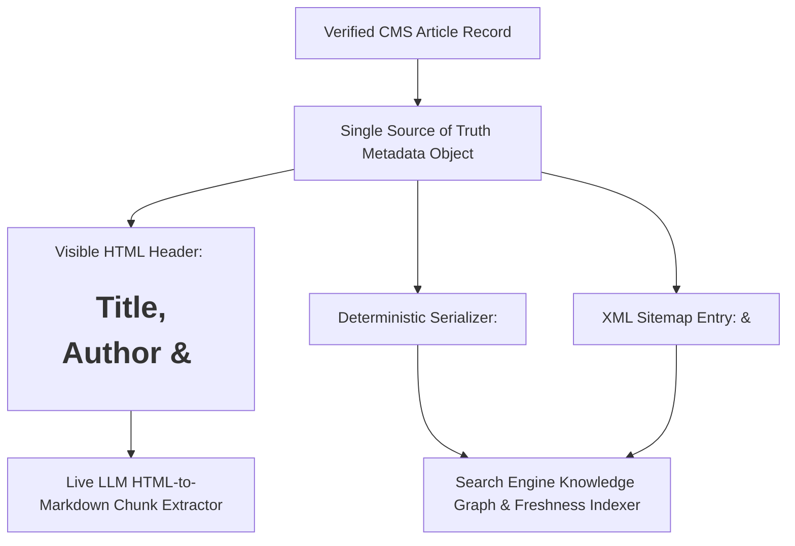

## 1. Introduction and Current Context

In recent GEO and SEO discussions, structured data (`<script type="application/ld+json">`) is often hyped as a 'secret language that makes AI models cite your website.' At the opposite extreme, some developers dismiss Schema.org entirely because language models can read plain English prose. Both extremes miss the actual engineering role of structured data in 2026.

## 2. Direct Answer and Key Takeaway

> **Key Takeaway:** Schema.org structured data serialized as **JSON-LD** (`schemaorg/schemaorg`) provides explicit, machine-readable entity disambiguation—telling search engines and knowledge-graph parsers the exact `headline`, `author`, `datePublished`, `dateModified`, `publisher`, and canonical URL of a page without guessing from CSS layout.

## 3. Definitions and Technical Background

Before evaluating architectural trade-offs or writing production code for **structured data SEO**, it is essential to establish precise engineering definitions for the core components involved:

- **JSON-LD (JavaScript Object Notation for Linked Data):** The W3C and search-engine recommended serialization format for embedding Schema.org structured metadata inside a `<script type="application/ld+json">` block in the HTML `<head>` or `<body>`.
- **Entity Disambiguation (`@id`, `sameAs`, `author`, `publisher`):** Using standardized Schema.org properties and canonical URIs to distinguish between identically named people, software libraries, or organizations across the web.
- **Visible-Content Parity Requirement:** The mandatory search quality rule stating that every field declared in JSON-LD must accurately reflect content that is visibly rendered to human readers on the same page.

## 4. Technical Architecture and Deep Dive

**What Schema.org Can Do Well:** When a web crawler ingests a technical article, parsing metadata from visual HTML alone is error-prone: one site puts the author's name in `<span class="byline">`, another puts three dates on the page. Valid `Article` or `BlogPosting` JSON-LD eliminates that ambiguity instantly. It maps `headline`, `description`, `datePublished`, `dateModified`, `author`, `publisher`, and `mainEntityOfPage` into standardized predicates defined in `schemaorg/schemaorg`.

**What Schema.org Cannot Do:** First, JSON-LD is **not a ranking multiplier** that rescues mediocre prose, and search engines explicitly state that valid structured data never guarantees rich-result rendering or citation inclusion. Second, understand how real-time AI browsing tools actually read pages: most HTML-to-Markdown extraction pipelines strip `<script>` tags—including `<script type="application/ld+json">`—when converting a fetched webpage into token-efficient text for the LLM context window!

**Preventing Schema Fraud and Hallucination:** The worst mistake an automated publishing system can make is populating JSON-LD fields with unverified or fabricated placeholders—such as inventing an `image` URL that returns `404 Not Found`, claiming a fictional `author` credential, or backdating `datePublished` to match an internal editorial planning calendar. Search engines issue manual and algorithmic structured-data penalties when JSON-LD misrepresents visible page facts.

Here is a clean, deterministic TypeScript helper for serializing valid, non-contradictory `BlogPosting` JSON-LD in Next.js (`vercel/next.js`) strictly from verified CMS fields:

```typescript
// File: lib/schema/articleJsonLd.ts
export interface VerifiedArticleMeta {
  headline: string;
  description: string;
  canonicalUrl: string;
  datePublished?: string; // ISO-8601, included ONLY when actually published
  dateModified?: string;  // ISO-8601
  authorName?: string;    // Included ONLY when verified
  imageUrl?: string;      // Included ONLY if asset exists (HTTP 200)
}

export function buildArticleJsonLd(meta: VerifiedArticleMeta) {
  return {
    '@context': 'https://schema.org',
    '@type': 'BlogPosting',
    headline: meta.headline,
    description: meta.description,
    mainEntityOfPage: {
      '@type': 'WebPage',
      '@id': meta.canonicalUrl,
    },
    publisher: {
      '@type': 'Organization',
      name: 'Aniket.app',
      url: 'https://aniket.app/',
    },
    ...(meta.authorName ? { author: { '@type': 'Person', name: meta.authorName } } : {}),
    ...(meta.datePublished ? { datePublished: meta.datePublished } : {}),
    ...(meta.dateModified ? { dateModified: meta.dateModified } : {}),
    ...(meta.imageUrl ? { image: [meta.imageUrl] } : {}),
  };
}
```

## 5. Comparative Analysis: Schema.org Capabilities vs. Myths for Traditional and Generative AI Search (2026)

The following table compares the key engineering trade-offs, operational boundaries, and implementation choices for **structured data SEO**:

| Structured Data Claim / Practice | Empirical Reality in 2026 | Recommended Engineering Action |
| --- | --- | --- |
| 'JSON-LD guarantees AI search citations and rich snippets' | False: Schema enables eligibility and disambiguation; never guarantees ranking or citation | Implement clean `BlogPosting` JSON-LD as hygiene, not a silver bullet |
| 'LLMs read JSON-LD directly instead of HTML body text' | False: Most live RAG HTML-to-Markdown extractors strip `<script>` tags during chunking | Keep all facts, tables, and FAQs in visible semantic HTML (`<table>`, `<h2>`) |
| '`datePublished` & `dateModified` help freshness filtering' | True: Search indexers use ISO-8601 schema dates + `<time>` tags to score recency | Keep visible byline dates, JSON-LD, and XML sitemap `<lastmod>` 100% identical |
| 'Adding 25 nested Schema types boosts authority' | False: Bloated, irrelevant ontology graphs add payload noise without ranking benefit | Stick to supported core types (`Article`/`BlogPosting`, `BreadcrumbList`) |
| 'Pre-filling placeholder image URLs or backdated timestamps' | Dangerous: Violates structured data guidelines and triggers schema distrust | Omit optional fields (`image`, `datePublished`) until verified values exist |

## 6. System Architecture and Execution Flow

The diagram below illustrates the end-to-end control flow, verification boundaries, and state transitions for **structured data SEO** in a production environment:



*Figure 32.1: Single-source-of-truth metadata architecture ensuring visible HTML headers, JSON-LD structured data, and XML sitemaps never contradict one another.*

## 7. Practical Implementation Steps and Engineering Checklist

To implement **structured data SEO** reliably in production systems, follow these sequential engineering steps:

1. Render visible page metadata and `<script type="application/ld+json">` from the exact same server-side TypeScript data object so they can never drift out of sync.
2. Include only Schema.org properties that are backed by real, verified data on your site: if an article does not yet have a rendered hero image URL or a confirmed publication timestamp, omit `image` and `datePublished` rather than inserting fake URLs or planning dates.
3. Properly escape JSON-LD output in React/Next.js.replace`) and never dump unescaped Markdown tables or multi-paragraph prose into metadata description fields.
4. Audit every page template to ensure multiple CMS plugins or layout wrappers are not injecting duplicate, conflicting `Article` or `WebPage` JSON-LD blocks on the same URL.

## 8. Limitations, Operational Risks, and Trade-Offs

Even well-architected deployments of **structured data SEO** face concrete engineering constraints that teams must mitigate proactively:

- Relying on `FAQPage` schema for rich results: Google restricted `FAQPage` rich results primarily to authoritative government and health sites in traditional SERPs; while visible FAQ sections (`<h2>` + `<h3>` + `<p>`) remain highly valuable for passage retrieval in AI search, do not expect `FAQPage` JSON-LD to generate collapsible SERP rich snippets for general tech blogs.
- XSS vulnerabilities via unescaped JSON-LD: injecting raw `JSON.stringify(data)` into `<script type="application/ld+json">` without escaping `<` characters allows a title containing `</script><script>alert(1)</script>` to execute arbitrary JavaScript.
- Fake `dateModified` bumping: running a daily cron job that updates `dateModified` to today's timestamp without making substantive changes to the article body is quickly detected by crawlers and causes search engines to ignore your timestamps.

## 9. Frequently Asked Questions (FAQs)

### Does adding Schema.org JSON-LD make ChatGPT or Claude cite my page more often?

JSON-LD helps search indexers (`Googlebot`, `OAI-SearchBot`, `Bingbot`) accurately parse your article's headline, publication date, author, and canonical URL.

### What happens if my JSON-LD `datePublished` is October 1, 2026, but the page actually went live on October 25, 2026?

Backdating `datePublished` to an internal planning calendar date misrepresents publication history and conflicts with when crawlers first discovered the URL and sitemap entry.

### Should I invent a placeholder `image` URL in `Article` JSON-LD if my article only has Mermaid diagrams?

No. Never invent a non-existent image URL just to satisfy a schema linter warning. Crawlers fetch declared schema image URLs; if they return HTTP 404, the structured data block is flagged as invalid.

## 10. Conclusion

Schema.org structured data is a precision disambiguation tool, not magic SEO dust. By generating clean, truthful `BlogPosting` or `TechArticle` JSON-LD deterministically from verified CMS fields—and ensuring 100% parity with visible semantic HTML and XML sitemaps—developers give search engines and knowledge graphs crystal-clear metadata.

### GitHub Repositories & Technical References

- **schemaorg/schemaorg** — Official repository for the Schema.org vocabulary, schemas, and documentation maintained by the W3C Schema.org Community Group. Verified GitHub URL: https://github.com/schemaorg/schemaorg
- **vercel/next.js** — React framework providing server-rendered metadata APIs and clean JSON-LD injection patterns. Verified GitHub URL: https://github.com/vercel/next.js/
- **payloadcms/payload** — Headless CMS that allows deriving deterministic JSON-LD and sitemap timestamps directly from typed collection fields. Verified GitHub URL: https://github.com/payloadcms/payload
